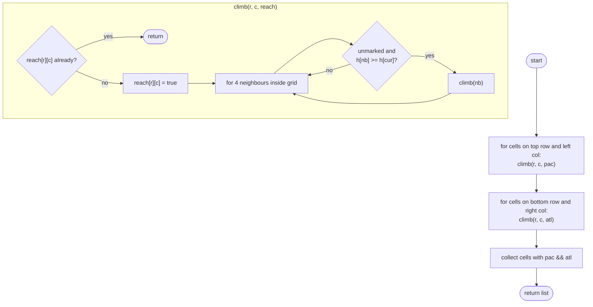

# LC 417 Pacific Atlantic Water Flow

> [!abstract] In one sentence
> Water flows downhill from a cell to an ocean exactly when the ocean can "climb" uphill to that cell, so run one uphill traversal from the Pacific edges and one from the Atlantic edges and intersect the two reached sets — O(m · n) instead of a flow simulation from each cell.

**Map:** [[NeetCode 150 MOC]] → [[DSA Dashboard]] · Pattern: [[Graphs]]

> [!question] Predict before you read
> Flow is allowed from a cell to a neighbour of *equal or lower* height. If you traverse from the ocean instead, what is the condition for stepping from the current cell to a neighbour, and why is that direction safe from cycles while the forward direction is not?

## Problem

You have an `m × n` matrix of heights. The Pacific Ocean touches the top row and the left column; the Atlantic touches the bottom row and the right column. Rain water on a cell flows to a 4-neighbour whose height is **less than or equal** to the current height, and reaches an ocean when it flows off the matrix's edge. Return every cell `[r, c]` from which water can reach both oceans (any order).

Example:
```
1 2 2 3 5
3 2 3 4 4
2 4 5 3 1      →  [0,4] [1,3] [1,4] [2,2] [3,0] [3,1] [4,0]
6 7 1 4 5
5 1 1 2 4
```
Example: `[ [1] ]` → `[ [0,0] ]` — a single cell touches both oceans.

Constraints that matter: 1 ≤ m, n ≤ 200 (40 000 cells), heights 0 … 10⁵. "Equal heights allowed" means a plateau is traversable in both directions, which is why a forward simulation needs a visited set per start cell and why the reverse traversal still needs one too.

## Clarifying questions

1. Is flow allowed onto an equal height? — Yes (`<=` forward, `>=` in reverse); this matters on plateaus.
2. Does every edge cell touch its ocean, including corners? — Yes; `(0,0)` touches the Pacific and `(m−1, n−1)` the Atlantic; corners `(0, n−1)` and `(m−1, 0)` touch both.
3. Any order of the output? — Yes; row-major is natural if you scan at the end.
4. Diagonal flow? — No.

## Brute force

From every cell, DFS downhill with a fresh visited set and record whether the walk ever leaves the grid through a Pacific edge and whether it ever leaves through an Atlantic edge: O(m · n) per start, O((m · n)²) total — 1.6 × 10⁹ steps at the limit. The repetition is obvious: neighbouring cells on the same slope re-explore the same basin. Memoising "can reach Pacific from here" across cells is tempting but breaks on plateaus, where the answer depends on the path taken (cycles of equal height), so the memo is not well-defined mid-traversal.

## The key insight

Flip the edges. Forward: `u → v` if `height[v] <= height[u]`. Reverse: start at the ocean and move `v → u` whenever `height[u] >= height[v]` — walk uphill or level. Every cell the uphill walk from the Pacific reaches can send water down to the Pacific along the reversed path, and vice versa. Two traversals with two boolean grids, intersect, done. The sources are known (the edge cells), the number of sources is O(m + n), and each traversal marks every cell at most once. Recognition cue: "which cells can reach a target region" — reverse from the target, exactly as in [[LC 130 Surrounded Regions]].

## Optimal approach

1. Allocate `pac[m][n]` and `atl[m][n]`.
2. For each cell on the top row and left column, DFS uphill marking `pac`; for each cell on the bottom row and right column, DFS uphill marking `atl`. The DFS steps to a neighbour only if it is inside the grid, unmarked, and `height[nb] >= height[cur]`.
3. Collect every `(r, c)` with `pac[r][c] && atl[r][c]`.



> [!example]- Excalidraw version — the same diagram as an editable canvas
> ![[LC 417 Pacific Atlantic Water Flow — Optimal approach.excalidraw]]
> [[LC 417 Pacific Atlantic Water Flow — Optimal approach.excalidraw|Open in Excalidraw]] — needs the Excalidraw plugin (see [[Plugins to Install]]).

## Walkthrough

The 5 × 5 example. The Pacific walk starts from row 0 and column 0; the Atlantic walk from row 4 and column 4. The shaded cells are reached by both.

> [!example] Pacific Atlantic: cells reached uphill by both oceans
> ![[LC 417 Pacific Atlantic Water Flow — Pacific Atlantic- cells reached uphill by both oceans.excalidraw]]
> [[LC 417 Pacific Atlantic Water Flow — Pacific Atlantic- cells reached uphill by both oceans.excalidraw|Open in Excalidraw]] — e.g. (2,2)=5: Pacific climbs 2 -> 3 -> 5 via (0,2),(1,2); Atlantic climbs 1 -> 3 -> 5 via (2,4),(2,3)

%% excalidraw-spec
{"kind": "grid", "title": "Pacific Atlantic: cells reached uphill by both oceans", "col_labels": ["c0", "c1", "c2", "c3", "c4"], "row_labels": ["r0", "r1", "r2", "r3", "r4"], "rows": [ [1, 2, 2, 3, 5], [3, 2, 3, 4, 4], [2, 4, 5, 3, 1], [6, 7, 1, 4, 5], [5, 1, 1, 2, 4] ], "highlight": [ [0, 4], [1, 3], [1, 4], [2, 2], [3, 0], [3, 1], [4, 0] ], "caption": "e.g. (2,2)=5: Pacific climbs 2 -> 3 -> 5 via (0,2),(1,2); Atlantic climbs 1 -> 3 -> 5 via (2,4),(2,3)"}
%%

| Walk | Sources | Some cells reached | Not reached (and why) |
|---|---|---|---|
| Pacific | row 0, column 0 | (0,4)=5 via 3→5 along row 0; (3,1)=7 via (2,0)=2 → (3,0)=6 → 7; (2,2)=5 | (4,1)=1: it sits in a basin of 1s walled in by higher cells, and a reverse step never goes down into a basin |
| Atlantic | row 4, column 4 | (3,0)=6 via (4,0)=5 → 6; (1,3)=4 via (1,4)=4 (equal); (2,2)=5 via (2,4)=1 → (2,3)=3 → 5 | (0,0)=1: both neighbours are higher, so no reverse step can enter it |

Cell (1,3) is reached by the Atlantic through the equal-height step from (1,4): that is where the `>=` matters.

## Java solution

```java
import java.util.*;

class Solution {
    private static final int[][] DIRS = {{1, 0}, {-1, 0}, {0, 1}, {0, -1}};
    private int m, n;
    private int[][] h;

    public List<List<Integer>> pacificAtlantic(int[][] heights) {
        h = heights; m = heights.length; n = heights[0].length;
        boolean[][] pac = new boolean[m][n], atl = new boolean[m][n];
        for (int r = 0; r < m; r++) { climb(r, 0, pac); climb(r, n - 1, atl); }      // left edge / right edge
        for (int c = 0; c < n; c++) { climb(0, c, pac); climb(m - 1, c, atl); }      // top edge / bottom edge
        List<List<Integer>> out = new ArrayList<>();
        for (int r = 0; r < m; r++)
            for (int c = 0; c < n; c++)
                if (pac[r][c] && atl[r][c]) out.add(List.of(r, c));
        return out;
    }

    // walk uphill (or level) away from the ocean: every cell reached can drain to that ocean
    private void climb(int r, int c, boolean[][] reach) {
        if (reach[r][c]) return;
        reach[r][c] = true;
        for (int[] d : DIRS) {
            int nr = r + d[0], nc = c + d[1];
            if (nr < 0 || nc < 0 || nr >= m || nc >= n) continue;
            if (reach[nr][nc] || h[nr][nc] < h[r][c]) continue;   // reverse edge: neighbour must not be lower
            climb(nr, nc, reach);
        }
    }
}
```

**Time** O(m · n) — each of the two walks marks a cell at most once and inspects four neighbours per cell · **Space** O(m · n) for the two boolean grids and the recursion stack (worst case a monotone snake path of length m · n)

The brute force, for contrast, and because interviewers sometimes ask you to write the forward check for a single cell:

```java
// snippet — forward simulation from one cell; needs a fresh visited set per start, O(m·n) each
boolean[] reaches = new boolean[2];                      // [0] Pacific, [1] Atlantic
void flow(int r, int c, boolean[][] seen) {
    if (r < 0 || c < 0) { reaches[0] = true; return; }   // fell off the top or left edge
    if (r >= m || c >= n) { reaches[1] = true; return; } // fell off the bottom or right edge
    if (seen[r][c]) return;
    seen[r][c] = true;
    for (int[] d : DIRS) {
        int nr = r + d[0], nc = c + d[1];
        boolean inside = nr >= 0 && nc >= 0 && nr < m && nc < n;
        if (!inside || h[nr][nc] <= h[r][c]) flow(nr, nc, seen);
    }
}
```

Run from all m · n cells this is O((m · n)²); the reverse walk is the same DFS with the comparison flipped and only O(m + n) starting points.

## Why it works

Claim: water from cell `x` reaches ocean `O` iff `x` is marked by the uphill walk from `O`. Forward direction: a downhill path `x = c₀ → c₁ → … → cₖ` (each `h[cᵢ₊₁] <= h[cᵢ]`, `cₖ` on `O`'s edge) read backwards is an uphill-or-level path from an `O` source to `x`, and DFS from all sources reaches every cell with such a path. Reverse direction: the walk only ever steps onto a cell that is `>=` the current one, so any marked cell has a non-increasing path back to a source and off the edge. The visited grid is needed because plateaus create cycles of equal height; marking on entry guarantees termination and the O(m · n) bound.

## Edge cases

- `1 × 1` grid — the single cell is a source for both walks; returned.
- Single row or single column — every cell touches both oceans only at the ends; interior cells need the height condition.
- Entire grid one height — both walks mark everything; all cells returned.
- Strictly increasing toward the centre (a hill) — both walks reach the peak; the peak and the slopes flowing to both sides qualify.
- Strictly increasing toward one corner — only that corner region and the opposite edges' cells reach both.

## Common mistakes

> [!warning] Pitfalls
> - **Using `<` instead of `<=` in reverse** — plateaus are cut off; the equal-height step (1,4) → (1,3) in the example is lost.
> - **One shared visited grid for both walks** — the Atlantic walk refuses cells the Pacific walk already marked; keep two grids (they are the answer sets, not scratch space).
> - **Starting only from the corners** — every cell on the four edges is a source, not just the corners.
> - **Forgetting the visited check before recursing** — infinite recursion on any plateau of two equal cells.
> - **Memoising the forward DFS** — on plateaus the memo is filled while the cycle is still open and records wrong "unreachable" answers.

## Variants & follow-ups

- Same reverse idea with "safe" cells seeded from the border → [[LC 130 Surrounded Regions]].
- Multi-source distance instead of reachability → [[LC 286 Walls and Gates]] (BFS, not DFS).
- Strictly increasing paths with a length to maximise → [[LC 329 Longest Increasing Path in a Matrix]] (no plateaus, so memoisation works there).
- Count the cells reachable from exactly one ocean → XOR of the two grids.
- What changes if there are `k` oceans? `k` boolean grids, or a bitmask per cell, and the intersection becomes a mask test; the total is O(k · m · n).

## Interview script

1. Restate: heights, flow to equal-or-lower neighbours, top/left is Pacific, bottom/right is Atlantic; cells that drain to both.
2. Brute force: DFS downhill from each cell, O((m · n)²), and memoisation fails on plateaus.
3. Insight: reverse the edges — climb uphill from each ocean's edge cells; a cell drains to an ocean iff the ocean's climb reaches it.
4. Approach: two boolean grids, DFS from the four edges with `h[nb] >= h[cur]`, intersect.
5. Complexity: O(m · n) time and space; mention stack depth and BFS as the iterative alternative.
6. Tests: `1 × 1`, flat grid, a plateau along an edge, a hill.

The interviewer is checking that you reverse the traversal direction rather than simulate, that you handle equal heights, and that you explain why two visited grids are the answer sets.

## Related

- [[Graphs]] — DFS on grids, reversing edges, multi-source traversals
- [[LC 130 Surrounded Regions]] — border-seeded flood fill with the same "reverse" idea
- [[LC 286 Walls and Gates]] — multi-source BFS distances
- [[LC 200 Number of Islands]] — the basic grid DFS/BFS
- [[LC 329 Longest Increasing Path in a Matrix]] — DFS with memo when there are no plateaus
- [[DSA Patterns in Java]] — grid DFS template, direction array
- [[Java Collections Cheat Sheet]] — `List.of(r, c)`, nested lists

## Attempt log

| Date | Result | Minutes | What I got wrong |
|---|---|---|---|
| | | | |

### Mastery checklist
- [ ] Solved without hints in under 25 minutes
- [ ] Stated complexity before coding
- [ ] Handled every edge case above
- [ ] Code compiled first time
- [ ] Can do the follow-up variant (BFS from the edges instead of DFS, k oceans with a bitmask)

## Open questions
- [ ]
