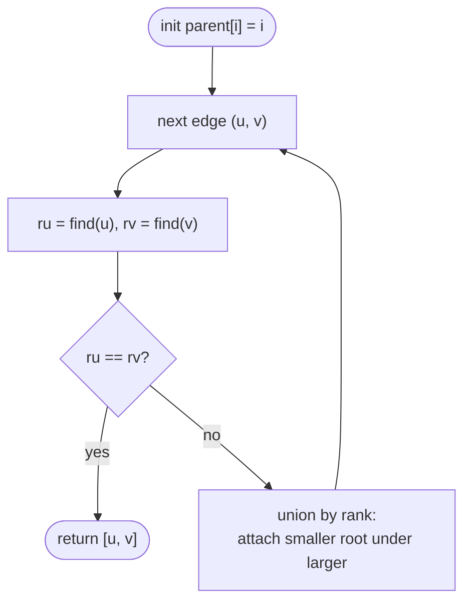

# LC 684 Redundant Connection

> [!abstract] In one sentence
> Add the edges one by one into a Union-Find structure; an edge whose endpoints are already in the same set would close a cycle, and because the input is a tree plus exactly one edge, the first such edge is the answer.

**Map:** [[NeetCode 150 MOC]] → [[DSA Dashboard]] · Pattern: [[Graphs]] · [[Union-Find]]

> [!question] Predict before you read
> The graph has `n` nodes and `n` edges and is connected. How many edges does a tree on `n` nodes have, and therefore how many edges here are "extra"? Does that tell you how many times the union will fail?

## Problem

You are given `n` edges of an undirected graph that started as a tree on nodes `1 … n` and then had one extra edge added (between two distinct nodes that were not already adjacent). Return the edge that can be removed so the remaining graph is a tree. If several edges qualify, return the one that appears **last** in the input.

Example: `edges = [ [1,2], [1,3], [2,3] ]` → `[2,3]` (triangle; all three edges are on the cycle, `[2,3]` is last).
Example: `edges = [ [1,2], [2,3], [3,4], [1,4], [1,5] ]` → `[1,4]` (the cycle is 1-2-3-4; `[1,5]` is a leaf edge and not removable).

Constraints that matter: 3 ≤ n ≤ 1000, no repeated edges, `edges.length == n`, the graph is connected. Exactly one cycle exists, so exactly one union operation will fail.

## Clarifying questions

1. Nodes are labelled from 1, not 0? — Yes; size the parent array `n + 1` or subtract 1.
2. Exactly one extra edge? — Yes; the graph has precisely one cycle.
3. "Last in the input" among the cycle edges — does my method naturally give that? — Yes: the first edge to fail the union is the one that *completes* the cycle, which is the latest cycle edge in input order.
4. Directed version exists? — Yes, LeetCode 685 is much harder (two cases); confirm this is the undirected one.

## Brute force

For each edge in reverse order, remove it and check whether the remaining `n − 1` edges form a connected graph (DFS from node 1 reaches all nodes): O(n) edges × O(n) check = O(n²), about 10⁶ here, so it passes. The wasted work is rebuilding and re-traversing the graph for every candidate when a single incremental pass can tell you, at the moment each edge arrives, whether it closes a cycle.

## The key insight

Insert edges incrementally into a disjoint-set structure. Before adding `(u, v)`, ask `find(u) == find(v)`: if the two endpoints are already connected by earlier edges, this edge would create a cycle — and since the cycle edges before it did *not* fail, this is the last cycle edge in input order, exactly what the problem asks for. Union-Find is the right tool because the only questions are "same component?" and "merge", repeated `n` times, each in near-constant amortised time. Recognition cue: "edges arrive one at a time; detect when one connects already-connected nodes".

## Optimal approach

1. `parent[i] = i`, `rank[i] = 0` for `i = 1 … n`.
2. For each edge `(u, v)` in order: `ru = find(u)`, `rv = find(v)`.
3. If `ru == rv`, return `[u, v]`.
4. Else link the root of lower rank under the other (union by rank); bump the rank on a tie.
5. `find` uses path halving: `parent[x] = parent[parent[x]]` while climbing.



> [!example]- Excalidraw version — the same diagram as an editable canvas
> ![[LC 684 Redundant Connection — Optimal approach.excalidraw]]
> [[LC 684 Redundant Connection — Optimal approach.excalidraw|Open in Excalidraw]] — needs the Excalidraw plugin (see [[Plugins to Install]]).

## Walkthrough

Second example: `[ [1,2], [2,3], [3,4], [1,4], [1,5] ]`.

| Edge | `find(u)`, `find(v)` | Action | Parent array (1 … 5) |
|---|---|---|---|
| (1,2) | 1, 2 | union: ranks tie, `parent[2] = 1`, `rank[1] = 1` | [1, 1, 3, 4, 5] |
| (2,3) | 1, 3 | union: `rank[1] > rank[3]`, `parent[3] = 1` | [1, 1, 1, 4, 5] |
| (3,4) | 1, 4 | union: `parent[4] = 1` | [1, 1, 1, 1, 5] |
| (1,4) | 1, 1 | same root → **return [1,4]** | unchanged |

> [!example] DSU just before edge (1,4): both endpoints already hang under root 1
> ![[LC 684 Redundant Connection — DSU just before edge (1,4)- both endpoints already hang under root 1.excalidraw]]
> [[LC 684 Redundant Connection — DSU just before edge (1,4)- both endpoints already hang under root 1.excalidraw|Open in Excalidraw]] — union by rank kept the tree flat: every find is one hop; node 5 is still alone because (1,5) comes later

%% excalidraw-spec
{"kind": "forest", "title": "DSU just before edge (1,4): both endpoints already hang under root 1", "parent": {"1": "1", "2": "1", "3": "1", "4": "1", "5": "5"}, "rank": {"1": 1}, "caption": "union by rank kept the tree flat: every find is one hop; node 5 is still alone because (1,5) comes later"}
%%

## Java solution

```java
import java.util.*;

class Solution {
    private int[] parent, rank;

    public int[] findRedundantConnection(int[][] edges) {
        int n = edges.length;                      // n nodes labelled 1..n, exactly n edges
        parent = new int[n + 1];
        rank = new int[n + 1];
        for (int i = 1; i <= n; i++) parent[i] = i;
        for (int[] e : edges)
            if (!union(e[0], e[1])) return e;      // endpoints already connected: this edge closes the cycle
        return new int[0];                         // unreachable for valid input
    }

    private int find(int x) {
        while (parent[x] != x) {
            parent[x] = parent[parent[x]];         // path halving: skip a generation on the way up
            x = parent[x];
        }
        return x;
    }

    private boolean union(int a, int b) {
        int ra = find(a), rb = find(b);
        if (ra == rb) return false;
        if (rank[ra] < rank[rb]) { int t = ra; ra = rb; rb = t; }   // ra is the taller tree
        parent[rb] = ra;
        if (rank[ra] == rank[rb]) rank[ra]++;
        return true;
    }
}
```

**Time** O(n · α(n)) — `n` unions and finds, each amortised inverse-Ackermann, effectively constant · **Space** O(n) for `parent` and `rank`

The DFS alternative asks, before adding each edge, whether a path already connects its endpoints:

```java
// snippet — O(n^2): rebuild nothing, just DFS in the graph of edges seen so far
for (int[] e : edges) {
    if (reachable(e[0], e[1], adj, new boolean[n + 1])) return e;   // DFS over the current adjacency
    adj.get(e[0]).add(e[1]);
    adj.get(e[1]).add(e[0]);
}
```

Each `reachable` call is O(n) in the worst case, so the whole thing is O(n²) — fine for n = 1000, but the point of the problem is to show the O(n · α) tool. Mention it as the fallback if you blank on DSU.

## Why it works

Invariant: after processing the first `k` edges, `find(x) == find(y)` iff `x` and `y` are connected by some of those `k` edges. A new edge `(u, v)` with `find(u) == find(v)` plus the existing path between them forms a cycle; one with different roots connects two previously separate components and cannot create a cycle. Since the input is a tree plus one edge, there is exactly one cycle, and among its edges the one processed last is the one that finds the others already in place — so the first failed union is the last cycle edge in input order, as required. Path halving and union by rank keep every `find` short; without them the structure is still correct, only slower (O(n) per find in the worst case).

## Edge cases

- Triangle `[1,2], [1,3], [2,3]` — the third edge fails; the answer is the last edge, as the tie-break demands.
- The extra edge is first in the input (e.g. `[2,3], [1,2], [1,3]`) — it does not fail; `[1,3]` does, which is the last cycle edge. Correct.
- Leaf edges after the cycle (`[1,5]` above) — never examined, the method returns early.
- `n = 3` — the smallest valid input; nothing special.
- Nodes labelled `1 … n` — index `n` must exist: `new int[n + 1]`.

## Common mistakes

> [!warning] Pitfalls
> - **Sizing the array `n`** — `parent[n]` throws `ArrayIndexOutOfBoundsException` because labels are 1-based.
> - **Returning the first edge whose endpoints are on the cycle** — you cannot know the cycle before the closing edge arrives; the DSU answer is correct precisely because it fails on the *closing* edge.
> - **`find` without compression and `union` without rank, then claiming O(α)** — correctness holds, the bound does not; say which optimisation you implemented.
> - **Linking `parent[a] = b` instead of linking the roots** — merges nodes, not sets; later finds are wrong.
> - **Confusing this with LeetCode 685 (directed)** — that one needs indegree analysis and two candidate edges.

## Variants & follow-ups

- Count components instead of detecting the cycle → [[LC 323 Number of Connected Components in an Undirected Graph]].
- "Is this edge list a tree?" → [[LC 261 Graph Valid Tree]]: `n − 1` edges and no failed union.
- Directed Redundant Connection II (LeetCode 685) → the extra edge may create a node with two parents, a cycle, or both; two candidates and a DSU check each.
- Minimum spanning tree → sort edges by weight and run exactly this loop, skipping failed unions: Kruskal, see [[LC 1584 Min Cost to Connect All Points]].
- What changes if edges can also be *removed*? DSU does not support deletion; offline you can process in reverse (deletions become insertions), online you need link-cut trees — say "offline reversal" and stop there.

## Interview script

1. Restate: tree plus one edge, return the edge whose removal restores a tree, last in input on ties.
2. Brute force: for each edge in reverse, remove it and test connectivity — O(n²).
3. Insight: add edges incrementally; the first edge joining two already-connected nodes closes the unique cycle and is the last cycle edge in input order.
4. Approach: Union-Find with path halving and union by rank; return the edge whose union fails.
5. Complexity: O(n · α(n)) time, O(n) space.
6. Tests: triangle, extra edge first in input, leaf edges after the cycle.

The interviewer is checking that you can write `find` and `union` from memory, that you know *why* the first failure is the right edge given the tie-break rule, and that you can state what path compression and union by rank buy.

## Related

- [[Union-Find]] — parent array, path compression, union by rank, the α bound
- [[Graphs]] — cycle detection in undirected graphs, DFS alternative
- [[LC 323 Number of Connected Components in an Undirected Graph]] — DSU counting components
- [[LC 261 Graph Valid Tree]] — DSU with the edge-count argument
- [[LC 1584 Min Cost to Connect All Points]] — Kruskal: the same loop over sorted edges
- [[DSA Patterns in Java]] — Union-Find class template
- [[Java Collections Cheat Sheet]] — arrays as the only data structure here

## Attempt log

| Date | Result | Minutes | What I got wrong |
|---|---|---|---|
| | | | |

### Mastery checklist
- [ ] Solved without hints in under 25 minutes
- [ ] Stated complexity before coding
- [ ] Handled every edge case above
- [ ] Code compiled first time
- [ ] Can do the follow-up variant (count components; explain why 685 is different)

## Open questions
- [ ]
