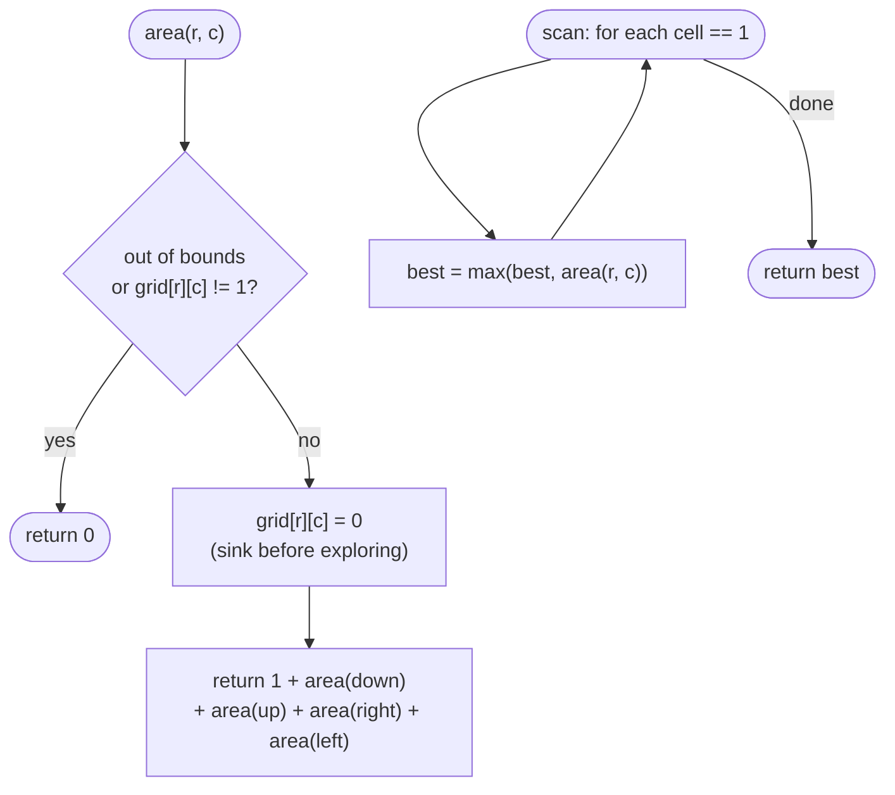

# LC 695 Max Area of Island

> [!abstract] In one sentence
> Same scan-and-sink as [[LC 200 Number of Islands]], except the fill is a function that returns the number of cells it sank, so the recursion `1 + area(up) + area(down) + area(left) + area(right)` computes each island's size and the caller keeps the largest.

**Map:** [[NeetCode 150 MOC]] → [[DSA Dashboard]] · Pattern: [[Graphs]]

> [!question] Predict before you read
> In a recursive flood fill, where does the "+1 for this cell" go so that a cell is never counted twice even though it has up to four neighbours that will try to visit it?

## Problem

You are given an `m × n` binary matrix `grid`. An island is a group of `1`s connected 4-directionally. Return the maximum area (number of cells) of an island, or `0` if there is none.

Example: `grid = [ [0,1,1,0], [1,1,0,0], [0,0,0,1], [0,0,1,1] ]` → `4` (the top-left island has four cells; the bottom-right has three).
Example: `grid = [ [0,0,0,0,0,0,0,0] ]` → `0`.

Constraints that matter: 1 ≤ m, n ≤ 50, so at most 2 500 cells and a recursion depth of at most 2 500 — comfortably within the stack, which is why the recursive form is fine here and not in the 300 × 300 problem.

## Clarifying questions

1. 4-directional connectivity? — Yes.
2. May I modify the grid? — Yes; sinking cells is the visited set. Otherwise use `boolean[][] seen`.
3. Integers or characters? — Integers `0`/`1` here (compare with `1`), unlike [[LC 200 Number of Islands]] which uses chars.
4. What if there is no land? — Return 0; the maximum of nothing is the initial value.

## Brute force

Label every cell with an island id by repeated scanning until labels stop changing (a cell takes the smallest label among itself and its land neighbours), then count labels. Each pass is O(m · n) and up to O(m + n) passes may be needed for a snake, so O(m · n · (m + n)). All of it re-derives connectivity that a single traversal from the first cell of each island gives directly.

## The key insight

A flood fill visits each cell of a component exactly once if you sink the cell *before* exploring its neighbours. Make the fill return how many cells it sank: the cell itself counts 1, and each of the four recursive calls returns the size of the part it discovered (0 for water, out-of-bounds, or already-sunk cells). The sum is the island's area. Because sinking happens on entry, no cell can contribute to two different sums. Recognition cue: "largest / size of a connected region".

## Optimal approach

1. `best = 0`. For every cell: if it is `1`, `best = max(best, area(r, c))`.
2. `area(r, c)`: if out of bounds or not `1`, return 0.
3. Set the cell to 0 (sink), return `1 + area(r+1, c) + area(r−1, c) + area(r, c+1) + area(r, c−1)`.
4. Return `best`.



> [!example]- Excalidraw version — the same diagram as an editable canvas
> ![[LC 695 Max Area of Island — Optimal approach.excalidraw]]
> [[LC 695 Max Area of Island — Optimal approach.excalidraw|Open in Excalidraw]] — needs the Excalidraw plugin (see [[Plugins to Install]]).

## Walkthrough

First example. The scan reaches `(0,1)` first; the fill from there sinks the four shaded cells and returns 4. Later the scan reaches `(2,3)` and that fill returns 3.

> [!example] Max Area of Island: the fill from (0,1) returns 4
> ![[LC 695 Max Area of Island — Max Area of Island- the fill from (0,1) returns 4.excalidraw]]
> [[LC 695 Max Area of Island — Max Area of Island- the fill from (0,1) returns 4.excalidraw|Open in Excalidraw]] — best = 4 after the first fill; the bottom-right fill returns 3 and does not replace it

%% excalidraw-spec
{"kind": "grid", "title": "Max Area of Island: the fill from (0,1) returns 4", "col_labels": ["c0", "c1", "c2", "c3"], "row_labels": ["r0", "r1", "r2", "r3"], "rows": [ [0, 1, 1, 0], [1, 1, 0, 0], [0, 0, 0, 1], [0, 0, 1, 1] ], "highlight": [ [0, 1], [0, 2], [1, 0], [1, 1] ], "caption": "best = 4 after the first fill; the bottom-right fill returns 3 and does not replace it"}
%%

Return values of the first fill, innermost first (each cell is sunk on entry, so the arrows into already-sunk cells return 0):

| Call | Sunk? | Children (down, up, right, left) | Returns |
|---|---|---|---|
| area(0,1) | yes | area(1,1), area(−1,1)=0, area(0,2), area(0,0)=0 | 1 + 2 + 0 + 1 + 0 = 4 |
| area(1,1) | yes | area(2,1)=0, area(0,1)=0 (sunk), area(1,2)=0, area(1,0) | 1 + 0 + 0 + 0 + 1 = 2 |
| area(1,0) | yes | all four 0 | 1 |
| area(0,2) | yes | area(1,2)=0, out=0, area(0,3)=0, area(0,1)=0 (sunk) | 1 |

## Java solution

```java
import java.util.*;

class Solution {
    public int maxAreaOfIsland(int[][] grid) {
        int best = 0;
        for (int r = 0; r < grid.length; r++)
            for (int c = 0; c < grid[0].length; c++)
                if (grid[r][c] == 1) best = Math.max(best, area(grid, r, c));
        return best;
    }

    private int area(int[][] g, int r, int c) {
        if (r < 0 || c < 0 || r >= g.length || c >= g[0].length || g[r][c] != 1) return 0;
        g[r][c] = 0;                                   // sink on entry: this cell is counted exactly once
        return 1 + area(g, r + 1, c) + area(g, r - 1, c) + area(g, r, c + 1) + area(g, r, c - 1);
    }
}
```

**Time** O(m · n) — each cell is entered at most once as land, plus O(1) rejected calls per land cell · **Space** O(m · n) worst-case recursion depth (an all-land grid), fine at 2 500 cells

For a large grid, the same with an explicit stack and a counter:

```java
// snippet — iterative fill: push on discovery, count on pop
int size = 0;
Deque<int[]> stack = new ArrayDeque<>();
stack.push(new int[]{r, c}); g[r][c] = 0;
while (!stack.isEmpty()) {
    int[] cur = stack.pop(); size++;
    for (int[] d : dirs) { /* in bounds and == 1: g[nr][nc] = 0; stack.push(...) */ }
}
```

Identical complexity; the only reason to choose it is stack depth, which at 50 × 50 is not a concern.

## Why it works

Invariant: at any moment the sunk cells are exactly the cells counted so far in some returned (or in-progress) sum. A cell is sunk at the single moment it is first entered as land, and that call returns `1` for it; any later call on the same cell returns 0 immediately. The four recursive calls partition the rest of the component reachable through this cell's neighbours, and by induction each returns the size of what it newly discovered. So `area(r, c)` for the first cell the scan meets returns the whole component's size, and since every component is met by the scan at its first cell, `best` is the maximum over all components.

## Edge cases

- No land → 0.
- All land → one fill of size m · n; depth m · n, fine at 2 500.
- One cell of land → 1.
- Several islands of equal maximum size → `max` keeps the first, the value is the same.
- Islands touching only diagonally → separate fills, separate sizes.

## Common mistakes

> [!warning] Pitfalls
> - **Sinking after the recursive calls** — infinite recursion between two adjacent cells.
> - **Returning `best` from inside the fill** — the fill returns a size; the outer loop takes the maximum.
> - **Comparing against `'1'`** — this grid is `int[][]`; mixing the two island problems' element types is a classic slip.
> - **Not resetting a per-island counter** when using a field instead of a return value — prefer the return value; it has no state to forget.
> - **Bounds check after the array read** — `ArrayIndexOutOfBoundsException`.

## Variants & follow-ups

- Count the islands instead → [[LC 200 Number of Islands]]; same fill, count calls instead of sizes.
- Largest island after flipping one 0 to 1 (LeetCode 827) → label each island with its size, then for every 0 sum the sizes of distinct neighbouring labels + 1.
- Islands with a border rule → [[LC 130 Surrounded Regions]].
- Reachability with a height condition → [[LC 417 Pacific Atlantic Water Flow]].
- Perimeter instead of area (LeetCode 463) → per land cell add 4 minus the number of land neighbours; no traversal needed.
- What changes if the grid is 10⁴ × 10⁴? Recursion is out; use the iterative fill or Union-Find with sizes, both still O(m · n).

## Interview script

1. Restate: binary grid, 4-connected 1s form islands, return the largest island's cell count.
2. Brute force: iterative relabelling until stable, O(m · n · (m + n)).
3. Insight: flood fill that returns its size; sink on entry so each cell counts once.
4. Approach: scan; for each land cell `best = max(best, area)`; `area` = bounds/land check, sink, `1 +` four recursive calls.
5. Complexity: O(m · n) time, O(m · n) worst-case stack, trivial at 50 × 50.
6. Tests: no land, all land, single cell, ties.

The interviewer is checking that you place the sink before the recursion, return a value rather than mutating a global, and can convert to an iterative fill when asked about stack depth.

## Related

- [[Graphs]] — flood fill, DFS on grids
- [[LC 200 Number of Islands]] — the counting twin
- [[LC 130 Surrounded Regions]] — fill from the border
- [[LC 417 Pacific Atlantic Water Flow]] — conditional reachability on a grid
- [[LC 1448 Count Good Nodes in Binary Tree]] — the same "return a count from recursion" shape on a tree
- [[DSA Patterns in Java]] — grid DFS template
- [[Java Collections Cheat Sheet]] — `Math.max`, `ArrayDeque` as a stack

## Attempt log

| Date | Result | Minutes | What I got wrong |
|---|---|---|---|
| | | | |

### Mastery checklist
- [ ] Solved without hints in under 25 minutes
- [ ] Stated complexity before coding
- [ ] Handled every edge case above
- [ ] Code compiled first time
- [ ] Can do the follow-up variant (largest island after one flip)

## Open questions
- [ ]
