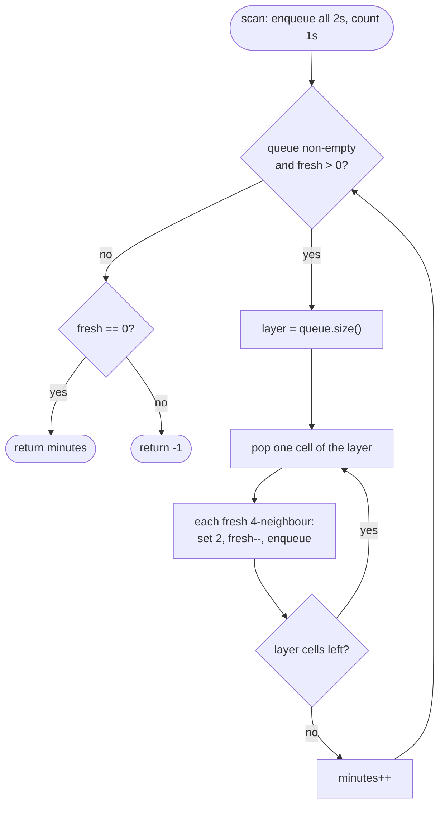

# LC 994 Rotting Oranges

> [!abstract] In one sentence
> Rot spreading one step per minute from every rotten orange at once is a multi-source BFS, so the answer is the number of BFS layers needed to empty the "fresh" count — and if the count is still positive when the queue runs dry, some orange is unreachable and the answer is −1.

**Map:** [[NeetCode 150 MOC]] → [[DSA Dashboard]] · Pattern: [[Graphs]]

> [!question] Predict before you read
> Two rotten oranges sit at opposite corners of a `1 × 5` row with three fresh oranges between them. How many minutes? Now justify why a single BFS seeded with both corners gives that number without special handling.

## Problem

You are given an `m × n` grid where `0` is empty, `1` is a fresh orange and `2` is a rotten orange. Every minute, every fresh orange 4-adjacent to a rotten one becomes rotten. Return the minimum number of minutes until no fresh orange remains, or `-1` if that is impossible.

Example: `[ [2,1,1], [1,1,0], [0,1,1] ]` → `4`.
Example: `[ [2,1,1], [0,1,1], [1,0,1] ]` → `-1` (the orange at (2,0) is walled off by empties).
Example: `[ [0,2] ]` → `0` (nothing fresh to begin with).

Constraints that matter: 1 ≤ m, n ≤ 10, so performance is irrelevant; the whole difficulty is the counting — when to increment the minute, and how to detect the unreachable case without a second scan.

## Clarifying questions

1. Do all rotten oranges spread at the same time? — Yes; that is what makes it one BFS with many sources rather than many BFS runs.
2. What if there are no fresh oranges at all? — Return 0, even if there are no rotten ones either.
3. What if there are fresh oranges but no rotten ones? — Return −1.
4. May I modify the grid? — Yes; writing `2` into a cell is the visited mark.

## Brute force

Simulate minute by minute: each minute scan the whole grid, collect fresh cells adjacent to a rotten cell, flip them all, repeat until a full scan flips nothing. Each sweep is O(m · n) and there can be O(m · n) sweeps (a snake-shaped path), so O((m · n)²). On a 10 × 10 grid that is nothing; the reason to do better is that the simulation re-scans cells that cannot change, while BFS only looks at the frontier.

## The key insight

The frontier *is* a BFS queue. All rotten oranges start in the queue together; every orange popped in layer `k` rots its fresh neighbours into layer `k + 1`. "Minutes" = number of layers that actually rot something. Keep a running `fresh` count so the end condition is `fresh == 0` and the failure condition is "queue empty but `fresh > 0`" — no second scan. Recognition cue: "spreads to neighbours each unit of time, from several starting points".

## Optimal approach

1. Scan: enqueue every `2`, count every `1` into `fresh`.
2. While the queue is not empty and `fresh > 0`: take the current queue size as this minute's layer; for each cell in the layer, rot each fresh 4-neighbour (write `2`, decrement `fresh`, enqueue); then `minutes++`.
3. Return `fresh == 0 ? minutes : -1`.



> [!example]- Excalidraw version — the same diagram as an editable canvas
> ![[LC 994 Rotting Oranges — Optimal approach.excalidraw]]
> [[LC 994 Rotting Oranges — Optimal approach.excalidraw|Open in Excalidraw]] — needs the Excalidraw plugin (see [[Plugins to Install]]).

## Walkthrough

First example. Only (0,0) is rotten at the start; `fresh = 6`.

> [!example] Rotting Oranges: minute in which each cell rots
> ![[LC 994 Rotting Oranges — Rotting Oranges- minute in which each cell rots.excalidraw]]
> [[LC 994 Rotting Oranges — Rotting Oranges- minute in which each cell rots.excalidraw|Open in Excalidraw]] — shaded = initially rotten; -1 = empty cell; the numbers are BFS layers, and the last layer (4) is the answer

%% excalidraw-spec
{"kind": "grid", "title": "Rotting Oranges: minute in which each cell rots", "col_labels": ["c0", "c1", "c2"], "row_labels": ["r0", "r1", "r2"], "rows": [ [0, 1, 2], [1, 2, -1], [-1, 3, 4] ], "highlight": [ [0, 0] ], "caption": "shaded = initially rotten; -1 = empty cell; the numbers are BFS layers, and the last layer (4) is the answer"}
%%

| Minute | Layer popped | Newly rotten | `fresh` after |
|---|---|---|---|
| 1 | (0,0) | (0,1), (1,0) | 4 |
| 2 | (0,1), (1,0) | (0,2), (1,1) | 2 |
| 3 | (0,2), (1,1) | (2,1) | 1 |
| 4 | (2,1) | (2,2) | 0 |

After minute 4 the loop condition `fresh > 0` fails, so `minutes` stays 4 and the final layer containing (2,2) is never popped — that is the point of the guard.

## Java solution

```java
import java.util.*;

class Solution {
    public int orangesRotting(int[][] grid) {
        int m = grid.length, n = grid[0].length, fresh = 0;
        Deque<int[]> queue = new ArrayDeque<>();
        for (int r = 0; r < m; r++)
            for (int c = 0; c < n; c++) {
                if (grid[r][c] == 2) queue.offer(new int[]{r, c});   // all rotten oranges start together
                else if (grid[r][c] == 1) fresh++;
            }
        int[][] dirs = {{1, 0}, {-1, 0}, {0, 1}, {0, -1}};
        int minutes = 0;
        while (!queue.isEmpty() && fresh > 0) {
            int layer = queue.size();                           // one minute = one BFS layer
            for (int i = 0; i < layer; i++) {
                int[] cell = queue.poll();
                for (int[] d : dirs) {
                    int nr = cell[0] + d[0], nc = cell[1] + d[1];
                    if (nr < 0 || nc < 0 || nr >= m || nc >= n || grid[nr][nc] != 1) continue;
                    grid[nr][nc] = 2;                           // rot on enqueue = visited mark
                    fresh--;
                    queue.offer(new int[]{nr, nc});
                }
            }
            minutes++;
        }
        return fresh == 0 ? minutes : -1;
    }
}
```

**Time** O(m · n) — each cell is enqueued at most once · **Space** O(m · n) for the queue in the worst case

## Why it works

BFS invariant: when the loop starts minute `k`, the queue holds exactly the oranges that rotted at minute `k − 1` (minute 0 = initially rotten), and every orange that *can* rot by minute `k` is adjacent to one of them. Processing the layer therefore rots precisely the oranges whose true rotting time is `k`, so `minutes` counts the last minute in which anything rotted. `fresh` reaching 0 means every fresh orange was reached; if the queue empties first, the remaining fresh oranges have no path of oranges to any rotten one and no amount of time will reach them. The `fresh > 0` guard in the loop condition stops the count one iteration early, so you never count a minute in which nothing happens.

## Edge cases

- No fresh oranges — `fresh == 0`, loop never runs, return 0 (also when there are no rotten ones).
- Fresh oranges but no rotten ones — queue empty, `fresh > 0`, return −1.
- Fresh orange isolated by empties — stays `1`, return −1.
- Single cell `[ [1] ]` → −1; `[ [2] ]` → 0; `[ [0] ]` → 0.
- Rotten oranges adjacent to each other — the second is not `1`, so it is never re-enqueued.

## Common mistakes

> [!warning] Pitfalls
> - **Off-by-one on the minute** — incrementing after the last layer gives `answer + 1`; either guard the loop with `fresh > 0` (as above) or increment only when the layer rotted something.
> - **A final scan for leftover `1`s instead of the counter** — works, but the counter is free and removes a whole pass; interviewers prefer the counter.
> - **Rotting on dequeue** — the same fresh cell can be enqueued twice from two rotten neighbours; `fresh` is decremented twice and goes negative.
> - **Treating `0` as walkable** — rot spreads only through oranges; the neighbour test must be `== 1`, not `!= 2`.
> - **Starting a BFS per rotten orange and taking the max** — wrong model: simultaneous spread needs all sources in one queue.

## Variants & follow-ups

- Same BFS but the answer is a per-cell distance, not a layer count → [[LC 286 Walls and Gates]].
- "Can everything rot?" only → the same code with the minutes dropped; it is a reachability question.
- Rot spreads diagonally too → eight directions in the array; nothing else changes.
- Each orange takes a different time to rot → weighted edges, Dijkstra with a priority queue instead of a plain queue.
- What changes if a fresh orange is added after `t` minutes? You cannot resume a finished BFS blindly; recompute, or keep the per-cell rot time (the grid above) and treat the new cell's time as `1 + min` of its neighbours' times.

## Interview script

1. Restate: rot spreads one step per minute from all rotten oranges at once; minutes until none fresh, or −1.
2. Brute force: minute-by-minute full-grid simulation, O((m · n)²).
3. Insight: the set of oranges that rot at minute `k` is BFS layer `k` of a multi-source BFS.
4. Approach: enqueue all 2s, count 1s, process layer by layer with `queue.size()`, decrement `fresh`, guard the loop with `fresh > 0`.
5. Complexity: O(m · n) time and space.
6. Tests: no fresh, no rotten, isolated fresh, the 4-minute example.

The interviewer is checking that you process in layers rather than counting per cell, that the −1 detection is O(1), and that the minute count is off by neither 0 nor 1.

## Related

- [[Graphs]] — BFS layers and multi-source BFS
- [[LC 286 Walls and Gates]] — the same BFS with distances written per cell
- [[LC 200 Number of Islands]] — the single-source grid traversal
- [[LC 127 Word Ladder]] — layer counting on an implicit graph of words
- [[LC 130 Surrounded Regions]] — border-seeded flood fill
- [[DSA Patterns in Java]] — grid BFS with layer counting
- [[Java Collections Cheat Sheet]] — `ArrayDeque.size()` snapshot for layer loops

## Attempt log

| Date | Result | Minutes | What I got wrong |
|---|---|---|---|
| | | | |

### Mastery checklist
- [ ] Solved without hints in under 25 minutes
- [ ] Stated complexity before coding
- [ ] Handled every edge case above
- [ ] Code compiled first time
- [ ] Can do the follow-up variant (per-cell distances, as in Walls and Gates)

## Open questions
- [ ]
