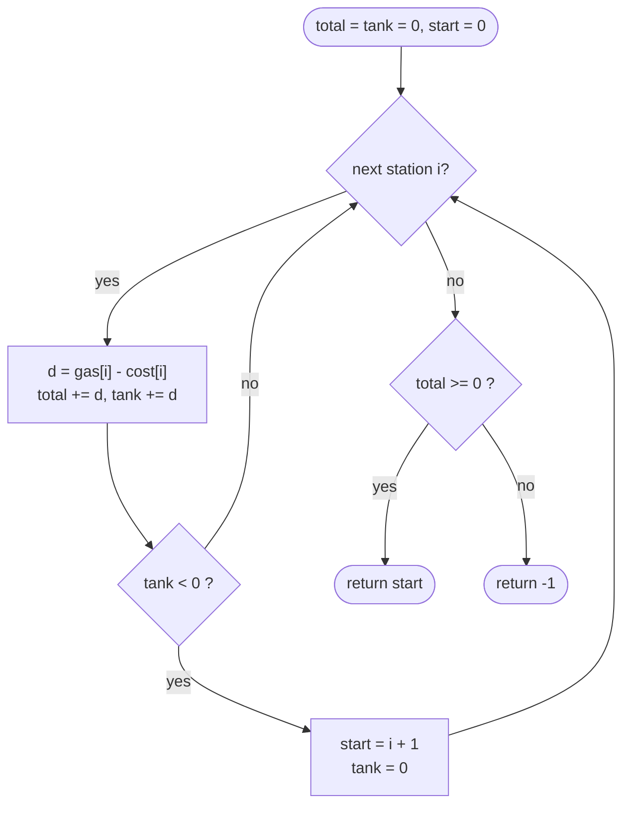

# LC 134 Gas Station

> [!abstract] In one sentence
> Drive from a candidate start keeping `tank += gas[i] − cost[i]`; the moment the tank goes negative every station since the candidate is disqualified too, so move the candidate to `i + 1` and reset — after one pass the surviving candidate is the answer whenever total gas covers total cost.

**Map:** [[NeetCode 150 MOC]] → [[DSA Dashboard]] · Pattern: [[Greedy]]

> [!question] Predict before you read
> If you start at station `s` and first run dry arriving at station `i`, why can none of the stations `s+1 … i` be the answer either? (Hint: how much fuel did you have when you *passed* each of them?)

## Problem

There are `n` gas stations on a circle. `gas[i]` is the fuel you get at station `i`; `cost[i]` is the fuel needed to drive from `i` to `i + 1` (wrapping around). You start with an empty tank at some station. Return the index of the unique station from which you can complete one full lap clockwise, or `−1` if none exists.

- `gas = [1, 2, 3, 4, 5]`, `cost = [3, 4, 5, 1, 2]` → `3`
- `gas = [2, 3, 4]`, `cost = [3, 4, 3]` → `-1`

Constraints that matter: `1 ≤ n ≤ 10⁵`, values up to `10⁴` (sums fit in `int`), and if a solution exists it is guaranteed unique.

## Clarifying questions

1. Is the answer unique when it exists? — Yes, guaranteed; so one candidate is enough.
2. Direction? — Clockwise only, `i → i + 1 → … → n − 1 → 0`.
3. Is the tank bounded? — No, it holds any amount.
4. Can `gas[i]` or `cost[i]` be zero? — Yes; nothing changes.

## Brute force

Try every start and simulate a lap: O(n²). The waste: a failed simulation from `s` that dies at `i` tells you about every start between `s` and `i`, and the brute force throws that information away.

## The key insight

Let `diff[i] = gas[i] − cost[i]`. Two facts: (1) a lap is possible at all iff `Σ diff ≥ 0` (necessary obviously; sufficient by the argument below); (2) if you start at `s` and the tank first goes negative on arriving at `i`, then every start in `s+1 … i` also fails by `i` — you had a non-negative tank when passing each of them, so starting there with an empty tank is strictly worse. Together: sweep once, reset the candidate after each failure, and the last candidate wins. Recognition cue: a circular array, "find the start that keeps a running sum non-negative" → prefix sums with a restart.

## Optimal approach

1. `total = 0`, `tank = 0`, `start = 0`.
2. For each `i`: `d = gas[i] − cost[i]`; `total += d`; `tank += d`; if `tank < 0` then `start = i + 1`, `tank = 0`.
3. Return `total ≥ 0 ? start : −1`.



> [!example]- Excalidraw version — the same diagram as an editable canvas
> ![[LC 134 Gas Station — Optimal approach.excalidraw]]
> [[LC 134 Gas Station — Optimal approach.excalidraw|Open in Excalidraw]] — needs the Excalidraw plugin (see [[Plugins to Install]]).

## Walkthrough

`gas = [1, 2, 3, 4, 5]`, `cost = [3, 4, 5, 1, 2]`, so `diff = [-2, -2, -2, 3, 3]`

| i | diff | tank before + diff | tank < 0? | start | total |
|---|---|---|---|---|---|
| 0 | -2 | -2 | yes → reset | 1 | -2 |
| 1 | -2 | -2 | yes → reset | 2 | -4 |
| 2 | -2 | -2 | yes → reset | 3 | -6 |
| 3 | 3 | 3 | no | 3 | -3 |
| 4 | 3 | 6 | no | 3 | 0 |

`total = 0 ≥ 0` → return 3. Check: from 3 the tank reads 3, 6, 4, 2, 0 on arrival at 4, 0, 1, 2, 3 — never negative.

> [!example] diff = gas - cost; prefix sum bottoms out at index 2
> ![[LC 134 Gas Station — diff = gas - cost; prefix sum bottoms out at index 2.excalidraw]]
> [[LC 134 Gas Station — diff = gas - cost; prefix sum bottoms out at index 2.excalidraw|Open in Excalidraw]] — the start is the index right after the global minimum of the prefix sums

%% excalidraw-spec
{"kind": "array", "title": "diff = gas - cost; prefix sum bottoms out at index 2", "values": [-2, -2, -2, 3, 3], "pointers": {"start": 3}, "highlight": [3, 4], "labels": {"2": "min prefix"}, "caption": "the start is the index right after the global minimum of the prefix sums"}
%%

## Java solution

```java
import java.util.*;

class Solution {
    public int canCompleteCircuit(int[] gas, int[] cost) {
        int total = 0;      // sum of gas - cost over the whole circle
        int tank = 0;       // fuel since the current candidate start
        int start = 0;
        for (int i = 0; i < gas.length; i++) {
            int d = gas[i] - cost[i];
            total += d;
            tank += d;
            if (tank < 0) {         // every start in [start..i] dies here; try i + 1
                start = i + 1;
                tank = 0;
            }
        }
        return total >= 0 ? start : -1;
    }
}
```

**Time** O(n) · **Space** O(1)

## Why it works

Let `P(j)` be the prefix sum of `diff[0..j]`. The first reset happens at the first `i` with `P(i) < 0`, and each later reset at the first `i` with `P(i)` below the previous reset value (the tank between resets is `P(i) − P(lastReset)`). So if `P` ever goes negative, the final `start` is `m + 1` where `m` is the first index of the global minimum `P(m) < 0`; and `m < n − 1` when `total ≥ 0`, because `P(n−1) = total ≥ 0 > P(m)`. Driving from `start`, the tank at any `j ≥ start` is `P(j) − P(m) ≥ 0` by minimality; after wrapping, the tank at `j < start` is `total − P(m) + P(j) ≥ total ≥ 0`. If `P` never goes negative, `start` stays 0 and the same two inequalities hold with `P(m)` replaced by 0. So `total ≥ 0` is sufficient, and the problem's uniqueness guarantee makes this candidate the only answer. Exchange argument: any start inside a failed segment is dominated by the segment's own start, so skipping the whole segment loses no candidate.

## Edge cases

- `n = 1`: `gas[0] ≥ cost[0]` → 0, else −1.
- Total exactly 0 (the example): works; `≥`, not `>`.
- All `diff ≥ 0`: no reset, answer 0.
- Last station negative (`diff = [3, -1, -3]`): `total = -1` → −1 even though `start` was never reset past 0.
- Reset on the last index (`diff = [1, -2]`): `start = 2` out of range, but `total < 0` returns −1 first.

## Common mistakes

> [!warning] What goes wrong
> - Returning `start` without checking `total ≥ 0` — the last candidate always survives the sweep, even when no lap is possible.
> - Resetting `tank = 0` but not moving `start`, or moving `start` to `i` instead of `i + 1`.
> - Simulating a full second lap "to be sure" — correct but O(n) extra and it signals you do not trust the argument.
> - Using the tank in two directions: this is clockwise only; a bidirectional version is a different problem.

## Variants & follow-ups

- Prove or disprove: "total ≥ 0 implies a valid start exists" without uniqueness — true, and the proof above does not use uniqueness except to say the candidate is *the* answer.
- Return all valid starts when they are not unique: compute prefix sums and return every `s` whose rotated prefix sums stay non-negative (O(n) with a sliding minimum, or O(n²) simply).
- The same reasoning — "a failure at `i` invalidates everything between the candidate and `i`" — is the frontier argument of [[LC 55 Jump Game]] and the negative-prefix drop of [[LC 53 Maximum Subarray]].
- Minimum initial fuel to complete a lap from station 0: `max(0, −min prefix sum)`.

## Interview script

Restate: "circular route, pick the unique start that never runs dry, or −1." Brute force: "simulate from each start, n²." Insight: "a failure at `i` kills every start in between, and total gas ≥ total cost guarantees a solution." Approach: "one pass with `tank`, `total`, `start`; reset on negative tank; answer `start` if total ≥ 0." Complexity: "O(n), O(1)." Tests: total exactly 0, all non-negative, single station, failure on the last index. Be ready to give the prefix-minimum proof — it is the part most candidates hand-wave.

## Related

- Pattern: [[Greedy]] (restart-on-failure shape) · prefix sums in [[Arrays & Hashing]]
- Same reasoning: [[LC 55 Jump Game]], [[LC 53 Maximum Subarray]]
- Next in the list: [[LC 846 Hand of Straights]]
- Java: [[DSA Patterns in Java]] (prefix-sum template), [[Java Pitfalls in Interviews]] (`%` with negatives if you rotate indices)

## Attempt log

| Date | Result | Minutes | What I got wrong |
|---|---|---|---|
| | | | |

### Mastery checklist
- [ ] Solved without hints in under 25 minutes
- [ ] Stated complexity before coding
- [ ] Handled every edge case above
- [ ] Code compiled first time
- [ ] Can do the follow-up variant

## Open questions
- [ ] Draw the prefix-sum curve for `diff` and mark the global minimum; convince yourself that starting right after it is the same as "rotating the curve so it never dips below zero".
