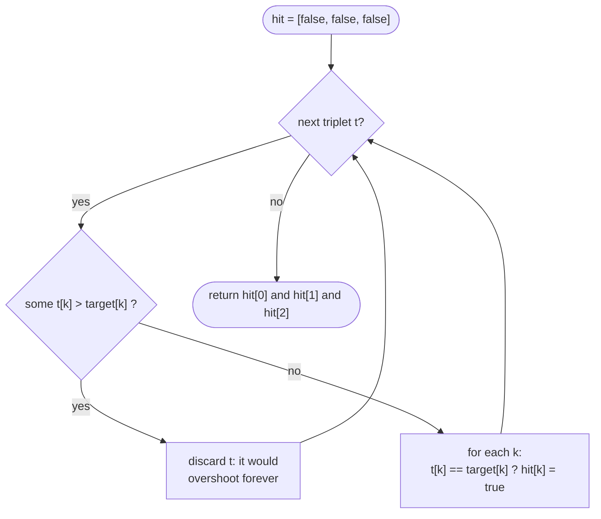

# LC 1899 Merge Triplets to Form Target Triplet

> [!abstract] In one sentence
> Discard every triplet that exceeds the target in some coordinate; merging all survivors can never overshoot, so the target is reachable iff, among the survivors, each coordinate of the target appears in at least one triplet.

**Map:** [[NeetCode 150 MOC]] → [[DSA Dashboard]] · Pattern: [[Greedy]]

> [!question] Predict before you read
> Why is it safe to merge *every* usable triplet instead of searching for the right subset — what property of `max` makes "more" never worse here?

## Problem

You are given `triplets`, a list of `[a, b, c]` integer triples, and a `target` triple. One operation picks two triplets `i` and `j` and replaces `triplets[j]` by the componentwise maximum `[max(aᵢ, aⱼ), max(bᵢ, bⱼ), max(cᵢ, cⱼ)]`. Return whether some sequence of operations can make `target` appear in the list.

- `triplets = [[2,5,3], [1,8,4], [1,7,5]]`, `target = [2,7,5]` → `true` (merge `[2,5,3]` with `[1,7,5]`)
- `triplets = [[3,4,5], [4,5,6]]`, `target = [3,2,5]` → `false` (every triplet has `b > 2`)

Constraints that matter: up to `10⁵` triplets, values up to `1000`; the target may already be present, and the empty merge is not allowed — but a single matching triplet counts (merge it with itself).

## Clarifying questions

1. Can I use a triplet in several merges? — Yes; operations are unlimited.
2. Does the target have to be produced by merging, or is "already present" enough? — Already present counts.
3. Can merged results be merged again? — Yes; the operation keeps the result in the list.
4. Are values bounded enough for `int`? — Yes, nothing is summed; `max` never grows.

## Brute force

Try every subset of triplets and merge: 2ⁿ. Even "try every pair" is O(n²) and wrong, since the answer may need three triplets (one per coordinate). The waste: subsets are pointless when including an extra usable triplet can never hurt.

## The key insight

`max` is monotone and idempotent: merging more triplets can only raise coordinates, and merging the same one twice changes nothing. So (1) a triplet with any coordinate *above* the target can never take part — once merged in, that coordinate exceeds the target forever; (2) every triplet with all coordinates *at or below* the target is harmless, so merge all of them; the result is the componentwise max of the usable set, which equals the target exactly when each coordinate is attained by some usable triplet. Recognition cue: an operation that is monotone (`max`, `min`, `OR`, `union`) and you are asked whether a target is reachable → filter the harmful elements, merge everything else.

## Optimal approach

1. `hit = [false, false, false]`.
2. For each triplet `t`: skip it if `t[0] > target[0]` or `t[1] > target[1]` or `t[2] > target[2]`; otherwise for each `k`, if `t[k] == target[k]` set `hit[k] = true`.
3. Return `hit[0] && hit[1] && hit[2]`.



> [!example]- Excalidraw version — the same diagram as an editable canvas
> ![[LC 1899 Merge Triplets to Form Target Triplet — Optimal approach.excalidraw]]
> [[LC 1899 Merge Triplets to Form Target Triplet — Optimal approach.excalidraw|Open in Excalidraw]] — needs the Excalidraw plugin (see [[Plugins to Install]]).

## Walkthrough

`triplets = [[2,5,3], [1,8,4], [1,7,5]]`, `target = [2,7,5]`

| triplet | usable? | hits | hit after |
|---|---|---|---|
| `[2,5,3]` | yes (2≤2, 5≤7, 3≤5) | a = 2 | `[T, F, F]` |
| `[1,8,4]` | no (8 > 7) | — | `[T, F, F]` |
| `[1,7,5]` | yes | b = 7, c = 5 | `[T, T, T]` → `true` |

> [!example] Usable triplets vs target [2, 7, 5]
> ![[LC 1899 Merge Triplets to Form Target Triplet — Usable triplets vs target -2, 7, 5-.excalidraw]]
> [[LC 1899 Merge Triplets to Form Target Triplet — Usable triplets vs target -2, 7, 5-.excalidraw|Open in Excalidraw]] — amber in row 2 is the poison (8 > 7); the other amber cells are the coordinates that reach the target

%% excalidraw-spec
{"kind": "grid", "title": "Usable triplets vs target [2, 7, 5]", "col_labels": ["", "a", "b", "c"], "row_labels": ["[2,5,3]", "[1,8,4]", "[1,7,5]", "max of usable"], "rows": [ [2, 5, 3], [1, 8, 4], [1, 7, 5], [2, 7, 5] ], "highlight": [ [0, 0], [2, 1], [2, 2], [1, 1] ], "caption": "amber in row 2 is the poison (8 > 7); the other amber cells are the coordinates that reach the target"}
%%

## Java solution

```java
import java.util.*;

class Solution {
    public boolean mergeTriplets(int[][] triplets, int[] target) {
        boolean[] hit = new boolean[3];                      // target[k] reached by some usable triplet
        for (int[] t : triplets) {
            if (t[0] > target[0] || t[1] > target[1] || t[2] > target[2]) continue;   // poison
            for (int k = 0; k < 3; k++) {
                if (t[k] == target[k]) hit[k] = true;
            }
        }
        return hit[0] && hit[1] && hit[2];
    }
}
```

**Time** O(n) · **Space** O(1)

## Why it works

Let `U` be the set of usable triplets (all coordinates `≤ target`). Any set of triplets whose merge equals the target contains no poison triplet (a coordinate above the target can never come back down), so it is a subset of `U`, and its merge is `≤` the merge of all of `U` coordinatewise. The merge of `U` is itself `≤ target`. Hence the target is reachable iff `merge(U) == target`, i.e. iff every coordinate `k` has some `t ∈ U` with `t[k] == target[k]`. Exchange argument in one line: swapping any solution for "all of `U`" can only move coordinates up, and never past the target.

## Edge cases

- Target already in the list: it is usable and hits all three coordinates → `true`.
- No usable triplet at all: `hit` stays all false → `false`.
- Target coordinates reached only across three different triplets: fine; the check is per coordinate.
- A usable triplet equal to the target in two coordinates and smaller in the third: contributes two hits, needs help for the third.
- Single triplet that is not the target: `false`; a merge with itself changes nothing.

## Common mistakes

> [!warning] What goes wrong
> - Testing only pairs of triplets: `[[2,0,0],[0,7,0],[0,0,5]]` with target `[2,7,5]` needs all three.
> - Forgetting the poison filter and just checking "each target coordinate appears somewhere": `[[2,9,5]]` with target `[2,7,5]` would wrongly pass.
> - Building the full merged triplet and comparing is fine, but comparing with `==` on `int[]` compares references; use `Arrays.equals` or the three booleans.
> - Checking `t[k] >= target[k]` instead of `==` after filtering — equivalent here, but it hides the reasoning and breaks the moment the filter is removed.

## Variants & follow-ups

- Componentwise `min` with a target: mirror the argument (filter triplets with any coordinate *below* the target).
- Bitwise `OR` to reach a target mask: filter values with bits outside the target, then `OR` the rest — same proof with "set bit" instead of "coordinate".
- `k`-tuples instead of triplets: the loop over `k` generalises; O(n·k).
- Ask for the minimum number of triplets used: at most three, one per coordinate — pick any usable hitter per coordinate and deduplicate.
- Same "discard what can never help, then be greedy with the rest" structure as [[LC 846 Hand of Straights]] and the frontier cuts in [[LC 763 Partition Labels]].

## Interview script

Restate: "merge is componentwise max; can we produce the target?" Brute force: "subsets, exponential." Insight: "max only goes up, so anything above the target is poison and everything else is free; merge all the free ones." Approach: "one pass with three booleans." Complexity: "O(n), O(1)." Tests: target present, no usable triplets, three triplets each contributing one coordinate, a poison triplet that would otherwise hit. The interviewer is checking that you state the monotonicity argument, not that you code the loop.

## Related

- Pattern: [[Greedy]] (filter-then-merge under a monotone operation)
- Neighbours in the list: [[LC 846 Hand of Straights]], [[LC 763 Partition Labels]]
- Another "range of possibilities" greedy: [[LC 678 Valid Parenthesis String]]
- Java: [[Java Collections Cheat Sheet]] (`Arrays.equals` for array comparison), [[Java Pitfalls in Interviews]] (`==` on arrays)

## Attempt log

| Date | Result | Minutes | What I got wrong |
|---|---|---|---|
| | | | |

### Mastery checklist
- [ ] Solved without hints in under 25 minutes
- [ ] Stated complexity before coding
- [ ] Handled every edge case above
- [ ] Code compiled first time
- [ ] Can do the follow-up variant

## Open questions
- [ ] State the two properties of `max` the proof used (monotone, idempotent) and find an operation with only one of them where "merge everything usable" stops being correct.
