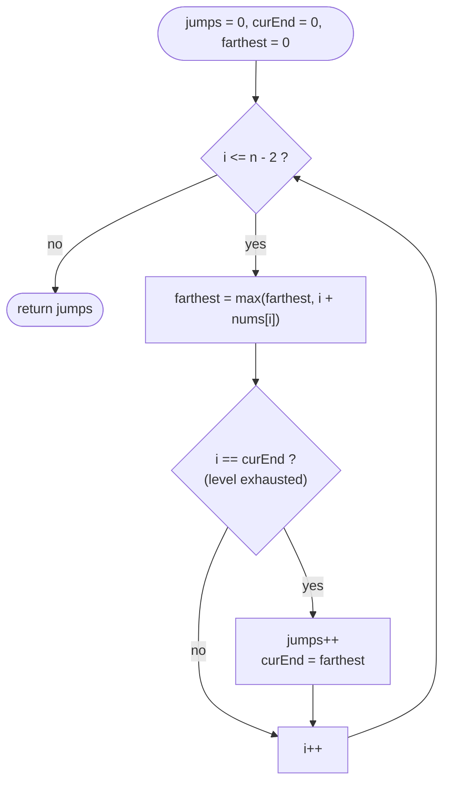

# LC 45 Jump Game II

> [!abstract] In one sentence
> Indices reachable in exactly `k` jumps form a contiguous range, so BFS over the array needs no queue: sweep `i`, track the farthest index the current level can reach, and when `i` hits the end of the current level, start the next level there and count one jump.

**Map:** [[NeetCode 150 MOC]] → [[DSA Dashboard]] · Pattern: [[Greedy]]

> [!question] Predict before you read
> In [[LC 55 Jump Game]] one running maximum was enough. What second variable do you need to *count* jumps, and why does the loop stop at `n − 2` rather than `n − 1`?

## Problem

Same setup as [[LC 55 Jump Game]]: from index `i` you may jump forward by any length `0 … nums[i]`. The last index is guaranteed reachable. Return the minimum number of jumps from index 0 to the last index.

- `[2, 3, 1, 1, 4]` → `2` (0 → 1 → 4)
- `[2, 3, 0, 1, 4]` → `2`
- `[0]` → `0`

Constraints that matter: `1 ≤ n ≤ 10⁴`, `0 ≤ nums[i] ≤ 1000`, and the guarantee of reachability removes the "stuck" check.

## Clarifying questions

1. Is the end guaranteed reachable? — Yes (the problem says so); otherwise return −1 when `i` passes the frontier.
2. Does `n = 1` need zero jumps? — Yes.
3. Can a jump overshoot the last index? — Yes, and it counts as arriving.
4. Do I return the count or the path? — The count; the path is a follow-up.

## Brute force

DP `jumps[i] = 1 + min(jumps[j])` over all `j` that can reach `i`: O(n²). Or a real BFS with a queue and a visited array: O(n) states but each index pushes up to `nums[i]` neighbours. The waste in both: the neighbours of a BFS level are a single contiguous range, so you never need to enumerate them one by one.

## The key insight

Level `k` of the BFS = the indices first reached with exactly `k` jumps, and because reachability is downward closed (see [[LC 55 Jump Game]]) each level is a contiguous range `[curEnd + 1 .. farthest]`, where `farthest` is the maximum `i + nums[i]` over the previous level. So you need two numbers: `curEnd`, the right edge of the current level, and `farthest`, the right edge of the next one. Recognition cue: "minimum number of steps / jumps" on an array with range moves → BFS levels compressed into a frontier.

## Optimal approach

1. `jumps = 0`, `curEnd = 0`, `farthest = 0`.
2. For `i = 0 … n−2`: `farthest = max(farthest, i + nums[i])`; if `i == curEnd` then `jumps++` and `curEnd = farthest` (the current level is exhausted; commit to the next one).
3. Return `jumps`.



> [!example]- Excalidraw version — the same diagram as an editable canvas
> ![[LC 45 Jump Game II — Optimal approach.excalidraw]]
> [[LC 45 Jump Game II — Optimal approach.excalidraw|Open in Excalidraw]] — needs the Excalidraw plugin (see [[Plugins to Install]]).

## Walkthrough

`nums = [2, 3, 1, 1, 4]`, `n − 2 = 3`

| i | i + nums[i] | farthest | i == curEnd? | jumps | curEnd after |
|---|---|---|---|---|---|
| 0 | 2 | 2 | yes (0) | 1 | 2 |
| 1 | 4 | 4 | no | 1 | 2 |
| 2 | 3 | 4 | yes (2) | 2 | 4 |
| 3 | 4 | 4 | no | 2 | 4 |

Level 0 = `{0}`, level 1 = `[1..2]`, level 2 = `[3..4]`. The last index sits in level 2, so the answer is 2 — and the loop never has to visit index 4.

> [!example] BFS levels compressed into ranges
> ![[LC 45 Jump Game II — BFS levels compressed into ranges.excalidraw]]
> [[LC 45 Jump Game II — BFS levels compressed into ranges.excalidraw|Open in Excalidraw]] — while i sweeps level 1 (amber), farthest records how far level 2 will extend

%% excalidraw-spec
{"kind": "array", "title": "BFS levels compressed into ranges", "values": [2, 3, 1, 1, 4], "pointers": {"curEnd": 2, "farthest": 4}, "highlight": [1, 2], "labels": {"0": "level 0", "1": "level 1", "3": "level 2"}, "caption": "while i sweeps level 1 (amber), farthest records how far level 2 will extend"}
%%

## Java solution

```java
import java.util.*;

class Solution {
    public int jump(int[] nums) {
        int jumps = 0;
        int curEnd = 0;        // right edge of the current BFS level
        int farthest = 0;      // right edge of the next level, grown while sweeping this one
        for (int i = 0; i < nums.length - 1; i++) {     // n - 1 itself never needs a jump
            farthest = Math.max(farthest, i + nums[i]);
            if (i == curEnd) {                           // level exhausted: must jump now
                jumps++;
                curEnd = farthest;
            }
        }
        return jumps;
    }
}
```

**Time** O(n) · **Space** O(1)

## Why it works

Invariant: when the sweep is inside `[prevEnd + 1 .. curEnd]`, every index there needs exactly `jumps` jumps, and `farthest` is the maximum reach of the indices visited so far in this level. At `i == curEnd` the whole level has been scanned, so `farthest` is exactly the right edge of the level `jumps + 1` — no index beyond it is reachable in `jumps + 1` jumps, and every index up to it is (shorten the jump). This is BFS, and BFS on unit-weight edges gives shortest paths; the greedy flavour is the exchange argument "landing farther dominates landing nearer, so only the farthest reach of a level matters". The loop stops at `n − 2` because reaching `n − 1` ends the game; counting a jump *from* it would overcount.

## Edge cases

- `n = 1` (`[0]`): the loop body never runs → 0.
- `n = 2`: `i = 0` is the only iteration; `jumps = 1` (`nums[0] ≥ 1` by the guarantee).
- A zero inside (`[2, 3, 0, 1, 4]`): zeros only fail to extend `farthest`; they cannot trap you because reachability is guaranteed.
- Overshoot (`[5, 1, 1]`): `farthest = 5` at `i = 0`; answer 1, even though 5 is past the end.
- Without the guarantee: add `if (i > farthest) return -1` before the update, exactly as in [[LC 55 Jump Game]].

## Common mistakes

> [!warning] What goes wrong
> - Looping to `i ≤ n − 1`: when `i == n − 1 == curEnd` you count a jump that never happens. `[2, 3, 1, 1, 4]` would return 3.
> - Updating `curEnd = farthest` before updating `farthest` with the current index.
> - Greedy "jump to the index with the largest `nums[j]`" instead of the largest `j + nums[j]`: on `[3, 5, 2, 4, 1, 1, 1, 1]` it picks index 1 (reach 6) over index 3 (reach 7) and answers 3 instead of 2.
> - A real BFS with a queue and `visited[]` is correct but the interviewer wants the O(1)-space version.

## Variants & follow-ups

- Feasibility only: [[LC 55 Jump Game]] (one variable instead of two).
- Return the actual path: remember, per level, the index that produced `farthest`, then reconstruct backwards.
- Jump Game IV (LC 1345): jumps to equal values anywhere in the array — ranges are no longer contiguous, so it is a real BFS with a value → indices map and a visited set ([[Graphs]]).
- Jump Game VII (LC 1696): a `[minJump, maxJump]` window with a sliding count of reachable indices.
- The same "extend the current segment to the farthest point it must cover, then cut" shape appears in [[LC 763 Partition Labels]].

## Interview script

Restate: "minimum jumps to the last index; reachable guaranteed." Brute force: "n² DP, or BFS with a queue." Insight: "each BFS level is a contiguous range; two variables — end of this level, farthest reach for the next — replace the queue." Approach: "sweep to `n − 2`; update farthest; at `i == curEnd` count a jump and advance." Complexity: "O(n), O(1)." Tests: `[0]`, `n = 2`, overshoot, a zero inside. Say explicitly why the loop stops at `n − 2`; that is the detail the interviewer waits for.

## Related

- Pattern: [[Greedy]] (frontier shape, BFS-levels-as-ranges)
- Prerequisite: [[LC 55 Jump Game]]
- Same "extend then cut" sweep: [[LC 763 Partition Labels]]; same "a failure invalidates everything in between": [[LC 134 Gas Station]]
- Java: [[DSA Patterns in Java]] (greedy sweeps and BFS templates)

## Attempt log

| Date | Result | Minutes | What I got wrong |
|---|---|---|---|
| | | | |

### Mastery checklist
- [ ] Solved without hints in under 25 minutes
- [ ] Stated complexity before coding
- [ ] Handled every edge case above
- [ ] Code compiled first time
- [ ] Can do the follow-up variant

## Open questions
- [ ] Write the queue-based BFS for this problem and mark the exact line where the contiguous-range property lets you delete the queue.
