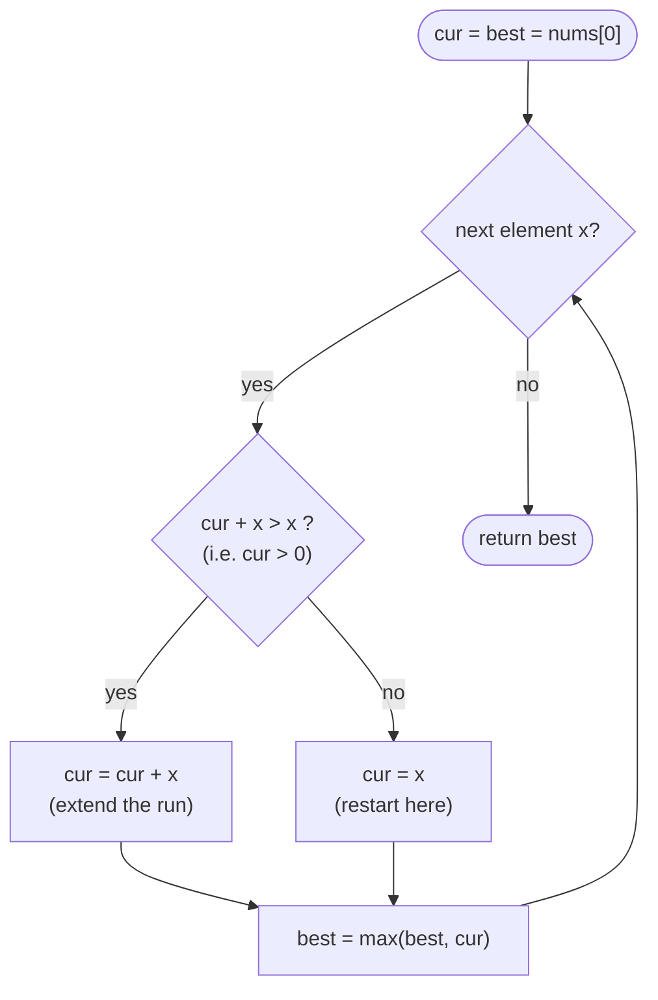

# LC 53 Maximum Subarray

> [!abstract] In one sentence
> Keep `cur` = the largest sum of a subarray ending at the current index; it is either the element alone or the element glued onto the previous `cur`, and a `cur` that has gone negative is worth less than starting fresh — so one pass with two variables finds the maximum subarray sum.

**Map:** [[NeetCode 150 MOC]] → [[DSA Dashboard]] · Pattern: [[Greedy]]

> [!question] Predict before you read
> Why is "drop the running sum as soon as it becomes negative" safe — could a negative prefix ever be needed to reach a big positive stretch further right?

## Problem

Given an integer array `nums` with at least one element, return the largest sum of any contiguous, non-empty subarray.

- `[-2, 1, -3, 4, -1, 2, 1, -5, 4]` → `6` (the subarray `[4, -1, 2, 1]`)
- `[-3, -1, -2]` → `-1` (all negative: the best subarray is the single largest element)

Constraints that matter: `1 ≤ n ≤ 10⁵`, values in `[-10⁴, 10⁴]`, so every sum fits in `int`. The follow-up asks for a divide-and-conquer solution.

## Clarifying questions

1. Must the subarray be non-empty? — Yes; an empty subarray (sum 0) is not allowed, which is exactly why all-negative inputs matter.
2. Do I return the sum or the subarray? — The sum; be ready to return the indices as a follow-up.
3. Can the array be all negative? — Yes; the answer is then the maximum element.
4. Contiguous, not a subsequence? — Contiguous. (The subsequence version is just "sum of all positives".)

## Brute force

Try every `(i, j)` pair and sum `nums[i..j]`: O(n³), or O(n²) with a running sum per `i`. The waste: the best subarray ending at `j` is recomputed from scratch for every `i`, although it depends on only one number — the best subarray ending at `j − 1`.

## The key insight

Define `cur[j]` = maximum sum of a subarray that ends exactly at `j`. Either that subarray is `nums[j]` alone, or it is `nums[j]` appended to the best subarray ending at `j − 1`: `cur[j] = max(nums[j], cur[j−1] + nums[j])`. The answer is the maximum `cur[j]`. The greedy reading: a running sum that has gone negative is dropped, because any subarray extended through it would be better without it. Recognition cue: "maximum / minimum sum of a contiguous subarray" → Kadane; "maximum product" → [[LC 152 Maximum Product Subarray]] (same shape, two running values).

## Optimal approach

1. `cur = best = nums[0]`.
2. For `i = 1 … n−1`: `cur = max(nums[i], cur + nums[i])`; then `best = max(best, cur)`.
3. Return `best`.



> [!example]- Excalidraw version — the same diagram as an editable canvas
> ![[LC 53 Maximum Subarray — Optimal approach.excalidraw]]
> [[LC 53 Maximum Subarray — Optimal approach.excalidraw|Open in Excalidraw]] — needs the Excalidraw plugin (see [[Plugins to Install]]).

## Walkthrough

`nums = [-2, 1, -3, 4, -1, 2, 1, -5, 4]`

| i | nums[i] | cur + nums[i] | cur = max(nums[i], cur + nums[i]) | best |
|---|---|---|---|---|
| 0 | -2 | — | -2 | -2 |
| 1 | 1 | -1 | 1 (restart) | 1 |
| 2 | -3 | -2 | -2 | 1 |
| 3 | 4 | 2 | 4 (restart) | 4 |
| 4 | -1 | 3 | 3 | 4 |
| 5 | 2 | 5 | 5 | 5 |
| 6 | 1 | 6 | 6 | 6 |
| 7 | -5 | 1 | 1 | 6 |
| 8 | 4 | 5 | 5 | 6 |

The two restarts (i = 1 and i = 3) are the greedy drops: the run `[-2]` and the run `[1, -3]` both had a negative total, so nothing to their right benefits from carrying them.

> [!example] Kadane on [-2, 1, -3, 4, -1, 2, 1, -5, 4]
> ![[LC 53 Maximum Subarray — Kadane on --2, 1, -3, 4, -1, 2, 1, -5, 4-.excalidraw]]
> [[LC 53 Maximum Subarray — Kadane on --2, 1, -3, 4, -1, 2, 1, -5, 4-.excalidraw|Open in Excalidraw]] — the best run [4, -1, 2, 1] = 6 starts right after the second drop

%% excalidraw-spec
{"kind": "array", "title": "Kadane on [-2, 1, -3, 4, -1, 2, 1, -5, 4]", "values": [-2, 1, -3, 4, -1, 2, 1, -5, 4], "pointers": {"start": 3, "end": 6}, "highlight": [3, 4, 5, 6], "labels": {"1": "restart", "3": "restart"}, "caption": "the best run [4, -1, 2, 1] = 6 starts right after the second drop"}
%%

## Java solution

```java
import java.util.*;

class Solution {
    public int maxSubArray(int[] nums) {
        int cur = nums[0];                 // best sum of a subarray ending at i
        int best = nums[0];                // best sum seen so far
        for (int i = 1; i < nums.length; i++) {
            cur = Math.max(nums[i], cur + nums[i]);   // extend the run or restart at i
            best = Math.max(best, cur);
        }
        return best;
    }
}
```

**Time** O(n) · **Space** O(1)

## Why it works

Invariant: after processing index `i`, `cur` is the maximum sum over all subarrays ending at `i`, and `best` is the maximum over all subarrays ending at or before `i`. The step is exact, not a heuristic: every subarray ending at `i` is either `[i..i]` or some subarray ending at `i − 1` with `nums[i]` appended, and the best of that second family is `cur[i−1] + nums[i]` by the induction hypothesis. The exchange argument behind the greedy phrasing: if an optimal subarray `[s..e]` has a prefix `[s..k]` with negative sum, then `[k+1..e]` is strictly better — so no optimal solution carries a negative prefix, and dropping one loses nothing.

## Edge cases

- `n = 1`: the loop does not run; returns `nums[0]`.
- All negative (`[-3, -1, -2]`): every step restarts; `best` tracks the maximum element, −1.
- All positive: never restarts; returns the total sum.
- Zeros (`[0, -1, 0]`): `best = 0` — a single zero is a valid subarray.
- Large magnitudes: `10⁵ × 10⁴ = 10⁹ < 2³¹`, so `int` is safe; say "`long` if the bounds were bigger".

## Common mistakes

> [!warning] What goes wrong
> - Initialising `best = 0`: returns 0 for all-negative input, but the empty subarray is not allowed.
> - Writing `cur = Math.max(0, cur) + nums[i]` is fine, but only if `best` starts at `nums[0]` or `Integer.MIN_VALUE`, never 0.
> - Updating `best` before `cur` inside the loop, so the last element never gets compared.
> - Confusing subarray (contiguous) with subsequence — the subsequence version is trivial and the interviewer will notice.

## Variants & follow-ups

- Return the subarray, not just the sum: record `start` whenever you restart and `(bestStart, bestEnd)` whenever `best` improves.
- Divide and conquer (the stated follow-up): `max(left half, right half, best crossing the middle)` in O(n log n); the crossing sum is the best suffix of the left half plus the best prefix of the right half.
- Maximum product subarray: track both the max and the min product because a negative flips them — [[LC 152 Maximum Product Subarray]].
- Circular array (LC 918): `max(kadane, total − minSubarray)`, guarding the all-negative case.
- Best time to buy and sell stock is Kadane on the day-to-day differences — [[LC 121 Best Time to Buy and Sell Stock]].
- Minimum subarray sum: negate the array, or swap `max` for `min`.

## Interview script

Restate: "largest sum of a non-empty contiguous subarray; may be all negative." Brute force: "n² over all pairs with a running sum." Insight: "the best subarray ending at i is either i alone or extends the best one ending at i − 1; a negative running sum is dropped." Approach: "one pass, `cur` and `best`, both seeded with `nums[0]`." Complexity: "O(n) time, O(1) space." Tests: all negative, single element, all positive, a zero. Offer the index-returning and divide-and-conquer variants before being asked; the interviewer is checking that you can justify the drop, not just recite Kadane.

## Related

- Pattern: [[Greedy]] (the exchange argument) and [[Dynamic Programming]] (Kadane is a 1-D DP with O(1) state)
- Same running-state shape: [[LC 152 Maximum Product Subarray]], [[LC 121 Best Time to Buy and Sell Stock]]
- Next in the list: [[LC 55 Jump Game]]
- Java: [[DSA Patterns in Java]] (prefix-sum and Kadane templates), [[Java Pitfalls in Interviews]] (seeding with `Integer.MIN_VALUE` vs 0)

## Attempt log

| Date | Result | Minutes | What I got wrong |
|---|---|---|---|
| | | | |

### Mastery checklist
- [ ] Solved without hints in under 25 minutes
- [ ] Stated complexity before coding
- [ ] Handled every edge case above
- [ ] Code compiled first time
- [ ] Can do the follow-up variant

## Open questions
- [ ] Kadane is usually filed under DP; NeetCode files it under greedy. Write one paragraph on which part of the argument is "DP" (the recurrence) and which is "greedy" (the exchange argument), and whether they are really different here.
