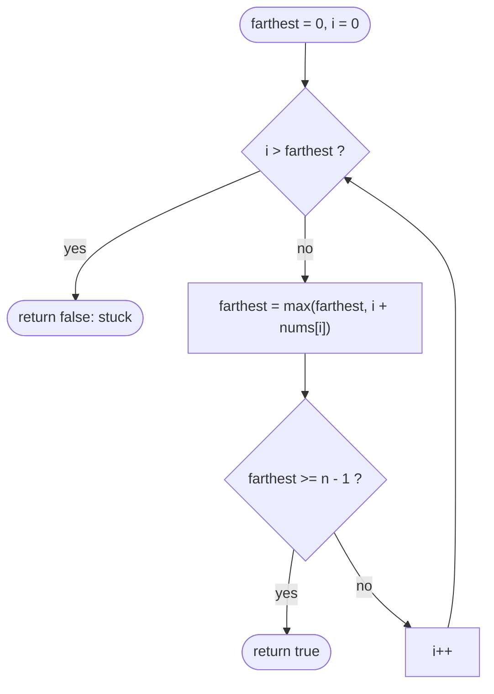

# LC 55 Jump Game

> [!abstract] In one sentence
> The set of reachable indices is always a prefix `[0..farthest]`, so you only need to carry one number — `farthest = max(farthest, i + nums[i])` for every `i` you can actually stand on — and the answer is whether that number ever covers the last index.

**Map:** [[NeetCode 150 MOC]] → [[DSA Dashboard]] · Pattern: [[Greedy]]

> [!question] Predict before you read
> Why is the set of reachable positions always a contiguous prefix of the array, and what does that let you throw away compared with a DP over every index?

## Problem

You stand at index 0 of `nums`; `nums[i]` is the maximum jump length from `i` (you may jump shorter). Return whether you can reach the last index.

- `[2, 3, 1, 1, 4]` → `true` (0 → 1 → 4)
- `[3, 2, 1, 0, 4]` → `false` (every path lands on index 3, whose jump length is 0)

Constraints that matter: `1 ≤ n ≤ 10⁴`, `0 ≤ nums[i] ≤ 10⁵`, so a single jump can overshoot the end — that still counts as reaching it.

## Clarifying questions

1. May I jump fewer steps than `nums[i]`? — Yes, any length from 0 to `nums[i]`.
2. Is overshooting the last index a success? — Yes; reaching or passing it counts.
3. What if `n = 1`? — You are already at the end: `true`, even for `[0]`.
4. Only forward jumps? — Yes.

## Brute force

DFS over every jump choice: exponential. Memoised as "can index `i` reach the end?" it becomes O(n²): for each `i`, scan up to `nums[i]` successors. The waste: the successors of `i` are the contiguous range `i+1 … i+nums[i]`, so the DP only ever asks "is *some* good index in this range?" — a question one running maximum answers.

## The key insight

If you can reach index `j`, you can reach every index before `j` too (shorten the jump that lands on `j`). So "reachable" is a prefix `[0..farthest]`, and extending it needs only `max(farthest, i + nums[i])` over the indices inside it. You are stuck exactly when the sweep arrives at an index `i > farthest`. Recognition cue: "can you reach / fewest jumps / maximum jump length" over an array → carry the frontier.

## Optimal approach

1. `farthest = 0`.
2. For `i = 0 … n−1`: if `i > farthest` return `false` (index `i` is unreachable, and so is everything after it); `farthest = max(farthest, i + nums[i])`; if `farthest ≥ n−1` return `true`.
3. Return `true`.



> [!example]- Excalidraw version — the same diagram as an editable canvas
> ![[LC 55 Jump Game — Optimal approach.excalidraw]]
> [[LC 55 Jump Game — Optimal approach.excalidraw|Open in Excalidraw]] — needs the Excalidraw plugin (see [[Plugins to Install]]).

## Walkthrough

`nums = [3, 2, 1, 0, 4]`

| i | i > farthest? | i + nums[i] | farthest after |
|---|---|---|---|
| 0 | no | 3 | 3 |
| 1 | no | 3 | 3 |
| 2 | no | 3 | 3 |
| 3 | no | 3 | 3 |
| 4 | **4 > 3** | — | return `false` |

> [!example] Frontier stalls at index 3
> ![[LC 55 Jump Game — Frontier stalls at index 3.excalidraw]]
> [[LC 55 Jump Game — Frontier stalls at index 3.excalidraw|Open in Excalidraw]] — every reachable index (amber) pushes farthest no further than 3; index 4 lies beyond the frontier

%% excalidraw-spec
{"kind": "array", "title": "Frontier stalls at index 3", "values": [3, 2, 1, 0, 4], "pointers": {"i": 4, "farthest": 3}, "highlight": [0, 1, 2, 3], "caption": "every reachable index (amber) pushes farthest no further than 3; index 4 lies beyond the frontier"}
%%

On `[2, 3, 1, 1, 4]` the frontier goes 2 → 4 at `i = 1`, which is already `≥ n − 1`, so the loop exits `true` after two iterations.

## Java solution

```java
import java.util.*;

class Solution {
    public boolean canJump(int[] nums) {
        int farthest = 0;                       // rightmost index reachable so far
        for (int i = 0; i < nums.length; i++) {
            if (i > farthest) return false;     // a gap: i (and everything after it) is unreachable
            farthest = Math.max(farthest, i + nums[i]);
            if (farthest >= nums.length - 1) return true;
        }
        return true;                            // n == 1 lands here
    }
}
```

**Time** O(n) · **Space** O(1)

## Why it works

Invariant: before processing `i`, `farthest` is the largest index reachable using only jumps that start at indices `< i`, and every index in `[0..farthest]` is reachable (reachability is downward closed, because any jump can be shortened). If `i ≤ farthest`, index `i` is reachable, so every index up to `i + nums[i]` becomes reachable — the update is exact. If `i > farthest`, no index `< i` can jump to `i` or beyond, and later indices are only reachable through indices `≥ i` — so nothing further is reachable and `false` is correct. The exchange argument: among all ways of reaching some index, the one that lands farthest can replace any other without loss, because a farther landing dominates a nearer one.

## Edge cases

- `n = 1`: `farthest = 0 ≥ 0` → `true` immediately, even for `[0]`.
- A zero you can jump over (`[2, 0, 1]`): `farthest = 2` at `i = 0` → `true`.
- Trailing zero (`[1, 0]`): `true`; a zero you must land on (`[1, 0, 1]`) → `false`.
- Huge jump at index 0: `i + nums[i] ≤ 10⁴ + 10⁵` fits in `int`, no overflow.

## Common mistakes

> [!warning] What goes wrong
> - Checking `i > farthest` *after* updating `farthest`, which lets an unreachable `i` contribute its jump.
> - Simulating "always take the longest jump": `[3, 2, 1, 0, 4]` shows the longest jump can land you on a zero; the frontier, not the jump, is what you keep.
> - Looping to `n − 2` only and forgetting the final `return true`.
> - Spending the first fifteen minutes on the O(n²) DP and running out of time before the greedy.

## Variants & follow-ups

- Minimum number of jumps: layer the same frontier into BFS levels — [[LC 45 Jump Game II]].
- Backward greedy: walk from the right keeping `goal = n − 1`; whenever `i + nums[i] ≥ goal`, set `goal = i`; answer `goal == 0`. Same complexity, worth knowing for "show me another way".
- Jumps to `i ± nums[i]` (LC 1306 Jump Game III): no monotone frontier, so it becomes BFS/DFS with a visited set.
- Jumps with costs or a range `[minJump, maxJump]` (LC 1345, LC 1696): BFS with a monotonic deque or DP — the greedy breaks the moment steps are not free.
- Circular tour feasibility uses the same "if you fail at i, nothing in between can be the start" reasoning — [[LC 134 Gas Station]].

## Interview script

Restate: "jump lengths are maxima; can index 0 reach the end?" Brute force: "DFS over choices, or n² DP over 'can i finish'." Insight: "reachable indices form a prefix; one running maximum of `i + nums[i]` is the frontier." Approach: "sweep; stuck if `i` passes the frontier; done when the frontier passes the end." Complexity: "O(n), O(1)." Tests: `[0]`, a zero you must land on, a zero you can skip, early overshoot. Mention the backward-goal version and name Jump Game II as the follow-up before the interviewer does.

## Related

- Pattern: [[Greedy]] (frontier / "farthest reach" shape)
- Follow-up: [[LC 45 Jump Game II]]
- Same "drop what cannot help" reasoning: [[LC 53 Maximum Subarray]], [[LC 134 Gas Station]]
- Java: [[DSA Patterns in Java]] (greedy sweeps); [[Dynamic Programming]] for the O(n²) version it replaces

## Attempt log

| Date | Result | Minutes | What I got wrong |
|---|---|---|---|
| | | | |

### Mastery checklist
- [ ] Solved without hints in under 25 minutes
- [ ] Stated complexity before coding
- [ ] Handled every edge case above
- [ ] Code compiled first time
- [ ] Can do the follow-up variant

## Open questions
- [ ] The O(n²) DP and the greedy both compute "reachable"; write out why the DP's inner loop over successors is exactly what the running max compresses, and find a jump variant where it cannot be compressed.
