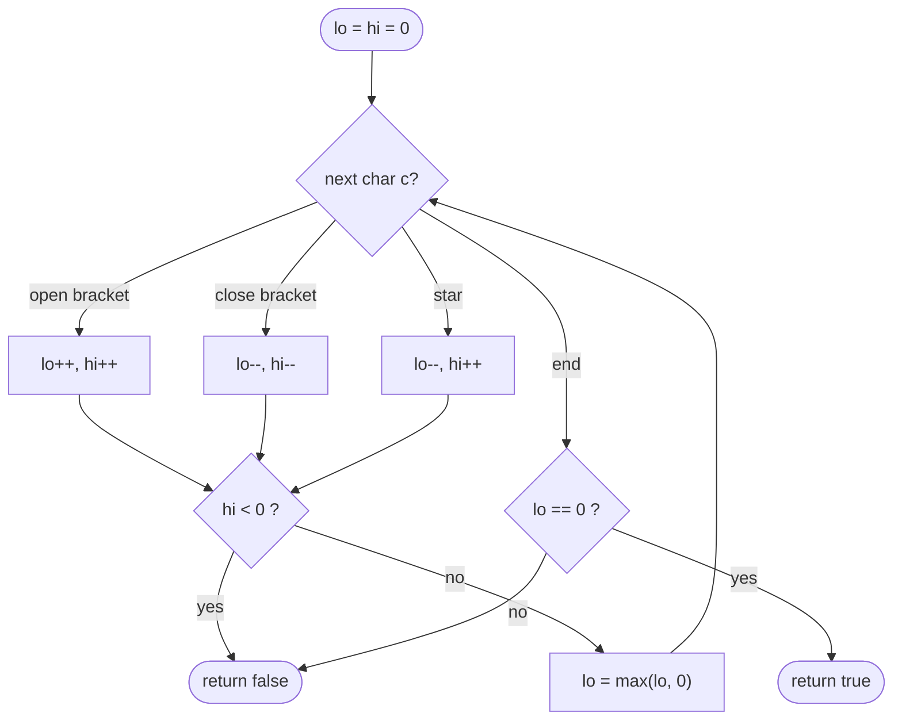

# LC 678 Valid Parenthesis String

> [!abstract] In one sentence
> The set of possible "unmatched `(` counts" after any prefix is a contiguous range, so two integers `lo` and `hi` replace a search over all wildcard assignments: `hi < 0` means too many `)` even with every `*` as `(`, and `lo == 0` at the end means some assignment closes everything.

**Map:** [[NeetCode 150 MOC]] → [[DSA Dashboard]] · Pattern: [[Greedy]]

> [!question] Predict before you read
> After reading `"(*"` the open count could be 0, 1 or 2. After `"(*))"` which counts are possible, and why does clamping the lower bound at 0 not lose information?

## Problem

A string contains `(`, `)` and `*`, where each `*` may stand for `(`, `)` or the empty string. Decide whether some choice makes the string a valid parenthesis string (every `(` closed by a later `)`, never a `)` without an open `(`).

- `"(*)"` → `true`
- `"(*))"` → `true` (`*` as `(`)
- `"(((*)"` → `false` (two `)` are missing and a single `*` can supply at most one)

Constraints that matter: `1 ≤ n ≤ 100` (so even O(n²) DP would pass, but the interviewer wants O(n)); the empty string is not an input, but `*` alone is valid.

## Clarifying questions

1. Can `*` be empty? — Yes; `"*"` is valid, which rules out any parity-based shortcut.
2. Only one kind of bracket? — Yes, only `(` and `)`.
3. Must I return the assignment? — No, just `true`/`false`.
4. Is `")("` invalid? — Yes: a `)` can only match an earlier `(`.

## Brute force

Try all `3^k` assignments of the `k` wildcards and validate each with a counter: exponential. DP `can[i][open]` ("is the prefix of length `i` consistent with `open` unmatched brackets?") is O(n²) time and space. The waste: for each prefix the set of feasible `open` values is a contiguous interval, so storing a boolean per value is storing a range as a bitmap.

## The key insight

Track `lo` = the fewest unmatched `(` possible so far (treat `*` as `)`) and `hi` = the most (treat `*` as `(`). Every value in `[lo, hi]` is achievable (a `*` can also be empty, so the range has no holes). A `(` shifts both up, a `)` shifts both down, a `*` widens the range by one on each side. If `hi < 0`, even the most generous reading has an unmatched `)` → `false`. Negative values of `lo` are dead states (an unmatched `)`), so clamp `lo` at 0. At the end the string is valid iff `0 ∈ [lo, hi]`, i.e. `lo == 0`. Recognition cue: a validity check with a wildcard that can go either way → track the range of a counter, not one value.

## Optimal approach

1. `lo = hi = 0`.
2. For each char: `(` → `lo++, hi++`; `)` → `lo--, hi--`; `*` → `lo--, hi++`.
3. If `hi < 0` return `false`; set `lo = max(lo, 0)`.
4. Return `lo == 0`.



> [!example]- Excalidraw version — the same diagram as an editable canvas
> ![[LC 678 Valid Parenthesis String — Optimal approach.excalidraw]]
> [[LC 678 Valid Parenthesis String — Optimal approach.excalidraw|Open in Excalidraw]] — needs the Excalidraw plugin (see [[Plugins to Install]]).

## Walkthrough

`s = "(*))"`

| char | lo, hi before | after the shift | hi < 0? | after clamp | feasible open counts |
|---|---|---|---|---|---|
| `(` | 0, 0 | 1, 1 | no | 1, 1 | {1} |
| `*` | 1, 1 | 0, 2 | no | 0, 2 | {0, 1, 2} |
| `)` | 0, 2 | -1, 1 | no | 0, 1 | {0, 1} |
| `)` | 0, 1 | -1, 0 | no | 0, 0 | {0} → `lo == 0`, `true` |

For `"(((*)"`: after the three `(` the range is `[3, 3]`; `*` → `[2, 4]`; `)` → `[1, 3]`; `lo = 1 ≠ 0` → `false`. For `")("`: the first char gives `hi = -1` → `false` at once.

> [!example] Range of unmatched ( after each prefix of (*))
> ![[LC 678 Valid Parenthesis String — Range of unmatched ( after each prefix of (-)).excalidraw]]
> [[LC 678 Valid Parenthesis String — Range of unmatched ( after each prefix of (-)).excalidraw|Open in Excalidraw]] — the band between lo and hi is the set of feasible counts; it must contain 0 at the end

%% excalidraw-spec
{"kind": "grid", "title": "Range of unmatched ( after each prefix of (*))", "col_labels": ["", "(", "*", ")", ")"], "row_labels": ["hi", "lo"], "rows": [ [1, 2, 1, 0], [1, 0, 0, 0] ], "highlight": [ [1, 3] ], "caption": "the band between lo and hi is the set of feasible counts; it must contain 0 at the end"}
%%

## Java solution

```java
import java.util.*;

class Solution {
    public boolean checkValidString(String s) {
        int lo = 0, hi = 0;             // range of possible unmatched '(' counts
        for (char c : s.toCharArray()) {
            if (c == '(')      { lo++; hi++; }
            else if (c == ')') { lo--; hi--; }
            else               { lo--; hi++; }   // '*' as ')', as empty, or as '('
            if (hi < 0) return false;            // unmatched ')' even with every '*' as '('
            lo = Math.max(lo, 0);                // a negative count is a dead branch, drop it
        }
        return lo == 0;                          // some assignment closes everything
    }
}
```

**Time** O(n) · **Space** O(1)

## Why it works

Invariant: after each prefix, `[lo, hi]` is exactly the set of unmatched-`(` counts achievable by assignments that are valid *so far* (never dipped below 0). Base: `{0}`. Step: `(` and `)` translate the set by ±1; `*` maps each value `v` to `{v−1, v, v+1}`, and the union of those over a contiguous range is the contiguous range `[lo−1, hi+1]` — this is where "`*` may be empty" matters, since without it the set would have parity holes. Values below 0 correspond to a `)` with nothing to match, so removing them (the clamp) is exact. `hi < 0` means the set became empty; `lo == 0` at the end means 0 is in the final set. Greedy reading: you never commit a `*` to a role; you keep the range of consequences of all roles, which is why no backtracking is needed.

## Edge cases

- `"*"`, `"**"`: `lo` clamps to 0, `hi` grows; `true`.
- `")"` or `")*"`: `hi` goes negative on the first char → `false`.
- `"("`: `lo = 1` at the end → `false`; `"(*"` → `lo = 0` → `true` (`*` as `)`).
- Many wildcards, no brackets: always `true`.
- A `*` that must be empty, e.g. `"(*)"`: both other roles are also feasible here; the range covers all of them.

## Common mistakes

> [!warning] What goes wrong
> - Returning `hi == 0` or `lo <= 0 && hi >= 0` at the end: after clamping, `lo == 0` is the whole condition; `hi == 0` is too strict (`"(*"` is valid with `hi = 2`).
> - Forgetting to clamp `lo`: on `"*)("` the lower bound drifts to −2 and the final `(` brings it back to −1 ≤ 0, so a sloppy `lo <= 0` check accepts an invalid string. With the clamp, `lo` ends at 1 and the answer is `false`.
> - Clamping `hi` instead of `lo`, or clamping `lo` before testing `hi < 0` with a combined `lo = max(lo, 0)` that also touches `hi` — keep the two roles separate.
> - Treating `*` as only `(` or `)` (two options) — the empty option is what keeps the range gap-free.

## Variants & follow-ups

- Two-pass greedy, the other O(1)-space answer: left to right count `*` as `(` and fail if the balance ever goes negative; right to left count `*` as `)` and fail symmetrically. Both passes passing is equivalent to `hi ≥ 0` throughout and `lo == 0` at the end:

```java
// snippet
int open = 0;                                   // left to right: '*' may be '('
for (char c : s.toCharArray()) {
    open += (c == ')') ? -1 : 1;
    if (open < 0) return false;
}
int close = 0;                                  // right to left: '*' may be ')'
for (int i = s.length() - 1; i >= 0; i--) {
    close += (s.charAt(i) == '(') ? -1 : 1;
    if (close < 0) return false;
}
return true;
```

- Stack version: push indices of `(` and `*` on two stacks; on `)` pop a `(` if possible, else a `*`; at the end every remaining `(` needs a `*` to its *right* (compare indices) — O(n) space, same answer.
- Without wildcards it is [[LC 20 Valid Parentheses]]; generating all valid strings is [[LC 22 Generate Parentheses]].
- Range tracking with a monotone operation is also the trick in [[LC 1899 Merge Triplets to Form Target Triplet]].

## Interview script

Restate: "`*` is `(`, `)` or nothing; is some reading balanced?" Brute force: "3^k assignments, or n² DP over the open count." Insight: "the feasible open counts form a range; track `lo` and `hi`." Approach: "shift on brackets, widen on `*`, fail on `hi < 0`, clamp `lo`, accept iff `lo == 0`." Complexity: "O(n), O(1)." Tests: `"*"`, `")("`, `"(*"`, `"(((*)"`. If asked for an alternative, give the two-pass greedy and say why both passes are needed.

## Related

- Pattern: [[Greedy]] (range of outcomes instead of a committed choice) · [[Stack & Monotonic Stack]] for the stack variant
- Prerequisite: [[LC 20 Valid Parentheses]]; sibling: [[LC 22 Generate Parentheses]]
- Same filter-then-range thinking: [[LC 1899 Merge Triplets to Form Target Triplet]]
- Java: [[Java Collections Cheat Sheet]] (`toCharArray`, `charAt`), [[DSA Patterns in Java]]

## Attempt log

| Date | Result | Minutes | What I got wrong |
|---|---|---|---|
| | | | |

### Mastery checklist
- [ ] Solved without hints in under 25 minutes
- [ ] Stated complexity before coding
- [ ] Handled every edge case above
- [ ] Code compiled first time
- [ ] Can do the follow-up variant

## Open questions
- [ ] Suppose `*` could only be `(` or `)` (never empty). Is the feasible set still an interval? Work out `"(*"` by hand and decide what the two-variable method would have to track instead.
