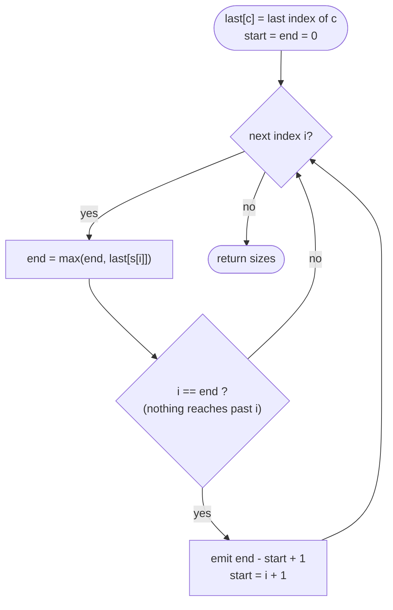

# LC 763 Partition Labels

> [!abstract] In one sentence
> Each letter pins its part to run at least until that letter's last occurrence, so a part is "closed" at the first index `i` where no letter seen since the part began reaches beyond `i` — one `last[26]` table and a running `end` give the cuts in a single sweep.

**Map:** [[NeetCode 150 MOC]] → [[DSA Dashboard]] · Pattern: [[Greedy]]

> [!question] Predict before you read
> This is really a merge-intervals problem in disguise. What are the intervals, and why does the sweep not need to sort them?

## Problem

Given a lowercase string `s`, split it into as many contiguous parts as possible such that each letter appears in at most one part. Return the sizes of the parts, in order.

- `"ababcbacadefegdehijhklij"` → `[9, 7, 8]` (parts `ababcbaca`, `defegde`, `hijhklij`)
- `"eccbbbbdec"` → `[10]`

Constraints that matter: `1 ≤ n ≤ 500`, only `'a'..'z'`, so a fixed `int[26]` table is enough.

## Clarifying questions

1. Must every letter be confined to a single part? — Yes; that is the only rule.
2. Maximise the number of parts, or is any valid split fine? — Maximise (equivalently, make each part as short as legally possible).
3. Return sizes or the substrings? — Sizes; substrings are a trivial change.
4. Alphabet? — Lowercase English, so `c − 'a'` indexes a 26-slot array.

## Brute force

For each candidate cut position, check that no letter occurs on both sides: O(n) cuts × O(n) check = O(n²), with an extra pass to prefer the earliest cuts. The waste: the check "does some letter cross this cut" is answered by one number — the farthest last-occurrence of any letter seen so far.

## The key insight

Each letter `c` defines an interval `[first[c], last[c]]` that must sit inside one part. Sweeping left to right, the part that started at `start` has to extend to at least `end = max(last[c])` over every letter seen since `start`; the moment `i == end`, nothing inside reaches further, so cutting here is legal — and it is the *earliest* legal cut, which is what maximises the count. Recognition cue: "each item must be wholly inside one group" / "earliest cut" → last-occurrence table plus a running frontier, the same shape as the level edge in [[LC 45 Jump Game II]].

## Optimal approach

1. One pass: `last[c] = i` for every index (later writes win).
2. `start = 0`, `end = 0`; for each `i`: `end = max(end, last[s[i]])`; if `i == end` then emit `end − start + 1` and set `start = i + 1`.
3. Return the sizes.



> [!example]- Excalidraw version — the same diagram as an editable canvas
> ![[LC 763 Partition Labels — Optimal approach.excalidraw]]
> [[LC 763 Partition Labels — Optimal approach.excalidraw|Open in Excalidraw]] — needs the Excalidraw plugin (see [[Plugins to Install]]).

## Walkthrough

`s = "abacdcde"`; `last = {a:2, b:1, c:5, d:6, e:7}`

| i | s[i] | last[s[i]] | end after | i == end? | emit |
|---|---|---|---|---|---|
| 0 | a | 2 | 2 | no | |
| 1 | b | 1 | 2 | no | |
| 2 | a | 2 | 2 | **yes** | 3 (`aba`) |
| 3 | c | 5 | 5 | no | |
| 4 | d | 6 | 6 | no | |
| 5 | c | 5 | 6 | no | |
| 6 | d | 6 | 6 | **yes** | 4 (`cdcd`) |
| 7 | e | 7 | 7 | **yes** | 1 (`e`) |

> [!example] Sweep over abacdcde: end is pulled right by last occurrences
> ![[LC 763 Partition Labels — Sweep over abacdcde- end is pulled right by last occurrences.excalidraw]]
> [[LC 763 Partition Labels — Sweep over abacdcde- end is pulled right by last occurrences.excalidraw|Open in Excalidraw]] — inside the second part: d at index 4 pushes end to 6, so the cut cannot come before index 6

%% excalidraw-spec
{"kind": "array", "title": "Sweep over abacdcde: end is pulled right by last occurrences", "values": ["a", "b", "a", "c", "d", "c", "d", "e"], "pointers": {"start": 3, "i": 4, "end": 6}, "highlight": [3, 4, 5, 6], "caption": "inside the second part: d at index 4 pushes end to 6, so the cut cannot come before index 6"}
%%

## Java solution

```java
import java.util.*;

class Solution {
    public List<Integer> partitionLabels(String s) {
        int[] last = new int[26];
        for (int i = 0; i < s.length(); i++) last[s.charAt(i) - 'a'] = i;   // last occurrence wins

        List<Integer> sizes = new ArrayList<>();
        int start = 0, end = 0;
        for (int i = 0; i < s.length(); i++) {
            end = Math.max(end, last[s.charAt(i) - 'a']);   // the part must reach at least this far
            if (i == end) {                                  // no letter seen so far extends beyond i
                sizes.add(end - start + 1);
                start = i + 1;
            }
        }
        return sizes;
    }
}
```

**Time** O(n) · **Space** O(1) (the 26-entry table; the output does not count)

## Why it works

Invariant: while scanning the part that began at `start`, `end` is the maximum last occurrence of every letter in `s[start..i]`; any valid part containing `s[start]` must therefore extend at least to `end`. When `i == end`, the segment `s[start..i]` contains every occurrence of each of its letters (none has a last occurrence beyond `i`), so cutting is valid. Exchange argument: take any valid partition; its first part ends at some `j ≥ end`. Replacing that part by `s[start..end]` and `s[end+1..j]` keeps validity (letters of the two pieces are disjoint, because every letter in `s[start..end]` ends by `end`) and does not reduce the number of parts. Repeating from `end + 1` shows the greedy partition has at least as many parts as any other.

## Edge cases

- All distinct letters (`"abc"`): every index is its own cut → `[1, 1, 1]`.
- One letter spanning everything (`"abca"`): `end = 3` from the first `a` → `[4]`.
- Single character: `[1]`.
- The last part always closes: at `i = n − 1`, `end ≤ n − 1` and `end ≥ i`, so `i == end`.
- Repeated letter at the very end (`"aab"`): `[2, 1]`.

## Common mistakes

> [!warning] What goes wrong
> - Resetting `end` to `0` after a cut: harmless here because `last[s[i]] ≥ i > old end`, but it reads as if you do not understand the invariant; reset nothing except `start`.
> - Using the *first* occurrence table, or counting remaining occurrences with a frequency map — both work but cost more code and more bugs.
> - Emitting `i − start` instead of `i − start + 1`.
> - Building the 26-table with a `HashMap<Character, Integer>` and boxing every character; fine functionally, slower, and you will forget `getOrDefault`.

## Variants & follow-ups

- Return the substrings: `s.substring(start, end + 1)` at each cut.
- Minimum number of parts such that each part has ≤ k distinct letters — a different problem (sliding window), despite the similar statement.
- The interval view: each letter is an interval `[first, last]`; merging overlapping intervals ([[LC 56 Merge Intervals]]) and reading off the merged lengths gives the same answer in O(n + 26 log 26).
- Same running-frontier mechanics as [[LC 45 Jump Game II]] (`curEnd`/`farthest`) and the same "cut as early as legal" exchange as interval scheduling in [[Intervals]].

## Interview script

Restate: "split into the most parts; each letter in one part only; return sizes." Brute force: "test every cut, n²." Insight: "a part must reach the last occurrence of every letter in it; cut at the first index that satisfies all of them." Approach: "`last[26]` table; sweep with `end = max(end, last[c])`; cut when `i == end`." Complexity: "O(n), O(1)." Tests: all distinct, one letter wrapping the whole string, repeated letter at the end. Mention that it is merge-intervals in disguise — interviewers like hearing the connection.

## Related

- Pattern: [[Greedy]] (earliest legal cut) · [[Intervals]] (the merged-intervals view)
- Same frontier mechanics: [[LC 45 Jump Game II]]; interval twin: [[LC 56 Merge Intervals]]
- Neighbour in the list: [[LC 1899 Merge Triplets to Form Target Triplet]]
- Java: [[Java Collections Cheat Sheet]] (`c - 'a'` indexing, `List<Integer>` idioms), [[DSA Patterns in Java]]

## Attempt log

| Date | Result | Minutes | What I got wrong |
|---|---|---|---|
| | | | |

### Mastery checklist
- [ ] Solved without hints in under 25 minutes
- [ ] Stated complexity before coding
- [ ] Handled every edge case above
- [ ] Code compiled first time
- [ ] Can do the follow-up variant

## Open questions
- [ ] Write the solution as explicit interval merging (26 intervals, sorted by start) and compare the two codes line by line: which variable in the sweep plays the role of the merged interval's end?
