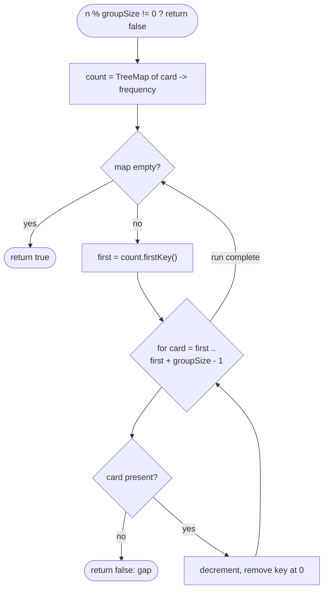

# LC 846 Hand of Straights

> [!abstract] In one sentence
> The smallest card still in hand can only be the first card of its run, so the greedy "take the minimum, consume `groupSize` consecutive values, repeat" never guesses — a `TreeMap<Integer, Integer>` of counts supplies the minimum and the lookups.

**Map:** [[NeetCode 150 MOC]] → [[DSA Dashboard]] · Pattern: [[Greedy]]

> [!question] Predict before you read
> Why is "the smallest remaining card starts a group" forced rather than merely convenient — what other group could it belong to?

## Problem

Given `hand` (integers) and `groupSize`, decide whether the whole hand can be split into groups of exactly `groupSize` cards whose values are consecutive (`v, v+1, …, v+groupSize−1`). Every card must be used once.

- `hand = [1, 2, 3, 6, 2, 3, 4, 7, 8]`, `groupSize = 3` → `true` (`[1,2,3] [2,3,4] [6,7,8]`)
- `hand = [1, 2, 3, 4, 5]`, `groupSize = 4` → `false` (5 cards cannot form groups of 4)

Constraints that matter: `1 ≤ n ≤ 10⁴`, values up to `10⁹` (so no counting array), duplicates allowed, `groupSize ≤ n`.

## Clarifying questions

1. Must all cards be used? — Yes; so `n % groupSize != 0` is an immediate `false`.
2. Are duplicates possible, and can two groups share a value? — Yes, `[2,3,4]` and `[2,3,4]` can both exist if there are two of each.
3. Value range? — Up to `10⁹`, so count with a map, not an array.
4. `groupSize = 1`? — Always `true`.

## Brute force

Try to assign cards to groups by backtracking: exponential. Even "sort, then for each unused card try to build a run by linear search" is O(n²). The waste: there is never a real choice — the smallest unused card has exactly one legal role.

## The key insight

A run is `v … v+groupSize−1`; the smallest card in hand cannot be anything but the `v` of its run, because every other position would require a smaller card. So: pick the minimum, demand `min+1, …, min+groupSize−1` exist, remove all of them, repeat. If any value is missing, no arrangement at all works. The data structure question is "give me the current minimum and let me decrement arbitrary keys" → an ordered map of counts. Recognition cue: "partition into consecutive runs / sequences of fixed length" → smallest-first greedy with counts.

## Optimal approach

1. If `n % groupSize != 0` return `false`.
2. Build `TreeMap<Integer, Integer> count`.
3. While the map is not empty: `first = count.firstKey()`; for `card = first … first+groupSize−1`: if `card` is absent return `false`; decrement it and remove the key when its count hits 0.
4. Return `true`.



> [!example]- Excalidraw version — the same diagram as an editable canvas
> ![[LC 846 Hand of Straights — Optimal approach.excalidraw]]
> [[LC 846 Hand of Straights — Optimal approach.excalidraw|Open in Excalidraw]] — needs the Excalidraw plugin (see [[Plugins to Install]]).

## Walkthrough

`hand = [1, 2, 3, 6, 2, 3, 4, 7, 8]`, `groupSize = 3`; counts `{1:1, 2:2, 3:2, 4:1, 6:1, 7:1, 8:1}`

| round | firstKey | consume | map after |
|---|---|---|---|
| 1 | 1 | 1, 2, 3 | `{2:1, 3:1, 4:1, 6:1, 7:1, 8:1}` |
| 2 | 2 | 2, 3, 4 | `{6:1, 7:1, 8:1}` |
| 3 | 6 | 6, 7, 8 | `{}` → `true` |

With `hand = [1, 2, 3, 3, 4, 5]` and `groupSize = 3`: round 1 consumes 1, 2, 3; round 2 starts at 3 and needs 4, 5 — fine, `true`. With `[1, 2, 4, 5, 6, 7]`: round 1 starts at 1, needs 3 → absent → `false`.

> [!example] Sorted hand; each round consumes the smallest remaining card and its two successors
> ![[LC 846 Hand of Straights — Sorted hand; each round consumes the smallest remaining card and its two successors.excalidraw]]
> [[LC 846 Hand of Straights — Sorted hand; each round consumes the smallest remaining card and its two successors.excalidraw|Open in Excalidraw]] — amber = the first run; the smallest card has no other place to go

%% excalidraw-spec
{"kind": "array", "title": "Sorted hand; each round consumes the smallest remaining card and its two successors", "values": [1, 2, 2, 3, 3, 4, 6, 7, 8], "highlight": [0, 1, 3], "labels": {"0": "round 1", "2": "round 2", "6": "round 3"}, "caption": "amber = the first run; the smallest card has no other place to go"}
%%

## Java solution

```java
import java.util.*;

class Solution {
    public boolean isNStraightHand(int[] hand, int groupSize) {
        if (hand.length % groupSize != 0) return false;
        TreeMap<Integer, Integer> count = new TreeMap<>();
        for (int card : hand) count.merge(card, 1, Integer::sum);

        while (!count.isEmpty()) {
            int first = count.firstKey();                        // smallest card must start a run
            for (int card = first; card < first + groupSize; card++) {
                Integer c = count.get(card);
                if (c == null) return false;                     // gap in the run
                if (c == 1) count.remove(card);                  // keep firstKey() honest
                else count.put(card, c - 1);
            }
        }
        return true;
    }
}
```

**Time** O(n log n) (each card is removed once, each map operation is O(log n)) · **Space** O(n)

## Why it works

Exchange argument: take any valid partition and look at the group containing the current minimum `m`. Since `m` is the smallest card left, it must be that group's first value, so the group is exactly `m … m+groupSize−1` — the same group the greedy forms (the specific copies of duplicate values are interchangeable). Removing it leaves a smaller instance where the same argument applies. Therefore if any valid partition exists, the greedy finds one, and if the greedy hits a gap, no partition exists. The `n % groupSize` check is only a fast exit; the loop would also fail on a leftover.

## Edge cases

- `groupSize = 1`: every run is a single card; `true` immediately through the loop.
- `n % groupSize != 0`: `false` before touching the map.
- Duplicates that need two parallel runs (`[1,1,2,2,3,3]`, size 3): round 1 and round 2 both start at 1; `true`.
- Values near `10⁹`: `first + groupSize` is at most `10⁹ + 10⁴`, no overflow.
- A card that can only ever be a run's end (e.g. `[1,2,3,4]`, size 2 → `[1,2] [3,4]`): handled, since 3 becomes the minimum after the first round.

## Common mistakes

> [!warning] What goes wrong
> - Leaving keys with count 0 in the `TreeMap`: `firstKey()` then returns a card you no longer have, and the loop either spins or reports a false gap.
> - Using a `HashMap` and calling `Collections.min` on the key set every round: O(n²).
> - Comparing boxed counts with `==` (`count.get(a) == count.get(b)`) — fine for small values thanks to the Integer cache, wrong above 127; see [[Java Pitfalls in Interviews]].
> - Starting runs from an arbitrary card instead of the minimum; `[1, 2, 2, 3, 3, 4]` with size 3 then fails depending on order.

## Variants & follow-ups

- Sort + `HashMap` instead of a `TreeMap`: iterate the sorted hand, and whenever a card still has count `c > 0`, subtract `c` from each of the next `groupSize` values at once. Same O(n log n), avoids the ordered map:

```java
// snippet
Arrays.sort(hand);
Map<Integer, Integer> cnt = new HashMap<>();
for (int c : hand) cnt.merge(c, 1, Integer::sum);
for (int c : hand) {
    int need = cnt.getOrDefault(c, 0);
    if (need == 0) continue;                       // already consumed by an earlier run
    for (int v = c; v < c + groupSize; v++) {
        if (cnt.getOrDefault(v, 0) < need) return false;
        cnt.put(v, cnt.get(v) - need);             // start `need` runs at c in one go
    }
}
return true;
```

- LC 1296 Divide Array in Sets of K Consecutive Numbers is this problem verbatim.
- LC 659 Split Array into Consecutive Subsequences (runs of length ≥ 3, any length) changes the greedy: prefer extending an existing run over starting a new one, which needs a second map of "runs ending at v".
- Related "forced choice" greedy with counts: [[LC 347 Top K Frequent Elements]] uses counts the other way round (frequency buckets).

## Interview script

Restate: "split the hand into runs of `groupSize` consecutive values, every card used." Brute force: "backtracking over assignments." Insight: "the smallest remaining card is forced to start a run, so there is no search." Approach: "`TreeMap` of counts; take `firstKey`, consume the run, remove zeros; repeat." Complexity: "O(n log n), O(n)." Tests: `n % groupSize != 0`, duplicates needing parallel runs, `groupSize = 1`, a gap. If asked to avoid the `TreeMap`, give the sort-and-`HashMap` version.

## Related

- Pattern: [[Greedy]] (forced-choice / smallest-first shape) · counting in [[Hashing]] · [[Sorting]] as preprocessing
- Neighbours in the list: [[LC 134 Gas Station]], [[LC 1899 Merge Triplets to Form Target Triplet]]
- Counting with maps: [[LC 347 Top K Frequent Elements]]
- Java: [[Java Collections Cheat Sheet]] (`TreeMap.firstKey`, `merge`, `getOrDefault`), [[Java Pitfalls in Interviews]] (boxed `Integer` comparison)

## Attempt log

| Date | Result | Minutes | What I got wrong |
|---|---|---|---|
| | | | |

### Mastery checklist
- [ ] Solved without hints in under 25 minutes
- [ ] Stated complexity before coding
- [ ] Handled every edge case above
- [ ] Code compiled first time
- [ ] Can do the follow-up variant

## Open questions
- [ ] In LC 659 the greedy must prefer extending a run; construct a hand where "always start a new run of minimum length" fails there but succeeds here, and explain which assumption of the exchange argument breaks.
