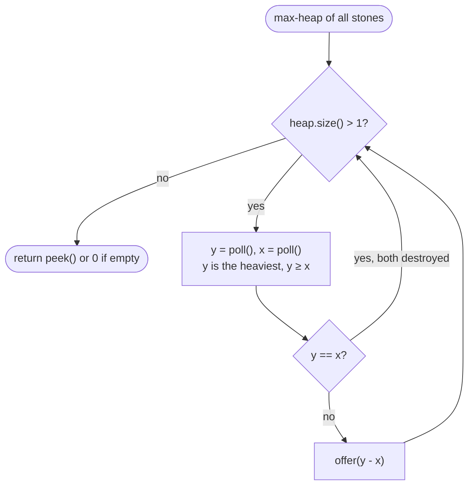

# LC 1046 Last Stone Weight

> [!abstract] In one sentence
> The process is fixed — always the two heaviest stones — so there is nothing to optimise, only to simulate efficiently, and "repeatedly give me the current maximum, then let me insert a new value" is the definition of a max-heap: two `poll`s and at most one `offer` per round, O(log n) each, until one or zero stones remain.

**Map:** [[NeetCode 150 MOC]] → [[DSA Dashboard]] · Pattern: [[Heaps & Priority Queues]]

> [!question] Predict before you read
> `n ≤ 30`, so sorting the array on every round would pass easily — why does the interviewer still want the heap, and what does `new PriorityQueue<Integer>()` give you if you forget the comparator?

## Problem

You have stones with positive integer weights. Each turn, take the two heaviest stones `x ≤ y` and smash them: if `x == y` both are destroyed; otherwise the stone of weight `y − x` goes back and `x` is destroyed. Return the weight of the last stone, or 0 if none remain.

Example: `[2, 7, 4, 1, 8, 1]` → 1 (8 and 7 → 1; 4 and 2 → 2; 2 and 1 → 1; 1 and 1 → gone; one stone of weight 1 remains). `[1]` → 1.

Constraints that matter: 1..30 stones, weights 1..1000 — tiny, so the point of the question is choosing the structure that matches the operations, not squeezing performance.

## Clarifying questions

1. Is there any choice in which stones to smash? — No; always the two heaviest, so the result is deterministic (contrast LC 1049, where you choose and it becomes a DP).
2. What if only one stone exists at the start? — Return its weight.
3. What is returned when every stone is destroyed? — 0.
4. Can the pushed-back stone be heavier than the other remaining stones? — Yes; that is why you cannot just walk a sorted array from the top.

## Brute force

Sort descending, smash the first two, insert the difference in sorted position, repeat: O(n) per round with a re-sort or a shifting insert, O(n²) or O(n² log n) in total. It passes at n = 30. The waste is re-establishing the order of all stones when only one value changed, and that waste is the structural reason the heap exists.

## The key insight

Each round needs the maximum, then the next maximum, then an insert — three operations a binary heap provides in O(log n), and nothing else is ever needed (no search, no iteration). Recognition cue: "repeatedly take the largest / smallest items, combine them, and put the result back" → heap simulation; the same shape is Huffman coding, [[LC 23 Merge k Sorted Lists]] and [[LC 621 Task Scheduler]].

## Optimal approach

1. Build a max-heap from all stones: `new PriorityQueue<>(Collections.reverseOrder())`.
2. While the heap has at least two stones: `y = poll()`, `x = poll()` (so `y ≥ x`); if `y != x` offer `y − x`.
3. Return `peek()` if a stone remains, else 0.



> [!example]- Excalidraw version — the same diagram as an editable canvas
> ![[LC 1046 Last Stone Weight — Optimal approach.excalidraw]]
> [[LC 1046 Last Stone Weight — Optimal approach.excalidraw|Open in Excalidraw]] — needs the Excalidraw plugin (see [[Plugins to Install]]).

## Walkthrough

`[2, 7, 4, 1, 8, 1]`.

| Round | Heap (sorted view) | y, x | Pushed back | Stones left |
|---|---|---|---|---|
| 1 | 8, 7, 4, 2, 1, 1 | 8, 7 | 1 | 4, 2, 1, 1, 1 |
| 2 | 4, 2, 1, 1, 1 | 4, 2 | 2 | 2, 1, 1, 1 |
| 3 | 2, 1, 1, 1 | 2, 1 | 1 | 1, 1, 1 |
| 4 | 1, 1, 1 | 1, 1 | — | 1 |
| end | 1 | — | — | return 1 |

The heap's actual array after offering the six stones one by one is `[8, 7, 4, 1, 2, 1]` — a valid max-heap even though siblings are not sorted:

> [!example] Max-heap after offering 2, 7, 4, 1, 8, 1
> ![[LC 1046 Last Stone Weight — Max-heap after offering 2, 7, 4, 1, 8, 1.excalidraw]]
> [[LC 1046 Last Stone Weight — Max-heap after offering 2, 7, 4, 1, 8, 1.excalidraw|Open in Excalidraw]] — poll() returns 8, then after sifting, 7; only the parent ≥ child property is guaranteed, not a sorted order

%% excalidraw-spec
{"kind": "tree", "title": "Max-heap after offering 2, 7, 4, 1, 8, 1", "levels": [8, 7, 4, 1, 2, 1], "highlight": [0, 1], "caption": "poll() returns 8, then after sifting, 7; only the parent ≥ child property is guaranteed, not a sorted order"}
%%

## Java solution

```java
import java.util.*;

class Solution {
    public int lastStoneWeight(int[] stones) {
        PriorityQueue<Integer> heap = new PriorityQueue<>(Collections.reverseOrder()); // max-heap
        for (int s : stones) heap.offer(s);
        while (heap.size() > 1) {
            int y = heap.poll();                  // heaviest
            int x = heap.poll();                  // second heaviest, x <= y
            if (y != x) heap.offer(y - x);        // equal stones vanish; otherwise the remainder returns
        }
        return heap.isEmpty() ? 0 : heap.peek();
    }
}
```

**Time** O(n log n) — at most n − 1 rounds, each with two polls and one offer in O(log n) · **Space** O(n) for the heap.

## Why it works

The problem statement is an algorithm; the only question is whether the simulation is faithful. A max-heap's `poll` returns the current maximum, and after it is removed the next `poll` returns the maximum of what is left, so `y` and `x` are exactly the two heaviest stones with `y ≥ x`. Offering `y − x` restores the heap property in O(log n). Every round removes at least one stone (two if equal), so the loop ends after at most n − 1 rounds with zero or one stone, and `peek` or 0 reports it.

## Edge cases

- One stone → the loop never runs; return that stone.
- Two equal stones → both destroyed; heap empty → 0.
- All stones equal, odd count (`[3, 3, 3]`) → pairs vanish, one survives → 3.
- Pushed-back stone becomes the new heaviest (`[10, 4, 4]` → 10 and 4 → 6; 6 and 4 → 2) — the heap handles it; a sorted-array walk would not.
- Weights all 1 → the answer is `n % 2`.

## Common mistakes

> [!warning] Pitfalls
> - Forgetting the comparator: `new PriorityQueue<Integer>()` is a *min*-heap, so you smash the two lightest stones.
> - Calling `peek()` on an empty heap at the end and unboxing the `null` → `NullPointerException`; check `isEmpty()` first.
> - Writing the comparator as `(a, b) -> b - a` out of habit — safe here (weights ≤ 1000) but it overflows for values near `Integer.MAX_VALUE`; `Collections.reverseOrder()` or `Integer.compare(b, a)` is the reflex to build.
> - Offering `y − x` even when it is 0: the result is still right (a zero stone never changes a smash), but it wastes rounds and confuses the trace.
> - Looping `while (!heap.isEmpty())` and polling twice — the second `poll` on a one-element heap returns `null`.

## Variants & follow-ups

- Last Stone Weight II (LC 1049): you *choose* which two to smash to minimise the final weight — a subset-sum DP, nothing to do with heaps; recognise the switch from "fixed rule" to "choice".
- Huffman coding: repeatedly merge the two *smallest* weights — the same loop with a min-heap and a sum instead of a difference.
- Halve the largest k times (LC 2530 / LC 1962): same max-heap loop with a different update.
- Stones arriving as a stream: the heap already supports interleaved `offer` calls; no change.
- Tiny value range (weights ≤ 1000): a counting array plus a pointer from the top also works in O(n + maxWeight); worth mentioning, not worth coding.

## Interview script

Restate: "Repeatedly smash the two heaviest stones; equal ones vanish, otherwise the difference returns; report the last stone or 0." Brute force: "Sort every round — O(n² log n); fine for 30 stones but it reorders everything for one change." Insight: "Each round is extract-max, extract-max, insert — a max-heap's native operations." Approach: "Build a max-heap with a reversed comparator, loop while size is at least 2, poll twice, offer the difference when non-zero, return the remaining root or 0." Complexity: "O(n log n) time, O(n) space." Tests: "The LeetCode example, a single stone, two equal stones, a case where the remainder becomes the heaviest."

## Related

- Pattern: [[Heaps & Priority Queues]] (heap simulation, Java's min-heap default)
- Same loop shape with different rules: [[LC 23 Merge k Sorted Lists]], [[LC 621 Task Scheduler]]
- Bounded heaps instead of full simulation: [[LC 703 Kth Largest Element in a Stream]], [[LC 215 Kth Largest Element in an Array]]
- Java refresher: [[Java Collections Cheat Sheet]] (`Collections.reverseOrder()`, `PriorityQueue.offer/poll/peek`, unboxing `null`), [[DSA Patterns in Java]] (heap templates)

## Attempt log

| Date | Result | Minutes | What I got wrong |
|---|---|---|---|
| | | | |

### Mastery checklist
- [ ] Solved without hints in under 25 minutes
- [ ] Stated complexity before coding
- [ ] Handled every edge case above
- [ ] Code compiled first time
- [ ] Can do the follow-up variant

## Open questions
- [ ]
