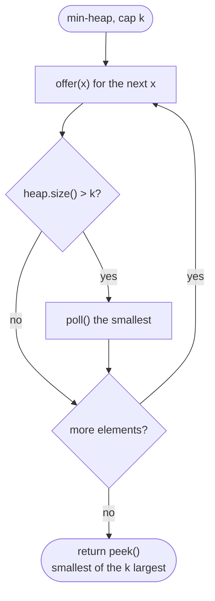

# LC 215 Kth Largest Element in an Array

> [!abstract] In one sentence
> Sorting answers the question in O(n log n) but computes far more order than you need; a min-heap capped at k carries exactly the k largest through one pass and leaves the kth largest at its root in O(n log k), and quickselect — one partition step of quicksort, then recurse into the side holding index n − k — brings the expected cost to O(n) at the price of reordering the input.

**Map:** [[NeetCode 150 MOC]] → [[DSA Dashboard]] · Pattern: [[Heaps & Priority Queues]]

> [!question] Predict before you read
> The kth largest sits at which index of the ascending sorted array, and why does quickselect with a fixed pivot (always the last element) degrade to O(n²) on an input LeetCode actually tests?

## Problem

Given an unsorted integer array and `k`, return the kth largest element in sorted order (duplicates count as separate elements, so it is not the kth distinct value). The follow-up asks for a solution that does not fully sort the array.

Example: `[3, 2, 1, 5, 6, 4]`, `k = 2` → 5. `[3, 2, 3, 1, 2, 4, 5, 5, 6]`, `k = 4` → 4.

Constraints that matter: `n ≤ 10⁵`, `1 ≤ k ≤ n`, values in −10⁴..10⁴ — large enough that O(n²) worst cases fail (there are all-equal and sorted test inputs), and the value range is small enough that a counting approach is also legal.

## Clarifying questions

1. Distinct or not? — Not distinct; `[5, 5, 4]` with `k = 2` gives 5.
2. May I reorder the input array? — Needed for quickselect; if not, work on a copy (O(n) extra space) or use the heap.
3. Is `k` always valid (`1..n`)? — Yes.
4. Is the value range small? — −10⁴..10⁴; a counting array of size 2·10⁴ + 1 is a legitimate O(n + range) alternative worth naming.

## Brute force

`Arrays.sort(nums)` and return `nums[n − k]`: O(n log n) time, in place. It is acceptable as the first answer and a fine fallback. The waste: the sort establishes the relative order of every pair of elements, while the question only asks where one boundary lies.

## The key insight

Two ways to avoid total order. **Bounded heap:** stream the elements through a min-heap capped at k; anything that falls out can never be the kth largest again, and the root at the end is the smallest of the k largest — the same mechanism as [[LC 703 Kth Largest Element in a Stream]]. **Quickselect:** a quicksort partition puts the pivot at its final sorted index `p`; if `p == n − k` you are done, otherwise only one side can contain the target, so recurse into that side alone — the geometric series n + n/2 + n/4 + … gives O(n) expected with random pivots. Recognition cue: "kth largest/smallest", "order statistic", "top k" → heap for simplicity and streams, quickselect for the O(n) follow-up.

## Optimal approach

1. `heap` = `PriorityQueue<Integer>` (min-heap).
2. For each `x`: `offer(x)`; if `size > k` then `poll()`.
3. Return `peek()`.



> [!example]- Excalidraw version — the same diagram as an editable canvas
> ![[LC 215 Kth Largest Element in an Array — Optimal approach.excalidraw]]
> [[LC 215 Kth Largest Element in an Array — Optimal approach.excalidraw|Open in Excalidraw]] — needs the Excalidraw plugin (see [[Plugins to Install]]).

## Walkthrough

Heap pass on `[3, 2, 1, 5, 6, 4]`, `k = 2`:

| x | After offer | Size > 2? | Popped | Heap |
|---|---|---|---|---|
| 3 | {3} | no | — | {3} |
| 2 | {2, 3} | no | — | {2, 3} |
| 1 | {1, 2, 3} | yes | 1 | {2, 3} |
| 5 | {2, 3, 5} | yes | 2 | {3, 5} |
| 6 | {3, 5, 6} | yes | 3 | {5, 6} |
| 4 | {4, 5, 6} | yes | 4 | {5, 6} |

`peek()` → 5. Quickselect on the same input, target index `n − k = 4`, Lomuto partition with the last element as pivot for readability:

> [!example] After partitioning [3,2,1,5,6,4] around pivot 4
> ![[LC 215 Kth Largest Element in an Array — After partitioning -3,2,1,5,6,4- around pivot 4.excalidraw]]
> [[LC 215 Kth Largest Element in an Array — After partitioning -3,2,1,5,6,4- around pivot 4.excalidraw|Open in Excalidraw]] — everything left of index 3 is < 4, everything right is ≥ 4; p < target, so only [6, 5] is searched next and its partition lands on index 4 with value 5

%% excalidraw-spec
{"kind": "array", "title": "After partitioning [3,2,1,5,6,4] around pivot 4", "values": [3, 2, 1, 4, 6, 5], "pointers": {"p": 3, "target": 4}, "highlight": [3], "caption": "everything left of index 3 is < 4, everything right is ≥ 4; p < target, so only [6, 5] is searched next and its partition lands on index 4 with value 5"}
%%

## Java solution

```java
import java.util.*;

class Solution {
    public int findKthLargest(int[] nums, int k) {
        PriorityQueue<Integer> heap = new PriorityQueue<>();   // min-heap holding the k largest so far
        for (int x : nums) {
            heap.offer(x);
            if (heap.size() > k) heap.poll();                  // the smallest of k+1 can never be the answer
        }
        return heap.peek();                                    // smallest of the k largest
    }
}
```

**Time** O(n log k) · **Space** O(k).

Quickselect for the O(n) average follow-up — shuffle first (or pick random pivots) so sorted and all-equal inputs do not degrade:

```java
// snippet
int findKthLargest(int[] a, int k) {
    int target = a.length - k, lo = 0, hi = a.length - 1;   // index of the answer in ascending order
    Random rnd = new Random();
    while (lo < hi) {
        swap(a, hi, lo + rnd.nextInt(hi - lo + 1));           // random pivot moved to the end
        int p = partition(a, lo, hi);
        if (p == target) return a[p];
        if (p < target) lo = p + 1; else hi = p - 1;          // only one side can hold the target
    }
    return a[lo];
}
int partition(int[] a, int lo, int hi) {                      // Lomuto: pivot = a[hi]
    int pivot = a[hi], store = lo;
    for (int i = lo; i < hi; i++) if (a[i] < pivot) swap(a, i, store++);
    swap(a, store, hi);                                       // a[lo..store-1] < pivot <= a[store+1..hi]
    return store;
}
```

## Why it works

Heap: after each element, the heap holds the k largest seen so far — the element polled is always the smallest of k + 1 candidates, which cannot be among the k largest, and nothing that leaves can return because the kth largest only increases as more elements arrive. The min-heap root is the minimum of the final k largest, i.e. the kth largest. Quickselect: after `partition`, `a[p]` is in its final sorted position with smaller elements to its left and greater-or-equal to its right, so the element of rank `target` is at `p` or strictly on one side; discarding the other side preserves the answer, and with random pivots the expected remaining size halves each round, giving expected linear total work.

## Edge cases

- `k = 1` → the maximum; the heap holds one element.
- `k = n` → the minimum; the heap holds everything and the root is the smallest.
- All elements equal → heap returns that value; Lomuto quickselect with `<` puts every element on the right of the pivot, so without randomisation the input `[1, 1, 1, …]` costs O(n²) (a known LeetCode test).
- `n = 1` → `k = 1`; the loop runs once.
- Negative values → the heap compares naturally; the counting-array variant needs an offset of 10⁴.

## Common mistakes

> [!warning] Pitfalls
> - A max-heap with k polls: correct, but O(n + k log n) with O(n) space — no better than sorting when k is large, and it misses the "cap at k" idea.
> - Off-by-one in the target index: the kth largest is at ascending index `n − k`, the kth smallest at `k − 1`.
> - Quickselect with a fixed pivot on sorted, reversed or all-equal input → O(n²) and a time-limit failure on LeetCode's tests; randomise the pivot or shuffle once.
> - Lomuto with `<=` instead of `<` (or vice versa) changes which side duplicates go to; either is correct for selection as long as the pivot ends at `store`, but all-equal inputs still degrade without a three-way partition.
> - Modifying the caller's array during quickselect without saying so.
> - Reaching for `nums[nums.length - k]` after `Arrays.sort` and calling it O(n) — it is O(n log n).

## Variants & follow-ups

- Kth smallest → max-heap capped at k, or quickselect with target `k − 1`.
- Return the k largest elements (unordered) → the heap's contents at the end; ordered → poll them out.
- Kth largest in a stream → [[LC 703 Kth Largest Element in a Stream]] (the same heap kept alive).
- Kth by a derived key → [[LC 973 K Closest Points to Origin]], [[LC 347 Top K Frequent Elements]].
- Kth smallest in a BST → in-order traversal with a counter: [[LC 230 Kth Smallest Element in a BST]].
- Guaranteed O(n) worst case → median-of-medians pivot selection; name it, do not code it.
- Small value range → counting array: O(n + range) time, walk down from the top subtracting counts until k is exhausted.

## Interview script

Restate: "Unsorted array, return the kth largest counting duplicates; ideally without sorting everything." Brute force: "Sort and index `n − k`, O(n log n)." Insight: "I only need the k largest, so a min-heap capped at k carries them and its root is the answer; and if O(n) is wanted, quickselect partitions around a pivot and discards the half that cannot contain index `n − k`." Approach: "One pass of offer-then-poll-if-oversize, return the root. For quickselect: random pivot, Lomuto partition, loop on the side containing the target." Complexity: "O(n log k) time and O(k) space for the heap; O(n) expected, O(n²) worst, in place for quickselect." Tests: "k = 1 and k = n, all-equal input, duplicates around the boundary, negative values, and the two LeetCode examples."

## Related

- Pattern: [[Heaps & Priority Queues]] (bounded top-k) · partition and quickselect: [[Sorting]]
- Same mechanism: [[LC 703 Kth Largest Element in a Stream]], [[LC 973 K Closest Points to Origin]], [[LC 347 Top K Frequent Elements]]
- Order statistics on a tree: [[LC 230 Kth Smallest Element in a BST]]
- Java refresher: [[Java Collections Cheat Sheet]] (`PriorityQueue` defaults, `Arrays.sort` on `int[]`, `Random.nextInt`), [[DSA Patterns in Java]] (heap top-k template, partition template)

## Attempt log

| Date | Result | Minutes | What I got wrong |
|---|---|---|---|
| | | | |

### Mastery checklist
- [ ] Solved without hints in under 25 minutes
- [ ] Stated complexity before coding
- [ ] Handled every edge case above
- [ ] Code compiled first time
- [ ] Can do the follow-up variant

## Open questions
- [ ]
