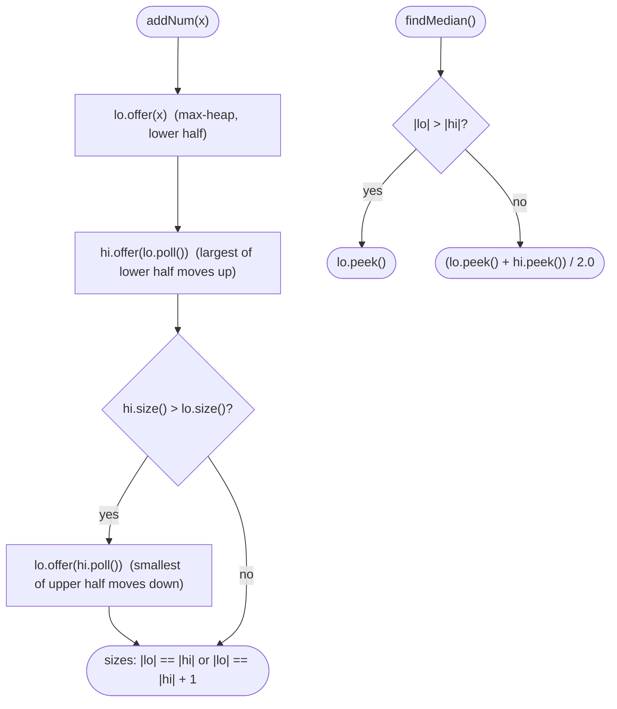

# LC 295 Find Median from Data Stream

> [!abstract] In one sentence
> You do not need the numbers sorted, only the boundary between the lower half and the upper half: a max-heap of the lower half and a min-heap of the upper half expose exactly that boundary at their tops, and rebalancing one element across the boundary after each insert keeps the sizes within one of each other.

**Map:** [[NeetCode 150 MOC]] → [[DSA Dashboard]] · Pattern: [[Heaps & Priority Queues]]

> [!question] Predict before you read
> After inserting `5, 2, 8, 1`, the lower half is `{1, 2}` and the upper half is `{5, 8}`. Which single value from each half do you need to compute the median, and which heap type makes each of those values O(1) to read?

## Problem

Design `MedianFinder` with `addNum(int num)` and `double findMedian()`. The median of a sorted list is the middle element (odd length) or the mean of the two middle elements (even length).

- `addNum(1)`, `addNum(2)`, `findMedian()` → `1.5`; `addNum(3)`, `findMedian()` → `2.0`.

Constraints that matter: up to `5·10⁴` calls, values in `[−10⁵, 10⁵]`; `findMedian` is only called after at least one `addNum`. Follow-ups ask about values limited to `[0, 100]` and about 99% of values in that range.

## Clarifying questions

1. Ratio of adds to reads? — Unknown; assume both frequent, so neither operation may be O(n).
2. Are values bounded? — The general problem says no; if bounded to `[0, 100]` a counting array wins (follow-up).
3. Can values repeat? — Yes; heaps handle duplicates naturally.
4. Memory: all `n` values must be kept? — Yes for the exact median; sketches (t-digest) are approximations.

## Brute force

Append to a list and sort on each `findMedian`: O(n log n) per read. Or keep the list sorted with binary-search insertion: O(log n) to find the spot but O(n) to shift elements. The waste: full order is maintained when only the middle matters.

## The key insight

Split the numbers into a lower half `L` and an upper half `U` with every element of `L` `<=` every element of `U`. The median needs only `max(L)` and `min(U)`. A max-heap gives `max(L)` in O(1), a min-heap gives `min(U)` in O(1), and each supports O(log n) insert. The only extra work is keeping `|L| == |U|` or `|L| == |U| + 1`: push the new number into `L`, move `L`'s max to `U` (this guarantees the ordering between halves), and if `U` became larger, move `U`'s min back to `L`. Two pushes and at most two pops per insert, all O(log n).

## Optimal approach

1. `lo`: max-heap (`PriorityQueue` with reversed comparator) holding the lower half; `hi`: min-heap holding the upper half.
2. `addNum(x)`: `lo.offer(x)`; `hi.offer(lo.poll())` — the largest of the lower half crosses to the upper half, so `max(lo) <= min(hi)` always holds; if `hi.size() > lo.size()`, `lo.offer(hi.poll())`.
3. `findMedian()`: if `lo.size() > hi.size()` return `lo.peek()`; else `(lo.peek() + hi.peek()) / 2.0`.



> [!example]- Excalidraw version — the same diagram as an editable canvas
> ![[LC 295 Find Median from Data Stream — Optimal approach.excalidraw]]
> [[LC 295 Find Median from Data Stream — Optimal approach.excalidraw|Open in Excalidraw]] — needs the Excalidraw plugin (see [[Plugins to Install]]).

## Walkthrough

Insert `5, 2, 8, 1`:

| add | after `lo.offer` | after move up | after rebalance | lo (max-heap) | hi (min-heap) | median |
|---|---|---|---|---|---|---|
| 5 | lo {5} | lo {}, hi {5} | hi bigger → lo {5}, hi {} | {5} | {} | 5 |
| 2 | lo {5, 2} | lo {2}, hi {5} | sizes 1/1 | {2} | {5} | 3.5 |
| 8 | lo {8, 2} | lo {2}, hi {5, 8} | hi bigger → lo {5, 2}, hi {8} | {5, 2} | {8} | 5 |
| 1 | lo {5, 2, 1} | lo {2, 1}, hi {5, 8} | sizes 2/2 | {2, 1} | {5, 8} | 3.5 |

> [!example] Two heaps after inserting 5, 2, 8, 1: lower half as a max-heap, upper half as a min-heap
> ![[LC 295 Find Median from Data Stream — Two heaps after inserting 5, 2, 8, 1- lower half as a max-heap, upper half as a mi.excalidraw]]
> [[LC 295 Find Median from Data Stream — Two heaps after inserting 5, 2, 8, 1- lower half as a max-heap, upper half as a mi.excalidraw|Open in Excalidraw]] — only the two shaded boundary values matter: median = (2 + 5) / 2 = 3.5

%% excalidraw-spec
{"kind": "array", "title": "Two heaps after inserting 5, 2, 8, 1: lower half as a max-heap, upper half as a min-heap", "values": [1, 2, "|", 5, 8], "pointers": {"lo.peek": 1, "hi.peek": 3}, "highlight": [1, 3], "labels": {"0": "lo (max-heap)", "2": "boundary", "4": "hi (min-heap)"}, "caption": "only the two shaded boundary values matter: median = (2 + 5) / 2 = 3.5"}
%%

## Java solution

```java
import java.util.*;

class MedianFinder {
    private final PriorityQueue<Integer> lo = new PriorityQueue<>(Collections.reverseOrder()); // lower half, max on top
    private final PriorityQueue<Integer> hi = new PriorityQueue<>();                           // upper half, min on top

    public MedianFinder() {}

    public void addNum(int num) {
        lo.offer(num);                 // 1. always enter through the lower half
        hi.offer(lo.poll());           // 2. its maximum crosses to the upper half: keeps max(lo) <= min(hi)
        if (hi.size() > lo.size()) {   // 3. lower half may be equal or one larger, never smaller
            lo.offer(hi.poll());
        }
    }

    public double findMedian() {
        if (lo.size() > hi.size()) return lo.peek();          // odd count: the extra element sits in lo
        return (lo.peek() + hi.peek()) / 2.0;                 // even count: average of the two boundary values
    }
}
```

**Time** `addNum` O(log n), `findMedian` O(1) · **Space** O(n)

Bounded-range follow-up (values in `[0, 100]`): a counting array and a walk to the middle:

```java
// snippet — values limited to [0, 100]: O(1) insert, O(100) median via prefix counts
int[] count = new int[101]; int n = 0;
void add(int x) { count[x]++; n++; }
double median() {
    int k1 = (n + 1) / 2, k2 = (n + 2) / 2, seen = 0, a = -1, b = -1;   // 1-based ranks of the middle(s)
    for (int v = 0; v <= 100; v++) {
        seen += count[v];
        if (a < 0 && seen >= k1) a = v;
        if (seen >= k2) { b = v; break; }
    }
    return (a + b) / 2.0;
}
```

## Why it works

Invariants after every `addNum`: (1) every element of `lo` is `<=` every element of `hi`; (2) `|lo| − |hi| ∈ {0, 1}`. Step 2 establishes (1): the new element enters `lo`, and whatever is now the largest of `lo` moves to `hi`, so afterwards `max(lo) <= min(hi)` whether the new element was small (it stays in `lo`, an old maximum moves) or large (it moves itself). Step 3 restores (2): after steps 1–2, `|hi|` grew by one, so either the sizes are equal, or `hi` is one larger and one pop-push fixes it; moving `min(hi)` to `lo` cannot break (1) because that element is `<=` everything left in `hi` and `>=` everything in `lo`. Given (1) and (2), the sorted order is `lo ∪ hi` with `lo` on the left, and the middle element(s) are the tops.

## Edge cases

- First insert: `lo` ends with one element, `hi` empty; `findMedian` returns it.
- All equal values: duplicates split across both heaps; median is that value.
- Strictly increasing or decreasing streams: every insert triggers both moves; still O(log n).
- Negative values: comparators handle them; no assumptions about sign.
- Even count with the two middle values far apart (`1`, `10⁵`): `/ 2.0` keeps the fractional `.5` — but `lo.peek() + hi.peek()` is an `int` sum; values are bounded by `10⁵` so no overflow, mention `long` if the range were larger.

## Common mistakes

> [!warning] What goes wrong
> - Building `lo` as a min-heap (the default `PriorityQueue`): `lo.peek()` is then the *smallest* of the lower half. Pass `Collections.reverseOrder()`.
> - Inserting directly into whichever heap "looks right" (`x < lo.peek() ? lo : hi`) without the cross-move: breaks invariant (1) when the chosen heap is empty, and needs extra balancing logic.
> - Allowing `hi` to be the larger heap and then returning `lo.peek()` for odd counts: the extra element is in `hi`. Pick a convention and keep it.
> - Integer division in the even case.
> - Using `PriorityQueue.remove(Object)` for deletions in the "sliding window median" variant: that is O(n); use lazy deletion.
> - Calling `findMedian` before any insert: the problem forbids it, but guard against `peek()` returning `null` if you reuse the class.

## Variants & follow-ups

- Values in `[0, 100]`: counting array, O(1) insert, O(100) read (snippet above).
- 99% of values in `[0, 100]`: counting array plus two small sorted structures for the outliers; the median almost always lands in the array.
- Sliding window median (LC 480): two heaps with lazy deletion and a removal map, or a `TreeMap` multiset.
- k-th largest in a stream: one heap suffices — [[LC 703 Kth Largest Element in a Stream]].
- Median of two sorted arrays: no stream, so a partition search — [[LC 4 Median of Two Sorted Arrays]].
- Percentiles at scale (p99 latency): approximate with t-digest / HdrHistogram; say why exactness is dropped.

## Interview script

Restate: "stream of integers; after any insert, report the median; many inserts and reads." Brute force: "sorted list with insertion, O(n) per insert." Insight: "the median only needs the boundary between the lower and upper halves; a max-heap for the lower half and a min-heap for the upper half expose both boundary values at their tops." Approach: "insert into the max-heap, move its top to the min-heap, rebalance if the min-heap got bigger; median is the max-heap top or the average of both tops." Complexity: "O(log n) insert, O(1) read, O(n) space." Tests: "first element, duplicates, monotone streams, even/odd counts." If they push: "bounded range → counting array; outliers → hybrid; sliding window → lazy deletion."

## Related

- Pattern: [[Heaps & Priority Queues]] (two heaps)
- Prerequisites: [[LC 703 Kth Largest Element in a Stream]] (one heap as a boundary keeper), [[LC 215 Kth Largest Element in an Array]]
- Siblings: [[LC 4 Median of Two Sorted Arrays]] (median without a stream), [[LC 1851 Minimum Interval to Include Each Query]] (heap with lazy deletion)
- Java: [[Java Collections Cheat Sheet]] (`PriorityQueue` comparator forms, `offer/poll/peek`), [[DSA Patterns in Java]] (two heaps template)

## Attempt log

| Date | Result | Minutes | What I got wrong |
|---|---|---|---|
| | | | |

### Mastery checklist
- [ ] Solved without hints in under 25 minutes
- [ ] Stated complexity before coding
- [ ] Handled every edge case above
- [ ] Code compiled first time
- [ ] Can do the follow-up variant

## Open questions
- [ ] Prove that the three-step insert never needs a third move. What would a two-step insert (choose heap by comparison, then rebalance) have to check?
- [ ] Design the sliding-window median with lazy deletion: what does "logical size" mean when stale elements sit in a heap?
