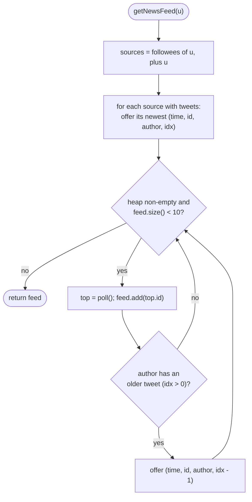

# LC 355 Design Twitter

> [!abstract] In one sentence
> Store follows as `Map<user, Set<user>>` and tweets as `Map<user, List<(time, id)>>` appended in order, stamp every tweet with a global counter so "newer" is a plain integer comparison, and build a feed by k-way merging the followees' lists through a max-heap on time — the heap holds one candidate per author, each pop yields the globally newest remaining tweet and pulls in that author's next one, and ten pops finish the feed without sorting anything.

**Map:** [[NeetCode 150 MOC]] → [[DSA Dashboard]] · Pattern: [[Heaps & Priority Queues]]

> [!question] Predict before you read
> Why must the heap entry carry the *index* of the tweet in its author's list and not just the tweet, and what goes wrong if you use `tweetId` itself as the timestamp?

## Problem

Design `Twitter` with `postTweet(userId, tweetId)`, `getNewsFeed(userId)` — the 10 most recent tweet ids posted by the user or by people they follow, newest first — `follow(followerId, followeeId)` and `unfollow(followerId, followeeId)`.

Example: `postTweet(1, 5)`; `getNewsFeed(1)` → `[5]`; `follow(1, 2)`; `postTweet(2, 6)`; `getNewsFeed(1)` → `[6, 5]`; `unfollow(1, 2)`; `getNewsFeed(1)` → `[5]`.

Constraints that matter: user and tweet ids up to 500, all tweet ids distinct, at most 3·10⁴ calls — small enough that a naive feed passes, but the question is a design question and the interviewer expects the merge.

## Clarifying questions

1. What defines "most recent"? — Order of `postTweet` calls; keep a global counter, since tweet ids carry no time meaning.
2. Does a user see their own tweets? — Yes, always, even if they never follow anyone.
3. What should `unfollow` do for someone not followed, or for yourself? — No-op; self-unfollow must not remove your own tweets from the feed.
4. How many tweets in a feed? — At most 10; fewer if fewer exist.
5. Can `follow` be called before either user has posted? — Yes; structures must be created lazily.

## Brute force

Keep one global list of `(time, user, tweet)`; on `getNewsFeed`, scan it from newest to oldest, keep tweets whose author is the user or a followee, stop at 10: O(total tweets) per feed, O(1) per post. LeetCode accepts it. The waste: every feed scans tweets by users you do not follow, and the cost grows with the whole site rather than with the people you follow.

## The key insight

Per-author lists are free to keep sorted — tweets are appended in time order — so a feed is a k-way merge of the followees' lists, truncated to 10 items. A max-heap seeded with each author's newest tweet always has the globally newest unseen tweet on top; after popping it, push the same author's next-older tweet. Ten pops cost O(10 log F) after an O(F log F) seed, where F is the number of followees. Recognition cue: "merge several already-sorted streams and take the top few" → one heap entry per stream, pop-and-refill, the mechanism of [[LC 23 Merge k Sorted Lists]].

## Optimal approach

1. State: `int clock`, `Map<Integer, Set<Integer>> follows`, `Map<Integer, List<int[]>> tweets` where each entry is `{time, tweetId}` in post order.
2. `postTweet`: `tweets.computeIfAbsent(user).add({clock++, tweetId})`.
3. `follow` / `unfollow`: add to or remove from `follows.computeIfAbsent(follower)`.
4. `getNewsFeed`: `sources = follows.get(user) ∪ {user}`. For each source with tweets, offer `{time, tweetId, author, index}` of its last tweet into a max-heap on `time`. While the heap is non-empty and the feed has fewer than 10 items: pop, append `tweetId`, and if `index − 1 ≥ 0` offer that author's previous tweet.



> [!example]- Excalidraw version — the same diagram as an editable canvas
> ![[LC 355 Design Twitter — Optimal approach.excalidraw]]
> [[LC 355 Design Twitter — Optimal approach.excalidraw|Open in Excalidraw]] — needs the Excalidraw plugin (see [[Plugins to Install]]).

## Walkthrough

`postTweet(1, 5)` at t0, `follow(1, 2)`, `postTweet(2, 6)` at t1, `postTweet(1, 7)` at t2, `postTweet(2, 8)` at t3. Lists: user 1 → `[(0, 5), (2, 7)]`, user 2 → `[(1, 6), (3, 8)]`. Now `getNewsFeed(1)`:

| Step | Heap (time: id, author, idx) | Popped | Feed | Pushed |
|---|---|---|---|---|
| seed | (2: 7, u1, 1), (3: 8, u2, 1) | — | [] | — |
| 1 | (3: 8, u2, 1), (2: 7, u1, 1) | 8 | [8] | (1: 6, u2, 0) |
| 2 | (2: 7, u1, 1), (1: 6, u2, 0) | 7 | [8, 7] | (0: 5, u1, 0) |
| 3 | (1: 6, u2, 0), (0: 5, u1, 0) | 6 | [8, 7, 6] | — (idx 0) |
| 4 | (0: 5, u1, 0) | 5 | [8, 7, 6, 5] | — |

Heap empty → return `[8, 7, 6, 5]`. After `unfollow(1, 2)` the seed contains only user 1's newest tweet and the feed is `[7, 5]`.

## Java solution

```java
import java.util.*;

class Twitter {
    private int clock = 0;                                          // larger = newer
    private final Map<Integer, Set<Integer>> follows = new HashMap<>();
    private final Map<Integer, List<int[]>> tweets = new HashMap<>(); // user -> [{time, tweetId}] in post order

    public Twitter() {}

    public void postTweet(int userId, int tweetId) {
        tweets.computeIfAbsent(userId, k -> new ArrayList<>()).add(new int[]{clock++, tweetId});
    }

    public List<Integer> getNewsFeed(int userId) {
        // entries: {time, tweetId, authorId, index in the author's list}; newest on top
        PriorityQueue<int[]> heap = new PriorityQueue<>((a, b) -> Integer.compare(b[0], a[0]));
        Set<Integer> sources = new HashSet<>(follows.getOrDefault(userId, Collections.emptySet()));
        sources.add(userId);                                        // own tweets always count
        for (int u : sources) {
            List<int[]> list = tweets.get(u);
            if (list == null || list.isEmpty()) continue;
            int i = list.size() - 1;
            heap.offer(new int[]{list.get(i)[0], list.get(i)[1], u, i});
        }
        List<Integer> feed = new ArrayList<>();
        while (!heap.isEmpty() && feed.size() < 10) {
            int[] top = heap.poll();
            feed.add(top[1]);
            int i = top[3] - 1;                                     // the author's next-older tweet
            if (i >= 0) {
                int[] t = tweets.get(top[2]).get(i);
                heap.offer(new int[]{t[0], t[1], top[2], i});
            }
        }
        return feed;
    }

    public void follow(int followerId, int followeeId) {
        follows.computeIfAbsent(followerId, k -> new HashSet<>()).add(followeeId);
    }

    public void unfollow(int followerId, int followeeId) {
        Set<Integer> s = follows.get(followerId);
        if (s != null) s.remove(followeeId);
    }
}
```

**Time** `postTweet`, `follow`, `unfollow` O(1) average; `getNewsFeed` O(F log F + 10 log F) for F followees · **Space** O(total tweets + total follow edges).

## Why it works

Each author's list is in strictly increasing time order because `clock` only grows and tweets are appended. Invariant of the merge: the heap contains, for every source author with unseen tweets, exactly that author's newest unseen tweet. Then the heap's maximum is the newest unseen tweet overall — any other unseen tweet is either in the heap (and older) or older than its author's heap entry. Popping it and pushing the author's next-older tweet restores the invariant, so the pops come out in decreasing time order, and stopping after ten yields the ten newest. Lazy map creation plus the `sources` set make self-follow and missing users harmless.

## Edge cases

- Feed for a user with no tweets and no followees → the seed loop adds nothing; empty list.
- Fewer than 10 tweets available → the loop ends when the heap empties; the feed is shorter.
- `follow(u, u)` → `sources` is a set, so the user appears once; `unfollow(u, u)` removes nothing relevant because `userId` is added to `sources` separately.
- `unfollow` of someone never followed, or by a user with no follow set → `s == null` or `remove` returns false; nothing breaks.
- Followee who never posted → `tweets.get(u)` is null; skipped.
- A user posts more than 10 tweets and follows nobody → the merge walks their own list from the end and stops at 10.

## Common mistakes

> [!warning] Pitfalls
> - Using `tweetId` as the time: ids are arbitrary, so a feed sorted by id is wrong whenever a smaller id is posted later.
> - Forgetting to include the user's own tweets in the feed.
> - Storing tweets in a `LinkedList` and calling `get(i)` — O(n) per access turns the merge quadratic; `ArrayList` gives O(1) index access.
> - Re-reading the author's list from the front (`get(0)`) instead of walking backwards from the end — the merge then returns oldest first.
> - Comparator `(a, b) -> b[0] - a[0]`: safe for small counters but the subtraction habit overflows elsewhere; `Integer.compare(b[0], a[0])`.
> - Calling `follows.get(userId)` and iterating it without a null guard for users who never followed anyone.
> - Letting `unfollow(u, u)` hide the user's own tweets by storing the user inside their own follow set as the only source.

## Variants & follow-ups

- Bound memory per user (keep only the last 10 tweets) — the feed never needs more than 10 per author, so a per-user `ArrayDeque` capped at 10 suffices.
- Pagination (`getNewsFeed(user, page)`) — keep the heap state as a cursor or pass the last-seen timestamp and skip entries newer than it.
- Celebrity accounts with millions of followers — fan-out on read (this solution) versus fan-out on write (precomputed inboxes); the hybrid is the standard answer, see *News Feed* in the HLD vault.
- Retweets and likes — a tweet becomes a record `{time, id, author, kind}`; the merge is unchanged.
- Thread safety — `ConcurrentHashMap`, an `AtomicInteger` clock, and copy-on-read for the follow set.
- Unfollow during feed generation — snapshot `sources` first, as the code does by copying the set.

## Interview script

Restate: "Four operations: post, follow, unfollow, and a feed of the 10 newest tweets from me and my followees, newest first." Brute force: "One global list scanned newest-to-oldest, filtered by followees — linear in all tweets ever posted." Insight: "Per-author lists are already sorted by a global counter, so a feed is a k-way merge of followee lists cut at 10: a max-heap seeded with each author's newest tweet, pop and refill." Approach: "`Map<user, Set<user>>` for follows, `Map<user, List<{time, id}>>` for tweets, a heap entry of time, id, author and index; seed, pop ten times, push the author's next-older tweet after each pop." Complexity: "O(1) for post/follow/unfollow, O(F log F) per feed where F is the followee count." Tests: "The LeetCode sequence, a user who follows nobody, self-follow and self-unfollow, a followee with no tweets, more than 10 tweets from one author."

## Related

- Pattern: [[Heaps & Priority Queues]] (k-way merge) · the merge on linked lists: [[LC 23 Merge k Sorted Lists]]
- Other design questions built from maps: [[LC 146 LRU Cache]] · the map mechanics: [[Hashing]]
- Heap plus queue simulation: [[LC 621 Task Scheduler]]
- Java refresher: [[Java Collections Cheat Sheet]] (`computeIfAbsent`, `getOrDefault`, `Collections.emptySet`, `PriorityQueue` with a lambda comparator, `int[]` as a tuple), [[DSA Patterns in Java]] (k-way merge template)

## Attempt log

| Date | Result | Minutes | What I got wrong |
|---|---|---|---|
| | | | |

### Mastery checklist
- [ ] Solved without hints in under 25 minutes
- [ ] Stated complexity before coding
- [ ] Handled every edge case above
- [ ] Code compiled first time
- [ ] Can do the follow-up variant

## Open questions
- [ ]
