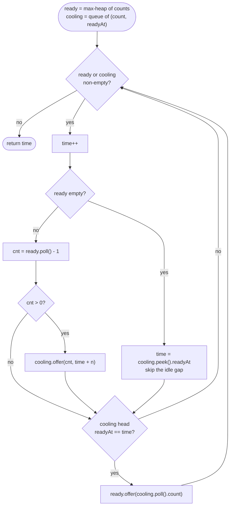

# LC 621 Task Scheduler

> [!abstract] In one sentence
> Tasks are interchangeable within a letter, so the whole input collapses to 26 counts; the schedule is tight when the most frequent letter is spread out as evenly as the cooldown allows and everything else fills the gaps, which the greedy "always run the ready task with the most left" achieves — implemented as a max-heap of remaining counts plus a queue of (count, time it becomes ready) that skips idle stretches, or computed directly as `max(T, (max − 1)·(n + 1) + ties)`.

**Map:** [[NeetCode 150 MOC]] → [[DSA Dashboard]] · Pattern: [[Heaps & Priority Queues]]

> [!question] Predict before you read
> For `AAABBB` with `n = 2`, why is the answer 8 and not 6, and what single change to the input would make the answer drop to exactly `tasks.length` with the same `n`?

## Problem

You are given tasks as uppercase letters and a cooldown `n`: two identical tasks must be at least `n` intervals apart. Each interval runs one task or idles. Tasks may be executed in any order. Return the minimum number of intervals to finish everything.

Example: `tasks = [A, A, A, B, B, B]`, `n = 2` → 8 (`A B idle A B idle A B`). Same tasks with `n = 0` → 6. `tasks = [A, A, A, B, B, B]`, `n = 3` → 10 (`A B idle idle A B idle idle A B`).

Constraints that matter: up to 10⁴ tasks, `n ≤ 100`, letters `A`–`Z` only — so a count array of 26 suffices and a tick-by-tick simulation (≤ 10⁴ · 101 ticks) is affordable, but the clean solutions are far smaller than that.

## Clarifying questions

1. Can I reorder tasks freely? — Yes; only the multiset of letters matters.
2. Does the cooldown apply across different letters? — No; only identical tasks need `n` intervals between them.
3. Is the answer the number of intervals including idles, not the schedule itself? — The count; the simulation can produce the schedule if asked.
4. What does `n = 0` mean? — No constraint; the answer is `tasks.length`.
5. Does the schedule end as soon as the last task runs (no trailing idle)? — Yes.

## Brute force

Simulate tick by tick: at each interval scan all 26 letters for the one with the most remaining occurrences whose last run was more than `n` ticks ago; run it or idle. O(T · 26) where T is the total number of intervals (≤ 10⁴ · 101). It passes, but it scans every letter every tick, walks idle stretches one tick at a time, and makes the greedy choice without making it explicit — which is what the heap and the formula do.

## The key insight

The most frequent task is the bottleneck. If `A` occurs `max` times, its occurrences must be separated by at least `n` other intervals, which forces a frame of `(max − 1)` blocks of width `n + 1` plus one final `A`; any other letter tied at `max` needs one more slot at the very end. Everything less frequent fits into the gaps without creating new conflicts, and if there are more tasks than the frame has room for, there is no idle at all and the answer is simply `tasks.length`. The greedy "run the ready task with the most remaining occurrences" builds exactly this frame — a max-heap of counts, with a FIFO cooldown queue because a task that ran earlier always becomes ready earlier. Recognition cue: "schedule with a cooldown / minimum distance between identical items" → most-frequent-first greedy, heap plus queue (also LC 358, LC 767).

## Optimal approach

1. Count the letters; push every non-zero count into a max-heap `ready`.
2. `cooling` is an `ArrayDeque<int[]>` of `{remaining, readyAt}` in insertion order (which is also readiness order).
3. Loop while either structure is non-empty: `time++`. If `ready` is empty, jump: `time = cooling.peek().readyAt`. Otherwise pop the largest count, decrement it, and if still positive push `{count, time + n}` onto `cooling`.
4. If the head of `cooling` has `readyAt == time`, move it back into `ready`.
5. Return `time`.



> [!example]- Excalidraw version — the same diagram as an editable canvas
> ![[LC 621 Task Scheduler — Optimal approach.excalidraw]]
> [[LC 621 Task Scheduler — Optimal approach.excalidraw|Open in Excalidraw]] — needs the Excalidraw plugin (see [[Plugins to Install]]).

## Walkthrough

`AAABBB`, `n = 2`. Counts: A = 3, B = 3. Entries in `cooling` are written `count@readyAt`.

| time | ready (counts) before | Action | cooling after | Released at this tick |
|---|---|---|---|---|
| 1 | {3, 3} | run A → 2 left | 2@3 | — |
| 2 | {3} | run B → 2 left | 2@3, 2@4 | — |
| 3 | {} | idle, jump to 3 | 2@4 | 2 (A) |
| 4 | {2} | run A → 1 left | 2@4, 1@6 | 2 (B) |
| 5 | {2} | run B → 1 left | 1@6, 1@7 | — |
| 6 | {} | idle, jump to 6 | 1@7 | 1 (A) |
| 7 | {1} | run A → 0 | 1@7 | 1 (B) |
| 8 | {1} | run B → 0 | — | — |

Both structures are empty → return 8. The closed form agrees: `max = 3`, two letters tied → `(3 − 1)·(2 + 1) + 2 = 8 ≥ 6`.

> [!example] Schedule for AAABBB with n = 2
> ![[LC 621 Task Scheduler — Schedule for AAABBB with n = 2.excalidraw]]
> [[LC 621 Task Scheduler — Schedule for AAABBB with n = 2.excalidraw|Open in Excalidraw]] — the most frequent task fixes the frame: (max - 1) blocks of width n + 1, then one slot per letter tied at max

%% excalidraw-spec
{"kind": "array", "title": "Schedule for AAABBB with n = 2", "values": ["A", "B", "idle", "A", "B", "idle", "A", "B"], "highlight": [0, 3, 6], "labels": {"2": "gap", "5": "gap"}, "caption": "the most frequent task fixes the frame: (max - 1) blocks of width n + 1, then one slot per letter tied at max"}
%%

## Java solution

```java
import java.util.*;

class Solution {
    public int leastInterval(char[] tasks, int n) {
        int[] count = new int[26];
        for (char t : tasks) count[t - 'A']++;
        PriorityQueue<Integer> ready = new PriorityQueue<>(Collections.reverseOrder()); // remaining counts
        for (int c : count) if (c > 0) ready.offer(c);
        Deque<int[]> cooling = new ArrayDeque<>();   // {remaining, readyAt}; FIFO = readiness order
        int time = 0;
        while (!ready.isEmpty() || !cooling.isEmpty()) {
            time++;
            if (ready.isEmpty()) {
                time = cooling.peek()[1];            // nothing runnable: fast-forward over the idle gap
            } else {
                int left = ready.poll() - 1;         // run the most frequent ready task
                if (left > 0) cooling.offer(new int[]{left, time + n});
            }
            if (!cooling.isEmpty() && cooling.peek()[1] == time)
                ready.offer(cooling.poll()[0]);      // at most one task becomes ready per tick
        }
        return time;
    }
}
```

**Time** O(T · log 26) ≈ O(T) where T is the answer, at most `tasks.length · (n + 1)`; counting is O(tasks) · **Space** O(26) for the heap and queue.

The closed form, when the interviewer only wants the number:

```java
// snippet
int[] count = new int[26];
for (char t : tasks) count[t - 'A']++;
int max = 0, ties = 0;
for (int c : count) { if (c > max) { max = c; ties = 1; } else if (c == max) ties++; }
return Math.max(tasks.length, (max - 1) * (n + 1) + ties);
```

## Why it works

Lower bound: a letter with `max` occurrences needs `n` intervals between consecutive runs, so at least `(max − 1)·(n + 1) + 1` intervals, and every other letter tied at `max` must occupy one more slot after the final block, giving `(max − 1)·(n + 1) + ties`; separately, every task needs its own interval, so `T ≥ tasks.length`. Achievability: fill the frame row by row with letters in decreasing count order — each letter appears at most once per block, so identical letters are `n + 1` apart; if the letters outnumber the frame's slots, the surplus widens the blocks uniformly, which only increases the spacing, so no idle is ever needed and the length is `tasks.length`. The heap simulation is this greedy executed one interval at a time: choosing the largest remaining count keeps the bottleneck letter spread out, the FIFO queue returns tasks in the order they became unavailable (which is the order they become available again), and the time jump reproduces idle slots without stepping through them.

## Edge cases

- `n = 0` → each task cools for 0 ticks and is released on the same tick it ran; the answer is `tasks.length`.
- One letter only (`AAAA`, `n = 2`) → `(4 − 1)·3 + 1 = 10`: `A idle idle A idle idle A idle idle A`.
- All letters distinct → `max = 1`, formula gives `ties = tasks.length`; no idle.
- Many letters with small `n` (`AAABBBCCC`, `n = 1`) → the frame `(3 − 1)·2 + 3 = 7 < 9`, so the answer is 9 with no idle.
- `n` larger than the number of distinct letters → gaps are unavoidable; both solutions handle it.

## Common mistakes

> [!warning] Pitfalls
> - Forgetting `Math.max(tasks.length, …)` in the formula: when other tasks outnumber the frame, the formula underestimates.
> - Counting `ties` wrongly (resetting it when a new max appears is required; incrementing on equality only).
> - Stepping idle time one tick at a time inside the simulation while also releasing only one task per tick — fine for correctness, but if you release in a `while` loop *and* jump time, make sure the queue head is re-checked after the jump (the code above checks once per tick, which suffices because at most one task enters `cooling` per tick, all with distinct `readyAt`).
> - Making `cooling` a heap: unnecessary — entries are offered with strictly increasing `readyAt`, so a deque already yields them in order.
> - Pushing a task with `left == 0` into `cooling` — it would be re-offered to the heap with count 0 and run as a phantom task.
> - Using a max-heap by `(a, b) -> b - a` — fine at these magnitudes, but the reflex should be `Collections.reverseOrder()`.

## Variants & follow-ups

- Produce the schedule, not just its length → the simulation emits the letter at each tick (store letters alongside counts); the formula cannot.
- Different cooldown per task type → the simulation generalises (per-task `readyAt`), the formula does not; `cooling` then needs a min-heap by `readyAt`.
- Tasks must run in the given order (LC 2365 Task Scheduler II) → no choice, just a map of "next time this task may run"; answer accumulates the waits.
- Rearrange a string so equal letters are at least `k` apart (LC 358, and LC 767 for `k = 2`) → identical heap plus queue, outputting characters.
- Minimum idle slots instead of total intervals → `answer − tasks.length`.
- Many task types (not just 26) → a `HashMap<Character, Integer>` for counts; the heap holds at most the number of distinct types.

## Interview script

Restate: "Letters are tasks, equal letters must be at least `n` intervals apart, I may reorder and idle; return the minimum number of intervals." Brute force: "Simulate every interval and scan all letters for the best runnable one — O(T · 26)." Insight: "Only counts matter and the most frequent letter dictates the frame: `(max − 1)` blocks of width `n + 1`, one more slot per letter tied at `max`, and never fewer than the number of tasks. The greedy that realises it is most-frequent-ready-first." Approach: "Max-heap of counts, deque of (remaining, readyAt); each tick run the top or jump over the idle gap, then release the queue head if its time has come. Or the closed form directly." Complexity: "Linear in the answer for the simulation with a constant-size heap; O(tasks) for the formula." Tests: "`AAABBB` with `n = 0, 2, 3`, a single letter, all-distinct letters, and a case with enough other letters that no idle is needed."

## Related

- Pattern: [[Heaps & Priority Queues]] (heap plus queue simulation) · the proof shape: [[Greedy]]
- Same simulate-with-a-heap loop: [[LC 1046 Last Stone Weight]], [[LC 355 Design Twitter]]
- Greedy on counts with a spacing constraint: [[LC 846 Hand of Straights]]
- Java refresher: [[Java Collections Cheat Sheet]] (`ArrayDeque` as a queue, `Collections.reverseOrder()`, `int[]` as a pair), [[DSA Patterns in Java]] (heap templates)

## Attempt log

| Date | Result | Minutes | What I got wrong |
|---|---|---|---|
| | | | |

### Mastery checklist
- [ ] Solved without hints in under 25 minutes
- [ ] Stated complexity before coding
- [ ] Handled every edge case above
- [ ] Code compiled first time
- [ ] Can do the follow-up variant

## Open questions
- [ ]
