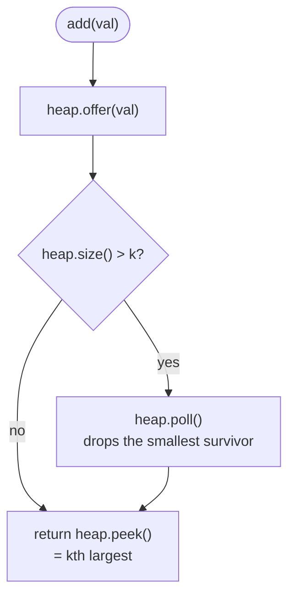

# LC 703 Kth Largest Element in a Stream

> [!abstract] In one sentence
> You never need the whole stream, only its k largest values: hold them in a *min*-heap of size k so the root is the smallest of the k largest — which is exactly the kth largest — and on every `add` push the value and pop the root if the size went over k, which is O(log k) per call and O(k) memory however long the stream runs.

**Map:** [[NeetCode 150 MOC]] → [[DSA Dashboard]] · Pattern: [[Heaps & Priority Queues]]

> [!question] Predict before you read
> Why does the kth *largest* call for a *min*-heap, and what happens to a value that is pushed and then immediately popped — can it ever matter again later in the stream?

## Problem

Design `KthLargest` with a constructor `KthLargest(int k, int[] nums)` and a method `add(int val)` that appends `val` to the stream and returns the kth largest element so far (kth in sorted order, duplicates counted separately, not kth distinct).

Example: `k = 3`, `nums = [4, 5, 8, 2]`; `add(3)` → 4, `add(5)` → 5, `add(10)` → 5, `add(9)` → 8, `add(4)` → 8.

Constraints that matter: `k ≤ 10⁴`, up to 10⁴ initial numbers and up to 10⁴ calls to `add`, values in −10⁴..10⁴; it is guaranteed that at least `k` elements exist whenever `add` is called — so the initial array may be shorter than `k`, and a per-call cost of O(n) would still pass, but the heap answer is what the question is for.

## Clarifying questions

1. Kth largest with or without duplicates? — With; `[5, 5, 4]` with `k = 2` gives 5.
2. Can the initial array have fewer than `k` elements? — Yes; the guarantee is only that there are at least `k` by the time `add` returns.
3. Does `add` return the kth largest *including* the value just added? — Yes.
4. Value range and negatives? — Both ends of −10⁴..10⁴; nothing special, but it rules out a counting array without an offset.

## Brute force

Keep an `ArrayList` of everything; on each `add` append and sort, then return the element at index `size − k`: O(n log n) per call, O(n) space growing with the stream. Inserting at the sorted position via binary search is still O(n) because of the shift. The waste: the sort maintains the order of all n values when only the boundary between "top k" and "the rest" is ever read.

## The key insight

A value outside the current top k can never re-enter it — new arrivals only push the kth largest up, never down. So discard everything below the top k permanently and keep the survivors in a min-heap: the root is the smallest survivor, i.e. the kth largest. Each `add` is push-then-pop-if-oversize. The orientation rule to remember: "k largest" → min-heap (evict the smallest), "k smallest" → max-heap (evict the largest). Recognition cue: "kth largest / top k so far / as elements arrive" → bounded heap of size k.

## Optimal approach

1. `heap` = `PriorityQueue<Integer>` (Java's default is a min-heap), `k` stored.
2. Constructor: call `add` for every initial number (lets the heap settle to size ≤ k without special cases).
3. `add(val)`: `heap.offer(val)`; if `heap.size() > k` then `heap.poll()`; return `heap.peek()`.



> [!example]- Excalidraw version — the same diagram as an editable canvas
> ![[LC 703 Kth Largest Element in a Stream — Optimal approach.excalidraw]]
> [[LC 703 Kth Largest Element in a Stream — Optimal approach.excalidraw|Open in Excalidraw]] — needs the Excalidraw plugin (see [[Plugins to Install]]).

## Walkthrough

`k = 3`, `nums = [4, 5, 8, 2]`. The constructor adds 4, 5, 8 (heap grows to 3) and then 2 (pushed, then popped as the smallest), leaving `{4, 5, 8}`.

| Call | After offer | Size > 3? | Popped | Heap (sorted view) | Returns |
|---|---|---|---|---|---|
| add(3) | {3, 4, 5, 8} | yes | 3 | {4, 5, 8} | 4 |
| add(5) | {4, 5, 5, 8} | yes | 4 | {5, 5, 8} | 5 |
| add(10) | {5, 5, 8, 10} | yes | 5 | {5, 8, 10} | 5 |
| add(9) | {5, 8, 9, 10} | yes | 5 | {8, 9, 10} | 8 |
| add(4) | {4, 8, 9, 10} | yes | 4 | {8, 9, 10} | 8 |

The heap after `add(9)` as the binary tree Java actually stores (array `[8, 9, 10]`):

> [!example] Min-heap of the 3 largest after add(9)
> ![[LC 703 Kth Largest Element in a Stream — Min-heap of the 3 largest after add(9).excalidraw]]
> [[LC 703 Kth Largest Element in a Stream — Min-heap of the 3 largest after add(9).excalidraw|Open in Excalidraw]] — the root is the smallest of the k largest, which is the kth largest; the order of siblings below it is irrelevant

%% excalidraw-spec
{"kind": "tree", "title": "Min-heap of the 3 largest after add(9)", "levels": [8, 9, 10], "highlight": [0], "caption": "the root is the smallest of the k largest, which is the kth largest; the order of siblings below it is irrelevant"}
%%

## Java solution

```java
import java.util.*;

class KthLargest {
    private final PriorityQueue<Integer> heap = new PriorityQueue<>();  // min-heap of the k largest so far
    private final int k;

    public KthLargest(int k, int[] nums) {
        this.k = k;
        for (int x : nums) add(x);          // reuse add: the heap never exceeds k
    }

    public int add(int val) {
        heap.offer(val);
        if (heap.size() > k) heap.poll();   // evict the smallest; the k largest survive
        return heap.peek();                 // smallest of the k largest = kth largest
    }
}
```

**Time** O(log k) per `add` (and O(n log k) for the constructor) · **Space** O(k), independent of the stream length.

## Why it works

Invariant after every `add`: the heap contains the k largest values seen so far (all values, if fewer than k). The new value either belongs to the new top k — then the element that drops out is the smallest of the k + 1 candidates, which `poll` removes — or it does not, in which case it is itself the smallest of the k + 1 and is the one polled. A value that leaves can never belong to the top k again, because the kth largest is non-decreasing as the stream grows. The min-heap root is the minimum of the top k, which is the kth largest by definition.

## Edge cases

- Initial `nums` empty or shorter than `k` → the heap holds everything; the first few `add` calls grow it to size k before any eviction.
- `k = 1` → the heap holds only the maximum; `add` returns the running max.
- `add` of a value smaller than the root when the heap is full → pushed, immediately popped; root unchanged.
- Duplicates → counted separately (`{5, 5, 8}` returns 5 for k = 3).
- Negative values → nothing changes; the heap compares with `Integer.compareTo`.

## Common mistakes

> [!warning] Pitfalls
> - Using a max-heap "because it is the kth largest": the root is then the maximum, and reaching the kth largest costs k − 1 pops per query.
> - Keeping every value in the heap and polling k times per `add` — O(n) space and O(k log n) per call.
> - Comparing `val` with `heap.peek()` before offering while the heap is still smaller than k — `peek()` on an empty heap returns `null`, and unboxing it throws. The push-then-pop form needs no empty check.
> - Returning `heap.poll()` instead of `heap.peek()` at the end — the answer is removed from the heap.
> - Building the constructor with a separate loop that forgets the eviction, leaving a heap larger than k.

## Variants & follow-ups

- Kth smallest in a stream → max-heap of size k (`new PriorityQueue<>(Collections.reverseOrder())`).
- Kth largest of a static array → the same heap, or quickselect in O(n) average: [[LC 215 Kth Largest Element in an Array]].
- Top-k by a derived key (frequency, distance) → same bounded heap with a comparator: [[LC 347 Top K Frequent Elements]], [[LC 973 K Closest Points to Origin]].
- Kth largest in a sliding window → removals are needed; two heaps with lazy deletion or a `TreeMap` of counts.
- Running median → two heaps balanced around the middle: [[LC 295 Find Median from Data Stream]].
- Shortcut when the heap is full: if `val <= heap.peek()` skip the offer entirely (same complexity, fewer heap operations).

## Interview script

Restate: "A class that takes `k` and a seed array, and whose `add` returns the kth largest value seen so far, duplicates counted." Brute force: "Keep everything sorted and index from the end — O(n log n) per add." Insight: "Only the k largest values can ever be the kth largest again, so I keep exactly those in a min-heap; its root is the kth largest." Approach: "Offer the value, poll if the size exceeds k, return the root; the constructor just calls add in a loop." Complexity: "O(log k) per add, O(k) space." Tests: "The LeetCode example, a seed shorter than k, k = 1, a value smaller than the current root, and duplicates equal to the root."

## Related

- Pattern: [[Heaps & Priority Queues]] (bounded top-k heap, orientation rule)
- Same heap on a static array, plus quickselect: [[LC 215 Kth Largest Element in an Array]]
- Top-k by a derived key: [[LC 347 Top K Frequent Elements]], [[LC 973 K Closest Points to Origin]]
- Two heaps instead of one: [[LC 295 Find Median from Data Stream]]
- Java refresher: [[Java Collections Cheat Sheet]] (`PriorityQueue` is a min-heap by default; `offer/poll/peek`; `peek` returns null on empty), [[DSA Patterns in Java]] (heap top-k template)

## Attempt log

| Date | Result | Minutes | What I got wrong |
|---|---|---|---|
| | | | |

### Mastery checklist
- [ ] Solved without hints in under 25 minutes
- [ ] Stated complexity before coding
- [ ] Handled every edge case above
- [ ] Code compiled first time
- [ ] Can do the follow-up variant

## Open questions
- [ ]
