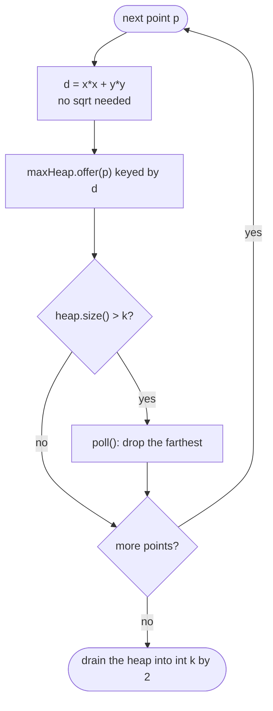

# LC 973 K Closest Points to Origin

> [!abstract] In one sentence
> "The k closest" is a bounded top-k problem: stream the points through a max-heap keyed by squared distance and cap it at k, so the root is always the worst of the current best k and is the one to evict when the heap overflows — O(n log k) instead of sorting all n, and because `sqrt` is monotonic the integer `x² + y²` orders points exactly like the true distance.

**Map:** [[NeetCode 150 MOC]] → [[DSA Dashboard]] · Pattern: [[Heaps & Priority Queues]]

> [!question] Predict before you read
> You want the k *smallest* distances — so should the heap be a min-heap or a max-heap, and why would using the natural orientation make the final answer wrong rather than merely slow?

## Problem

Given `points[i] = [xᵢ, yᵢ]` on a plane and an integer `k`, return the `k` points closest to the origin `(0, 0)` by Euclidean distance, in any order. The answer is guaranteed to be unique (no ties at the boundary).

Example: `points = [[1, 3], [-2, 2]]`, `k = 1` → `[[-2, 2]]` (distances √10 and √8). `points = [[3, 3], [5, -1], [-2, 4]]`, `k = 2` → `[[3, 3], [-2, 4]]`.

Constraints that matter: up to 10⁴ points, coordinates in −10⁴..10⁴ (so `x² + y² ≤ 2·10⁸` fits an `int`), `1 ≤ k ≤ n`.

## Clarifying questions

1. Ties at the kth position? — The problem guarantees a unique answer; say that otherwise you would need a tie-break rule.
2. Output order? — Any.
3. Integer coordinates? — Yes, so squared distances are exact integers; no floating point anywhere.
4. Is `k` ever equal to `n`? — Possible; then every point is returned and the heap never evicts.
5. May I modify the input array? — Relevant only for quickselect, which partitions in place.

## Brute force

Compute each point's distance and sort the whole array by it: O(n log n) time, O(log n) to O(n) extra for the sort. It is correct and short, and it is also what many interviewers accept first. The waste: a full sort orders all n points when only the boundary between the k closest and the rest matters, and when k ≪ n that is most of the work.

## The key insight

Keep only the k best seen so far, with the *worst of them* instantly available — that is a heap whose root is the farthest of the kept points, i.e. a max-heap on distance. Each new point is offered; if the size exceeds k the root (the farthest) is evicted. Compare squared distances: `sqrt` preserves order, so it adds cost and floating-point error without changing any decision. Recognition cue: "k closest / k smallest / k largest among n" → bounded heap of size k with the opposite orientation, exactly as in [[LC 703 Kth Largest Element in a Stream]] and [[LC 347 Top K Frequent Elements]].

## Optimal approach

1. `heap` = `PriorityQueue<int[]>` with comparator "larger squared distance first" (a max-heap).
2. For each point: `offer`; if `size > k` then `poll` (evicts the farthest of the k + 1).
3. Drain the heap into an `int[k][]` and return it.



> [!example]- Excalidraw version — the same diagram as an editable canvas
> ![[LC 973 K Closest Points to Origin — Optimal approach.excalidraw]]
> [[LC 973 K Closest Points to Origin — Optimal approach.excalidraw|Open in Excalidraw]] — needs the Excalidraw plugin (see [[Plugins to Install]]).

## Walkthrough

`points = [[3, 3], [5, -1], [-2, 4]]`, `k = 2`. Squared distances: 18, 26, 20.

| Point | d | Heap after offer (farthest first) | Size > 2? | Evicted | Heap after |
|---|---|---|---|---|---|
| [3, 3] | 18 | 18 | no | — | 18 |
| [5, -1] | 26 | 26, 18 | no | — | 26, 18 |
| [-2, 4] | 20 | 26, 20, 18 | yes | 26 → [5, -1] | 20, 18 |

Result: `[[-2, 4], [3, 3]]` in either order.

> [!example] Squared distances; shaded = kept in the size-2 max-heap
> ![[LC 973 K Closest Points to Origin — Squared distances; shaded = kept in the size-2 max-heap.excalidraw]]
> [[LC 973 K Closest Points to Origin — Squared distances; shaded = kept in the size-2 max-heap.excalidraw|Open in Excalidraw]] — the heap root is always the largest kept distance (20 at the end); a new point only survives if it beats the root

%% excalidraw-spec
{"kind": "array", "title": "Squared distances; shaded = kept in the size-2 max-heap", "values": [18, 26, 20], "highlight": [0, 2], "labels": {"1": "evicted"}, "caption": "the heap root is always the largest kept distance (20 at the end); a new point only survives if it beats the root"}
%%

## Java solution

```java
import java.util.*;

class Solution {
    public int[][] kClosest(int[][] points, int k) {
        // max-heap on squared distance: the root is the farthest of the k kept so far
        PriorityQueue<int[]> heap = new PriorityQueue<>(
            (a, b) -> Integer.compare(dist(b), dist(a)));
        for (int[] p : points) {
            heap.offer(p);
            if (heap.size() > k) heap.poll();        // evict the farthest
        }
        int[][] out = new int[k][];
        for (int i = 0; i < k; i++) out[i] = heap.poll();
        return out;
    }

    private static int dist(int[] p) {              // squared: same order as sqrt, exact ints
        return p[0] * p[0] + p[1] * p[1];
    }
}
```

**Time** O(n log k) — each of n points costs at most one offer and one poll on a heap of size ≤ k + 1 · **Space** O(k) for the heap plus the output.

When the interviewer wants O(n) average, quickselect on the array of points by squared distance, partitioning around a random pivot until the pivot lands at index `k − 1`:

```java
// snippet
int lo = 0, hi = points.length - 1;
while (lo < hi) {
    int p = partition(points, lo, hi);     // Lomuto on dist(); returns the pivot's final index
    if (p == k - 1) break;
    if (p < k - 1) lo = p + 1; else hi = p - 1;
}
return Arrays.copyOfRange(points, 0, k); // the first k are the k closest, unordered
```

## Why it works

Invariant after processing i points: the heap holds the k closest among them (all of them while i ≤ k). Offering the (i + 1)th point makes k + 1 candidates; the one that does not belong to the k closest is the farthest of the k + 1, and that is precisely the root of a max-heap, which `poll` removes. A point evicted once can never be among the k closest later, because adding points only tightens the boundary. Ordering by `x² + y²` instead of `√(x² + y²)` changes no comparison since squaring is strictly increasing on non-negative numbers, and the integer arithmetic cannot overflow under the constraints.

## Edge cases

- `k == n` → the heap never exceeds k; every point is returned.
- `k == 1` → the heap holds one point; the answer is the single closest.
- A point at the origin → distance 0, never evicted once the heap is full of farther points.
- Negative coordinates → squares are positive; nothing special.
- Duplicate points → both kept or both evicted together; with the uniqueness guarantee they never straddle the boundary.

## Common mistakes

> [!warning] Pitfalls
> - A min-heap capped at k: after evictions it holds the k *farthest* points — the wrong answer, not just a slow one.
> - `Math.sqrt` with a comparator like `(a, b) -> (int) (da - db)`: the cast truncates fractional differences to 0 and declares distinct distances equal.
> - `dist(a) - dist(b)` in the comparator: safe at these bounds (≤ 2·10⁸) but the subtraction habit overflows on larger inputs; use `Integer.compare`.
> - Allocating the output as `new int[k][2]` and then assigning `out[i] = heap.poll()` — works, but `new int[k][]` says what you mean; `new int[k]` (one dimension) does not compile.
> - Recomputing `dist` inside the comparator on every comparison: correct, but for very large n precompute it once per point by storing `{d, index}` pairs.
> - Quickselect without a random pivot — adversarial (already sorted) inputs degrade to O(n²).

## Variants & follow-ups

- Points arrive as a stream → the same heap keeps answering after every arrival (no quickselect possible).
- K farthest points → flip the comparator (a min-heap capped at k).
- Only the kth closest distance is needed → same heap, return `dist(heap.peek())`, or [[LC 215 Kth Largest Element in an Array]] on the distances.
- K closest to an arbitrary point `(px, py)` → subtract before squaring; nothing else changes.
- Ties at the boundary allowed → define the tie-break (index order, then x, then y) in the comparator, or return all tied points by a second pass.
- Very large n, small k, distributed data → each shard keeps its own k closest, then merge the shard heaps (k-way merge).

## Interview script

Restate: "n integer points, return the k nearest to the origin in any order; the answer is unique." Brute force: "Compute distances, sort, take the first k — O(n log n)." Insight: "I only need the k best at any time, with the worst of them on top so I can evict it: a max-heap by squared distance capped at k. Squared distance keeps everything in integers." Approach: "Offer each point, poll when the size passes k, drain the heap at the end." Complexity: "O(n log k) time, O(k) space; quickselect gives O(n) average if we may reorder the input." Tests: "k equal to n, k = 1, a point on the origin, negative coordinates, and the LeetCode examples."

## Related

- Pattern: [[Heaps & Priority Queues]] (bounded top-k, orientation rule) · quickselect lives in [[Sorting]]
- Same bounded heap: [[LC 703 Kth Largest Element in a Stream]], [[LC 215 Kth Largest Element in an Array]], [[LC 347 Top K Frequent Elements]]
- Java refresher: [[Java Collections Cheat Sheet]] (`PriorityQueue` with a comparator, `Integer.compare`, `int[][]` allocation, `Arrays.copyOfRange`), [[DSA Patterns in Java]] (heap top-k template)

## Attempt log

| Date | Result | Minutes | What I got wrong |
|---|---|---|---|
| | | | |

### Mastery checklist
- [ ] Solved without hints in under 25 minutes
- [ ] Stated complexity before coding
- [ ] Handled every edge case above
- [ ] Code compiled first time
- [ ] Can do the follow-up variant

## Open questions
- [ ]
