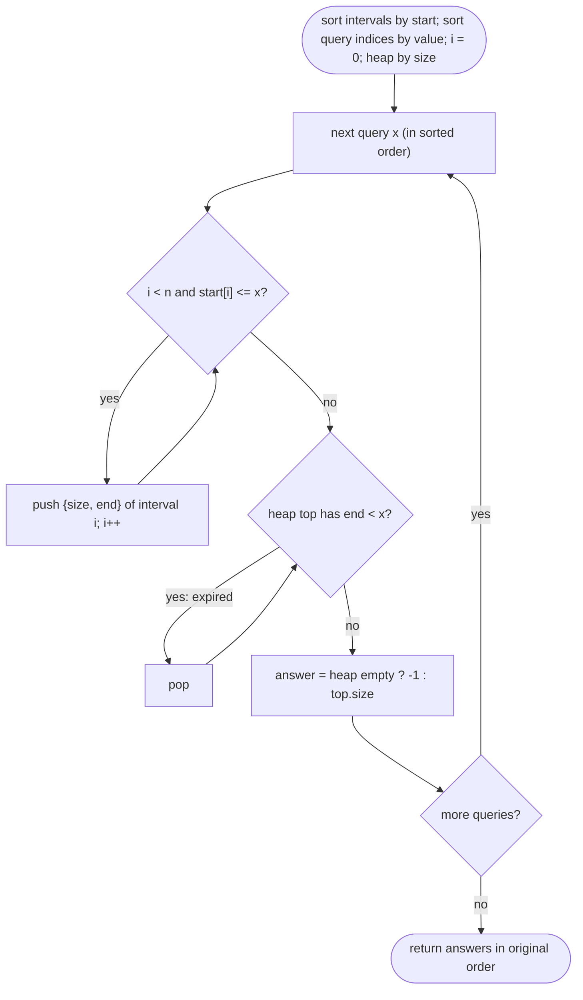

# LC 1851 Minimum Interval to Include Each Query

> [!abstract] In one sentence
> Sort the queries so the sweep moves only forward, add intervals to a size-ordered heap the moment the sweep passes their start, and ignore (pop) any heap top whose end is already behind the sweep; because an interval that has ended can never cover a later query, lazy deletion is safe and each interval enters and leaves the heap once.

**Map:** [[NeetCode 150 MOC]] → [[DSA Dashboard]] · Pattern: [[Intervals]]

> [!question] Predict before you read
> Intervals `[1,4],[2,4],[3,6],[4,4]`, queries `2, 3, 4, 5`. If you answer the queries in increasing order, which intervals could possibly be needed for query 5 that were not needed for query 4, and which can never be needed again?

## Problem

Given `intervals[i] = [l, r]` (inclusive) and `queries[j]`, for each query return the size `r − l + 1` of the smallest interval containing it, or `−1` if none does. Answers must be in the original query order.

- `intervals = [[1,4],[2,4],[3,6],[4,4]]`, `queries = [2,3,4,5]` → `[3,3,1,4]`
- `intervals = [[2,3],[2,5],[1,8],[20,25]]`, `queries = [2,19,5,22]` → `[2,-1,4,6]`

Constraints that matter: up to `10⁵` intervals and `10⁵` queries, coordinates up to `10⁷`; O(n·q) = `10¹⁰` is far too slow.

## Clarifying questions

1. Inclusive endpoints? — Yes; `[4,4]` contains 4 and has size 1.
2. Can we reorder the queries? — Yes, as long as the output follows the input order (offline processing).
3. Ties on size? — Any minimum-size interval; the size is what is returned.
4. Duplicated queries or intervals? — Allowed; harmless.

## Brute force

For each query scan all intervals and take the smallest containing one: O(n·q). The waste: consecutive (sorted) queries share almost all of their candidate sets; the brute force rebuilds the candidates from scratch each time.

## The key insight

Process queries in increasing order (remember original indices). Sweep intervals sorted by start: when the sweep point `x` passes an interval's start, that interval becomes a candidate for `x` and every later query — push it into a min-heap keyed by size (store `[size, end]`). A candidate stops being valid once `end < x`, and since `x` only grows, it is invalid forever — so when the heap's top has `end < x`, pop it and forget it (lazy deletion). The top of the heap is then the smallest interval that has started and not ended, i.e. the smallest interval containing `x`. The heap may hold invalid intervals below the top; that is fine because they only surface when they become the minimum, and they are popped then.

## Optimal approach

1. Sort intervals by start. Build an array of query indices sorted by query value.
2. `i = 0` (pointer into intervals), min-heap of `int[]{size, end}`.
3. For each query `x` in sorted order: while `i < n` and `intervals[i].start <= x`: push `{end − start + 1, end}`, `i++`. While heap non-empty and `heap.peek().end < x`: pop. `ans[origIdx] = heap.isEmpty() ? −1 : heap.peek().size`.
4. Return `ans`.



> [!example]- Excalidraw version — the same diagram as an editable canvas
> ![[LC 1851 Minimum Interval to Include Each Query — Optimal approach.excalidraw]]
> [[LC 1851 Minimum Interval to Include Each Query — Optimal approach.excalidraw|Open in Excalidraw]] — needs the Excalidraw plugin (see [[Plugins to Install]]).

## Walkthrough

`intervals = [[1,4],[2,4],[3,6],[4,4]]`, `queries = [2,3,4,5]`:

| query x | pushed (size,end) | popped (end < x) | heap top | answer |
|---|---|---|---|---|
| 2 | (4,4) from [1,4]; (3,4) from [2,4] | — | (3,4) | 3 |
| 3 | (4,6) from [3,6] | — | (3,4) | 3 |
| 4 | (1,4) from [4,4] | — | (1,4) | 1 |
| 5 | — | (1,4) end 4 < 5; (3,4) end 4 < 5; (4,4) end 4 < 5 | (4,6) | 4 |

> [!example] Heap contents keyed by size after query 4, then after the lazy pops at query 5
> ![[LC 1851 Minimum Interval to Include Each Query — Heap contents keyed by size after query 4, then after the lazy pops at .excalidraw]]
> [[LC 1851 Minimum Interval to Include Each Query — Heap contents keyed by size after query 4, then after the lazy pops at .excalidraw|Open in Excalidraw]] — shaded entries all end at 4 and expire for x = 5; they are popped only when they reach the top

%% excalidraw-spec
{"kind": "array", "title": "Heap contents keyed by size after query 4, then after the lazy pops at query 5", "values": ["(1,4)", "(3,4)", "(4,4)", "(4,6)"], "pointers": {"top@4": 0, "top@5": 3}, "highlight": [0, 1, 2], "labels": {"3": "[3,6] survives: end 6 >= 5"}, "caption": "shaded entries all end at 4 and expire for x = 5; they are popped only when they reach the top"}
%%

## Java solution

```java
import java.util.*;

class Solution {
    public int[] minInterval(int[][] intervals, int[] queries) {
        Arrays.sort(intervals, (a, b) -> Integer.compare(a[0], b[0]));           // by start
        int q = queries.length;
        Integer[] order = new Integer[q];
        for (int j = 0; j < q; j++) order[j] = j;
        Arrays.sort(order, (a, b) -> Integer.compare(queries[a], queries[b]));  // query indices by value
        PriorityQueue<int[]> heap = new PriorityQueue<>((a, b) -> Integer.compare(a[0], b[0])); // {size, end}
        int[] ans = new int[q];
        int i = 0;
        for (int idx : order) {
            int x = queries[idx];
            while (i < intervals.length && intervals[i][0] <= x) {                 // every interval that has started
                heap.offer(new int[]{intervals[i][1] - intervals[i][0] + 1, intervals[i][1]});
                i++;
            }
            while (!heap.isEmpty() && heap.peek()[1] < x) heap.poll();            // lazy deletion of expired tops
            ans[idx] = heap.isEmpty() ? -1 : heap.peek()[0];
        }
        return ans;
    }
}
```

**Time** O((n + q) log n + q log q) · **Space** O(n + q)

An alternative with a sorted-value structure instead of lazy deletion: a `TreeMap<Integer, Integer>` multiset of sizes, removing an interval exactly when the sweep passes its end (needs intervals also sorted by end):

```java
// snippet — explicit removal: two sorted lists (by start, by end) and a TreeMap multiset of sizes
// add when start <= x; remove when end < x; answer = sizes.firstKey() or -1
// same complexity, more bookkeeping, no stale entries
```

## Why it works

Invariant before answering query `x`: the heap contains every interval with `start <= x` (pushed as the sweep passed its start; starts are processed in order so none are skipped) and, among the heap's contents, every interval with `end >= x` is valid for `x`; intervals with `end < x` may linger but are never valid for `x` or any later query (queries are increasing). The top is the smallest-size element; if its end is `< x` it is popped, and the loop continues until the top is valid or the heap is empty. A valid top is the minimum size over all valid intervals, because every valid interval is in the heap and the heap minimum is `<=` all of them. Each interval is pushed once and popped at most once, giving the O((n + q) log n) bound. Answers are written to `ans[idx]` so the original order is restored.

## Edge cases

- Query before every start → heap empty → `−1`.
- Query after every end → everything expires → `−1`.
- Point interval `[4,4]` with query 4 → size 1 (inclusive ends).
- Duplicate queries → same answer, computed twice (fine) or cached.
- Nested intervals → the smaller one is on top as long as it is valid.
- Intervals ending exactly at `x` → still valid (`end < x` is the expiry test, not `<=`).

## Common mistakes

> [!warning] What goes wrong
> - Keying the heap by end instead of size: the top is then the earliest-ending interval, not the smallest.
> - Popping intervals when `end <= x`: an interval ending exactly at `x` contains `x`.
> - Forgetting to remember original query indices and returning answers in sorted-query order.
> - Pushing intervals by scanning all of them per query (O(n·q) again): the pointer `i` must persist across queries.
> - Comparator subtraction (`a[0] − b[0]`): sizes are up to `10⁷`, safe here, but `Integer.compare` is the habit.
> - Assuming a popped interval might be needed later: it cannot, because queries only increase — say this out loud, it is the correctness argument.

## Variants & follow-ups

- Queries arrive online (cannot sort): a segment tree over coordinate-compressed points storing the minimum size per point (range-update-min, point-query), O(log n) per query — see [[Segment Trees]].
- Return the interval itself: store its index in the heap tuple.
- Maximum interval instead of minimum: max-heap by size.
- Count of intervals covering each query: prefix sums over a difference array after coordinate compression.
- "Smallest interval containing a query *range*": requires `start <= ql` and `end >= qr`; same sweep keyed on `ql`, expiry on `end < qr`.

## Interview script

Restate: "for each query point, the size of the smallest interval containing it; `−1` if none; queries can be answered in any order internally." Brute force: "scan all intervals per query, O(n·q), too slow at `10⁵` each." Insight: "sort the queries and sweep: an interval becomes a candidate when its start is passed and is dead forever once its end is behind the sweep; keep candidates in a min-heap by size and lazily drop dead tops." Approach: "sort intervals by start, query indices by value; per query push all started intervals, pop expired tops, read the top." Complexity: "O((n + q) log n)." Tests: "query before all starts, after all ends, point interval, interval ending exactly at the query." If they push: "online queries need a segment tree with coordinate compression; counting coverage is a difference array."

## Related

- Pattern: [[Intervals]] (offline sweep), [[Heaps & Priority Queues]] (lazy deletion)
- Prerequisites: [[LC 253 Meeting Rooms II]] (heap of ends while sweeping starts), [[LC 56 Merge Intervals]]
- Siblings: [[LC 295 Find Median from Data Stream]] (heap invariants), [[Segment Trees]] (the online version)
- Java: [[Java Collections Cheat Sheet]] (`PriorityQueue<int[]>` with a comparator, sorting `Integer[]` indices), [[DSA Patterns in Java]]

## Attempt log

| Date | Result | Minutes | What I got wrong |
|---|---|---|---|
| | | | |

### Mastery checklist
- [ ] Solved without hints in under 25 minutes
- [ ] Stated complexity before coding
- [ ] Handled every edge case above
- [ ] Code compiled first time
- [ ] Can do the follow-up variant

## Open questions
- [ ] Why can a stale (expired) interval sit below the heap top without affecting any answer? Write the one-line invariant.
- [ ] Sketch the segment-tree solution for online queries: what does each leaf store and what is the update when an interval `[l, r]` of size `s` arrives?
