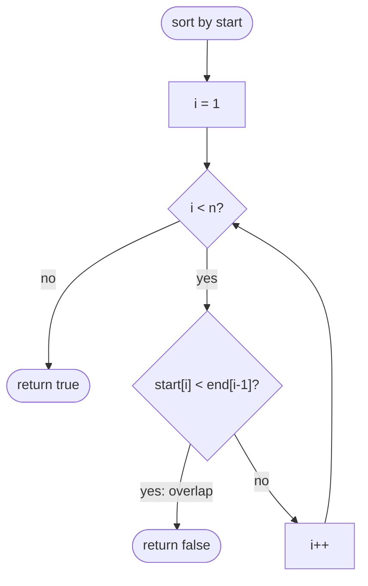

# LC 252 Meeting Rooms

> [!abstract] In one sentence
> Sorting by start time lines the meetings up so that any overlap must show between neighbours — a meeting that overlaps a later one necessarily overlaps the very next one — which turns an O(n²) pairwise check into one pass of `start[i] < end[i−1]`.

**Map:** [[NeetCode 150 MOC]] → [[DSA Dashboard]] · Pattern: [[Intervals]]

> [!question] Predict before you read
> After sorting by start, suppose meeting 2 overlaps meeting 5. Can meeting 2 avoid overlapping meetings 3 and 4? Argue it in one sentence — that argument is the whole solution.

## Problem

Given meeting time intervals `[start, end)`, determine whether a single person could attend all of them (no two overlap). A meeting ending at `t` and another starting at `t` do not conflict.

- `[[0,30],[5,10],[15,20]]` → `false`
- `[[7,10],[2,4]]` → `true`
- `[]` → `true`

Constraints that matter: up to `10⁴` intervals; O(n²) would pass but the expected answer is the sort.

## Clarifying questions

1. Is `[1,5]` followed by `[5,8]` a conflict? — No; back-to-back is allowed (`start >= prevEnd`).
2. Can the input be empty or have one meeting? — Yes → `true`.
3. Are intervals well-formed (`start < end`)? — Assume yes; ask if zero-length meetings exist.
4. Must the input stay unmodified? — If so, sort a copy or an index array.

## Brute force

Compare every pair: O(n²) with the overlap test `a.start < b.end && b.start < a.end`. Fine for `10⁴`, but it ignores the structure; the interviewer wants to hear the sort.

## The key insight

Sort by start. If meeting `i` overlaps some later meeting `j > i`, then `start[j] < end[i]`; every meeting between them has `start[i] <= start[k] <= start[j] < end[i]`, so `k = i + 1` also overlaps `i`. Hence it suffices to check consecutive pairs: conflict iff `start[i] < end[i−1]` for some `i`.

## Optimal approach

1. Sort by start.
2. For `i = 1..n−1`: if `intervals[i][0] < intervals[i−1][1]` return `false`.
3. Return `true`.



> [!example]- Excalidraw version — the same diagram as an editable canvas
> ![[LC 252 Meeting Rooms — Optimal approach.excalidraw]]
> [[LC 252 Meeting Rooms — Optimal approach.excalidraw|Open in Excalidraw]] — needs the Excalidraw plugin (see [[Plugins to Install]]).

## Walkthrough

`[[0,30],[5,10],[15,20]]` sorted by start → unchanged:

| i | prev | current | start[i] < end[i−1]? |
|---|---|---|---|
| 1 | [0,30] | [5,10] | 5 < 30 → conflict → `false` |

`[[7,10],[2,4]]` sorted → `[2,4],[7,10]`: `7 < 4`? no → `true`.

> [!example] Sorted by start: [0,30] [5,10] [15,20]
> ![[LC 252 Meeting Rooms — Sorted by start- -0,30- -5,10- -15,20-.excalidraw]]
> [[LC 252 Meeting Rooms — Sorted by start- -0,30- -5,10- -15,20-.excalidraw|Open in Excalidraw]] — 5 < 30: the second meeting starts before the first ends, so one person cannot attend both

%% excalidraw-spec
{"kind": "array", "title": "Sorted by start: [0,30] [5,10] [15,20]", "values": ["[0,30]", "[5,10]", "[15,20]"], "pointers": {"i-1": 0, "i": 1}, "highlight": [0, 1], "caption": "5 < 30: the second meeting starts before the first ends, so one person cannot attend both"}
%%

## Java solution

```java
import java.util.*;

class Solution {
    public boolean canAttendMeetings(int[][] intervals) {
        Arrays.sort(intervals, (a, b) -> Integer.compare(a[0], b[0]));   // by start
        for (int i = 1; i < intervals.length; i++) {
            if (intervals[i][0] < intervals[i - 1][1]) return false;      // starts before the previous one ends
        }
        return true;
    }
}
```

**Time** O(n log n) · **Space** O(1) extra (sort uses O(log n))

## Why it works

Overlap of `[a, b)` and `[c, d)` with `a <= c` means `c < b`. After sorting by start, for any pair `i < j`, `start[i] <= start[i+1] <= start[j]`; if `start[j] < end[i]` then `start[i+1] < end[i]` too, so a conflict anywhere implies a conflict between some adjacent pair. Conversely an adjacent conflict is a conflict. So the adjacent scan is both necessary and sufficient; the `<` (not `<=`) encodes that touching meetings are fine.

## Edge cases

- Empty or single meeting → `true`.
- Back-to-back (`[1,5],[5,9]`) → `true`.
- Identical meetings → `false`.
- One meeting containing all others → `false` at the first comparison after sorting.
- Unsorted input → handled by the sort; sorting by end instead of start also works for this problem but not for the general habit.

## Common mistakes

> [!warning] What goes wrong
> - Checking `<=` instead of `<`: rejects back-to-back meetings.
> - Comparing with the previous *start* instead of the previous *end*.
> - Sorting with `a[0] − b[0]`: overflow for large coordinates; use `Integer.compare`.
> - Forgetting to sort and only checking adjacent pairs in input order.
> - Mutating the caller's array when it should stay untouched (sort a copy if asked).

## Variants & follow-ups

- Minimum number of rooms: [[LC 253 Meeting Rooms II]].
- Minimum removals to make attendable: [[LC 435 Non-overlapping Intervals]].
- Merge overlapping meetings: [[LC 56 Merge Intervals]].
- Streaming meetings (bookings arriving one by one, LC 729 My Calendar I): a `TreeMap` keyed by start with `floorEntry`/`ceilingEntry` checks, O(log n) per booking.
- Find free slots between meetings: scan the sorted list and emit gaps.

## Interview script

Restate: "can one person attend all meetings, where back-to-back is fine?" Brute force: "pairwise overlap check, O(n²)." Insight: "after sorting by start, a conflict anywhere implies a conflict between adjacent meetings, so one linear pass suffices." Approach: "sort by start; return false when `start[i] < end[i−1]`." Complexity: "O(n log n) for the sort, O(1) extra." Tests: "empty, single, back-to-back, identical, nested." If they push: "for online bookings I would use a `TreeMap` with neighbour checks; for counting rooms, a heap of end times."

## Related

- Pattern: [[Intervals]] (sort by start, adjacent check), [[Sorting]]
- Siblings: [[LC 56 Merge Intervals]], [[LC 253 Meeting Rooms II]], [[LC 435 Non-overlapping Intervals]]
- Java: [[Java Collections Cheat Sheet]] (`Arrays.sort` with comparator, `TreeMap.floorEntry`), [[Java Pitfalls in Interviews]]

## Attempt log

| Date | Result | Minutes | What I got wrong |
|---|---|---|---|
| | | | |

### Mastery checklist
- [ ] Solved without hints in under 25 minutes
- [ ] Stated complexity before coding
- [ ] Handled every edge case above
- [ ] Code compiled first time
- [ ] Can do the follow-up variant

## Open questions
- [ ] Implement LC 729 (My Calendar I) with a `TreeMap`. Which two neighbours must you check and why only those two?
- [ ] Would sorting by end and checking `start[i] < end[i−1]` also be correct here? Find a case that distinguishes the two sorts for the *merge* problem.
