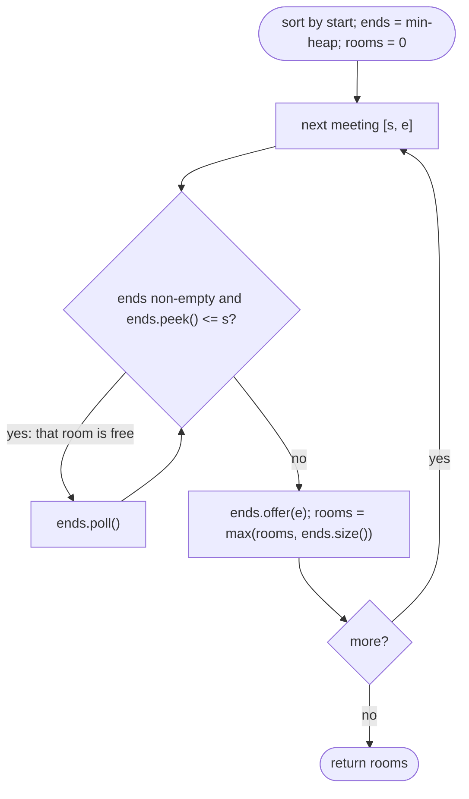

# LC 253 Meeting Rooms II

> [!abstract] In one sentence
> You never need more rooms than the peak number of simultaneous meetings, and you can always get by with exactly that many by handing each new meeting the room that freed up earliest — a min-heap of end times answers "is any room free yet?" in O(log n) per meeting.

**Map:** [[NeetCode 150 MOC]] → [[DSA Dashboard]] · Pattern: [[Intervals]]

> [!question] Predict before you read
> `[[0,30],[5,10],[15,20]]`. At time 5 how many meetings are running? At time 15? What is the peak, and why can the answer never be less than the peak?

## Problem

Given meeting intervals `[start, end)`, return the minimum number of conference rooms required.

- `[[0,30],[5,10],[15,20]]` → `2`
- `[[7,10],[2,4]]` → `1`

Constraints that matter: up to `10⁴` intervals, `0 ≤ start < end ≤ 10⁶`; O(n log n) expected.

## Clarifying questions

1. Does a meeting ending at `t` free its room for a meeting starting at `t`? — Yes (`end <= start` means no conflict).
2. Do we need the assignment of meetings to rooms? — Only the count; the heap version can produce an assignment with a little bookkeeping.
3. Can intervals be unsorted / duplicated? — Yes.
4. Is the number of rooms bounded? — No; the answer is at most `n`.

## Brute force

For each meeting count how many others overlap it: O(n²), and even that is wrong as an answer — overlapping "with meeting A" is not the same as "simultaneous with each other" (three meetings can pairwise overlap A without all overlapping at one instant, but the correct count needs the maximum over *instants*). The right brute force is: for every start time, count the meetings containing it, O(n²).

## The key insight

Lower bound: at the instant when the most meetings are in progress, each needs its own room. Upper bound: processing meetings in start order and reusing the room that frees up first never exceeds that peak, because a room is reused whenever one is free, so rooms in use at any step equal the meetings currently running. Mechanically: sort by start; keep a min-heap of end times of running meetings; for each new meeting, pop every end `<= start` (those rooms are free), push the new end; track the max heap size. The sweep-line variant separates starts and ends into two sorted arrays and walks them: a start before the next end adds a room, an end releases one.

## Optimal approach

1. Sort intervals by start.
2. Min-heap `ends`.
3. For each `[s, e]`: while `ends` non-empty and `ends.peek() <= s`, pop (a room freed). Push `e`. `rooms = max(rooms, ends.size())`.
4. Return `rooms`.



> [!example]- Excalidraw version — the same diagram as an editable canvas
> ![[LC 253 Meeting Rooms II — Optimal approach.excalidraw]]
> [[LC 253 Meeting Rooms II — Optimal approach.excalidraw|Open in Excalidraw]] — needs the Excalidraw plugin (see [[Plugins to Install]]).

## Walkthrough

`[[0,30],[5,10],[15,20]]` sorted by start (unchanged):

| meeting | pop ends <= start | heap after push | size | rooms |
|---|---|---|---|---|
| [0,30] | — | {30} | 1 | 1 |
| [5,10] | 30 <= 5? no | {10, 30} | 2 | 2 |
| [15,20] | 10 <= 15 → pop | {20, 30} | 2 | 2 |

> [!example] Meetings on a timeline (rows = meetings, columns = time buckets of 5)
> ![[LC 253 Meeting Rooms II — Meetings on a timeline (rows = meetings, columns = time buckets of 5).excalidraw]]
> [[LC 253 Meeting Rooms II — Meetings on a timeline (rows = meetings, columns = time buckets of 5).excalidraw|Open in Excalidraw]] — at time 5 two meetings run at once (shaded column): the peak, and the answer

%% excalidraw-spec
{"kind": "grid", "title": "Meetings on a timeline (rows = meetings, columns = time buckets of 5)", "col_labels": ["", "0", "5", "10", "15", "20", "25"], "row_labels": ["", "[0,30]", "[5,10]", "[15,20]"], "rows": [ ["#", "#", "#", "#", "#", "#"], ["", "#", "", "", "", ""], ["", "", "", "#", "", ""] ], "highlight": [ [0, 1], [1, 1] ], "caption": "at time 5 two meetings run at once (shaded column): the peak, and the answer"}
%%

## Java solution

```java
import java.util.*;

class Solution {
    public int minMeetingRooms(int[][] intervals) {
        Arrays.sort(intervals, (a, b) -> Integer.compare(a[0], b[0]));   // by start
        PriorityQueue<Integer> ends = new PriorityQueue<>();              // end times of meetings in progress
        int rooms = 0;
        for (int[] in : intervals) {
            while (!ends.isEmpty() && ends.peek() <= in[0]) ends.poll();  // rooms whose meeting already ended
            ends.offer(in[1]);                                            // this meeting occupies a room
            rooms = Math.max(rooms, ends.size());                         // rooms in use right now
        }
        return rooms;
    }
}
```

**Time** O(n log n) · **Space** O(n)

Sweep line with two sorted arrays — no heap, same complexity, and the clearest proof of the "peak overlap" idea:

```java
// snippet — count +1 at each start, -1 at each end, in time order (ends before starts on ties)
int n = intervals.length; int[] starts = new int[n], ends = new int[n];
for (int i = 0; i < n; i++) { starts[i] = intervals[i][0]; ends[i] = intervals[i][1]; }
Arrays.sort(starts); Arrays.sort(ends);
int rooms = 0, cur = 0, j = 0;
for (int i = 0; i < n; i++) {
    while (ends[j] <= starts[i]) { cur--; j++; }   // every meeting that ended by this start releases a room
    cur++; rooms = Math.max(rooms, cur);
}
return rooms;
```

## Why it works

Let `P` be the maximum number of meetings in progress at any instant. Any schedule needs at least `P` rooms (those `P` meetings are pairwise concurrent at that instant). The heap algorithm uses at most `P`: when meeting `m` is pushed, every end time still in the heap is `> start(m)`, and those meetings started no later than `m` (start order), so all of them are in progress at `start(m)` together with `m`; the heap size is therefore a count of concurrent meetings at a real instant, hence `<= P`. The maximum heap size is reached exactly at the instant that realises `P`, so the algorithm returns `P`. Ties: popping when `end <= start` encodes that a room freed at `t` can be reused at `t`. The sweep version computes the same running count directly.

## Edge cases

- Empty input → 0 (loop never runs).
- One meeting → 1.
- All back-to-back (`[1,2],[2,3],[3,4]`) → 1, thanks to `<=` when popping.
- All identical → `n`.
- Nested meetings (`[1,10],[2,3],[4,5]`) → 2: the inner ones reuse one room after each other.
- Large coordinates: no arithmetic on them beyond comparisons.

## Common mistakes

> [!warning] What goes wrong
> - Popping only one end per meeting instead of every end `<= start`: `rooms` is still correct? No — stale ends inflate the heap size and the answer.
> - Using `<` instead of `<=` when freeing rooms: back-to-back meetings then need two rooms.
> - Sorting by end instead of start: the heap no longer counts concurrent meetings.
> - Returning `ends.size()` at the end instead of the maximum seen.
> - In the sweep version, processing starts before ends on equal times: back-to-back meetings get double counted; the `while (ends[j] <= starts[i])` order handles it.
> - A max-heap by mistake: `peek()` must be the *earliest* end.

## Variants & follow-ups

- Which room does each meeting use? Keep `(end, roomId)` pairs in the heap and a counter for new rooms.
- Meetings with priorities / earliest-start assignment to rooms (LC 2402 Meeting Rooms III): two heaps (free rooms by id, busy rooms by end).
- Maximum concurrent events in a log of `(start, end)` pairs: the sweep version, which also generalises to +k/−k weights (bandwidth, memory peaks).
- Minimum platforms at a railway station: identical problem.
- Can attend all meetings: [[LC 252 Meeting Rooms]] (answer is `rooms == 1`).

## Interview script

Restate: "minimum rooms so that no two concurrent meetings share a room; a room freed at `t` is usable at `t`." Brute force: "for every start instant, count meetings containing it — O(n²)." Insight: "the answer is the peak number of concurrent meetings: a lower bound by definition, and achievable by always reusing the earliest-freed room." Approach: "sort by start; min-heap of end times; pop all ends `<= start`, push the new end, track the max heap size." Complexity: "O(n log n) time, O(n) space." Tests: "back-to-back, identical, nested, single." If they push: "a sweep over two sorted arrays gives the same count without a heap; with room ids I keep `(end, id)` in the heap."

## Related

- Pattern: [[Intervals]] (sweep line), [[Heaps & Priority Queues]] (min-heap of end times)
- Prerequisites: [[LC 252 Meeting Rooms]], [[LC 56 Merge Intervals]]
- Siblings: [[LC 1851 Minimum Interval to Include Each Query]] (heap with lazy removal over intervals)
- Java: [[Java Collections Cheat Sheet]] (`PriorityQueue` basics, `Arrays.sort` on `int[][]`), [[DSA Patterns in Java]] (interval scheduling and sweep templates)

## Attempt log

| Date | Result | Minutes | What I got wrong |
|---|---|---|---|
| | | | |

### Mastery checklist
- [ ] Solved without hints in under 25 minutes
- [ ] Stated complexity before coding
- [ ] Handled every edge case above
- [ ] Code compiled first time
- [ ] Can do the follow-up variant

## Open questions
- [ ] Modify the heap solution to output a room assignment and verify it uses exactly `rooms` rooms.
- [ ] Why does the pairwise-overlap brute force overcount? Give three intervals that pairwise overlap but have peak concurrency 2.
