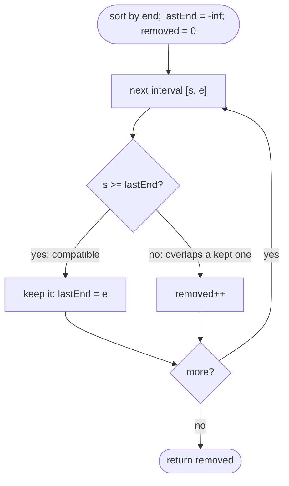

# LC 435 Non-overlapping Intervals

> [!abstract] In one sentence
> Among overlapping candidates, the one that ends earliest leaves the most room for everything after it, so sorting by end time and greedily keeping each interval that starts at or after the last kept end maximises the kept set — and the answer is `n` minus that count.

**Map:** [[NeetCode 150 MOC]] → [[DSA Dashboard]] · Pattern: [[Intervals]]

> [!question] Predict before you read
> `[[1,100],[2,3],[4,5]]`. If you sort by *start* and keep the first interval, how many removals do you make? If you sort by *end* instead? Which rule is safe, and why?

## Problem

Given intervals `[start, end)` (touching intervals like `[1,2]` and `[2,3]` do not overlap), return the minimum number of intervals to remove so that the remaining intervals are non-overlapping.

- `[[1,2],[2,3],[3,4],[1,3]]` → `1` (remove `[1,3]`)
- `[[1,2],[1,2],[1,2]]` → `2`
- `[[1,2],[2,3]]` → `0`

Constraints that matter: up to `10⁵` intervals, coordinates in `[−5·10⁴, 5·10⁴]`; O(n log n) needed, O(n²) is too slow.

## Clarifying questions

1. Are `[1,2]` and `[2,3]` overlapping? — No; the end is exclusive for overlap purposes (`start >= lastEnd` is fine).
2. Duplicates allowed? — Yes; all but one copy must go.
3. Return the count or the removed intervals? — The count; the greedy also identifies which ones.
4. Sorted input? — Not guaranteed; sorting is part of the solution.

## Brute force

Try every subset, keep the largest disjoint one: `2^n`. Or a DP over intervals sorted by end (`best[i]` = max kept ending with interval `i`): O(n²), which is the weighted-interval-scheduling shape and correct, but unnecessary when all weights are 1. The waste: with equal weights the greedy choice is provably optimal.

## The key insight

Maximise the number of kept intervals (removals = `n − kept`). Classic interval scheduling: sort by end; always keep the interval that ends earliest among those compatible with what you have kept. Exchange argument: take any optimal solution and look at its first interval `o`; the greedy's first interval `g` ends no later than `o`, so replacing `o` with `g` keeps the solution feasible and the same size. Induct along the sequence. Practically: keep `lastEnd`; for each interval in end order, if `start >= lastEnd` keep it and set `lastEnd = end`, else it overlaps a kept interval and is removed.

## Optimal approach

1. Sort intervals by end (ties: any order).
2. `kept = 0`, `lastEnd = −∞`.
3. For each `[s, e]`: if `s >= lastEnd` → `kept++`, `lastEnd = e`; else → it is removed (count it).
4. Return `n − kept`.



> [!example]- Excalidraw version — the same diagram as an editable canvas
> ![[LC 435 Non-overlapping Intervals — Optimal approach.excalidraw]]
> [[LC 435 Non-overlapping Intervals — Optimal approach.excalidraw|Open in Excalidraw]] — needs the Excalidraw plugin (see [[Plugins to Install]]).

## Walkthrough

`[[1,2],[2,3],[3,4],[1,3]]` sorted by end → `[1,2],[2,3],[1,3],[3,4]`:

| interval | lastEnd before | s >= lastEnd? | action | lastEnd after | removed |
|---|---|---|---|---|---|
| [1,2] | −∞ | yes | keep | 2 | 0 |
| [2,3] | 2 | yes | keep | 3 | 0 |
| [1,3] | 3 | no | remove | 3 | 1 |
| [3,4] | 3 | yes | keep | 4 | 1 |

> [!example] Intervals sorted by end; shaded ones are kept, the pointer marks lastEnd after each keep
> ![[LC 435 Non-overlapping Intervals — Intervals sorted by end; shaded ones are kept, the pointer marks lastEnd after each k.excalidraw]]
> [[LC 435 Non-overlapping Intervals — Intervals sorted by end; shaded ones are kept, the pointer marks lastEnd after each k.excalidraw|Open in Excalidraw]] — earliest end first; [1,3] starts before the current lastEnd and is dropped

%% excalidraw-spec
{"kind": "array", "title": "Intervals sorted by end; shaded ones are kept, the pointer marks lastEnd after each keep", "values": ["[1,2]", "[2,3]", "[1,3]", "[3,4]"], "pointers": {"lastEnd=4": 3}, "highlight": [0, 1, 3], "labels": {"2": "removed: starts before 3"}, "caption": "earliest end first; [1,3] starts before the current lastEnd and is dropped"}
%%

## Java solution

```java
import java.util.*;

class Solution {
    public int eraseOverlapIntervals(int[][] intervals) {
        Arrays.sort(intervals, (a, b) -> Integer.compare(a[1], b[1]));   // by end; compare, never subtract
        int removed = 0;
        int lastEnd = Integer.MIN_VALUE;
        for (int[] in : intervals) {
            if (in[0] >= lastEnd) {        // starts at or after the last kept end: compatible
                lastEnd = in[1];
            } else {
                removed++;                 // overlaps the kept interval; the kept one ends earlier, so drop this one
            }
        }
        return removed;
    }
}
```

**Time** O(n log n) · **Space** O(1) extra (O(log n) for the sort)

Equivalent formulation sorted by start, keeping the interval with the smaller end on conflict:

```java
// snippet — sort by start; when two overlap, discard the one that ends later
Arrays.sort(intervals, (a, b) -> Integer.compare(a[0], b[0]));
int removed = 0, end = intervals[0][1];
for (int i = 1; i < intervals.length; i++) {
    if (intervals[i][0] < end) { removed++; end = Math.min(end, intervals[i][1]); }
    else end = intervals[i][1];
}
```

## Why it works

Let `G` be the greedy's kept set and `O` any maximum disjoint set, both listed in end order. Claim: for every `k`, the `k`-th kept interval of `G` ends no later than the `k`-th of `O`. Base: `G`'s first interval has the globally earliest end. Step: `O`'s `(k+1)`-th interval starts at or after `O`'s `k`-th end, hence at or after `G`'s `k`-th end, so it was a compatible candidate when the greedy chose its `(k+1)`-th, and the greedy chose one ending no later. Therefore `G` has at least as many intervals as `O`. Removals are minimised because `removed = n − |G|`. The scan is correct because after sorting by end, any interval with `start < lastEnd` overlaps the kept interval that set `lastEnd` (that interval ends at `lastEnd` and starts no later than `start`, since it was kept earlier with an end `<=` the current end).

## Edge cases

- Empty input → 0.
- One interval → 0.
- All identical → `n − 1`.
- Touching intervals (`[1,2],[2,3]`) → 0, thanks to `>=`.
- One giant interval covering many small ones (`[1,100]` + disjoint smalls) → remove the giant (it ends last and is skipped by the greedy).
- Negative coordinates: `Integer.MIN_VALUE` as the initial `lastEnd` is safe because `start ≥ −5·10⁴`.

## Common mistakes

> [!warning] What goes wrong
> - Sorting by start and always keeping the first of an overlapping pair: `[1,100],[2,3],[4,5]` removes two instead of one.
> - Using `>` instead of `>=` for compatibility: touching intervals get counted as overlaps.
> - Comparator `a[1] − b[1]`: overflow risk with large coordinates; use `Integer.compare`.
> - Counting `kept` and returning it instead of `n − kept`.
> - Initialising `lastEnd` to 0: fails with negative starts.

## Variants & follow-ups

- Maximum number of non-overlapping intervals (activity selection): return `kept`.
- Weighted intervals: greedy fails; sort by end and DP with binary search for the last compatible interval, O(n log n).
- Minimum arrows to burst balloons (LC 452): same greedy with "overlap" meaning `start <= lastEnd` (closed intervals).
- Minimum rooms needed instead of removals: [[LC 253 Meeting Rooms II]].
- Return the removed intervals: collect them in the `else` branch.

## Interview script

Restate: "remove the fewest intervals so none overlap; touching is fine." Brute force: "subsets, or an O(n²) DP over end-sorted intervals." Insight: "removals = `n` − max disjoint set; the max disjoint set is the classic greedy: keep the earliest-ending compatible interval, because it leaves the most room — exchange argument." Approach: "sort by end, track `lastEnd`, keep when `start >= lastEnd`, else count a removal." Complexity: "O(n log n), O(1) extra." Tests: "touching, duplicates, one giant interval, negatives." If they push: "weighted version needs DP with binary search; LC 452 is the same greedy with closed intervals."

## Related

- Pattern: [[Intervals]] (sort by end), [[Greedy]] (exchange argument)
- Prerequisites: [[LC 56 Merge Intervals]] (sorting intervals, overlap test)
- Siblings: [[LC 252 Meeting Rooms]] (overlap detection), [[LC 253 Meeting Rooms II]] (resource counting)
- Java: [[Java Collections Cheat Sheet]] (`Arrays.sort` with a comparator on `int[][]`), [[Java Pitfalls in Interviews]] (subtraction comparators)

## Attempt log

| Date | Result | Minutes | What I got wrong |
|---|---|---|---|
| | | | |

### Mastery checklist
- [ ] Solved without hints in under 25 minutes
- [ ] Stated complexity before coding
- [ ] Handled every edge case above
- [ ] Code compiled first time
- [ ] Can do the follow-up variant

## Open questions
- [ ] Construct an input where "keep the shortest interval" (by length) is not optimal.
- [ ] Write the weighted interval scheduling DP and state why the greedy's exchange argument breaks with weights.
