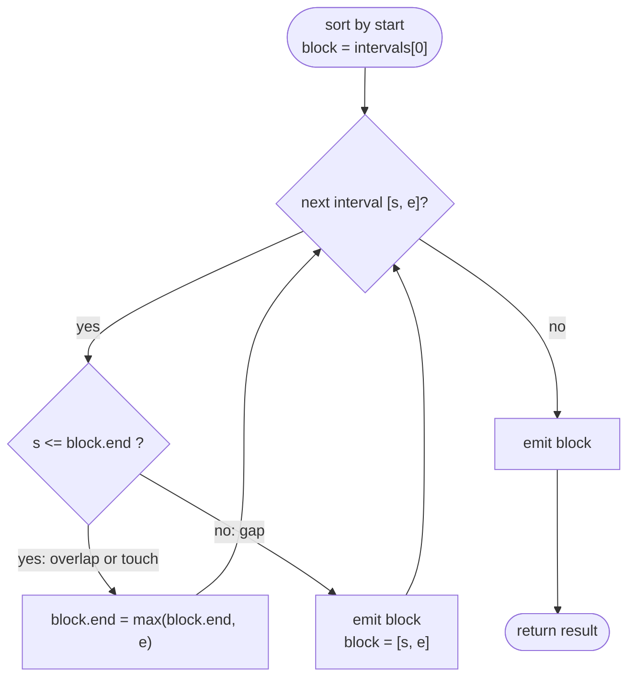

# LC 56 Merge Intervals

> [!abstract] In one sentence
> After sorting by start, every interval either overlaps the block being built (then `end = max(end, its end)`) or lies strictly to the right of it (then the block is final and a new one begins) — one sort plus one linear sweep.

**Map:** [[NeetCode 150 MOC]] → [[DSA Dashboard]] · Pattern: [[Intervals]]

> [!question] Predict before you read
> With `[[1,10], [2,3], [4,5]]` the naive "set `end` to the newest interval's end" gives `[1,5]`. Which single character in the sweep fixes that, and why is sorting by *start* (not end) the right order?

## Problem

Given a list of `[start, end]` intervals in any order, merge all overlapping ones and return the resulting non-overlapping intervals (any order accepted; sorted is natural).

- `[[1,3], [2,6], [8,10], [15,18]]` → `[[1,6], [8,10], [15,18]]`
- `[[1,4], [4,5]]` → `[[1,5]]` (touching counts as overlapping)

Constraints that matter: `1 ≤ n ≤ 10⁴`, `0 ≤ start ≤ end ≤ 10⁴`; intervals may be nested or identical.

## Clarifying questions

1. Do touching intervals merge? — Yes, `[1,4]` and `[4,5]` → `[1,5]`.
2. Is the input sorted? — No; sorting is part of the solution (if it were, see [[LC 57 Insert Interval]] for the no-sort scan).
3. Can intervals be nested or duplicated? — Yes; the `max` on the end handles nesting.
4. Output order? — Any; sorted by start is what the sweep produces.

## Brute force

Repeatedly find any overlapping pair and merge it until none remain: O(n²) per round, O(n) rounds in the worst case. The waste: after sorting, every merge decision is local — an interval only ever needs to be compared with the block immediately before it.

## The key insight

Sort by start. Then the block `[start, end]` you are building can only be touched by the *next* interval: if `next.start ≤ end` they overlap (or touch) and the block grows to `max(end, next.end)`; otherwise `next.start > end`, and since every later interval starts even later, none of them can reach back into the block — it is finished. Recognition cue: "merge / union of ranges", "overlapping", "how many after merging" → sort by start and sweep with one open block.

## Optimal approach

1. Sort `intervals` by start.
2. `start, end = intervals[0]`. For each later interval: if `s ≤ end` then `end = max(end, e)`; else emit `[start, end]` and set `start, end = s, e`.
3. Emit the final block.



> [!example]- Excalidraw version — the same diagram as an editable canvas
> ![[LC 56 Merge Intervals — Optimal approach.excalidraw]]
> [[LC 56 Merge Intervals — Optimal approach.excalidraw|Open in Excalidraw]] — needs the Excalidraw plugin (see [[Plugins to Install]]).

## Walkthrough

`[[1,3], [2,6], [8,10], [15,18]]` (already sorted)

| next | s ≤ end? | block after | emitted |
|---|---|---|---|
| [1,3] | — (seed) | [1,3] | |
| [2,6] | 2 ≤ 3 | [1,6] | |
| [8,10] | 8 > 6 | [8,10] | [1,6] |
| [15,18] | 15 > 10 | [15,18] | [8,10] |
| end | | | [15,18] |

> [!example] Number line 1..18: the two overlapping intervals form one block
> ![[LC 56 Merge Intervals — Number line 1..18- the two overlapping intervals form one block.excalidraw]]
> [[LC 56 Merge Intervals — Number line 1..18- the two overlapping intervals form one block.excalidraw|Open in Excalidraw]] — 1 = covered; the first block (amber) is [1,6]; the gap at 7 closes it before [8,10] starts a new one

%% excalidraw-spec
{"kind": "grid", "title": "Number line 1..18: the two overlapping intervals form one block", "col_labels": ["", "1", "2", "3", "4", "5", "6", "7", "8", "9", "10"], "row_labels": ["[1,3]", "[2,6]", "[8,10]", "block"], "rows": [ [1, 1, 1, 0, 0, 0, 0, 0, 0, 0], [0, 1, 1, 1, 1, 1, 0, 0, 0, 0], [0, 0, 0, 0, 0, 0, 0, 1, 1, 1], [1, 1, 1, 1, 1, 1, 0, 2, 2, 2] ], "highlight": [ [3, 0], [3, 1], [3, 2], [3, 3], [3, 4], [3, 5] ], "caption": "1 = covered; the first block (amber) is [1,6]; the gap at 7 closes it before [8,10] starts a new one"}
%%

## Java solution

```java
import java.util.*;

class Solution {
    public int[][] merge(int[][] intervals) {
        Arrays.sort(intervals, (a, b) -> Integer.compare(a[0], b[0]));   // by start
        List<int[]> out = new ArrayList<>();
        int start = intervals[0][0], end = intervals[0][1];              // the block being built
        for (int i = 1; i < intervals.length; i++) {
            int s = intervals[i][0], e = intervals[i][1];
            if (s <= end) {
                end = Math.max(end, e);          // overlap or touch: extend (max handles nesting)
            } else {
                out.add(new int[]{start, end});  // gap: the block is final
                start = s;
                end = e;
            }
        }
        out.add(new int[]{start, end});          // the last block is still open
        return out.toArray(new int[0][]);
    }
}
```

**Time** O(n log n) for the sort, O(n) sweep · **Space** O(n) for the output (O(log n) sort stack)

## Why it works

Invariant: before processing interval `i`, the emitted blocks plus the open block form exactly the merged union of `intervals[0..i−1]`, and the open block has the largest end among them. Sorting by start means `intervals[i].start ≥` every earlier start, so `intervals[i]` can overlap at most the open block (all earlier blocks end before the open block starts, and the open block's start is ≤ `intervals[i].start`). If `s ≤ end` the union with the open block is one interval `[start, max(end, e)]`; otherwise there is a gap and the open block can never be touched again, because every remaining interval starts at or after `s > end`. Induction over `i` gives the result.

## Edge cases

- Single interval: the loop does not run; emitted once.
- Nested (`[[1,10], [2,3]]`): `max` keeps `end = 10`.
- Identical intervals: merged into one.
- Touching (`[[1,4], [4,5]]`): `4 ≤ 4` → merged, because the test is `<=`.
- Already disjoint and sorted: every interval is emitted as is.
- Zero-length intervals (`[5,5]`): legal, merge like any other.

## Common mistakes

> [!warning] What goes wrong
> - `end = e` instead of `end = Math.max(end, e)`: a nested interval shrinks the block.
> - Comparator `(a, b) -> a[0] - b[0]`: fine for these bounds but overflows for large magnitudes; always `Integer.compare`. See [[Java Pitfalls in Interviews]].
> - Forgetting to add the last open block after the loop.
> - Sorting by end: `[[2,3], [1,10]]` then compares `[1,10]` against `[2,3]` and the block logic breaks.
> - Using `<` instead of `<=` so touching intervals stay apart.

## Variants & follow-ups

- Sorted input, one new interval: skip the sort — [[LC 57 Insert Interval]].
- Minimum removals to make the set disjoint: sort by end instead — [[LC 435 Non-overlapping Intervals]].
- How many intervals overlap at the busiest point: sweep line with +1/−1 events — [[LC 253 Meeting Rooms II]].
- Total covered length after merging: sum `end − start` over the blocks.
- Intervals as letter spans: [[LC 763 Partition Labels]] is merge-intervals on 26 intervals.
- Streaming inserts: `TreeMap<Integer, Integer>` keyed by start, `floorEntry` / `ceilingKey` to find neighbours (LC 352).

## Interview script

Restate: "merge all overlapping ranges, touching included." Brute force: "repeatedly merge any overlapping pair — n² or worse." Insight: "sorted by start, an interval only ever interacts with the block just before it; a gap closes the block permanently." Approach: "sort, sweep with `start`/`end`, extend with `max`, emit on gap, emit the last block." Complexity: "O(n log n), O(n)." Tests: nested, touching, identical, single, already disjoint. State the `Integer.compare` comparator without being asked.

## Related

- Pattern: [[Intervals]] (sort-by-start sweep) · [[Sorting]] as preprocessing
- Siblings: [[LC 57 Insert Interval]], [[LC 435 Non-overlapping Intervals]], [[LC 253 Meeting Rooms II]]
- Intervals in disguise: [[LC 763 Partition Labels]]
- Java: [[Java Collections Cheat Sheet]] (sorting `int[][]`, `List<int[]>` to `int[][]`), [[Java Pitfalls in Interviews]] (subtraction comparators)

## Attempt log

| Date | Result | Minutes | What I got wrong |
|---|---|---|---|
| | | | |

### Mastery checklist
- [ ] Solved without hints in under 25 minutes
- [ ] Stated complexity before coding
- [ ] Handled every edge case above
- [ ] Code compiled first time
- [ ] Can do the follow-up variant

## Open questions
- [ ] Could the sweep be done without sorting if the coordinates are small (`≤ 10⁴`)? Sketch a counting / difference-array version and compare its complexity with `n log n`.
