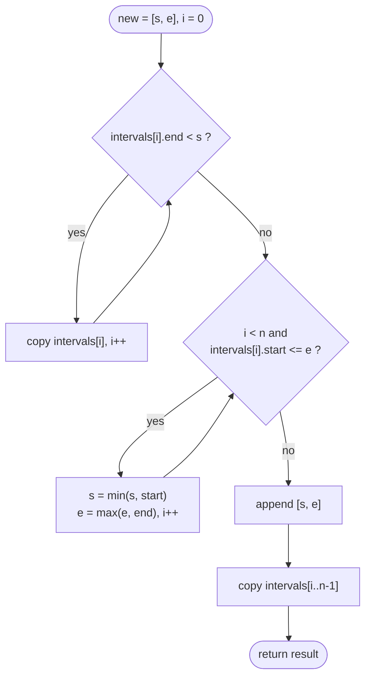

# LC 57 Insert Interval

> [!abstract] In one sentence
> Walk the sorted list in three phases — copy everything that ends before the new interval starts, swallow everything that starts before the (growing) new interval ends, copy the rest — and the merged result falls out in O(n) without sorting.

**Map:** [[NeetCode 150 MOC]] → [[DSA Dashboard]] · Pattern: [[Intervals]]

> [!question] Predict before you read
> Two tests decide the three phases: "ends before new starts" and "starts after new ends". Which one must use `<=` rather than `<` for touching intervals such as `[1, 2]` and `[2, 3]` to merge?

## Problem

You get `intervals`, a list of `[start, end]` pairs sorted by `start` and pairwise non-overlapping, plus one `newInterval`. Insert it so that the list stays sorted and non-overlapping, merging where necessary, and return the new list.

- `intervals = [[1,3], [6,9]]`, `newInterval = [2,5]` → `[[1,5], [6,9]]`
- `intervals = [[1,2], [3,5], [6,7], [8,10], [12,16]]`, `newInterval = [4,8]` → `[[1,2], [3,10], [12,16]]`

Constraints that matter: up to `10⁴` intervals, bounds up to `10⁵`, `intervals` may be empty, and intervals that merely touch (`[1,2]` and `[2,3]`) count as overlapping and must merge.

## Clarifying questions

1. Is the input sorted and disjoint? — Yes, both; this is what makes the no-sort solution possible.
2. Do touching intervals merge? — Yes (`[1,2]` + `[2,3]` → `[1,3]`).
3. Can `intervals` be empty? — Yes; return `[newInterval]`.
4. Must I modify in place? — No; return a new array.

## Brute force

Append `newInterval`, sort, and run [[LC 56 Merge Intervals]]: O(n log n). Correct and short, but it throws away the sortedness you were given; the interviewer wants the O(n) scan.

## The key insight

Because the input is sorted and disjoint, the intervals fall into three contiguous groups relative to `newInterval = [s, e]`: those with `end < s` (strictly before — keep as is), those with `start ≤ e` after that point (they overlap the span, which may have grown — absorb with `min` / `max`), and the remainder (strictly after — keep as is). One index moves through the three groups in order. Recognition cue: "sorted non-overlapping intervals plus one more" → three-phase scan; "unsorted" → sort and merge.

## Optimal approach

1. `i = 0`; while `intervals[i].end < s`: copy `intervals[i]`, `i++`.
2. While `i < n` and `intervals[i].start ≤ e`: `s = min(s, start)`, `e = max(e, end)`, `i++`.
3. Append `[s, e]`; copy the remaining intervals.



> [!example]- Excalidraw version — the same diagram as an editable canvas
> ![[LC 57 Insert Interval — Optimal approach.excalidraw]]
> [[LC 57 Insert Interval — Optimal approach.excalidraw|Open in Excalidraw]] — needs the Excalidraw plugin (see [[Plugins to Install]]).

## Walkthrough

`intervals = [[1,2], [3,5], [6,7], [8,10], [12,16]]`, `newInterval = [4,8]`

| i | interval | phase test | action | [s, e] |
|---|---|---|---|---|
| 0 | [1,2] | end 2 < 4 | copy | [4,8] |
| 1 | [3,5] | start 3 ≤ 8 | absorb | [3,8] |
| 2 | [6,7] | start 6 ≤ 8 | absorb | [3,8] |
| 3 | [8,10] | start 8 ≤ 8 (touching) | absorb | [3,10] |
| 4 | [12,16] | start 12 > 10 | append [3,10], copy rest | — |

Result `[[1,2], [3,10], [12,16]]`.

> [!example] Three phases over the sorted list
> ![[LC 57 Insert Interval — Three phases over the sorted list.excalidraw]]
> [[LC 57 Insert Interval — Three phases over the sorted list.excalidraw|Open in Excalidraw]] — amber intervals are absorbed into [4,8], which grows to [3,10]; the others are copied unchanged

%% excalidraw-spec
{"kind": "array", "title": "Three phases over the sorted list", "values": ["[1,2]", "[3,5]", "[6,7]", "[8,10]", "[12,16]"], "pointers": {"before": 0, "overlap": 1, "after": 4}, "highlight": [1, 2, 3], "caption": "amber intervals are absorbed into [4,8], which grows to [3,10]; the others are copied unchanged"}
%%

## Java solution

```java
import java.util.*;

class Solution {
    public int[][] insert(int[][] intervals, int[] newInterval) {
        List<int[]> out = new ArrayList<>();
        int n = intervals.length, i = 0;
        int s = newInterval[0], e = newInterval[1];

        while (i < n && intervals[i][1] < s) out.add(intervals[i++]);   // phase 1: entirely before

        while (i < n && intervals[i][0] <= e) {                           // phase 2: overlaps the span
            s = Math.min(s, intervals[i][0]);
            e = Math.max(e, intervals[i][1]);
            i++;
        }
        out.add(new int[]{s, e});

        while (i < n) out.add(intervals[i++]);                            // phase 3: entirely after
        return out.toArray(new int[0][]);
    }
}
```

**Time** O(n) · **Space** O(n) for the output (O(1) extra)

## Why it works

Sortedness gives the three groups their order: once some interval has `end ≥ s`, every later interval has `start ≥` that interval's start, so none of them can be "entirely before" either. In phase 2 the span `[s, e]` only grows, and each absorbed interval overlaps the current span (`start ≤ e` and, since phase 1 ended, `end ≥ original s`), so the union stays a single interval. Phase 2 stops at the first interval with `start > e`; all later intervals start even later, so none overlaps the final span. The output is therefore the sorted, disjoint union of the input and `newInterval`.

## Edge cases

- Empty `intervals`: phases 1 and 2 do nothing; output `[newInterval]`.
- New interval before everything (`[[3,5]]`, new `[1,2]`): phase 1 copies nothing, phase 2 absorbs nothing → `[[1,2], [3,5]]`.
- New interval after everything: phase 1 copies all → appended last.
- New interval swallowing everything (`[[1,2], [3,4]]`, new `[0,10]`): phase 2 absorbs all → `[[0,10]]`.
- New interval inside an existing one (`[[1,10]]`, new `[3,4]`): absorbed; `s = 1`, `e = 10`.
- Touching on either side: `[1,2]` + `[2,3]` merges, because phase 1 uses strict `<` and phase 2 uses `<=`.

## Common mistakes

> [!warning] What goes wrong
> - Phase 1 with `<=` or phase 2 with `<`: touching intervals stay separate, which LeetCode counts as wrong.
> - Forgetting `Math.min` for `s`: `[[3,5]]` with new `[4,8]` must become `[3,8]`, not `[4,8]`.
> - Forgetting the `i < n` guard in phase 2 when `newInterval` extends past the last interval.
> - Returning a `List<int[]>` where an `int[][]` is required; `toArray(new int[0][])` is the idiom.
> - Binary-searching for the insert position and then merging anyway — the merge is already linear, so the search buys nothing.

## Variants & follow-ups

- Unsorted input: sort first, then this is [[LC 56 Merge Intervals]].
- Remove an interval instead of inserting one (LC 1272 Remove Interval): the same three phases, but the overlap phase emits up to two fragments.
- A stream of inserts with range queries (LC 715 Range Module, LC 352 Data Stream as Disjoint Intervals): keep the intervals in a `TreeMap<Integer, Integer>` keyed by start and use `floorKey` / `ceilingKey` for the two phase boundaries — O(log n) per insert.
- Intersection of two sorted interval lists (LC 986): two pointers, advance the one that ends first.
- Count removals to make everything disjoint: [[LC 435 Non-overlapping Intervals]].

## Interview script

Restate: "sorted, disjoint list; insert one interval; merge; return sorted and disjoint." Brute force: "append, sort, merge — n log n." Insight: "sorted input splits into before / overlapping / after; the overlapping run collapses into one min–max span." Approach: "three while loops with one index; touching counts as overlap." Complexity: "O(n), O(1) extra." Tests: empty list, insert at the front, at the back, swallowing all, nested inside one, touching. Mention the `TreeMap` version for repeated inserts.

## Related

- Pattern: [[Intervals]] (sorted-scan family)
- The unsorted twin: [[LC 56 Merge Intervals]]; the scheduling twin: [[LC 435 Non-overlapping Intervals]]
- Overlap test practice: [[LC 252 Meeting Rooms]]; intervals in disguise: [[LC 763 Partition Labels]]
- Java: [[Java Collections Cheat Sheet]] (`List<int[]>` to `int[][]`, `TreeMap.floorKey`), [[DSA Patterns in Java]] (interval templates)

## Attempt log

| Date | Result | Minutes | What I got wrong |
|---|---|---|---|
| | | | |

### Mastery checklist
- [ ] Solved without hints in under 25 minutes
- [ ] Stated complexity before coding
- [ ] Handled every edge case above
- [ ] Code compiled first time
- [ ] Can do the follow-up variant

## Open questions
- [ ] Sketch the `TreeMap<Integer, Integer>` version: which two lookups (`floorKey` on `s`, `ceilingKey` on `e`?) find the first and last interval to absorb, and what goes wrong for an interval whose floor entry ends before `s`?
