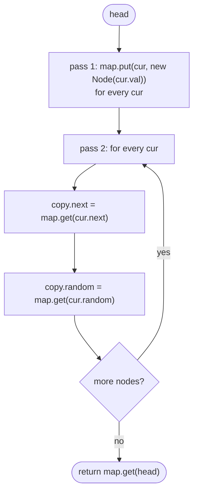

# LC 138 Copy List with Random Pointer

> [!abstract] In one sentence
> A `random` pointer may point *forward* to a node whose copy does not exist yet, so copying in one pass fails; create all copies first and remember the old → new mapping (a `HashMap`, or the trick of placing each copy immediately after its original), then set every `next` and `random` by translating the original's targets through that mapping.

**Map:** [[NeetCode 150 MOC]] → [[DSA Dashboard]] · Pattern: [[Linked Lists]]

> [!question] Predict before you read
> If the copies are woven into the original list as `A → A' → B → B' → …`, what single expression gives `A'.random` — and why does `HashMap.get(null)` returning `null` save you two `if` statements in the map version?

## Problem

Each node of a singly linked list has an `int val`, a `next` pointer and a `random` pointer that points to any node in the list or to `null`. Build a deep copy: a new list of new nodes whose `next` and `random` pointers reproduce the original's structure exactly, with no pointer into the original list. Return the head of the copy.

Example: the list written as pairs `(7, null), (13, 0), (11, 4), (10, 2), (1, 0)` — each pair is `val` and the index its `random` points to — must produce a structurally identical new list.

Constraints that matter: 0..1000 nodes; values may repeat, so a node is identified by *reference*, never by value; `random` may be `null`, may point to the node itself, forward or backward.

## Clarifying questions

1. Can `random` point forward (to a node later in the list) or to itself? — Both; this is why a single forward pass cannot set `random` directly.
2. Are values unique? — No; the map must be keyed by node identity, not value.
3. May I temporarily modify the original list? — Usually yes if restored; it enables the O(1)-space interleaving solution. Ask before doing it.
4. What does the judge check? — That no copied pointer refers to an original node and that the shape matches.

## Brute force

For each node, create its copy, then to set `random` scan the original list to find the *index* of `random`'s target and walk the copy to the same index: O(n) per node, O(n²) total. Correct, no extra memory beyond the copy. The waste is the repeated index lookup — a map from original node to its copy answers "which copy corresponds to this target" in O(1).

## The key insight

Separate *creation* from *wiring*. Once every copy exists and you can translate any original node to its copy, both pointers of every copy are `translate(original.next)` and `translate(original.random)` — no ordering problem remains. The translation table can be a `HashMap<Node, Node>` (O(n) space, two passes) or the list itself: insert each copy directly after its original, so `translate(x) = x.next` for every original `x`, then unweave. Recognition cue: "deep copy", "clone", "pointer to arbitrary node" — the same idea as [[LC 133 Clone Graph]], where the map is also keyed by node reference.

## Optimal approach

1. Pass 1: for each original `cur`, `copy.put(cur, new Node(cur.val))`.
2. Pass 2: for each original `cur`, `c = copy.get(cur)`; `c.next = copy.get(cur.next)`; `c.random = copy.get(cur.random)`.
3. Return `copy.get(head)` — `null` for an empty list.



> [!example]- Excalidraw version — the same diagram as an editable canvas
> ![[LC 138 Copy List with Random Pointer — Optimal approach.excalidraw]]
> [[LC 138 Copy List with Random Pointer — Optimal approach.excalidraw|Open in Excalidraw]] — needs the Excalidraw plugin (see [[Plugins to Install]]).

## Walkthrough

Original `7 → 13 → 11 → 10 → 1` with `random`: 7 → null, 13 → 7, 11 → 1, 10 → 11, 1 → 7. After pass 1 the map holds five entries; pass 2 fills the copies:

| cur | copy.next ← map.get(cur.next) | copy.random ← map.get(cur.random) |
|---|---|---|
| 7 | 13' | map.get(null) = null |
| 13 | 11' | 7' |
| 11 | 10' | 1' (forward reference — already exists) |
| 10 | 1' | 11' |
| 1 | map.get(null) = null | 7' |

The interleaving version produces this intermediate shape before unweaving:

> [!example] Copies woven after their originals
> ![[LC 138 Copy List with Random Pointer — Copies woven after their originals.excalidraw]]
> [[LC 138 Copy List with Random Pointer — Copies woven after their originals.excalidraw|Open in Excalidraw]] — for any original x the copy is x.next, so x.next.random = x.random.next; the final pass splits odd and even positions back into two lists

%% excalidraw-spec
{"kind": "list", "title": "Copies woven after their originals", "nodes": ["7", "7'", "13", "13'", "11", "11'", "10", "10'"], "highlight": [1, 3, 5, 7], "caption": "for any original x the copy is x.next, so x.next.random = x.random.next; the final pass splits odd and even positions back into two lists"}
%%

## Java solution

```java
import java.util.*;

class Solution {
    public Node copyRandomList(Node head) {
        Map<Node, Node> copy = new HashMap<>();              // keyed by identity: Node has no equals override
        for (Node cur = head; cur != null; cur = cur.next) {
            copy.put(cur, new Node(cur.val));                // pass 1: every copy exists before any wiring
        }
        for (Node cur = head; cur != null; cur = cur.next) { // pass 2: translate both pointers
            Node c = copy.get(cur);
            c.next = copy.get(cur.next);                     // get(null) returns null: tail handled for free
            c.random = copy.get(cur.random);                 // same for a null random
        }
        return copy.get(head);                               // null when head is null
    }
}

class Node {
    int val;
    Node next, random;
    Node(int val) { this.val = val; }
}
```

**Time** O(n) — two passes with O(1) map operations · **Space** O(n) for the map (the copy itself is output, not overhead).

The O(1)-extra-space version weaves copies into the original list and uses the list as the map:

```java
// snippet
for (Node cur = head; cur != null; cur = cur.next.next) {       // 1. weave: A → A' → B → B' → …
    Node c = new Node(cur.val); c.next = cur.next; cur.next = c;
}
for (Node cur = head; cur != null; cur = cur.next.next)         // 2. randoms via the weave
    if (cur.random != null) cur.next.random = cur.random.next;
Node dummy = new Node(0), tail = dummy;                          // 3. unweave, restoring the original
for (Node cur = head; cur != null; cur = cur.next) {
    tail.next = cur.next; tail = tail.next; cur.next = cur.next.next;
}
return dummy.next;                                              // O(n) time, O(1) extra space
```

## Why it works

Invariant after pass 1: `copy` is a bijection from original nodes to fresh nodes with the same values, and no copied pointer has been set. Pass 2 sets, for every original `x`, `copy(x).next = copy(x.next)` and `copy(x).random = copy(x.random)`, where `copy(null) = null` by the map's behaviour on a missing key. Therefore the copied list has an edge `copy(x) → copy(y)` exactly when the original has `x → y`, for both pointer kinds — a structure-preserving map, which is the definition of a deep copy — and every target is a fresh node, so nothing points back into the original. The weaving version maintains the same bijection implicitly: after step 1, `copy(x) = x.next` for every original `x`, which is why `x.next.random = x.random.next` is the same assignment as `copy(x).random = copy(x.random)`.

## Edge cases

- Empty list → both loops skip; `copy.get(null)` is `null`.
- Single node with `random` to itself → `c.random = copy.get(cur) = c`: the copy points to itself, not the original.
- `random` forward references → fine, every copy was created in pass 1.
- All `random` null → `copy.get(null)` yields null each time.
- Duplicate values → irrelevant; the map is keyed by reference (`Node` inherits identity `hashCode`/`equals`).

## Common mistakes

> [!warning] Pitfalls
> - Trying to set `random` in the same pass that creates nodes, with `if (!map.containsKey(target)) create it` — works but every creation site must agree, and it is easy to create a node twice. Two passes are simpler and provably correct.
> - Overriding `equals`/`hashCode` on `Node` by value: nodes with equal values collapse into one map entry and the copy merges them.
> - In the weaving version, forgetting to restore the original list's `next` pointers: the judge checks the original is unchanged.
> - In the weaving version, writing `cur.next.random = cur.random.next` without the `cur.random != null` guard — NullPointerException.
> - Returning `head` (the original) or forgetting that `map.get(head)` is the answer, not the first node created.

## Variants & follow-ups

- Clone a graph with arbitrary edges: [[LC 133 Clone Graph]] — the same map, with DFS/BFS instead of a linear walk because there is no `next` order.
- Clone a binary tree with random pointers (LC 1485): the map version transfers unchanged; recursion replaces the loop.
- Copy a doubly linked list with child pointers (flatten, LC 430): structure first, pointers second, again.
- "Do it in O(1) extra space without modifying the original" — not possible without random access; say so and explain the weaving trade-off (temporary modification, restored).
- Serialising the list with random pointers (indices instead of references) is the on-disk version of the same translation table.

## Interview script

Restate: "Deep copy a list where each node also has a random pointer to any node or null; no copied pointer may touch the original." Brute force: "For each random, find its index in the original and walk the copy — O(n²)." Insight: "Separate creation from wiring: make all copies first, keep an old → new map, then every pointer of a copy is the map lookup of the original's pointer." Approach: "Two passes over the list with a `HashMap<Node, Node>`; `get(null)` returning null handles the tail and null randoms." Complexity: "O(n) time, O(n) space; the follow-up weaves each copy after its original to get O(1) extra space in three passes." Tests: "Empty, single self-referencing node, a forward random, duplicate values."

## Related

- Pattern: [[Linked Lists]] · the map idea: [[Hashing]]
- Same translation-table technique on a graph: [[LC 133 Clone Graph]]
- Map keyed by node reference, as in [[LC 146 LRU Cache]]
- Java refresher: [[Java Collections Cheat Sheet]] (`HashMap.get` on a missing or null key, identity vs value equality)

## Attempt log

| Date | Result | Minutes | What I got wrong |
|---|---|---|---|
| | | | |

### Mastery checklist
- [ ] Solved without hints in under 25 minutes
- [ ] Stated complexity before coding
- [ ] Handled every edge case above
- [ ] Code compiled first time
- [ ] Can do the follow-up variant

## Open questions
- [ ]
