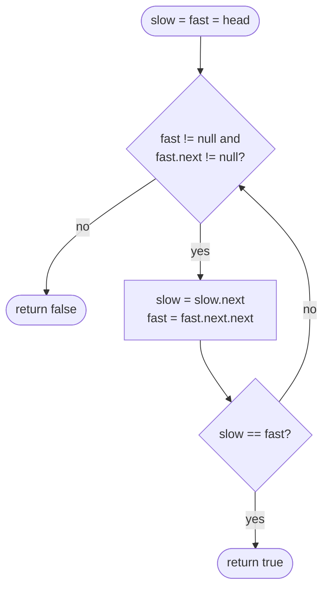

# LC 141 Linked List Cycle

> [!abstract] In one sentence
> A pointer that moves two nodes per step and one that moves one node per step either reach `null` (no cycle) or both end up inside the cycle, where their distance shrinks by one node every step and therefore reaches zero — detection in O(n) time and O(1) space, with no marking and no set.

**Map:** [[NeetCode 150 MOC]] → [[DSA Dashboard]] · Pattern: [[Linked Lists]]

> [!question] Predict before you read
> Why can the fast pointer never "jump over" the slow one inside a cycle, and what is the most steps the slow pointer takes before they meet, expressed in terms of the cycle length?

## Problem

Given the head of a singly linked list, return `true` if the list contains a cycle — that is, if following `next` from some node eventually revisits that node — and `false` otherwise. The judge describes the cycle with a hidden index `pos` (the node the tail points back to); your code never sees it.

Examples: `3 → 2 → 0 → −4` with the tail linked back to node 2 → `true`. `1 → 2` with the tail linked to 1 → `true`. `1` alone → `false`.

Constraints that matter: 0..10⁴ nodes; values are irrelevant and may repeat, so you cannot detect a cycle by comparing values. The follow-up asks for O(1) memory.

## Clarifying questions

1. May I modify the nodes (e.g. mark them)? — Usually no; and the O(1)-space follow-up is the real question.
2. Can the list be empty or a single node pointing to itself? — Yes; both must be handled (`false` and `true` respectively).
3. Do I need to return where the cycle starts? — Not here; that is LC 142 and [[LC 287 Find the Duplicate Number]].
4. Are values unique? — No, so comparing values proves nothing; compare node references.

## Brute force

Walk the list keeping a `HashSet<ListNode>` of visited nodes; the first node seen twice proves a cycle, and reaching `null` proves none. O(n) time, O(n) space, and perfectly acceptable as a first answer. A worse brute force counts steps and declares a cycle after more than 10⁴ moves — it works only because of the constraint and says nothing about the structure. The waste in the set version is memory: a node's identity is recorded when the geometry of the walk already reveals the cycle.

## The key insight

Two walkers at different speeds. Without a cycle the fast one runs off the end. With a cycle both eventually live inside it, and then the distance from fast to slow (measured forward around the cycle) decreases by exactly one per step — slow moves one, fast moves two — so it reaches zero after at most cycle-length steps. There is no way to skip over: a distance that changes by exactly one cannot go from positive to negative without passing zero. Recognition cue: "cycle", "loop", "does it terminate", "O(1) space", and — disguised — "n + 1 numbers in 1..n, find the duplicate" ([[LC 287 Find the Duplicate Number]]).

## Optimal approach

1. `slow = head`, `fast = head`.
2. While `fast != null && fast.next != null`: `slow = slow.next`, `fast = fast.next.next`; if `slow == fast` return `true`.
3. The loop exited because `fast` reached the end: return `false`.



> [!example]- Excalidraw version — the same diagram as an editable canvas
> ![[LC 141 Linked List Cycle — Optimal approach.excalidraw]]
> [[LC 141 Linked List Cycle — Optimal approach.excalidraw|Open in Excalidraw]] — needs the Excalidraw plugin (see [[Plugins to Install]]).

## Walkthrough

`3 → 2 → 0 → −4 → (back to 2)`: the cycle has length 3 and starts one node in.

| Step | slow | fast | Note |
|---|---|---|---|
| 0 | 3 | 3 | start together |
| 1 | 2 | 0 | fast enters the cycle |
| 2 | 0 | 2 | both in the cycle; gap fast→slow is 1 |
| 3 | −4 | −4 | gap 0: meet, return true |

> [!example] Floyd on 3 → 2 → 0 → -4 → 2
> ![[LC 141 Linked List Cycle — Floyd on 3 → 2 → 0 → -4 → 2.excalidraw]]
> [[LC 141 Linked List Cycle — Floyd on 3 → 2 → 0 → -4 → 2.excalidraw|Open in Excalidraw]] — state after step 2: fast is one node behind slow going forward around the cycle, so the next step closes the gap

%% excalidraw-spec
{"kind": "list", "title": "Floyd on 3 → 2 → 0 → -4 → 2", "nodes": ["3", "2", "0", "-4"], "pointers": {"slow": 2, "fast": 1}, "cycle_to": 1, "caption": "state after step 2: fast is one node behind slow going forward around the cycle, so the next step closes the gap"}
%%

Compare the acyclic `1 → 2 → 3`: step 1 puts `slow` on 2 and `fast` on 3; `fast.next` is null, the guard fails, return `false`.

## Java solution

```java
import java.util.*;

class Solution {
    public boolean hasCycle(ListNode head) {
        ListNode slow = head, fast = head;
        while (fast != null && fast.next != null) {   // order matters: fast is checked before fast.next
            slow = slow.next;
            fast = fast.next.next;
            if (slow == fast) return true;            // reference equality, never .val
        }
        return false;                                  // fast ran off the end
    }
}

class ListNode {
    int val;
    ListNode next;
    ListNode(int x) { val = x; next = null; }
}
```

**Time** O(n) — at most n steps to enter the cycle plus at most cycle-length steps to meet · **Space** O(1).

The set-based answer, for completeness and as the version to give first if you are rusty:

```java
// snippet
Set<ListNode> seen = new HashSet<>();           // identity-based: ListNode does not override equals
for (ListNode cur = head; cur != null; cur = cur.next)
    if (!seen.add(cur)) return true;            // add returns false when already present
return false;                                   // O(n) time, O(n) space
```

## Why it works

Two cases. If there is no cycle, `fast` advances two nodes per step over a finite list and reaches `null` (or a node whose `next` is null) within n/2 steps; the guard stops the loop and `false` is correct because `slow == fast` can only happen at the start, which is checked after the first move. If there is a cycle of length L, then after at most a steps (a = nodes before the cycle) `slow` is in the cycle, and `fast`, being ahead, is already there. Let d be the distance from `fast` forward to `slow` along the cycle, 0 ≤ d < L. Each step `slow` moves one and `fast` two, so d decreases by one modulo L — strictly by one as long as d > 0. After d ≤ L − 1 further steps, d = 0 and `slow == fast`. So the loop returns `true` within a + L steps, which is at most n.

## Edge cases

- Empty list → `fast == null`, guard fails, `false`.
- Single node, no cycle → `fast.next == null`, `false`.
- Single node pointing to itself → step 1: `slow = fast = that node`, `true`.
- Two nodes forming a cycle → step 1: `slow` on 2, `fast` back on 1; step 2: both on 2 — `true`.
- Cycle that starts at the head (`pos = 0`) → same argument, a = 0.

## Common mistakes

> [!warning] Pitfalls
> - Guard written as `fast.next != null && fast != null`: evaluated left to right, it dereferences `fast` before the null check and throws on even-length acyclic lists.
> - Comparing `slow.val == fast.val`: values repeat; a list `1 → 1` without a cycle returns a false positive.
> - Checking `slow == fast` *before* the first move: they start equal, so every list reports a cycle.
> - Moving both pointers one step (`fast = fast.next`) from different starting nodes: equal speeds keep a constant gap inside the cycle and never meet. The speeds must differ.
> - Guarding with `fast.next.next != null`: it skips the final step and misses a cycle entered on the last node.

## Variants & follow-ups

- Return the node where the cycle *begins* (LC 142): after the meeting, reset one pointer to `head` and advance both one step at a time; they meet at the cycle start. The arithmetic is in [[Linked Lists]] and the whole of [[LC 287 Find the Duplicate Number]].
- Length of the cycle: after meeting, keep `slow` still and walk `fast` once around, counting.
- Remove the cycle: find the start, walk to the node before it, set its `next = null`.
- Happy number ([[LC 202 Happy Number]]): the "list" is `n → sumOfSquaredDigits(n)`; the same two-speed walk detects the loop that is not 1.
- Middle of the list: the same two speeds with the roles reversed — stop when `fast` ends, read `slow` ([[LC 143 Reorder List]]).

## Interview script

Restate: "Return whether following `next` from the head ever revisits a node; values may repeat." Brute force: "A `HashSet` of visited nodes — O(n) time, O(n) space." Insight: "Two pointers at speeds one and two: no cycle means fast falls off; a cycle means both end up inside it and the forward gap shrinks by one per step, so it reaches zero." Approach: "Loop while `fast` and `fast.next` are non-null; move; compare references." Complexity: "O(n) time, O(1) space." Tests: "Empty, single self-loop, two-node cycle, long acyclic list with even and odd length — the two lengths exercise both halves of the guard."

## Related

- Pattern: [[Linked Lists]] · the broader family: [[Two Pointers]] (fast/slow)
- Same mechanism on an array: [[LC 287 Find the Duplicate Number]]
- Fast/slow for the middle: [[LC 143 Reorder List]] · fixed gap instead of 2:1: [[LC 19 Remove Nth Node From End of List]]
- Cycle in a number sequence: [[LC 202 Happy Number]]
- Java refresher: [[Java Collections Cheat Sheet]] (`Set.add` returns a boolean; identity vs `equals`)

## Attempt log

| Date | Result | Minutes | What I got wrong |
|---|---|---|---|
| | | | |

### Mastery checklist
- [ ] Solved without hints in under 25 minutes
- [ ] Stated complexity before coding
- [ ] Handled every edge case above
- [ ] Code compiled first time
- [ ] Can do the follow-up variant

## Open questions
- [ ]
