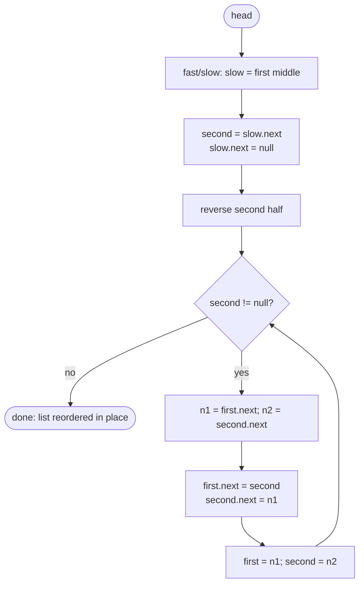

# LC 143 Reorder List

> [!abstract] In one sentence
> The target order alternates one node from the front and one from the back, which on a singly linked list is impossible directly — but if you cut the list at its middle and reverse the second half, "from the back" becomes "from the front of the reversed half", and the answer is a plain interleave of two lists: find the middle, reverse, zip.

**Map:** [[NeetCode 150 MOC]] → [[DSA Dashboard]] · Pattern: [[Linked Lists]]

> [!question] Predict before you read
> For an odd-length list, which half must be longer, and what goes wrong in the interleave step if your middle-finding guard lands on the *second* middle of an even-length list?

## Problem

Given the head of a singly linked list `L0 → L1 → … → Ln−1 → Ln`, reorder it in place to `L0 → Ln → L1 → Ln−1 → L2 → Ln−2 → …`. You may not change node values, only `next` pointers. Nothing is returned.

Examples: `1 → 2 → 3 → 4` → `1 → 4 → 2 → 3`. `1 → 2 → 3 → 4 → 5` → `1 → 5 → 2 → 4 → 3`.

Constraints that matter: 1..5·10⁴ nodes, so a recursive solution over the whole list is out; values are irrelevant. In-place with O(1) extra space is expected even though the statement does not say it.

## Clarifying questions

1. May I use O(n) extra memory? — Allowed by the judge, but the interviewer wants O(1); offer the array version only as the brute force.
2. Is modifying values allowed? — No; relink nodes.
3. Single node or two nodes? — Already in order; return immediately.
4. Odd length: where does the middle element end up? — Last (`1 → 5 → 2 → 4 → 3`); it belongs to the first half.

## Brute force

Copy the nodes into an `ArrayList<ListNode>`, then walk two indices `i = 0` and `j = n − 1` inward, linking `nodes[i].next = nodes[j]`, `nodes[j].next = nodes[i + 1]`, and terminating the last node with `null`. O(n) time, O(n) space; it is correct and quick to write. The waste is the array: it exists only to give "the node from the back" random access, which reversing the second half provides for free.

## The key insight

The output zips the first half (in order) with the second half (in *reverse*). Three moves you already own produce exactly those two lists and then combine them: fast/slow pointers find the middle ([[LC 141 Linked List Cycle]] geometry); three-pointer reversal flips the second half ([[LC 206 Reverse Linked List]]); and an alternating splice is the merge loop of [[LC 21 Merge Two Sorted Lists]] with "take from the other list" instead of "take the smaller". The one subtlety is the cut: the first half must be at least as long as the second, so for even n the middle is the *first* middle, and you must terminate the first half with `null` before reversing — otherwise the reversed half still points into the first half and the interleave loops forever. Recognition cue: "reorder", "fold", "L0 Ln L1 Ln−1", "palindrome list" (same first two moves).

## Optimal approach

1. Find the first middle: `slow = fast = head`; while `fast.next != null && fast.next.next != null` move slow 1, fast 2. `slow` is the last node of the first half.
2. Cut: `second = slow.next; slow.next = null`.
3. Reverse `second` with the prev/cur/next loop.
4. Interleave: while `second != null`: save `n1 = first.next`, `n2 = second.next`; `first.next = second; second.next = n1`; `first = n1; second = n2`.



> [!example]- Excalidraw version — the same diagram as an editable canvas
> ![[LC 143 Reorder List — Optimal approach.excalidraw]]
> [[LC 143 Reorder List — Optimal approach.excalidraw|Open in Excalidraw]] — needs the Excalidraw plugin (see [[Plugins to Install]]).

## Walkthrough

`1 → 2 → 3 → 4 → 5`. Middle search: fast 1 → 3 → 5, slow 1 → 2 → 3; the guard stops with `fast = 5` (no `fast.next`). Cut after 3: first half `1 → 2 → 3`, second half `4 → 5`, reversed to `5 → 4`.

> [!example] After the middle search
> ![[LC 143 Reorder List — After the middle search.excalidraw]]
> [[LC 143 Reorder List — After the middle search.excalidraw|Open in Excalidraw]] — slow is the last node of the first half; the amber nodes are cut off and reversed before interleaving

%% excalidraw-spec
{"kind": "list", "title": "After the middle search", "nodes": ["1", "2", "3", "4", "5"], "pointers": {"slow": 2, "fast": 4}, "highlight": [3, 4], "caption": "slow is the last node of the first half; the amber nodes are cut off and reversed before interleaving"}
%%

| Interleave step | first | second | n1 | n2 | Links made | List |
|---|---|---|---|---|---|---|
| 1 | 1 | 5 | 2 | 4 | 1 → 5, 5 → 2 | 1 → 5 → 2 → 3 |
| 2 | 2 | 4 | 3 | null | 2 → 4, 4 → 3 | 1 → 5 → 2 → 4 → 3 |
| 3 | 3 | null | — | — | stop | 3.next is still null from the cut |

For even length `1 → 2 → 3 → 4` the guard stops at `fast = 3`, `slow = 2` (the first middle); halves are `1 → 2` and `4 → 3`; two interleave steps give `1 → 4 → 2 → 3`.

## Java solution

```java
import java.util.*;

class Solution {
    public void reorderList(ListNode head) {
        if (head == null || head.next == null) return;

        // 1. first middle: for even length this stops on the earlier of the two middles
        ListNode slow = head, fast = head;
        while (fast.next != null && fast.next.next != null) {
            slow = slow.next;
            fast = fast.next.next;
        }

        // 2. cut, then reverse the second half
        ListNode second = slow.next;
        slow.next = null;                     // without this the halves stay connected
        ListNode prev = null;
        while (second != null) {
            ListNode next = second.next;
            second.next = prev;
            prev = second;
            second = next;
        }
        second = prev;                        // head of the reversed half

        // 3. interleave; the first half is never shorter, so second runs out first
        ListNode first = head;
        while (second != null) {
            ListNode n1 = first.next, n2 = second.next;
            first.next = second;
            second.next = n1;
            first = n1;
            second = n2;
        }
    }
}

class ListNode {
    int val;
    ListNode next;
    ListNode() {}
    ListNode(int val) { this.val = val; }
    ListNode(int val, ListNode next) { this.val = val; this.next = next; }
}
```

**Time** O(n) — three linear passes · **Space** O(1) — only pointers; no recursion.

## Why it works

Let the list have n nodes and the cut produce a first half of length ⌈n/2⌉ and a second half of length ⌊n/2⌋ (that is what stopping on the first middle guarantees). After reversal the second half reads `Ln, Ln−1, …`. The interleave invariant: after k steps the output prefix is `L0, Ln, L1, Ln−1, …, Lk−1, Ln−k+1` and `first` points at `Lk`, `second` at `Ln−k`; each step links `Lk → Ln−k → Lk+1`, extending the prefix by exactly the next two required nodes. Because the first half is at least as long as the second, when `second` becomes `null` the node `first` points at is the last node of the first half (odd n) or `null` (even n); in both cases the last link written — `second.next = n1` — already terminates the list correctly, because the cut left the first half ending in `null`. No node is ever lost: `n1` and `n2` are saved before the two overwrites.

## Edge cases

- One node → early return; two nodes → early return (already `L0 → L1`).
- Three nodes `1 → 2 → 3` → middle is 2, halves `1 → 2` and `3`; result `1 → 3 → 2`.
- Even length → first half longer by zero; the final interleave step writes `second.next = null` from the saved `n1`.
- All values equal → irrelevant; the code never reads values.
- 5·10⁴ nodes → iterative throughout, no stack risk.

## Common mistakes

> [!warning] Pitfalls
> - Using the `fast != null && fast.next != null` guard: on even length it lands on the *second* middle, the first half becomes shorter, and the interleave ends with a node dropped or a self-loop.
> - Forgetting `slow.next = null` before reversing: the reversed half's tail still points to the first half's last node → cycle.
> - Reversing the whole list instead of the second half, then trying to zip "head and reversed head": both lists share nodes and the splice corrupts itself.
> - Overwriting `first.next` before saving `n1` (the generic linked-list bug).
> - Returning a new head: the signature is `void`; `head` stays the first node, so nothing needs returning — but if you built a dummy chain you must still mutate the original nodes.

## Variants & follow-ups

- Palindrome linked list (LC 234): the same first two moves, then compare the halves instead of zipping; restore the list afterwards if asked.
- Reorder with a different pattern (`L0 → L2 → L4 → … → L1 → L3`, LC 328 Odd Even Linked List): one pass splitting into two chains by index parity, then concatenate.
- Reverse in groups of k: [[LC 25 Reverse Nodes in k-Group]] — the "reverse a sub-range and reconnect" discipline from step 2, repeated.
- Rotate the list by k (LC 61): find length, connect tail to head, cut at `n − k mod n`.
- Interviewer twist: "do it without reversing". Answer: a stack of the second half gives the same order in O(n/2) space, or the array brute force.

## Interview script

Restate: "Rearrange in place so the order alternates front, back, front, back; node values must not change." Brute force: "Store nodes in an array and link `i` and `n − 1 − i` alternately — O(n) space." Insight: "The output zips the first half with the *reversed* second half, and I can get the reversed second half in place: fast/slow to the middle, cut, three-pointer reversal." Approach: "Middle with the first-middle guard, cut and null-terminate, reverse, then interleave saving both next pointers before relinking." Complexity: "O(n) time, O(1) space." Tests: "Lengths 1, 2, 3 and 4 — length 4 catches the wrong middle, length 3 checks the middle node ends up last — and I confirm the final node's `next` is null."

## Related

- Pattern: [[Linked Lists]] · prerequisites: [[LC 206 Reverse Linked List]], [[LC 141 Linked List Cycle]] (fast/slow geometry), [[LC 21 Merge Two Sorted Lists]] (the splice loop)
- Builds on this: [[LC 25 Reverse Nodes in k-Group]]
- Java refresher: [[DSA Patterns in Java]] (fast/slow and reversal templates)

## Attempt log

| Date | Result | Minutes | What I got wrong |
|---|---|---|---|
| | | | |

### Mastery checklist
- [ ] Solved without hints in under 25 minutes
- [ ] Stated complexity before coding
- [ ] Handled every edge case above
- [ ] Code compiled first time
- [ ] Can do the follow-up variant

## Open questions
- [ ]
