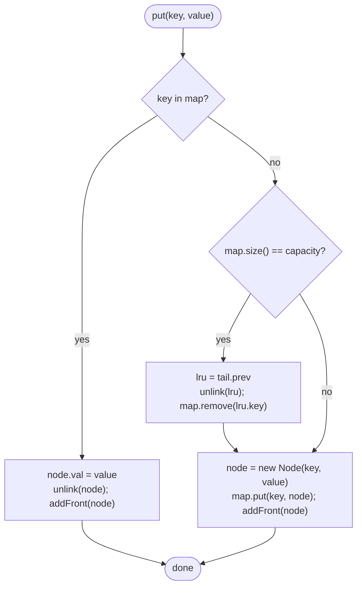

# LC 146 LRU Cache

> [!abstract] In one sentence
> A hash map gives O(1) lookup but no notion of order, and a doubly linked list gives O(1) reordering but no lookup; store each entry as a list node *and* map the key to that node, keep the list ordered by recency between two sentinel nodes, and every `get`/`put` becomes "find the node through the map, unlink it, add it at the front, evict from the back when full" — four pointer writes per operation, no scans.

**Map:** [[NeetCode 150 MOC]] → [[DSA Dashboard]] · Pattern: [[Linked Lists]]

> [!question] Predict before you read
> Why must the list be *doubly* linked, and why does evicting the node before the tail sentinel require the node to store its key as well as its value?

## Problem

Design a data structure with a fixed `capacity` that supports `get(key)` — return the value or −1 if absent — and `put(key, value)` — insert or update. Both must run in O(1) average time. When a `put` would exceed the capacity, evict the least recently used key first, where "used" means touched by either `get` or `put`.

Example: `capacity = 2`; `put(1, 1)`, `put(2, 2)`, `get(1)` → 1, `put(3, 3)` evicts 2, `get(2)` → −1, `put(4, 4)` evicts 1, `get(1)` → −1, `get(3)` → 3, `get(4)` → 4.

Constraints that matter: capacity 1..3000, keys and values up to 10⁴ and 10⁵, up to 2·10⁵ calls — so an O(n) scan per operation (6·10⁸ steps) is too slow in the worst case, and the O(1) requirement is real.

## Clarifying questions

1. Does `get` count as a use? — Yes; it moves the key to most-recent.
2. Does `put` on an existing key update the value and count as a use? — Yes, both; it must not evict anything.
3. Is `capacity` at least 1? — Yes; otherwise every `put` would evict immediately.
4. Thread safety? — Not required here; say that a production version wraps operations in a lock or uses a concurrent design (see *Design an LRU Cache* in the LLD vault).
5. May I use `LinkedHashMap`? — Ask. Many interviewers allow it as a warm-up and then ask for the hand-rolled version; know both.

## Brute force

Keep a `HashMap<Integer, Integer>` for values plus an `ArrayList` of keys in recency order; on every use, remove the key from the list (O(n) search and shift) and append it. Eviction removes index 0 — another O(n) shift. Or use a `LinkedList` and `remove(Object)`, which still scans. Correct, but every operation is O(n) because an array or list cannot *find* an element by key in O(1) and *remove* it in O(1) at the same time.

## The key insight

Each structure covers the other's weakness. The map answers "where is the node for key k" in O(1). The node, being in a doubly linked list, can be unlinked in O(1) because it knows both neighbours; it is then re-inserted after the head sentinel. The least recently used node is always `tail.prev`. Sentinels (`head`, `tail`) mean the list is never empty and no `null` checks appear in `unlink` or `addFront`. The node must carry its key so that on eviction you can remove the map entry. Recognition cue: "O(1) get and put", "evict least recently used", "ordered by access" — the same glue appears in LFU caches, `LinkedHashMap`, and [[LC 981 Time Based Key-Value Store]] variants with recency.

## Optimal approach

1. `Node { key, val, prev, next }`; `map: key → Node`; sentinels `head ⇄ tail`.
2. `get(k)`: node = map.get(k); if null return −1; `unlink(node)`; `addFront(node)`; return value.
3. `put(k, v)`: if present, update value, `unlink` + `addFront`, done. Else if `map.size() == capacity`: `lru = tail.prev`; `unlink(lru)`; `map.remove(lru.key)`. Then create the node, `map.put`, `addFront`.
4. `unlink(n)`: `n.prev.next = n.next; n.next.prev = n.prev`. `addFront(n)`: insert between `head` and `head.next`.



> [!example]- Excalidraw version — the same diagram as an editable canvas
> ![[LC 146 LRU Cache — Optimal approach.excalidraw]]
> [[LC 146 LRU Cache — Optimal approach.excalidraw|Open in Excalidraw]] — needs the Excalidraw plugin (see [[Plugins to Install]]).

## Walkthrough

`capacity = 2`. The list is shown most-recent first, between the sentinels.

| Call | Action | List (head → … → tail) | Map keys | Returns |
|---|---|---|---|---|
| put(1, 1) | insert | 1 | {1} | — |
| put(2, 2) | insert | 2, 1 | {1, 2} | — |
| get(1) | move 1 to front | 1, 2 | {1, 2} | 1 |
| put(3, 3) | full: evict tail.prev = 2; insert 3 | 3, 1 | {1, 3} | — |
| get(2) | miss | 3, 1 | {1, 3} | −1 |
| put(4, 4) | full: evict 1; insert 4 | 4, 3 | {3, 4} | — |
| get(1) | miss | 4, 3 | {3, 4} | −1 |
| get(3) | move 3 to front | 3, 4 | {3, 4} | 3 |

> [!example] The DLL after put(3, 3)
> ![[LC 146 LRU Cache — The DLL after put(3, 3).excalidraw]]
> [[LC 146 LRU Cache — The DLL after put(3, 3).excalidraw|Open in Excalidraw]] — sentinels (amber) never move and never hold data; every real node has both neighbours, so unlink needs no null checks

%% excalidraw-spec
{"kind": "list", "title": "The DLL after put(3, 3)", "nodes": ["head", "3", "1", "tail"], "pointers": {"MRU": 1, "LRU": 2}, "highlight": [0, 3], "caption": "sentinels (amber) never move and never hold data; every real node has both neighbours, so unlink needs no null checks"}
%%

## Java solution

```java
import java.util.*;

class LRUCache {
    private static class Node {
        int key, val;                 // key is stored so eviction can delete the map entry
        Node prev, next;
        Node(int key, int val) { this.key = key; this.val = val; }
    }

    private final int capacity;
    private final Map<Integer, Node> map = new HashMap<>();
    private final Node head = new Node(0, 0);   // sentinel: most recently used is head.next
    private final Node tail = new Node(0, 0);   // sentinel: least recently used is tail.prev

    public LRUCache(int capacity) {
        this.capacity = capacity;
        head.next = tail;
        tail.prev = head;
    }

    public int get(int key) {
        Node n = map.get(key);
        if (n == null) return -1;
        unlink(n);
        addFront(n);                  // a read is a use
        return n.val;
    }

    public void put(int key, int value) {
        Node n = map.get(key);
        if (n != null) {              // update in place, refresh recency, no eviction
            n.val = value;
            unlink(n);
            addFront(n);
            return;
        }
        if (map.size() == capacity) { // evict before inserting so size never exceeds capacity
            Node lru = tail.prev;
            unlink(lru);
            map.remove(lru.key);
        }
        n = new Node(key, value);
        map.put(key, n);
        addFront(n);
    }

    private void unlink(Node n) {     // O(1) thanks to prev pointers and sentinels
        n.prev.next = n.next;
        n.next.prev = n.prev;
    }

    private void addFront(Node n) {   // insert between head and head.next
        n.next = head.next;
        n.prev = head;
        head.next.prev = n;
        head.next = n;
    }
}
```

**Time** O(1) per `get` and `put` — one hash lookup plus at most eight pointer writes · **Space** O(capacity) nodes plus the map.

The library version is `LinkedHashMap` in access order with an eviction hook; it is the same map-plus-DLL internally and is the right answer when the interviewer allows it:

```java
// snippet
class LRUCache extends LinkedHashMap<Integer, Integer> {
    private final int capacity;
    LRUCache(int capacity) { super(capacity, 0.75f, true); this.capacity = capacity; }   // true = access order
    public int get(int key) { return super.getOrDefault(key, -1); }                      // getOrDefault counts as access
    public void put(int key, int value) { super.put(key, value); }
    @Override protected boolean removeEldestEntry(Map.Entry<Integer, Integer> eldest) { return size() > capacity; }
}
```

## Why it works

Invariant: the list contains exactly the keys in the map, ordered from most to least recently used, and every real node sits between two non-null neighbours. `get` on a hit and `put` on an existing key move the touched node to the front, which is the only change the recency order needs; neither changes the set of keys, so the map stays consistent. `put` on a new key first restores room (if full) by removing `tail.prev`, which by the ordering invariant is the least recently used, from *both* structures — the key stored on the node is what makes the map removal possible — then inserts the new node at the front and into the map. Each of these is a constant number of pointer writes because `prev` pointers and sentinels make unlinking position-independent; the hash map gives the node in expected O(1). Hence both operations are O(1) and the eviction policy is exactly LRU.

## Edge cases

- `capacity = 1` → every new `put` evicts the only node; `put` on the existing key just updates.
- `get` on an empty cache → map miss, −1, list untouched.
- `put` of an existing key when full → must *not* evict (the update branch returns before the size check).
- Repeated `get` of the same key → unlink then add-front of the node already at the front; harmless.
- Evicting when the list has exactly one real node → `tail.prev` is that node; after unlinking, `head.next == tail` again.

## Common mistakes

> [!warning] Pitfalls
> - Singly linked list: unlinking a middle node needs its predecessor, which costs O(n) to find; the `prev` pointer is the whole point.
> - Omitting the key from the node: on eviction you know which node to drop but not which map entry.
> - Checking capacity *before* the update branch, so updating an existing key in a full cache evicts something.
> - Wrong order inside `addFront` (setting `head.next = n` before `n.next = head.next`): the old front node is lost.
> - Forgetting `unlink` before `addFront` on a hit: the node ends up linked twice and the list loops.
> - With `LinkedHashMap`, constructing it with the default `accessOrder = false` (insertion order) — then `get` does not refresh recency and the eviction is FIFO, not LRU.

## Variants & follow-ups

- LFU cache (LC 460): a map from frequency to its own DLL plus a `minFreq` counter; each node stores its frequency.
- Time-based expiry: store an expiry timestamp per node and treat expired hits as misses (lazy) or sweep from the tail.
- Thread-safe LRU: a single lock around both structures is correct and simple; segment the cache (one lock per shard) for throughput — the design discussion lives in *Design an LRU Cache* in the LLD vault.
- Snapshot the cache contents most-recent first: walk from `head.next` — O(n), the only operation that scans.
- Distributed LRU: this is Redis `allkeys-lru` (approximate, sampled) — worth a sentence if the interviewer is from infra.

## Interview script

Restate: "Fixed-capacity key-value store; `get` and `put` in O(1); evict the least recently used on overflow; both operations count as uses." Brute force: "Map plus a list of keys in recency order — the list makes each operation O(n)." Insight: "Combine a hash map for lookup with a doubly linked list for order: the map points to the node, the node can unlink itself in O(1), and the LRU is always at the tail." Approach: "Sentinels, `unlink` and `addFront` helpers, nodes store their key for eviction, update branch before the capacity check." Complexity: "O(1) per operation, O(capacity) space." Tests: "Capacity 1, update of an existing key when full, repeated gets of the same key, and the LeetCode example sequence. If allowed, I would also mention `LinkedHashMap` with `accessOrder = true` and `removeEldestEntry`."

## Related

- Pattern: [[Linked Lists]] · the other half of the design: [[Hashing]]
- Map keyed by node identity: [[LC 138 Copy List with Random Pointer]]
- Other O(1)-per-operation designs: [[LC 155 Min Stack]], [[LC 981 Time Based Key-Value Store]]
- Java refresher: [[Java Collections Cheat Sheet]] (`LinkedHashMap` constructor with `accessOrder`, `removeEldestEntry`, `getOrDefault`)

## Attempt log

| Date | Result | Minutes | What I got wrong |
|---|---|---|---|
| | | | |

### Mastery checklist
- [ ] Solved without hints in under 25 minutes
- [ ] Stated complexity before coding
- [ ] Handled every edge case above
- [ ] Code compiled first time
- [ ] Can do the follow-up variant

## Open questions
- [ ]
