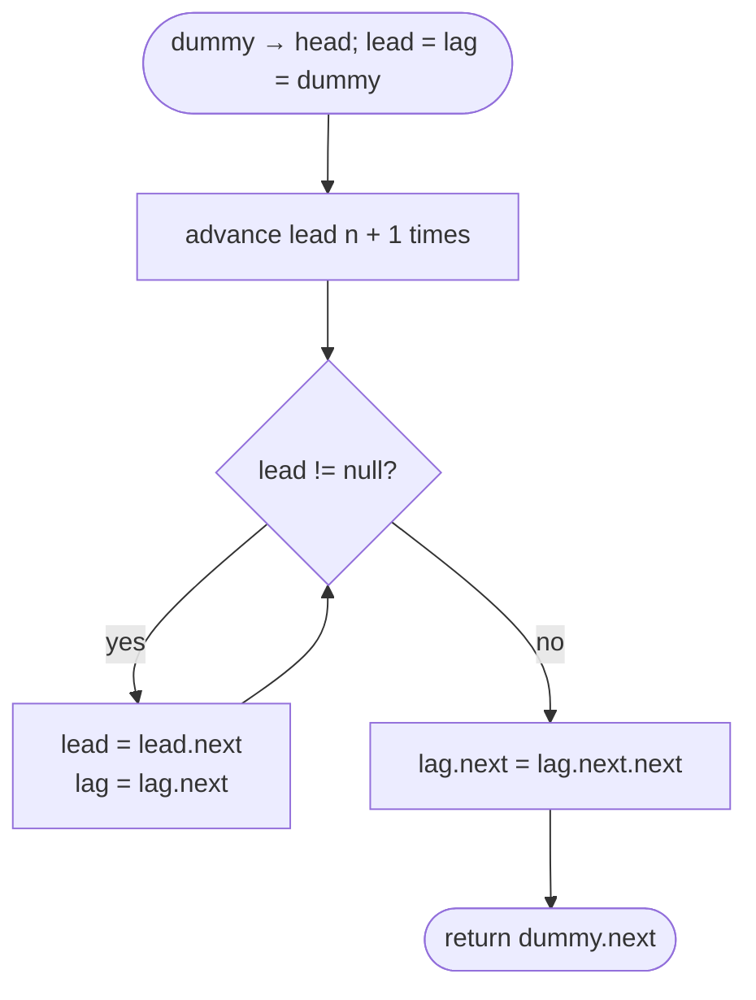

# LC 19 Remove Nth Node From End of List

> [!abstract] In one sentence
> You cannot count from the end of a singly linked list, but two pointers moving in step keep a fixed gap, so if the leader starts n + 1 nodes ahead of the lagger and both walk until the leader is `null`, the lagger stops on the node *before* the n-th from the end — one pass, O(1) space, and a dummy head makes "remove the first node" the same move as any other.

**Map:** [[NeetCode 150 MOC]] → [[DSA Dashboard]] · Pattern: [[Linked Lists]]

> [!question] Predict before you read
> Why is the gap n + 1 and not n — and if both pointers start on the dummy and the list has exactly n nodes, where does the lagger end up?

## Problem

Given the head of a singly linked list and an integer `n`, remove the n-th node counting from the end and return the head of the resulting list.

Examples: `1 → 2 → 3 → 4 → 5`, `n = 2` → `1 → 2 → 3 → 5`. `1`, `n = 1` → `[]`. `1 → 2`, `n = 1` → `1`.

Constraints that matter: 1..30 nodes and `1 ≤ n ≤ size`, so the target always exists and may be the head. The follow-up asks for a single pass.

## Clarifying questions

1. Is `n` always valid (1 ≤ n ≤ length)? — Yes; otherwise you would need a guard after advancing the leader.
2. Can the node to remove be the head? — Yes (`n == length`); this is what the dummy is for.
3. One pass required, or is counting the length first acceptable? — Two passes are a fine first answer; the one-pass version is the expected follow-up.
4. Should I return the removed node or free it? — Return the new head; in Java the removed node is garbage-collected.

## Brute force

Two passes: walk once to count the length L, then walk again to node L − n − 1 (0-based) and unlink its successor; if L == n, return `head.next`. O(L) time, O(1) space, two traversals plus a special case for the head. It is correct and many interviewers accept it. The waste is only the second traversal and the branch — both disappear with a fixed-gap pair of pointers and a dummy node.

## The key insight

Two pointers advanced together never change their distance. Put `lead` n + 1 steps ahead of `lag`, then move both until `lead` is `null`: `lead` has walked L + 1 steps from the dummy, so `lag` has walked L − n, which is the node immediately before the target. The "+1" is what makes `lag` stop *before* rather than *on* the node — you need the predecessor to unlink. Starting both on a dummy means that when the target is the head, `lag` ends on the dummy and `lag.next = lag.next.next` removes the head with the same line of code. Recognition cue: "k-th from the end", "one pass", "without knowing the length".

## Optimal approach

1. `dummy = new ListNode(0, head)`; `lead = lag = dummy`.
2. Advance `lead` n + 1 times.
3. While `lead != null`: advance both.
4. `lag.next = lag.next.next`.
5. Return `dummy.next`.



> [!example]- Excalidraw version — the same diagram as an editable canvas
> ![[LC 19 Remove Nth Node From End of List — Optimal approach.excalidraw]]
> [[LC 19 Remove Nth Node From End of List — Optimal approach.excalidraw|Open in Excalidraw]] — needs the Excalidraw plugin (see [[Plugins to Install]]).

## Walkthrough

`1 → 2 → 3 → 4 → 5`, `n = 2`. Positions count the dummy as 0.

| Phase | lead | lag | Gap |
|---|---|---|---|
| start | dummy | dummy | 0 |
| after n + 1 = 3 advances | 3 | dummy | 3 |
| move 1 | 4 | 1 | 3 |
| move 2 | 5 | 2 | 3 |
| move 3 | null | 3 | 3 |

> [!example] lead has fallen off; lag sits before the target
> ![[LC 19 Remove Nth Node From End of List — lead has fallen off; lag sits before the target.excalidraw]]
> [[LC 19 Remove Nth Node From End of List — lead has fallen off; lag sits before the target.excalidraw|Open in Excalidraw]] — lag = 3, so lag.next = lag.next.next unlinks the amber node 4, the 2nd from the end

%% excalidraw-spec
{"kind": "list", "title": "lead has fallen off; lag sits before the target", "nodes": ["dummy", "1", "2", "3", "4", "5"], "pointers": {"lag": 3}, "highlight": [4], "caption": "lag = 3, so lag.next = lag.next.next unlinks the amber node 4, the 2nd from the end"}
%%

With `n = 5` (remove the head): `lead` takes 6 advances and is already `null` (dummy → 1 → 2 → 3 → 4 → 5 → null); the loop does not run; `lag` is the dummy and `dummy.next = 2` drops node 1.

## Java solution

```java
import java.util.*;

class Solution {
    public ListNode removeNthFromEnd(ListNode head, int n) {
        ListNode dummy = new ListNode(0, head);   // lets the head be removed like any other node
        ListNode lead = dummy, lag = dummy;
        for (int i = 0; i <= n; i++) lead = lead.next;   // gap of n + 1 (n is valid, so no null check)
        while (lead != null) {                    // walk together until lead falls off
            lead = lead.next;
            lag = lag.next;
        }
        lag.next = lag.next.next;                 // lag is the predecessor of the target
        return dummy.next;
    }
}

class ListNode {
    int val;
    ListNode next;
    ListNode() {}
    ListNode(int val) { this.val = val; }
    ListNode(int val, ListNode next) { this.val = val; this.next = next; }
}
```

**Time** O(L) — one pass; `lead` visits every node once · **Space** O(1).

The two-pass version, in case the single-pass idea does not come:

```java
// snippet
int len = 0;
for (ListNode c = head; c != null; c = c.next) len++;
ListNode dummy = new ListNode(0, head), prev = dummy;
for (int i = 0; i < len - n; i++) prev = prev.next;   // stop on the predecessor
prev.next = prev.next.next;
return dummy.next;
```

## Why it works

Number the positions with the dummy at 0 and the k-th real node at k, so the list ends at position L and `null` is position L + 1. After the setup `lead` is at n + 1 and `lag` at 0; the loop preserves `lead − lag = n + 1` and stops when `lead = L + 1`, so `lag = L − n`. The n-th node from the end is at position L − n + 1, hence `lag.next` is exactly the target and `lag.next.next` the node after it, which may be `null`. Because `1 ≤ n ≤ L`, the setup never dereferences `null`: n + 1 ≤ L + 1 advances from the dummy land at worst on `null` itself, never beyond. And `lag ≥ 0` always, so `lag.next` exists.

## Edge cases

- Single node, `n = 1` → `lead` advances twice to `null`; `lag` is the dummy; result `null`.
- `n == L` (remove the head) → loop runs zero times; `dummy.next = head.next`.
- `n == 1` (remove the tail) → `lag` stops on the second-to-last node; `lag.next.next` is `null`, so the tail is dropped correctly.
- Two nodes, either `n` → both cases above.
- Values repeated or negative → irrelevant; the code never reads them.

## Common mistakes

> [!warning] Pitfalls
> - Advancing `lead` only n times: `lag` stops *on* the target and you have no pointer to its predecessor.
> - Starting `lag` at `head` instead of the dummy and then special-casing `n == L` — it works, but the dummy removes the branch; interviewers notice the cleaner version.
> - Writing the loop as `while (lead.next != null)` with a gap of n: the same off-by-one from the other side; pick one convention and trace it on `n = L`.
> - Returning `head` instead of `dummy.next`: wrong when the head was the node removed.
> - Checking `lead != null` inside the setup loop "for safety" — harmless here, but if `n` could exceed `L` you need to *return* something sensible, not silently continue.

## Variants & follow-ups

- Find (not remove) the k-th from the end: gap of k, no dummy needed; return `lag` when `lead` is `null`.
- Swap the k-th from the start with the k-th from the end (LC 1721): one pass to find the first, then a lagging pointer from the head to find the second.
- Delete the middle node (LC 2095): the same "predecessor" discipline with fast/slow instead of a fixed gap — see the middle search in [[LC 143 Reorder List]].
- Rotate by k from the end (LC 61): gap of k to find the new tail.
- Stream version: "k-th most recent item in a stream with no random access" — keep a circular buffer of k items, the array form of the same gap.

## Interview script

Restate: "Delete the n-th node from the end, n valid, return the new head; the head itself may be the one to delete." Brute force: "Count the length, walk to position L − n − 1, unlink — two passes and a special case for the head." Insight: "Two pointers moving together keep a fixed gap; a gap of n + 1 started from a dummy lands the trailing pointer on the predecessor of the target when the leader falls off." Approach: "Dummy, advance the leader n + 1 times, walk both until the leader is null, splice, return `dummy.next`." Complexity: "O(L) time, O(1) space, one pass." Tests: "`n = 1`, `n = L`, and a single-node list — `n = L` is the one that proves the dummy was needed."

## Related

- Pattern: [[Linked Lists]] · the gap idea in general: [[Two Pointers]]
- Same two-speed family: [[LC 141 Linked List Cycle]] (2:1 speed), [[LC 143 Reorder List]] (middle)
- Same dummy-head discipline: [[LC 21 Merge Two Sorted Lists]]
- Java refresher: [[DSA Patterns in Java]] (dummy-head and fixed-gap templates)

## Attempt log

| Date | Result | Minutes | What I got wrong |
|---|---|---|---|
| | | | |

### Mastery checklist
- [ ] Solved without hints in under 25 minutes
- [ ] Stated complexity before coding
- [ ] Handled every edge case above
- [ ] Code compiled first time
- [ ] Can do the follow-up variant

## Open questions
- [ ]
