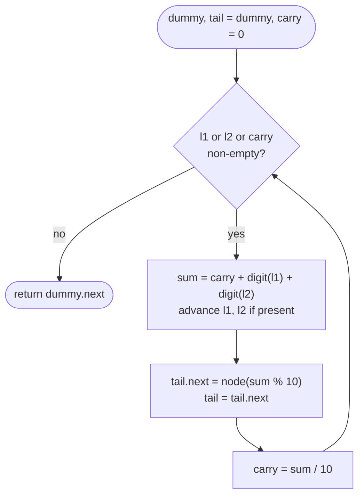

# LC 2 Add Two Numbers

> [!abstract] In one sentence
> The lists store digits least-significant first, which is exactly the order schoolbook addition consumes them, so one pass that adds `carry + a + b`, writes `sum % 10` and carries `sum / 10` produces the answer — provided the loop continues while *any* of the two lists or the carry has something left.

**Map:** [[NeetCode 150 MOC]] → [[DSA Dashboard]] · Pattern: [[Linked Lists]]

> [!question] Predict before you read
> `5` + `5` must give `0 → 1`. Which loop condition produces the second node without a special case after the loop, and what is the largest value `sum` can take in any iteration?

## Problem

Two non-empty linked lists represent non-negative integers with their digits stored in *reverse* order (the head is the ones digit), one digit per node. Add the two numbers and return the sum as a linked list in the same format.

Examples: `2 → 4 → 3` + `5 → 6 → 4` (342 + 465) → `7 → 0 → 8` (807). `0` + `0` → `0`. `9 → 9 → 9 → 9 → 9 → 9 → 9` + `9 → 9 → 9 → 9` → `8 → 9 → 9 → 9 → 0 → 0 → 0 → 1`.

Constraints that matter: 1..100 nodes per list, digits 0..9, no leading zeros except the number 0 itself. A hundred digits do not fit in a `long`, so converting to integers is wrong, not just slow.

## Clarifying questions

1. Are the digits least-significant first? — Yes here; the follow-up (LC 445) stores them most-significant first.
2. Can the lists have different lengths? — Yes; treat a missing node as digit 0.
3. May the result be longer than both inputs? — Yes, by one digit (a final carry); e.g. `5 + 5 = 10`.
4. May I reuse the input nodes for the result? — Allowed, but building fresh nodes is cleaner and avoids mutating inputs; ask.

## Brute force

Walk each list to build the number as a `long` (or `BigInteger`), add, then split the sum into digits and build a list. With `BigInteger` it is O(n) and correct; with `long` it overflows past 18 digits and the judge has 100-digit cases. The waste is conceptual — you materialise a number only to decompose it again, when the lists are already in the digit order addition needs.

## The key insight

Reverse order is a gift: the first nodes are the ones digits, so a single forward walk performs long addition exactly as on paper. The three ingredients: a running `carry`, "missing node means 0", and the loop condition `l1 != null || l2 != null || carry != 0` — the `carry != 0` clause is what emits the final `1` of `5 + 5` without an `if` after the loop. A dummy head makes the first digit ordinary. Recognition cue: "numbers as digit lists / arrays / strings", "add", "no built-in big integers"; the same carry loop appears in [[LC 66 Plus One]] and [[LC 43 Multiply Strings]].

## Optimal approach

1. `dummy`, `tail = dummy`, `carry = 0`.
2. While `l1 != null || l2 != null || carry != 0`: `sum = carry` plus each available digit (advancing that list); append `new ListNode(sum % 10)`; `carry = sum / 10`.
3. Return `dummy.next`.



> [!example]- Excalidraw version — the same diagram as an editable canvas
> ![[LC 2 Add Two Numbers — Optimal approach.excalidraw]]
> [[LC 2 Add Two Numbers — Optimal approach.excalidraw|Open in Excalidraw]] — needs the Excalidraw plugin (see [[Plugins to Install]]).

## Walkthrough

`9 → 9 → 9` + `1` (999 + 1 = 1000):

| Iteration | l1 digit | l2 digit | carry in | sum | emitted | carry out |
|---|---|---|---|---|---|---|
| 1 | 9 | 1 | 0 | 10 | 0 | 1 |
| 2 | 9 | — (0) | 1 | 10 | 0 | 1 |
| 3 | 9 | — (0) | 1 | 10 | 0 | 1 |
| 4 | — (0) | — (0) | 1 | 1 | 1 | 0 |

Iteration 4 runs only because `carry != 0`; both lists are exhausted. Result `0 → 0 → 0 → 1`.

> [!example] Digit columns for 999 + 1, least significant first
> ![[LC 2 Add Two Numbers — Digit columns for 999 + 1, least significant first.excalidraw]]
> [[LC 2 Add Two Numbers — Digit columns for 999 + 1, least significant first.excalidraw|Open in Excalidraw]] — the amber column exists only because of the carry; its node holds 1

%% excalidraw-spec
{"kind": "array", "title": "Digit columns for 999 + 1, least significant first", "values": ["9+1", "9+0", "9+0", "0+0"], "labels": {"0": "carry 0", "1": "carry 1", "2": "carry 1", "3": "carry 1"}, "highlight": [3], "caption": "the amber column exists only because of the carry; its node holds 1"}
%%

## Java solution

```java
import java.util.*;

class Solution {
    public ListNode addTwoNumbers(ListNode l1, ListNode l2) {
        ListNode dummy = new ListNode(0), tail = dummy;
        int carry = 0;
        while (l1 != null || l2 != null || carry != 0) {   // carry != 0 emits the extra top digit
            int sum = carry;
            if (l1 != null) { sum += l1.val; l1 = l1.next; }   // a missing node contributes 0
            if (l2 != null) { sum += l2.val; l2 = l2.next; }
            tail.next = new ListNode(sum % 10);
            tail = tail.next;
            carry = sum / 10;                                   // 0 or 1: sum is at most 19
        }
        return dummy.next;
    }
}

class ListNode {
    int val;
    ListNode next;
    ListNode() {}
    ListNode(int val) { this.val = val; }
    ListNode(int val, ListNode next) { this.val = val; this.next = next; }
}
```

**Time** O(max(n, m)) — one node of output per iteration, at most max(n, m) + 1 iterations · **Space** O(max(n, m)) for the output list, O(1) beyond it.

## Why it works

Invariant after k iterations: the output holds the k lowest digits of the sum and `carry` holds the carry out of the k-th digit position. Each iteration computes the digit at position k + 1 as `(carry + a + b) mod 10` with `a`, `b` the digits at that position (0 if the list has ended), and the new carry as the integer division — exactly the definition of positional addition. Since digits are at most 9 and the carry at most 1, `sum ≤ 19`, so the carry is always 0 or 1 and a single extra iteration suffices to flush it. The loop stops only when both lists are exhausted *and* the carry is 0, so no digit is left unwritten; it cannot run forever because each iteration either consumes a node or clears a non-zero carry that cannot be regenerated without digits.

## Edge cases

- `0 + 0` → one iteration, sum 0, carry 0 → `0`.
- Different lengths (`999 + 1`) → the shorter list contributes 0 after it ends.
- Final carry (`5 + 5`) → the `carry != 0` clause runs one more iteration → `0 → 1`.
- One list much longer with no carries → the loop copies its remaining digits one by one (no shortcut needed).
- 100-digit inputs → no integer conversion; the loop never holds more than `sum`.

## Common mistakes

> [!warning] Pitfalls
> - Looping only while both lists are non-null, then bolting on two "copy the rest" loops and a final carry check — three places to get wrong instead of one condition.
> - Forgetting the final carry entirely: `5 + 5` returns `0`.
> - Converting to `int`/`long`: overflows at 10 or 19 digits; the tests go to 100.
> - Writing `carry = sum > 9 ? 1 : 0` and `sum - 10` — correct here, but `sum / 10` and `sum % 10` generalise to [[LC 43 Multiply Strings]] where a column can exceed 19.
> - Reversing the inputs first "to make it feel natural" — they are already in the natural order for addition; reversal is needed only in the most-significant-first follow-up.

## Variants & follow-ups

- Digits stored most-significant first (LC 445 Add Two Numbers II): either reverse both lists with [[LC 206 Reverse Linked List]], add, and reverse the result, or push digits onto two stacks and pop in step — same carry loop.
- Add two numbers as arrays or strings (LC 415 Add Strings, [[LC 66 Plus One]]): the same loop with indices running from the end.
- Multiply: [[LC 43 Multiply Strings]] — a 2-D version where position `i + j` accumulates products before a single carry pass.
- Subtract (with the larger first): same loop with a borrow instead of a carry.
- Base other than 10: replace `10` by the base; binary addition (LC 67) is base 2.

## Interview script

Restate: "Two digit lists, least-significant first, return their sum in the same format; lengths differ, result may be one digit longer." Brute force: "Convert to integers — overflows at 100 digits, so it is not even correct." Insight: "The order matches long addition, so one forward walk with a carry does it; the loop runs while either list or the carry is non-empty, which covers unequal lengths and the overflow digit." Approach: "Dummy head, tail pointer, `sum = carry + digits`, emit `sum % 10`, carry `sum / 10`." Complexity: "O(max(n, m)) time and output space." Tests: "`0 + 0`, `5 + 5`, `999 + 1`, and lists of very different length."

## Related

- Pattern: [[Linked Lists]] · same dummy-and-tail construction: [[LC 21 Merge Two Sorted Lists]]
- Same carry loop on arrays and strings: [[LC 66 Plus One]], [[LC 43 Multiply Strings]]
- Needed for the most-significant-first follow-up: [[LC 206 Reverse Linked List]]
- Java refresher: [[Java Pitfalls in Interviews]] (`int` overflow — why converting is wrong)

## Attempt log

| Date | Result | Minutes | What I got wrong |
|---|---|---|---|
| | | | |

### Mastery checklist
- [ ] Solved without hints in under 25 minutes
- [ ] Stated complexity before coding
- [ ] Handled every edge case above
- [ ] Code compiled first time
- [ ] Can do the follow-up variant

## Open questions
- [ ]
