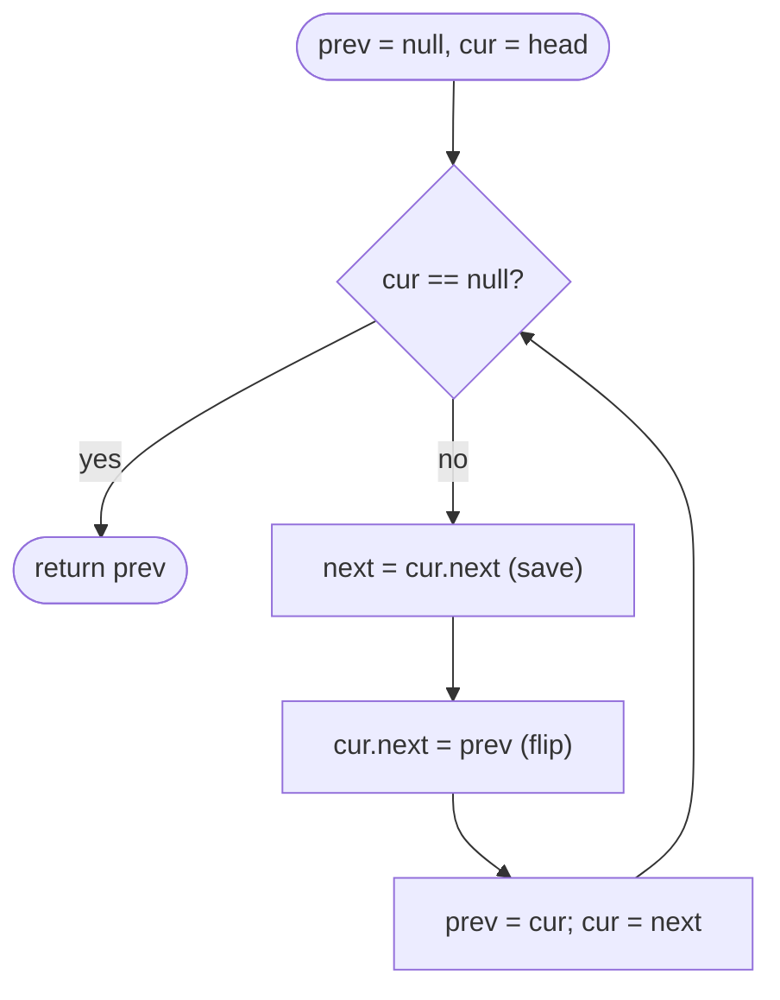

# LC 206 Reverse Linked List

> [!abstract] In one sentence
> Reversing a list is flipping every `next` edge, and flipping one edge needs exactly two things you are about to lose — the node's old successor (to keep walking) and its predecessor (to point back at) — so three pointers and the rule "save `next` before you overwrite it" reverse the list in one O(n) pass with no extra memory.

**Map:** [[NeetCode 150 MOC]] → [[DSA Dashboard]] · Pattern: [[Linked Lists]]

> [!question] Predict before you read
> The loop body has four assignments. Which one must come first, and what exactly is lost if you write `cur.next = prev` before it?

## Problem

Given the head of a singly linked list, reverse the list and return the head of the reversed list.

Examples: `1 → 2 → 3 → 4 → 5` → `5 → 4 → 3 → 2 → 1`. `1 → 2` → `2 → 1`. `[]` → `[]`.

Constraints that matter: up to 5000 nodes, values in −5000..5000 (irrelevant — you never look at values). The follow-up asks for both an iterative and a recursive solution; 5000 frames of recursion is fine on the JVM's default stack.

## Clarifying questions

1. In place, or may I build a new list? — In place, O(1) extra space, is what they want; say so before coding.
2. Should the original head still be usable afterwards? — No; it becomes the tail with `next == null`.
3. Empty list or a single node? — Return it unchanged (`null` or the node itself).
4. Do they want the recursive version too? — Usually as a follow-up; have both ready and know the stack cost.

## Brute force

Copy the values into an `ArrayList`, then walk the list again writing the values back from the end: O(n) time but O(n) extra space, and it rewrites values instead of restructuring nodes (an interviewer will say "the nodes are the objects, not the ints"). Repeatedly detaching the last node and moving it to the front is O(n²) because finding the last node is O(n) each time. The waste in both: the nodes already exist and are already linked; the only thing wrong is the direction of each edge.

## The key insight

Flip one edge at a time. To flip `cur.next` you need `prev` (where it must now point) and you must remember `cur.next` (where you would otherwise go next, which is about to be overwritten). That is the whole algorithm: `next = cur.next; cur.next = prev; prev = cur; cur = next`. Recognition cue: "reverse", "in place", "O(1) space"; and as a *sub-step* of [[LC 143 Reorder List]], [[LC 25 Reverse Nodes in k-Group]] and palindrome checks — if you cannot write these four lines without thinking, those problems are out of reach.

## Optimal approach

1. `prev = null`, `cur = head`.
2. While `cur != null`: save `next = cur.next`; flip `cur.next = prev`; advance `prev = cur`, `cur = next`.
3. Return `prev` — the last node you flipped, now the head.



> [!example]- Excalidraw version — the same diagram as an editable canvas
> ![[LC 206 Reverse Linked List — Optimal approach.excalidraw]]
> [[LC 206 Reverse Linked List — Optimal approach.excalidraw|Open in Excalidraw]] — needs the Excalidraw plugin (see [[Plugins to Install]]).

## Walkthrough

`1 → 2 → 3 → 4 → 5`. Each row is the state at the *top* of the loop.

| Iteration | prev | cur | next (saved) | Reversed prefix | Untouched suffix |
|---|---|---|---|---|---|
| 0 | null | 1 | 2 | — | 1 → 2 → 3 → 4 → 5 |
| 1 | 1 | 2 | 3 | 1 → null | 2 → 3 → 4 → 5 |
| 2 | 2 | 3 | 4 | 2 → 1 → null | 3 → 4 → 5 |
| 3 | 3 | 4 | 5 | 3 → 2 → 1 → null | 4 → 5 |
| 4 | 4 | 5 | null | 4 → 3 → 2 → 1 → null | 5 |
| 5 | 5 | null | — | 5 → 4 → 3 → 2 → 1 → null | — |

> [!example] Top of iteration 2
> ![[LC 206 Reverse Linked List — Top of iteration 2.excalidraw]]
> [[LC 206 Reverse Linked List — Top of iteration 2.excalidraw|Open in Excalidraw]] — the amber nodes already point backwards (2 → 1 → null); cur = 3 is the next edge to flip and next = 4 is the saved way forward

%% excalidraw-spec
{"kind": "list", "title": "Top of iteration 2", "nodes": ["1", "2", "3", "4", "5"], "pointers": {"prev": 1, "cur": 2, "next": 3}, "highlight": [0, 1], "caption": "the amber nodes already point backwards (2 → 1 → null); cur = 3 is the next edge to flip and next = 4 is the saved way forward"}
%%

## Java solution

```java
import java.util.*;

class Solution {
    public ListNode reverseList(ListNode head) {
        ListNode prev = null, cur = head;
        while (cur != null) {
            ListNode next = cur.next;   // save: the only way to reach the rest of the list
            cur.next = prev;            // flip this one edge
            prev = cur;                 // the reversed prefix now starts at cur
            cur = next;                 // continue into the untouched suffix
        }
        return prev;                    // cur is null, prev is the new head
    }

    // Follow-up: recursive. Reverse everything after head, then hang head on the end.
    public ListNode reverseListRecursive(ListNode head) {
        if (head == null || head.next == null) return head;
        ListNode newHead = reverseListRecursive(head.next);  // head.next is now the tail of the reversed rest
        head.next.next = head;          // make that tail point back at head
        head.next = null;               // head is the new tail; break the old forward edge
        return newHead;
    }
}

class ListNode {
    int val;
    ListNode next;
    ListNode() {}
    ListNode(int val) { this.val = val; }
    ListNode(int val, ListNode next) { this.val = val; this.next = next; }
}
```

**Time** O(n) — every edge is flipped exactly once · **Space** O(1) iterative, O(n) call stack recursive.

## Why it works

Invariant at the top of every iteration: `prev` is the head of a correctly reversed list containing exactly the nodes visited so far, and `cur` is the head of the untouched remainder in original order; the two lists share no node. One iteration moves `cur` from the front of the remainder to the front of the reversed list (its `next` now points at the old reversed head), so the invariant holds with one more node reversed. When `cur` becomes `null` the remainder is empty, so `prev` heads a reversed list of all n nodes. Nothing is ever lost because `next` is saved before the only pointer to it is overwritten. The recursive version is the same invariant read from the other end: the call on `head.next` returns the reversed tail whose last node is `head.next`; attaching `head` after it and nulling `head.next` extends the reversed list by one.

## Edge cases

- Empty list → loop never runs, returns `prev = null`.
- Single node → one iteration sets `1.next = null` (already null), returns the node.
- Two nodes `1 → 2` → iteration 1: `1.next = null`; iteration 2: `2.next = 1`; return 2.
- Long list (5000) → the recursive version uses 5000 frames; fine on the JVM, but say you would use the loop in production.

## Common mistakes

> [!warning] Pitfalls
> - Writing `cur.next = prev` before saving `next`: the rest of the list is unreachable after the first iteration and the loop ends with a two-node result.
> - Returning `head` (now the tail) or `cur` (now `null`) instead of `prev`.
> - In the recursive version, forgetting `head.next = null`: the old head still points forward to the node that now points back at it — a two-node cycle, and the judge loops forever.
> - Swapping the last two assignments (`cur = next` before `prev = cur`): `prev` then becomes the node you have not flipped yet.
> - Using a dummy head here. It adds nothing; the dummy belongs to problems that may remove or splice the first node.

## Variants & follow-ups

- Reverse only positions `left..right` (LC 92 Reverse Linked List II): dummy head, walk to the node before `left`, reverse `right − left + 1` nodes with the same loop, then reconnect both ends — exactly the single-group step of [[LC 25 Reverse Nodes in k-Group]].
- Reverse every k nodes: [[LC 25 Reverse Nodes in k-Group]].
- Palindrome linked list (LC 234): find the middle, reverse the second half, compare, optionally restore.
- Reorder `L0 → Ln → L1 → Ln−1`: [[LC 143 Reorder List]] (middle + reverse + interleave).
- Doubly linked list: swap `prev` and `next` in every node, then return the old tail.

## Interview script

Restate: "Reverse a singly linked list in place and return the new head." Brute force: "Copy to an array and rewrite values — O(n) space, and it does not restructure the nodes." Insight: "Flip each edge as I walk; the only hazard is that flipping destroys my way forward, so I save `next` first." Approach: "`prev`, `cur`, `next`; four assignments per node; return `prev`." Complexity: "O(n) time, O(1) space; the recursive version is the same idea with O(n) stack." Tests: "Empty, one node, two nodes, and I check that the old head ends with `next == null`."

## Related

- Pattern: [[Linked Lists]] · prerequisite: [[Recursion]] (for the follow-up)
- Uses this as a sub-step: [[LC 143 Reorder List]], [[LC 25 Reverse Nodes in k-Group]]
- Same dummy-free pointer discipline: [[LC 21 Merge Two Sorted Lists]]
- Java refresher: [[DSA Patterns in Java]] (linked-list reversal template)

## Attempt log

| Date | Result | Minutes | What I got wrong |
|---|---|---|---|
| | | | |

### Mastery checklist
- [ ] Solved without hints in under 25 minutes
- [ ] Stated complexity before coding
- [ ] Handled every edge case above
- [ ] Code compiled first time
- [ ] Can do the follow-up variant

## Open questions
- [ ]
