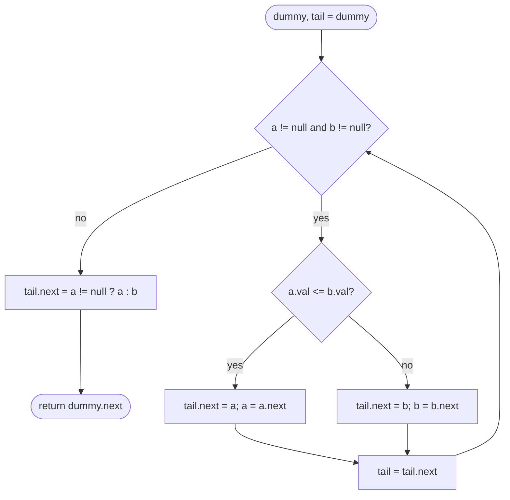

# LC 21 Merge Two Sorted Lists

> [!abstract] In one sentence
> Because both inputs are sorted, the smallest remaining node overall is always one of the two current heads, so a single output tail that repeatedly takes the smaller head and then appends the leftover list builds the merged list in O(n + m) with no allocation beyond a dummy node.

**Map:** [[NeetCode 150 MOC]] → [[DSA Dashboard]] · Pattern: [[Linked Lists]]

> [!question] Predict before you read
> After the main loop one of the two lists still has nodes. Why is it correct to attach *all* of them in one assignment without comparing anything, and why does the dummy head make the "first node" case disappear?

## Problem

You are given the heads of two sorted singly linked lists. Splice their nodes into one sorted list (reuse the nodes, do not create new ones) and return its head.

Examples: `1 → 2 → 4` and `1 → 3 → 4` → `1 → 1 → 2 → 3 → 4 → 4`. `[]` and `[]` → `[]`. `[]` and `0` → `0`.

Constraints that matter: each list has 0..50 nodes; values in −100..100 and non-decreasing. Duplicates across the lists are normal — the tie rule only affects stability, not correctness.

## Clarifying questions

1. Reuse the existing nodes or allocate a new list? — Reuse; that is the point of doing it on a linked list.
2. Are the inputs guaranteed sorted ascending, and can they be empty? — Yes and yes; an empty input must return the other list as is.
3. On a tie, which node goes first? — Either is accepted; taking from the first list keeps the merge stable, which matters if nodes carry more data than the key.
4. Recursive solution acceptable? — Fine for 50 nodes; for long lists prefer the loop (stack depth equals output length).

## Brute force

Append all nodes of the second list to the first and sort the combined list (collect into an array, sort, relink): O((n + m) log(n + m)). Or insert each node of list B into list A at its sorted position: O(n · m). The waste is ignoring that both inputs are *already* sorted — the merge step of merge sort does the job in a single linear pass.

## The key insight

At every moment the smallest node not yet placed is one of the two heads (everything behind a head is larger than it). So the output is built by repeatedly taking the smaller head. A dummy node in front of the output means the first real node is attached exactly like every other one — no `if (result == null)` special case. When one list runs out, the other is already sorted and entirely larger than what was placed, so it is attached whole. Recognition cue: "two sorted ... into one", "merge"; it reappears inside [[LC 23 Merge k Sorted Lists]] and in every merge-sort implementation.

## Optimal approach

1. `dummy = new ListNode(0)`, `tail = dummy`.
2. While both lists are non-empty: compare heads; `tail.next` = the smaller head; advance that list; `tail = tail.next`.
3. `tail.next` = whichever list is non-empty (possibly both empty → `null`).
4. Return `dummy.next`.



> [!example]- Excalidraw version — the same diagram as an editable canvas
> ![[LC 21 Merge Two Sorted Lists — Optimal approach.excalidraw]]
> [[LC 21 Merge Two Sorted Lists — Optimal approach.excalidraw|Open in Excalidraw]] — needs the Excalidraw plugin (see [[Plugins to Install]]).

## Walkthrough

`a = 1 → 2 → 4`, `b = 1 → 3 → 4`. The tie at the start goes to `a` because the test is `<=`.

| Step | a head | b head | Taken | Output so far |
|---|---|---|---|---|
| 1 | 1 | 1 | a (tie → a) | 1 |
| 2 | 2 | 1 | b | 1 → 1 |
| 3 | 2 | 3 | a | 1 → 1 → 2 |
| 4 | 4 | 3 | b | 1 → 1 → 2 → 3 |
| 5 | 4 | 4 | a (tie → a) | 1 → 1 → 2 → 3 → 4 |
| 6 | — | 4 | splice b | 1 → 1 → 2 → 3 → 4 → 4 |

> [!example] Output chain after step 4
> ![[LC 21 Merge Two Sorted Lists — Output chain after step 4.excalidraw]]
> [[LC 21 Merge Two Sorted Lists — Output chain after step 4.excalidraw|Open in Excalidraw]] — tail always sits on the last placed node; the dummy is never part of the answer, which starts at dummy.next

%% excalidraw-spec
{"kind": "list", "title": "Output chain after step 4", "nodes": ["dummy", "1", "1", "2", "3"], "pointers": {"tail": 4}, "highlight": [0], "caption": "tail always sits on the last placed node; the dummy is never part of the answer, which starts at dummy.next"}
%%

## Java solution

```java
import java.util.*;

class Solution {
    public ListNode mergeTwoLists(ListNode a, ListNode b) {
        ListNode dummy = new ListNode(0);    // placeholder so the first node needs no special case
        ListNode tail = dummy;
        while (a != null && b != null) {
            if (a.val <= b.val) {            // <= keeps the merge stable: ties take from a
                tail.next = a;
                a = a.next;
            } else {
                tail.next = b;
                b = b.next;
            }
            tail = tail.next;
        }
        tail.next = (a != null) ? a : b;     // the survivor is sorted and larger than everything placed
        return dummy.next;
    }
}

class ListNode {
    int val;
    ListNode next;
    ListNode() {}
    ListNode(int val) { this.val = val; }
    ListNode(int val, ListNode next) { this.val = val; this.next = next; }
}
```

**Time** O(n + m) — each comparison places one node and the splice is O(1) · **Space** O(1) — one dummy node, nodes are reused.

The recursive form is three lines and worth knowing because it is how [[LC 23 Merge k Sorted Lists]] is often written on a whiteboard; its cost is O(n + m) stack frames.

```java
// snippet
if (a == null) return b;
if (b == null) return a;
if (a.val <= b.val) { a.next = mergeTwoLists(a.next, b); return a; }
else                { b.next = mergeTwoLists(a, b.next); return b; }
```

## Why it works

Invariant: after each loop iteration the chain `dummy.next … tail` is sorted, contains exactly the nodes removed from the two inputs, and every value in it is ≤ every value still in either input. The loop keeps this because it appends the smaller of the two heads, which is the minimum of everything remaining (each input is sorted, so its head is its minimum). When one input is exhausted, the other is sorted and consists only of values ≥ `tail.val`, so attaching it whole preserves sortedness. Termination: every iteration consumes one node, so at most n + m iterations run.

## Edge cases

- Both empty → loop skipped, `tail.next = null`, return `dummy.next = null`.
- One empty → loop skipped, the other list is returned unchanged (same node identity).
- All of `a` smaller than all of `b` → `a` is consumed first, `b` is spliced in one assignment.
- Equal values across lists → `<=` takes `a` first; the output is still sorted either way.
- Lists sharing no node but with equal values — no issue; the code never compares node identity.

## Common mistakes

> [!warning] Pitfalls
> - Forgetting the final splice `tail.next = a != null ? a : b` — the output silently loses the tail of the longer list.
> - Returning `dummy` instead of `dummy.next` — a stray `0` appears at the front.
> - Advancing the wrong pointer (`a = a.next` inside the `else` branch) — nodes are skipped or repeated.
> - Creating `new ListNode(a.val)` instead of linking the existing node — correct output, but the interviewer asked for a splice and you doubled the memory.
> - Writing `tail = a` instead of `tail = tail.next` after the splice attempts — both work here, but the latter is the habit that survives when the taken node is not `a`.

## Variants & follow-ups

- Merge k sorted lists: [[LC 23 Merge k Sorted Lists]] — a heap of heads or pairwise divide-and-conquer, each pair merged with exactly this function.
- Merge two sorted arrays in place from the back (LC 88): same comparison, written from the end so nothing is overwritten.
- Merge sort on a linked list (LC 148): split with fast/slow, recurse, merge with this function — O(n log n), O(log n) stack.
- Intersection or union of two sorted lists: same two-pointer walk with a different action on `<`, `==`, `>`.
- Merge descending lists: flip the comparison, or merge ascending then [[LC 206 Reverse Linked List]].

## Interview script

Restate: "Two sorted linked lists, splice their nodes into one sorted list, return its head." Brute force: "Concatenate and sort — O(N log N), and it ignores that the inputs are sorted." Insight: "The global minimum is always one of the two heads, so I take the smaller head each step; a dummy node removes the empty-output special case." Approach: "Dummy, a `tail` pointer, loop while both non-empty, attach the smaller head, advance, then splice the remainder." Complexity: "O(n + m) time, O(1) space." Tests: "Both empty, one empty, all of one list smaller, ties — and I check the last node of the output has `next == null`, which it does because the spliced tail was already terminated."

## Related

- Pattern: [[Linked Lists]] · prerequisite: [[LC 206 Reverse Linked List]] (pointer discipline)
- Builds on this: [[LC 23 Merge k Sorted Lists]]
- Same dummy-plus-tail construction: [[LC 2 Add Two Numbers]]
- Why merging is linear: [[Sorting]] (merge sort)
- Java refresher: [[DSA Patterns in Java]] (dummy-head construction idiom)

## Attempt log

| Date | Result | Minutes | What I got wrong |
|---|---|---|---|
| | | | |

### Mastery checklist
- [ ] Solved without hints in under 25 minutes
- [ ] Stated complexity before coding
- [ ] Handled every edge case above
- [ ] Code compiled first time
- [ ] Can do the follow-up variant

## Open questions
- [ ]
