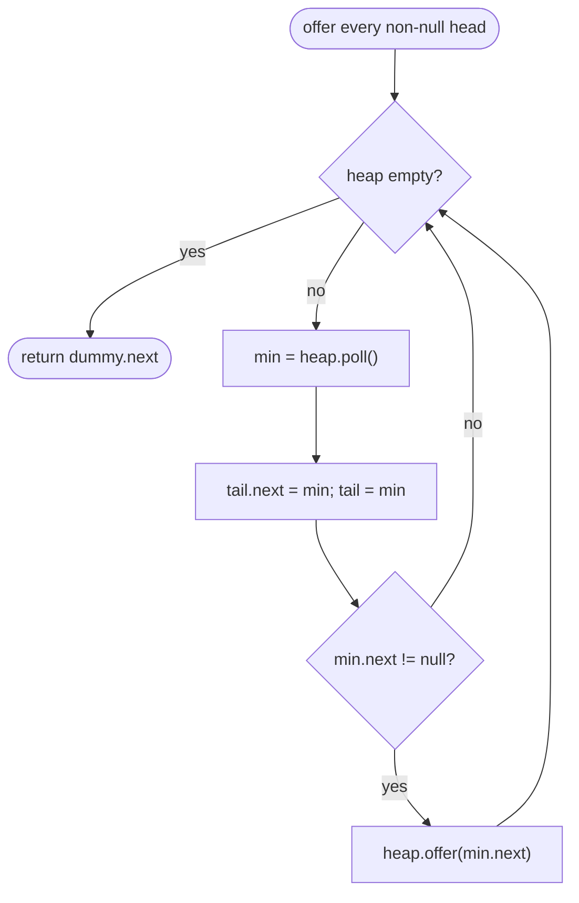

# LC 23 Merge k Sorted Lists

> [!abstract] In one sentence
> The next output node is always the smallest of the k current heads, so a min-heap of at most k heads turns "scan k candidates" into O(log k) per node — O(N log k) overall — and the divide-and-conquer alternative reaches the same bound by halving the number of lists at each of log k levels, each level merging all N nodes once.

**Map:** [[NeetCode 150 MOC]] → [[DSA Dashboard]] · Pattern: [[Linked Lists]]

> [!question] Predict before you read
> Merging the lists one after another into an accumulator (list 1 with 2, the result with 3, …) is also "just merging". Why is it O(N · k) and not O(N log k), and which single change to the *order* of merges fixes it?

## Problem

You are given an array of k linked lists, each sorted in ascending order. Merge all of them into one sorted linked list and return its head.

Examples: `[1 → 4 → 5, 1 → 3 → 4, 2 → 6]` → `1 → 1 → 2 → 3 → 4 → 4 → 5 → 6`. `[]` → `[]`. An array holding one empty list → `[]`.

Constraints that matter: k from 0 to 10⁴, each list up to 500 nodes, total N up to 10⁴ (the judge's sum bound); values in −10⁴..10⁴. Some entries of the array may be `null`. k can be large, so anything O(N · k) is at the edge; O(N log k) is the target.

## Clarifying questions

1. Can the array be empty, or contain empty (`null`) lists? — Both; `null` heads must be skipped, not pushed.
2. Should nodes be reused or copied? — Reuse; splice the existing nodes.
3. Is extra memory proportional to k acceptable? — Yes; O(k) for the heap is expected. O(N) (collect all values and sort) is the brute force.
4. Do the lists share nodes? — No; they are independent chains.

## Brute force

Collect every value into an array, sort, and build a new list: O(N log N) time, O(N) space, correct and short. Slightly better: merge sequentially with [[LC 21 Merge Two Sorted Lists]] — list 1 with list 2, that result with list 3, and so on. The accumulator is re-walked on every merge, so the cost is Σ (size of accumulator) ≈ O(N · k) when the lists are similar in size. The waste: comparing each node against the accumulator again and again, when at any moment only k candidates (the current heads) matter and only the minimum among them is needed.

## The key insight

At every step the output's next node is the minimum over the k current heads — a *repeated extract-min over a changing set of k items*, which is what a heap is for. Pop the smallest head, append it, and push that list's next node to replace it; the heap never exceeds k entries, so each of the N nodes costs O(log k). The divide-and-conquer view reaches the same bound differently: pair the lists up and merge each pair (one pass over all N nodes), halve the count, repeat log k times. Recognition cue: "k sorted inputs", "merge streams", "smallest across several sorted sources" — [[LC 355 Design Twitter]] is this problem with tweets instead of nodes.

## Optimal approach

1. Build a `PriorityQueue<ListNode>` ordered by `val`; offer every non-null head.
2. `dummy`, `tail = dummy`.
3. While the heap is non-empty: `min = poll()`; `tail.next = min; tail = min`; if `min.next != null`, offer it.
4. Return `dummy.next`.



> [!example]- Excalidraw version — the same diagram as an editable canvas
> ![[LC 23 Merge k Sorted Lists — Optimal approach.excalidraw]]
> [[LC 23 Merge k Sorted Lists — Optimal approach.excalidraw|Open in Excalidraw]] — needs the Excalidraw plugin (see [[Plugins to Install]]).

## Walkthrough

Lists `A = 1 → 4 → 5`, `B = 1 → 3 → 4`, `C = 2 → 6`. The heap holds one node per list that still has nodes; the table shows heap contents by value (list letter in brackets).

| Step | Heap before | Polled | Pushed | Output so far |
|---|---|---|---|---|
| 1 | 1(A) 1(B) 2(C) | 1(A) | 4(A) | 1 |
| 2 | 1(B) 2(C) 4(A) | 1(B) | 3(B) | 1 → 1 |
| 3 | 2(C) 3(B) 4(A) | 2(C) | 6(C) | 1 → 1 → 2 |
| 4 | 3(B) 4(A) 6(C) | 3(B) | 4(B) | … → 3 |
| 5 | 4(A) 4(B) 6(C) | 4(A) | 5(A) | … → 4 |
| 6 | 4(B) 5(A) 6(C) | 4(B) | — (B done) | … → 4 |
| 7 | 5(A) 6(C) | 5(A) | — | … → 5 |
| 8 | 6(C) | 6(C) | — | … → 6 |

> [!example] Heap after step 3: one head per live list
> ![[LC 23 Merge k Sorted Lists — Heap after step 3- one head per live list.excalidraw]]
> [[LC 23 Merge k Sorted Lists — Heap after step 3- one head per live list.excalidraw|Open in Excalidraw]] — the root is the next output node; polling it and pushing its successor keeps the heap at most k entries

%% excalidraw-spec
{"kind": "tree", "title": "Heap after step 3: one head per live list", "levels": [3, 4, 6], "highlight": [0], "caption": "the root is the next output node; polling it and pushing its successor keeps the heap at most k entries"}
%%

The divide-and-conquer order for the same input: merge (A, B) → `1 → 1 → 3 → 4 → 4 → 5`, carry C, then merge the two: each node is touched once per level, and there are ⌈log₂ 3⌉ = 2 levels.

## Java solution

```java
import java.util.*;

class Solution {
    public ListNode mergeKLists(ListNode[] lists) {
        PriorityQueue<ListNode> heap = new PriorityQueue<>((a, b) -> Integer.compare(a.val, b.val));
        for (ListNode head : lists) {
            if (head != null) heap.offer(head);        // null entries would throw inside the comparator
        }
        ListNode dummy = new ListNode(0), tail = dummy;
        while (!heap.isEmpty()) {
            ListNode min = heap.poll();                // smallest of the current heads
            tail.next = min;
            tail = min;
            if (min.next != null) heap.offer(min.next); // its list's next head takes its place
        }
        return dummy.next;                             // tail.next is already null: the last polled node was a tail
    }
}

class ListNode {
    int val;
    ListNode next;
    ListNode() {}
    ListNode(int val) { this.val = val; }
    ListNode(int val, ListNode next) { this.val = val; this.next = next; }
}
```

**Time** O(N log k) — N polls and at most N offers on a heap of size ≤ k · **Space** O(k) for the heap; nodes are reused.

The divide-and-conquer version uses no heap and only O(log k) stack; its unit is the two-list merge from [[LC 21 Merge Two Sorted Lists]]:

```java
// snippet
ListNode merge(ListNode[] lists, int lo, int hi) {           // merges lists[lo..hi]
    if (lo > hi) return null;
    if (lo == hi) return lists[lo];
    int mid = lo + (hi - lo) / 2;
    return mergeTwoLists(merge(lists, lo, mid), merge(lists, mid + 1, hi));
}
// every node is merged once per level and there are ceil(log2 k) levels: O(N log k) time, O(log k) stack
```

Sequential merging is the trap: `acc = mergeTwoLists(acc, lists[i])` for i = 0..k−1 re-walks the growing accumulator, Σ i · (N/k) ≈ N · k / 2 node visits. Pairing lists of *similar size* is what keeps every level at N visits; the heap achieves the same balance implicitly.

## Why it works

Two invariants, one per structure.

1. **Heap contents.** Before each iteration the heap holds exactly the current head of every list that still has unconsumed nodes (one node per such list, and nothing else). Initially true by construction (null heads are skipped). An iteration removes one list's head and, if that list continues, inserts its next node — so the heap again holds precisely one current head per non-exhausted list.

2. **Output order.** The chain `dummy.next … tail` is sorted and every node in it is ≤ every unconsumed node. The polled node is the minimum of the heap, i.e. the minimum of all current heads; because each list is sorted, its head is the smallest unconsumed node of that list, so the polled node is the global minimum of everything unconsumed. Appending a global minimum keeps the chain sorted and keeps the second half of the invariant.

Termination: each iteration consumes exactly one node, so there are N iterations. The final `tail.next` is `null` because the last node polled had `next == null` (otherwise its successor would still be in the heap). Correctness of divide-and-conquer follows from the correctness of the two-way merge and induction on the number of lists; the log k depth comes from halving the range each level.

## Edge cases

- `lists` empty → heap empty, return `dummy.next = null`.
- All lists `null` (`[null]`, `[null, null]`) → nothing offered, same result.
- A single list → its nodes are polled and re-appended in order; the output is the same chain.
- Lists of very different lengths → the heap simply shrinks as lists finish; no imbalance cost (unlike sequential merging).
- Duplicates across lists → ties resolved arbitrarily by the heap; the output is still sorted. If stability by list index is required, compare on `(val, listIndex)`.
- Negative values → the comparator uses `Integer.compare`, no subtraction overflow.

## Common mistakes

> [!warning] Pitfalls
> - Offering `null` heads: the comparator dereferences `a.val` and throws `NullPointerException` on the first sift.
> - Comparator `(a, b) -> a.val - b.val`: fine for these bounds, overflows for values near `Integer.MIN_VALUE`; use `Integer.compare`.
> - Pushing *all* nodes of every list into the heap up front: correct, but O(N log N) time and O(N) space — you have thrown away the "one head per list" idea.
> - Forgetting `if (min.next != null)` before offering: offers `null`, which throws on comparison.
> - Sequential accumulation (`acc = merge(acc, lists[i])`) presented as "merge sort style": it is O(N · k); the interviewer will ask you to draw the recursion tree.
> - In the divide-and-conquer version, recursing on `(lo, mid)` and `(mid, hi)` — infinite recursion when `hi = lo + 1`; the right half must start at `mid + 1`.

## Variants & follow-ups

- Merge k sorted *arrays* or *iterators*: heap entries become `(value, arrayIndex, position)` — the external-merge-sort step used when data does not fit in memory.
- [[LC 355 Design Twitter]]: k followees' tweet lists (newest first) merged by timestamp, stopping after 10 — the heap version with an early exit.
- Smallest range covering an element from each of k lists (LC 632): the same heap plus a running maximum.
- k-th smallest in a sorted matrix (LC 378): rows are the k sorted lists; pop k times.
- Streaming inputs: only the heap version works when lists are produced lazily (network streams, log shards); divide-and-conquer needs all inputs present.

## Interview script

Restate: "k ascending lists, N nodes in total, produce one sorted list reusing the nodes; lists may be empty." Brute force: "Collect all values and sort — O(N log N), O(N) space; or merge sequentially, which is O(N · k) because the accumulator is re-walked." Insight: "The next node is always the minimum of the k current heads — repeated extract-min over k items, which is a heap of size k; O(log k) per node." Approach: "Offer non-null heads; loop: poll, append, offer the polled node's successor; dummy head for the output." Complexity: "O(N log k) time, O(k) space; divide-and-conquer gives the same time with O(log k) stack and no heap." Tests: "Empty array, array of nulls, one list, equal values across lists, one very long list with many short ones. I would state the invariant: the heap always holds exactly one head per unfinished list."

## Related

- Pattern: [[Linked Lists]] · the data structure: [[Heaps & Priority Queues]]
- The unit operation: [[LC 21 Merge Two Sorted Lists]]
- Same k-way merge in disguise: [[LC 355 Design Twitter]]
- Other "size-k heap" problems: [[LC 215 Kth Largest Element in an Array]], [[LC 703 Kth Largest Element in a Stream]]
- Java refresher: [[Java Collections Cheat Sheet]] (`PriorityQueue` with a comparator, `offer`/`poll`, no null elements), [[DSA Patterns in Java]] (heap k-way merge template)

## Attempt log

| Date | Result | Minutes | What I got wrong |
|---|---|---|---|
| | | | |

### Mastery checklist
- [ ] Solved without hints in under 25 minutes
- [ ] Stated complexity before coding
- [ ] Handled every edge case above
- [ ] Code compiled first time
- [ ] Can do the follow-up variant

## Open questions
- [ ] Write the divide-and-conquer version iteratively (merge adjacent pairs in a loop until one list remains) and confirm it is also O(N log k).
