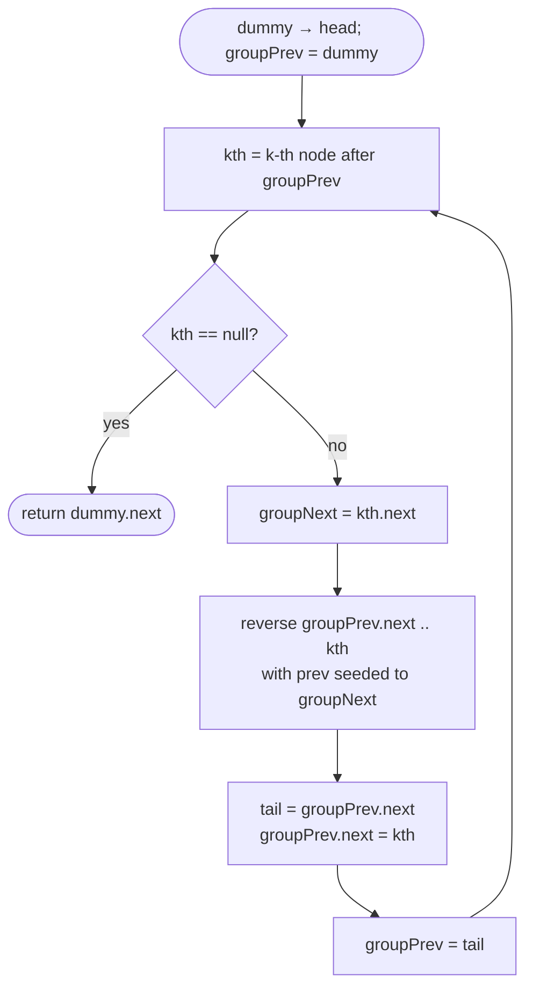

# LC 25 Reverse Nodes in k-Group

> [!abstract] In one sentence
> The problem is [[LC 206 Reverse Linked List]] applied to consecutive k-node windows, and the whole difficulty is the *seams*: keep a pointer to the node before the current block (`groupPrev`, starting at a dummy), find the block's k-th node to prove the block is full, reverse the block with `prev` seeded to the node after it so the reversed tail already points onward, then set `groupPrev.next` to the new block head and move `groupPrev` to the block's new tail — the old first node.

**Map:** [[NeetCode 150 MOC]] → [[DSA Dashboard]] · Pattern: [[Linked Lists]]

> [!question] Predict before you read
> In the plain reversal `prev` starts as `null`. If instead it starts as the first node *after* the block, which of the two splice writes becomes unnecessary — and after the block is reversed, which node is the new `groupPrev`?

## Problem

Given the head of a linked list and an integer k, reverse the nodes k at a time and return the modified list. Nodes in a final group of fewer than k remain in their original order. Only `next` pointers may change — node values must not be swapped.

Examples: `1 → 2 → 3 → 4 → 5`, `k = 2` → `2 → 1 → 4 → 3 → 5`. Same list, `k = 3` → `3 → 2 → 1 → 4 → 5`. `k = 1` → unchanged.

Constraints that matter: 1..5000 nodes and `1 ≤ k ≤ n`; the follow-up asks for O(1) extra space, which rules out collecting nodes into an array per group and rules out a recursion-per-group of depth n/k when k is small (5000 frames is survivable on the JVM, but say it).

## Clarifying questions

1. What happens to a trailing group shorter than k? — Left as is. Confirm, because the alternative ("reverse it too") changes the lookahead.
2. May I change values instead of links? — No; the point is pointer surgery.
3. Is `k` always ≤ the length? — Yes per constraints, but the lookahead handles `k > n` anyway (nothing reversed).
4. Extra space? — O(1) expected; a stack of k nodes per group is the fallback brute force.

## Brute force

Walk the list pushing nodes onto a stack k at a time; when the stack holds k nodes pop them onto the output tail; if the list ends with fewer than k on the stack, append them in original order (the stack must be drained from the bottom — a `Deque` makes that possible). O(n) time, O(k) space, and the final-group handling is awkward. Or copy all nodes to an array, reverse each full window of k, and relink: O(n) space. The waste is memory: the in-place three-pointer loop already reverses a block; only the reconnection has to be designed.

## The key insight

Treat each block exactly like the sub-range reversal of LC 92: you need the node *before* the block (to re-point at the new head) and the node *after* it (to let the new tail point onward). Seed the reversal's `prev` with that *after* node and loop until `cur` reaches it: the block's old first node then ends with `next = after` automatically, so only one splice write remains — `groupPrev.next = kth` (the old k-th node, now first). The old first node is the block's new tail and becomes the `groupPrev` for the next block. The lookahead ("walk k steps from `groupPrev`; if you hit `null`, stop") is what preserves a short final group without special-casing. Recognition cue: "reverse every k", "in groups", "swap pairs" (k = 2, LC 24 Swap Nodes in Pairs).

## Optimal approach

1. `dummy → head`; `groupPrev = dummy`.
2. Loop: `kth = groupPrev`; advance k steps while non-null. If `kth == null` → stop (short group).
3. `groupNext = kth.next`.
4. Reverse: `prev = groupNext`, `cur = groupPrev.next`; while `cur != groupNext`: save `next`, `cur.next = prev`, advance.
5. Splice: `groupHead = groupPrev.next` (old first, now tail); `groupPrev.next = kth`; `groupPrev = groupHead`.
6. Return `dummy.next`.



> [!example]- Excalidraw version — the same diagram as an editable canvas
> ![[LC 25 Reverse Nodes in k-Group — Optimal approach.excalidraw]]
> [[LC 25 Reverse Nodes in k-Group — Optimal approach.excalidraw|Open in Excalidraw]] — needs the Excalidraw plugin (see [[Plugins to Install]]).

## Walkthrough

`1 → 2 → 3 → 4 → 5`, `k = 2`.

| Block | groupPrev | kth | groupNext | After reversal + splice | Next groupPrev |
|---|---|---|---|---|---|
| 1 | dummy | 2 | 3 | dummy → 2 → 1 → 3 → 4 → 5 | 1 |
| 2 | 1 | 4 | 5 | dummy → 2 → 1 → 4 → 3 → 5 | 3 |
| 3 | 3 | null (only 5 remains) | — | stop | — |

> [!example] Before reversing block 2 (k = 2)
> ![[LC 25 Reverse Nodes in k-Group — Before reversing block 2 (k = 2).excalidraw]]
> [[LC 25 Reverse Nodes in k-Group — Before reversing block 2 (k = 2).excalidraw|Open in Excalidraw]] — the amber nodes form the block; prev is seeded with groupNext = 5 so that after reversal node 3 already points at 5

%% excalidraw-spec
{"kind": "list", "title": "Before reversing block 2 (k = 2)", "nodes": ["dummy", "2", "1", "3", "4", "5"], "pointers": {"groupPrev": 2, "kth": 4, "groupNext": 5}, "highlight": [3, 4], "caption": "the amber nodes form the block; prev is seeded with groupNext = 5 so that after reversal node 3 already points at 5"}
%%

Inside block 2 the reversal loop runs with `prev = 5`, `cur = 3`: step 1 sets `3.next = 5`, step 2 sets `4.next = 3`, `cur` becomes 5 which equals `groupNext`, stop. Then `1.next = 4` and `groupPrev = 3`.

## Java solution

```java
import java.util.*;

class Solution {
    public ListNode reverseKGroup(ListNode head, int k) {
        ListNode dummy = new ListNode(0, head);
        ListNode groupPrev = dummy;                       // last node of the previous (already reversed) block
        while (true) {
            ListNode kth = groupPrev;                     // 1. lookahead: is there a full block?
            for (int i = 0; i < k && kth != null; i++) kth = kth.next;
            if (kth == null) break;                       // fewer than k nodes left: leave them

            ListNode groupNext = kth.next;                // first node after the block (may be null)
            ListNode prev = groupNext, cur = groupPrev.next;
            while (cur != groupNext) {                    // 2. reverse exactly the k block nodes
                ListNode next = cur.next;
                cur.next = prev;                          // first iteration: old head now points at groupNext
                prev = cur;
                cur = next;
            }

            ListNode groupTail = groupPrev.next;          // 3. splice: old first node is now the block tail
            groupPrev.next = kth;                         // old k-th node is now the block head
            groupPrev = groupTail;                        // next block starts after this tail
        }
        return dummy.next;
    }
}

class ListNode {
    int val;
    ListNode next;
    ListNode() {}
    ListNode(int val) { this.val = val; }
    ListNode(int val, ListNode next) { this.val = val; this.next = next; }
}
```

**Time** O(n) — the lookahead and the reversal each touch every node of a block once, so at most 2n steps · **Space** O(1).

A recursive form is popular because it reads like the problem statement; its cost is n/k stack frames:

```java
// snippet
ListNode reverseKGroup(ListNode head, int k) {
    ListNode kth = head;
    for (int i = 0; i < k; i++) { if (kth == null) return head; kth = kth.next; }   // short group: unchanged
    ListNode prev = reverseKGroup(kth, k);         // reverse the rest first; it becomes this block's "after"
    ListNode cur = head;
    while (cur != kth) { ListNode next = cur.next; cur.next = prev; prev = cur; cur = next; }
    return prev;                                   // the old k-th node, now first
}
```

## Why it works

State the loop invariant at the top of every outer iteration: the list from `dummy.next` to `groupPrev` consists of all earlier blocks, each reversed, in the correct order; `groupPrev.next` is the first node not yet processed; and the suffix from `groupPrev.next` onward is in its original order.

One iteration preserves it. The lookahead walks k edges from `groupPrev`; it reaches a non-null `kth` exactly when at least k unprocessed nodes exist, so a short tail is never touched (the invariant's suffix clause already makes it correct output). The inner loop is the standard reversal restricted to the window `groupPrev.next … kth`: it runs k times because `cur` starts at the first block node and the k-th node's successor is `groupNext`, and the three-pointer invariant from [[LC 206 Reverse Linked List]] gives that after the loop every block node points to its predecessor within the block, except the old first node, whose `next` was set to `prev`'s initial value `groupNext` in the first iteration. So the reversed block is already attached *forward*. The one remaining dangling edge is `groupPrev.next`, which still points to the old first node; setting it to `kth` attaches the block *backward*. Now the processed prefix has grown by one correctly reversed block, its last node is the old first node, which is where `groupPrev` is moved — restoring the invariant. Termination: each iteration advances `groupPrev` by k nodes; the loop ends at the first short lookahead.

## Edge cases

- `k = 1` → every lookahead finds `kth = groupPrev.next`, the inner loop runs once and sets `cur.next = groupNext`, which it already was; the list is unchanged.
- `k = n` → one block, the whole list reversed; `groupNext` is `null`, so the old head ends with `null`.
- `n` not a multiple of k (`k = 3` on five nodes) → blocks `1-3` reversed, `4 → 5` untouched because the lookahead from node 1 (the new groupPrev) reaches `null` on the third step.
- `k > n` → the first lookahead fails; the list is returned as is.
- Single node → `k` must be 1; unchanged.

## Common mistakes

> [!warning] Pitfalls
> - Reversing first and checking the block size afterwards: the short final group gets reversed, and restoring it costs another pass.
> - Seeding `prev = null` and looping `k` times by count: the old first node then ends with `next = null`, cutting off the rest of the list unless you add a second splice write — more state, more bugs.
> - Looping `while (cur != null)` instead of `while (cur != groupNext)`: reverses the whole remaining list.
> - Updating `groupPrev = kth` (the new head) instead of the old first node (the new tail): the next lookahead starts inside the just-reversed block.
> - Returning `head` instead of `dummy.next`: wrong whenever the first block was reversed (always, if n ≥ k).
> - In the recursive version, forgetting the short-group check before recursing, which reverses the tail.

## Variants & follow-ups

- LC 24 Swap Nodes in Pairs is exactly k = 2; the same code works, or a tighter three-pointer swap.
- Reverse a single sub-range `left..right` (LC 92): one block whose size is `right − left + 1`, no loop around it.
- Reverse *alternate* k-groups (classic GfG variant): after the splice, advance `groupPrev` k more nodes without reversing.
- Reverse the final short group too: when the lookahead fails, reverse from `groupPrev.next` to the end with `prev = null`.
- Reverse the groups counting from the *end* (LC 2074 style variants): compute the length first, then skip `n mod k` nodes before starting.

## Interview script

Restate: "Reverse every consecutive block of k nodes in place; a shorter final block stays; only pointers change." Brute force: "Push k nodes on a stack and pop them out — O(k) space and a fiddly final group." Insight: "Each block is a sub-range reversal; the two things I must keep are the node before the block and the node after it. If I seed the reversal's `prev` with the node after, the block's old head already points onward, and only one splice write remains." Approach: "Dummy; `groupPrev`; lookahead k nodes, stop if null; reverse until `cur` hits `groupNext`; `groupPrev.next = kth`; `groupPrev` moves to the old first node." Complexity: "O(n) time, O(1) space; the recursive version is n/k frames." Tests: "`k = 1`, `k = n`, five nodes with `k = 2` and `k = 3`, and `k` larger than the list. The invariant I state: everything up to `groupPrev` is finished output and everything after it is untouched input."

## Related

- Pattern: [[Linked Lists]] · prerequisite: [[LC 206 Reverse Linked List]] (the inner loop)
- Same seam discipline (cut, reverse, reconnect): [[LC 143 Reorder List]]
- Dummy-head splicing in its simplest form: [[LC 21 Merge Two Sorted Lists]]
- Lookahead with a fixed gap: [[LC 19 Remove Nth Node From End of List]]
- Java refresher: [[DSA Patterns in Java]] (reversal template, dummy head)

## Attempt log

| Date | Result | Minutes | What I got wrong |
|---|---|---|---|
| | | | |

### Mastery checklist
- [ ] Solved without hints in under 25 minutes
- [ ] Stated complexity before coding
- [ ] Handled every edge case above
- [ ] Code compiled first time
- [ ] Can do the follow-up variant

## Open questions
- [ ] Rewrite the inner loop as a helper `reverse(first, stopAt)` that returns nothing, and check whether that makes the splice easier or harder to read.
