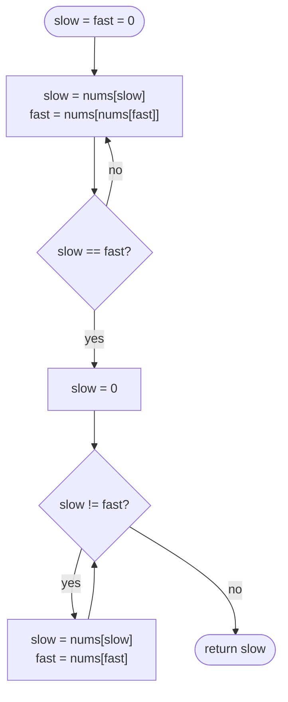

# LC 287 Find the Duplicate Number

> [!abstract] In one sentence
> Read `i → nums[i]` as a `next` pointer: because every value is a valid index in 1..n and index 0 is never pointed at, the walk from 0 must enter a cycle, and the cycle's entrance is the only index with two incoming edges — the duplicated value — so [[LC 141 Linked List Cycle]] plus its "find the start" second phase solves an array problem with no extra memory and no mutation.

**Map:** [[NeetCode 150 MOC]] → [[DSA Dashboard]] · Pattern: [[Linked Lists]]

> [!question] Predict before you read
> Why can index 0 never be part of the cycle, and why does the node where the cycle begins have to be the duplicate rather than just some node on the cycle?

## Problem

You are given an array `nums` of n + 1 integers, each in the range 1..n inclusive. By the pigeonhole principle at least one value repeats; the problem guarantees exactly *one* value is repeated (possibly more than twice). Return that value without modifying the array and using only constant extra space.

Examples: `[1, 3, 4, 2, 2]` → 2. `[3, 1, 3, 4, 2]` → 3. `[3, 3, 3, 3, 3]` → 3.

Constraints that matter: n up to 10⁵; values are in 1..n, never 0, which is what makes index 0 a safe starting point. "Without modifying" rules out sorting and the negate-marking trick; "constant space" rules out a `HashSet`.

## Clarifying questions

1. Exactly one duplicated value, or could several values repeat? — Exactly one value, possibly appearing many times.
2. May I modify the array (sort it, flip signs)? — No; the follow-up explicitly forbids it.
3. Is O(n log n) time acceptable for O(1) space? — Yes as a first improvement (binary search on the value); O(n) is the target.
4. Is 0 ever a value? — No, values are 1..n. If 0 were allowed the linked-list reading would break.

## Brute force

Compare every pair: O(n²), O(1) space, no mutation — correct but slow. A `HashSet` finds the repeat in O(n) with O(n) space. Sorting gives O(n log n) and O(1) space but mutates. Marking visited values by negating `nums[|x|]` is O(n)/O(1) but mutates. Each of these spends either time, space or the "do not modify" rule; the waste is not seeing the array as a graph whose structure already encodes the duplicate.

## The key insight

Treat each index as a node with a single outgoing edge to `nums[i]`. Every node has out-degree 1 and the values lie in 1..n, so following edges from index 0 never leaves 1..n after the first step and never returns to 0 (nothing points at 0). A walk that cannot stop in a finite set must cycle, and because 0 is outside the cycle the walk enters the cycle through a node that has one incoming edge from the tail *and* one from inside the cycle — two indices `i ≠ j` with `nums[i] == nums[j] == entrance`. That is the duplicate. So: Floyd's phase 1 (meet inside the cycle), phase 2 (one pointer back to 0, both advance one step, they meet at the entrance). Recognition cue: "n + 1 values in 1..n", "no extra space, no modification" → hidden linked list; "find the first repeated / missing" with bounded values → also consider [[LC 268 Missing Number]] and the cyclic-sort family.

## Optimal approach

1. `slow = fast = 0`. Repeat `slow = nums[slow]`, `fast = nums[nums[fast]]` until they are equal (do-while, since they start equal).
2. `slow = 0`. While `slow != fast`: advance both by one step.
3. Return `slow` (equal to `fast`): the cycle entrance.



> [!example]- Excalidraw version — the same diagram as an editable canvas
> ![[LC 287 Find the Duplicate Number — Optimal approach.excalidraw]]
> [[LC 287 Find the Duplicate Number — Optimal approach.excalidraw|Open in Excalidraw]] — needs the Excalidraw plugin (see [[Plugins to Install]]).

## Walkthrough

`nums = [1, 3, 4, 2, 2]`. Edges: 0 → 1, 1 → 3, 2 → 4, 3 → 2, 4 → 2. The walk from 0 is `0 → 1 → 3 → 2 → 4 → 2 → …`: tail of length a = 3, cycle `2 → 4 → 2` of length L = 2, entrance 2.

> [!example] The hidden list of [1, 3, 4, 2, 2]
> ![[LC 287 Find the Duplicate Number — The hidden list of -1, 3, 4, 2, 2-.excalidraw]]
> [[LC 287 Find the Duplicate Number — The hidden list of -1, 3, 4, 2, 2-.excalidraw|Open in Excalidraw]] — node labels are indices; node 2 is entered from 3 and from 4, so nums[3] == nums[4] == 2 is the duplicate; the meeting point of phase 1 is node 4

%% excalidraw-spec
{"kind": "list", "title": "The hidden list of [1, 3, 4, 2, 2]", "nodes": ["0", "1", "3", "2", "4"], "pointers": {"slow": 4, "fast": 4}, "cycle_to": 3, "caption": "node labels are indices; node 2 is entered from 3 and from 4, so nums[3] == nums[4] == 2 is the duplicate; the meeting point of phase 1 is node 4"}
%%

| Phase | Step | slow | fast |
|---|---|---|---|
| 1 | 1 | nums[0] = 1 | nums[nums[0]] = 3 |
| 1 | 2 | 3 | nums[nums[3]] = 4 |
| 1 | 3 | 2 | nums[nums[4]] = 4 |
| 1 | 4 | 4 | 4 — meet |
| 2 | reset | 0 | 4 |
| 2 | 1 | 1 | 2 |
| 2 | 2 | 3 | 4 |
| 2 | 3 | 2 | 2 — entrance, return 2 |

## Java solution

```java
import java.util.*;

class Solution {
    public int findDuplicate(int[] nums) {
        // Phase 1: index i has an edge to nums[i]; walk from 0 at speeds 1 and 2 until they meet.
        int slow = 0, fast = 0;
        do {
            slow = nums[slow];
            fast = nums[nums[fast]];
        } while (slow != fast);

        // Phase 2: restart one pointer at 0; equal speeds now meet exactly at the cycle entrance.
        slow = 0;
        while (slow != fast) {
            slow = nums[slow];
            fast = nums[fast];
        }
        return slow;                         // the index with two incoming edges = the repeated value
    }
}
```

**Time** O(n) — phase 1 takes at most tail + cycle steps, phase 2 at most tail steps · **Space** O(1), array untouched.

The O(n log n) alternative — binary search on the *value*, counting how many elements are ≤ mid — is worth knowing because it needs no graph insight, only pigeonhole:

```java
// snippet
int lo = 1, hi = nums.length - 1;            // candidate values 1..n
while (lo < hi) {
    int mid = lo + (hi - lo) / 2, count = 0;
    for (int x : nums) if (x <= mid) count++;
    if (count > mid) hi = mid;               // more than mid values in 1..mid: a duplicate is ≤ mid
    else lo = mid + 1;
}
return lo;                                   // O(n log n) time, O(1) space, no mutation
```

## Why it works

Let the walk from 0 have a tail of length a (nodes before the cycle) and a cycle of length L. Phase 1 is [[LC 141 Linked List Cycle]]: after a steps both pointers are in the cycle and the gap closes by one per step, so they meet at some node b steps past the entrance. At that moment `slow` has taken s = a + b steps (plus possibly whole laps) and `fast` 2s steps; the difference s is a multiple of L. Phase 2 starts `slow` at 0 and `fast` at the meeting point. After a more steps `slow` is at the entrance; `fast` is at position b + a past the entrance, and a + b ≡ 0 (mod L), so `fast` is at the entrance too — and they cannot have met earlier, because before step a `slow` is on the tail, which no cycle node ever occupies. Finally, the entrance is the duplicate: it has an incoming edge from the last tail node and one from the last cycle node, two distinct indices holding the same value; and no other value can be repeated because the problem promises exactly one. If a = 0 the "tail" argument degenerates: 0 would be on the cycle, which is impossible since no value is 0, so a ≥ 1 always.

## Edge cases

- Duplicate appears many times (`[3, 3, 3, 3, 3]`) → 0 → 3 → 3 → …, a self-loop at 3; phase 1 meets at 3 immediately after the first step, phase 2 returns 3.
- Smallest input `[1, 1]` → 0 → 1 → 1; answer 1.
- Duplicate is n (`[2, 2, 1]`) → fine; all values are valid indices.
- Cycle entered on the first step (`nums[0] = k` and `k` is the duplicate) → a = 1; phase 2 takes one step.
- Values sorted or unsorted → irrelevant to the walk.

## Common mistakes

> [!warning] Pitfalls
> - Using `while (slow != fast)` for phase 1 instead of `do … while`: both start at 0, the loop never runs, and you return 0.
> - Starting at `nums[0]` for one pointer and 0 for the other: both pointers must begin at the same node for the meeting arithmetic to hold.
> - Resetting *both* pointers in phase 2, or moving `fast` by two steps in phase 2: the second phase needs equal speeds.
> - Returning `fast` after phase 1 (the meeting point) — it is on the cycle but is not necessarily the entrance (see the walkthrough: 4, not 2).
> - In the binary-search version, searching over *indices* instead of *values*, or using `count >= mid` — the pigeonhole test is strictly greater.

## Variants & follow-ups

- Find the missing number in 0..n: [[LC 268 Missing Number]] — sum or XOR, no cycle needed.
- Find *all* duplicates with values in 1..n, modification allowed (LC 442): negate `nums[|x| − 1]`; a value already negative is a duplicate.
- Find the duplicate *and* the missing number (LC 645): index marking or arithmetic on sums and squared sums.
- Cycle start on an actual linked list (LC 142): phase 2 verbatim.
- "What if values could be 0?" — then 0 can be inside the cycle and the entrance argument fails; you would need a different start or the binary-search approach. Saying this shows you understood the proof.

## Interview script

Restate: "n + 1 values in 1..n, exactly one repeated value, return it with no extra memory and no modification." Brute force: "Pairs in O(n²); a set in O(n) space; sort or sign-marking mutate." Insight: "Index-to-value edges make the array a linked list starting at 0; since no value is 0 the start is outside the cycle, and the cycle entrance is the one index with two incoming edges — the duplicate." Approach: "Floyd: do-while at speeds 1 and 2 until they meet, reset one to 0, advance both one step, return the meeting node." Complexity: "O(n) time, O(1) space." Tests: "`[1, 1]`, all elements equal, duplicate equal to n, and I would also name the O(n log n) binary search on the value as the fallback if I blanked on the graph."

## Related

- Pattern: [[Linked Lists]] · the mechanism: [[LC 141 Linked List Cycle]] (phase 1 and the cycle-start proof)
- The alternative search: [[Binary Search]], as a "search on the answer" like [[LC 875 Koko Eating Bananas]]
- Same bounded-values family: [[LC 268 Missing Number]]
- Java refresher: [[DSA Patterns in Java]] (fast/slow template; binary-search-on-answer template)

## Attempt log

| Date | Result | Minutes | What I got wrong |
|---|---|---|---|
| | | | |

### Mastery checklist
- [ ] Solved without hints in under 25 minutes
- [ ] Stated complexity before coding
- [ ] Handled every edge case above
- [ ] Code compiled first time
- [ ] Can do the follow-up variant

## Open questions
- [ ]
