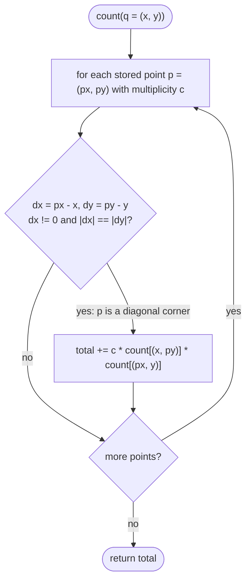

# LC 2013 Detect Squares

> [!abstract] In one sentence
> Fix the query point as one corner; any stored point on a 45° diagonal from it (equal non-zero `|dx|` and `|dy|`) determines the whole axis-aligned square, and the number of squares using that diagonal is the product of how many copies of the other two corners exist — so a point-count map turns the search into a loop over candidates with two constant-time lookups.

**Map:** [[NeetCode 150 MOC]] → [[DSA Dashboard]] · Pattern: [[Math & Geometry]]

> [!question] Predict before you read
> Query point `(11, 10)`, stored points `(3, 10)`, `(11, 2)`, `(3, 2)`. Which stored point is diagonally opposite the query, how do you derive the other two corners from that pair, and what happens to the count if `(3, 10)` was added twice?

## Problem

Design `DetectSquares` with `add(point)` (points may repeat) and `count(point)`: the number of ways to choose three previously added points that, together with the query point, form an axis-aligned square of positive area. Repeated points count as distinct choices.

- `add([3,10])`, `add([11,2])`, `add([3,2])`, `count([11,10])` → `1`; `count([14,8])` → `0`; `add([11,2])`, `count([11,10])` → `2`.

Constraints that matter: coordinates in `[0, 1000]`, up to `5000` calls total; a query may be O(number of distinct points).

## Clarifying questions

1. Axis-aligned only (sides parallel to the axes)? — Yes; rotated squares are not counted.
2. Positive area — degenerate squares with zero side are excluded? — Yes.
3. Duplicates count separately? — Yes; two copies of a corner double the count.
4. Is the query point itself required to be stored? — No; `count` does not add it.

## Brute force

For each query, try all triples of stored points and test whether they form a square with the query: O(p³). Even with the square test simplified, hopeless beyond a few hundred points. The waste: once one diagonal is chosen, the other two corners are determined; there is nothing to search for them.

## The key insight

For query `q = (x, y)` and a candidate diagonal corner `p = (px, py)`, an axis-aligned square exists only if `|px − x| == |py − y| > 0`. Then the other corners are `(x, py)` and `(px, y)` — the point sharing the query's `x` with the candidate's `y`, and vice versa. With a map `count[(x, y)] → multiplicity`, the number of squares for this diagonal is `count[p] * count[(x, py)] * count[(px, y)]`. Summing over all stored points `p` gives the answer; the loop is over distinct points (the map's keys), and multiplicities are handled by multiplication. Because coordinates are small (`<= 1000`), a key can be `x * 1001 + y` in an `int`, avoiding object keys.

## Optimal approach

1. `add`: `count.merge(key(x, y), 1, Integer::sum)`.
2. `count(q)`: `total = 0`; for each `(p, c)` in the map: `dx = px − x`, `dy = py − y`; if `dx == 0 || |dx| != |dy|` skip; `total += c * count[(x, py)] * count[(px, y)]`.
3. Return `total`.



> [!example]- Excalidraw version — the same diagram as an editable canvas
> ![[LC 2013 Detect Squares — Optimal approach.excalidraw]]
> [[LC 2013 Detect Squares — Optimal approach.excalidraw|Open in Excalidraw]] — needs the Excalidraw plugin (see [[Plugins to Install]]).

## Walkthrough

Stored: `(3,10)×1`, `(11,2)×2`, `(3,2)×1`; query `(11, 10)`:

| candidate p | dx, dy | diagonal? | other corners | product |
|---|---|---|---|---|
| (3,10) | −8, 0 | no (dy = 0) | — | 0 |
| (11,2) | 0, −8 | no (dx = 0) | — | 0 |
| (3,2) | −8, −8 | yes | (11,2) ×2, (3,10) ×1 | 1·2·1 = 2 |

Answer `2`: the square `(11,10),(3,10),(3,2),(11,2)` once per copy of `(11,2)`.

> [!example] The square anchored at the query (11,10) with diagonal corner (3,2)
> ![[LC 2013 Detect Squares — The square anchored at the query (11,10) with diagonal corner (3,2).excalidraw]]
> [[LC 2013 Detect Squares — The square anchored at the query (11,10) with diagonal corner (3,2).excalidraw|Open in Excalidraw]] — diagonal = query + (3,2); the two remaining corners are read off by swapping coordinates; count = 1 x 2 x 1

%% excalidraw-spec
{"kind": "grid", "title": "The square anchored at the query (11,10) with diagonal corner (3,2)", "col_labels": ["", "x=3", "x=11"], "row_labels": ["", "y=10", "y=2"], "rows": [ ["(3,10) x1", "(11,10) query"], ["(3,2) x1", "(11,2) x2"] ], "highlight": [ [1, 2], [2, 1] ], "caption": "diagonal = query + (3,2); the two remaining corners are read off by swapping coordinates; count = 1 x 2 x 1"}
%%

## Java solution

```java
import java.util.*;

class DetectSquares {
    private final Map<Integer, Integer> count = new HashMap<>();   // key = x * 1001 + y → multiplicity

    public DetectSquares() {}

    private static int key(int x, int y) { return x * 1001 + y; }

    public void add(int[] point) {
        count.merge(key(point[0], point[1]), 1, Integer::sum);
    }

    public int count(int[] point) {
        int x = point[0], y = point[1], total = 0;
        for (Map.Entry<Integer, Integer> e : count.entrySet()) {
            int px = e.getKey() / 1001, py = e.getKey() % 1001;
            int dx = px - x, dy = py - y;
            if (dx == 0 || Math.abs(dx) != Math.abs(dy)) continue;   // not a diagonal corner (or zero area)
            int c1 = count.getOrDefault(key(x, py), 0);              // corner sharing the query's x
            int c2 = count.getOrDefault(key(px, y), 0);              // corner sharing the query's y
            total += e.getValue() * c1 * c2;
        }
        return total;
    }
}
```

**Time** `add` O(1), `count` O(d) for d distinct points · **Space** O(d)

A variant that loops only over points sharing the query's `x` (so candidates are the *adjacent* corners rather than the diagonal), often faster when points are spread out:

```java
// snippet — index points by x column: for each (x, py) in the query's column, side = py - y,
// then squares to the right use (x + side, y) and (x + side, py); to the left use x - side.
// total += cnt(x, py) * cnt(x + side, y) * cnt(x + side, py)  and the same with x - side
```

## Why it works

An axis-aligned square with one corner at `q` has its opposite corner at `q + (±s, ±s)` for side `s > 0`, and its other two corners at `(x, y ± s)` and `(x ± s, y)` with matching signs — exactly the swap `(x, py)` and `(px, y)`. Conversely any stored point with `|dx| == |dy| = s > 0` defines one such square. Distinct squares correspond to distinct diagonal corners, so summing over stored points counts each geometric square once; multiplying the three multiplicities counts the number of ways to *choose* the three points, which is what the problem asks (repeated points are distinct choices). Keys `x * 1001 + y` are injective because `y <= 1000 < 1001`.

## Edge cases

- No stored points → 0.
- Candidate equal to the query (`dx = dy = 0`) → skipped by `dx == 0` (zero-area square).
- Points on the same row/column as the query (`dx = 0` or `dy = 0`) → not diagonal corners.
- Duplicated corners → counted multiplicatively (`×2` above).
- Squares extending to negative coordinates: corners outside `[0, 1000]` simply have count 0 (`getOrDefault`).
- Many calls: `count` is O(distinct points) ≤ 5000, so 5000 queries ≈ 2.5·10⁷ steps.

## Common mistakes

> [!warning] What goes wrong
> - Checking `dx == dy` only: misses the two diagonals with opposite signs (`dx = −dy`). Use absolute values.
> - Forgetting `dx != 0`, which admits zero-area "squares" when the candidate equals the query.
> - Counting the square once per corner found instead of multiplying multiplicities: duplicates are then wrong.
> - Using `int[]` as a `HashMap` key: arrays use identity `hashCode`/`equals`, so lookups always miss. Encode to an `int` or use a `record Point(int x, int y)`.
> - Mutating the map while iterating (adding in `count`): the problem does not require it, but a `ConcurrentModificationException` is a classic.
> - Looping over all stored *copies* instead of distinct points: multiplicities are already in the values.

## Variants & follow-ups

- Rotated squares allowed: for each pair of stored points as one side, compute the two possible squares via a 90° rotation of the side vector; O(d²) per query.
- Count rectangles instead of squares: drop the `|dx| == |dy|` condition and keep `dx != 0 && dy != 0`.
- Remove points: decrement the map, delete the key at zero.
- Large coordinate range: key with `((long) x << 32) | y` or a record.
- Count all squares among the stored points (no query): for each pair as a diagonal, look up the other two — O(d²).

## Interview script

Restate: "store points with repetition; for a query point count the ways to pick three stored points forming an axis-aligned square with it." Brute force: "all triples, O(p³)." Insight: "fix the diagonal: a stored point at equal non-zero `|dx|` and `|dy|` determines the square, and the other two corners are the coordinate swaps; multiply the three multiplicities." Approach: "`HashMap` from encoded point to count; `count` loops over distinct points, filters diagonals, sums products of counts." Complexity: "O(1) add, O(d) count, O(d) space." Tests: "no points, duplicates, zero-area candidate, corners off-grid." If they push: "rotated squares need the side-vector rotation trick and O(d²); rectangles drop the equal-length check."

## Related

- Pattern: [[Math & Geometry]] (coordinate geometry), [[Hashing]] (count maps, encoding keys)
- Prerequisites: [[LC 1 Two Sum]] (map lookups replacing a search)
- Siblings: [[LC 48 Rotate Image]] (coordinate swaps), [[LC 981 Time Based Key-Value Store]] (another design problem over a map)
- Java: [[Java Collections Cheat Sheet]] (`merge`, `getOrDefault`, `entrySet`), [[Java Pitfalls in Interviews]] (arrays as map keys)

## Attempt log

| Date | Result | Minutes | What I got wrong |
|---|---|---|---|
| | | | |

### Mastery checklist
- [ ] Solved without hints in under 25 minutes
- [ ] Stated complexity before coding
- [ ] Handled every edge case above
- [ ] Code compiled first time
- [ ] Can do the follow-up variant

## Open questions
- [ ] Implement the "column index" variant and compare its cost when all points share one `x` versus when they are spread out.
- [ ] Write the rotated-squares version: given side vector `(dx, dy)`, what are the two rotations and the two squares they define?
