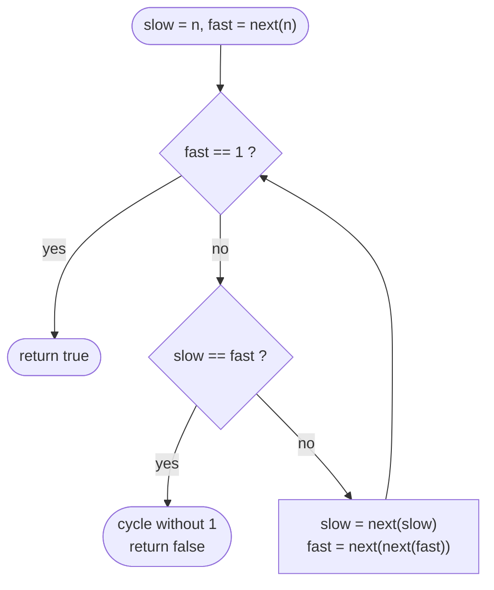

# LC 202 Happy Number

> [!abstract] In one sentence
> The map `n → sum of squared digits` is a function on a bounded set, so iterating it must eventually repeat; the number is happy iff the repeat is the fixed point 1, and "does iterating a function repeat?" is cycle detection — a set of seen values, or Floyd's tortoise and hare for O(1) space.

**Map:** [[NeetCode 150 MOC]] → [[DSA Dashboard]] · Pattern: [[Math & Geometry]]

> [!question] Predict before you read
> Why can the sequence not grow without bound? What is the largest possible digit-square sum of a number below 1000, and what does that say about numbers above 1000?

## Problem

A number is *happy* if, when you repeatedly replace it by the sum of the squares of its decimal digits, you eventually reach 1 (and then stay there). Otherwise the process loops forever in a cycle that excludes 1. Return `true` if `n` is happy.

- `n = 19` → `true` (19 → 82 → 68 → 100 → 1)
- `n = 2` → `false` (2 → 4 → 16 → 37 → 58 → 89 → 145 → 42 → 20 → 4 …)

Constraints that matter: `1 ≤ n ≤ 2³¹ − 1`, so the input itself can have ten digits, but the first step already drops it to at most `10 · 81 = 810`.

## Clarifying questions

1. Does the process always terminate in a cycle or at 1? — Yes (bounded sequence, pigeonhole), so "loop forever" never actually needs infinite time to detect.
2. Is 1 happy? — Yes: `1 → 1`, the fixed point.
3. Expected space? — O(1) is possible; say you know both the set version and Floyd's.
4. Can `n` be 0 or negative? — No; `n ≥ 1`.

## Brute force

Iterate the digit-square map and store every value in a `HashSet<Integer>`; stop at 1 (`true`) or when a value is seen again (`false`). Each step is O(log n) digit work and the set stays small — provably under 1000 entries after the first step. This is already fast; the only "waste" is the set, and the follow-up asks you to remove it.

## The key insight

Every value after the first step is below `810`, a bounded set, so by pigeonhole the sequence repeats within at most ~810 steps. Repetition in the iteration of a deterministic function is exactly the structure of a linked list with a cycle (`next = f(x)`), so Floyd's slow/fast pointers detect it with two variables: advance `slow` by one application and `fast` by two; they meet inside the cycle, and the cycle is `{1}` iff `fast == 1` at that point. Recognition cue: "repeatedly apply a function, decide if it loops" → cycle detection, same as [[LC 141 Linked List Cycle]] and [[LC 287 Find the Duplicate Number]].

## Optimal approach

1. Define `next(x)`: sum of `d²` over the decimal digits of `x` (peel digits with `% 10` and `/ 10`).
2. `slow = n`, `fast = next(n)`.
3. While `fast != 1` and `slow != fast`: `slow = next(slow)`, `fast = next(next(fast))`.
4. Return `fast == 1`.



> [!example]- Excalidraw version — the same diagram as an editable canvas
> ![[LC 202 Happy Number — Optimal approach.excalidraw]]
> [[LC 202 Happy Number — Optimal approach.excalidraw|Open in Excalidraw]] — needs the Excalidraw plugin (see [[Plugins to Install]]).

## Walkthrough

`n = 19`: the chain is 19 → 82 → 68 → 100 → 1 → 1.

| iteration | slow | fast | test |
|---|---|---|---|
| start | 19 | 82 | fast ≠ 1, slow ≠ fast |
| 1 | 82 | 1 (68 → 100 → 1) | fast == 1 → return true |

`n = 2`: chain 2 → 4 → 16 → 37 → 58 → 89 → 145 → 42 → 20 → 4 (cycle of length 8).

| iteration | slow | fast | test |
|---|---|---|---|
| start | 2 | 4 | continue |
| 1 | 4 | 37 | continue |
| 2 | 16 | 89 | continue |
| 3 | 37 | 42 | continue |
| 4 | 58 | 4 | continue |
| 5 | 89 | 37 | continue |
| 6 | 145 | 89 | continue |
| 7 | 42 | 42 | slow == fast → return false |

> [!example] Iterating next(x) from 2 forms a rho shape
> ![[LC 202 Happy Number — Iterating next(x) from 2 forms a rho shape.excalidraw]]
> [[LC 202 Happy Number — Iterating next(x) from 2 forms a rho shape.excalidraw|Open in Excalidraw]] — 20 maps back to 4; slow and fast meet at 42 inside the cycle

%% excalidraw-spec
{"kind": "list", "title": "Iterating next(x) from 2 forms a rho shape", "nodes": ["2", "4", "16", "37", "58", "89", "145", "42", "20"], "pointers": {"slow": 7, "fast": 7}, "cycle_to": 1, "caption": "20 maps back to 4; slow and fast meet at 42 inside the cycle"}
%%

## Java solution

```java
import java.util.*;

class Solution {
    public boolean isHappy(int n) {
        int slow = n, fast = next(n);
        while (fast != 1 && slow != fast) {
            slow = next(slow);
            fast = next(next(fast));
        }
        return fast == 1;
    }

    private int next(int x) {
        int sum = 0;
        while (x > 0) {
            int d = x % 10;
            sum += d * d;
            x /= 10;
        }
        return sum;
    }
}
```

**Time** O(log n) per step, bounded number of steps (effectively O(1) after the first step) · **Space** O(1)

The set version, for when the interviewer prefers clarity over the trick:

```java
import java.util.*;

class Solution {
    public boolean isHappy(int n) {
        Set<Integer> seen = new HashSet<>();
        while (n != 1 && seen.add(n)) {   // add returns false when n was already present
            int sum = 0;
            for (int x = n; x > 0; x /= 10) sum += (x % 10) * (x % 10);
            n = sum;
        }
        return n == 1;
    }
}
```

**Time** O(k · log n) for k steps, k < 1000 · **Space** O(k)

## Why it works

A number with `d` digits maps to at most `81 · d`. For `d ≥ 4`, `81 · d < 10^(d−1) ≤ n`, so the value strictly decreases until it has at most three digits; from then on it stays `≤ 243`. A deterministic function iterated on a finite set must revisit a value, and once it does the sequence is periodic from there. If the period contains 1 it is the fixed point `1 → 1`; otherwise 1 is never reached. Floyd: if the sequence is eventually periodic with period `p`, then after `slow` enters the cycle the gap between `fast` and `slow` grows by one per step modulo `p`, so they coincide within `p` steps. Checking `fast == 1` first avoids a spurious "cycle found" when the cycle is `{1}` itself.

## Edge cases

- `n = 1`: `fast = next(1) = 1` → `true` immediately.
- `n = 7`: happy (7 → 49 → 97 → 130 → 10 → 1).
- `n = 4`: inside the unhappy cycle from the start; Floyd still terminates when `slow == fast`.
- `n = Integer.MAX_VALUE = 2147483647`: first step yields `4 + 1 + 16 + 49 + 16 + 64 + 9 + 36 + 16 + 49 = 260`; no overflow since the sum is at most 810.

## Common mistakes

> [!warning] What goes wrong
> - Looping `while (n != 1)` with no cycle detection: infinite loop on any unhappy number.
> - Testing `slow == fast` *before* `fast == 1`: when `n = 1`, `slow == fast == 1` and you return `false`.
> - Starting with `slow = fast = n` and a `do … while` is fine, but starting `slow = fast = n` with a plain `while (slow != fast)` exits immediately.
> - Computing `next` with `Math.pow` and doubles: works but slow and smells; `d * d` with ints is the idiom.
> - Hard-coding "unhappy iff the sequence hits 4": true for base 10, but an interviewer will ask you to justify it; the cycle argument is the real answer.

## Variants & follow-ups

- Return the cycle itself, or its length: once `slow == fast`, advance one pointer until it returns, counting steps.
- Different digit function (sum of cubes, product of digits): same skeleton, only `next` changes, though boundedness must be re-argued.
- Generalised cycle detection: "given `f` on a finite set and a start, find the first repeated value" is [[LC 287 Find the Duplicate Number]] with `f(i) = nums[i]`.
- Memoise happiness across many queries with a shared `Map<Integer, Boolean>`: every value on a decided chain inherits the answer.

## Interview script

Restate: "iterate sum of squared digits; true if we hit 1, false if we loop." Brute force: "HashSet of seen values, loop until 1 or repeat." Insight: "values are bounded below 1000 after one step, so a repeat is guaranteed — it is cycle detection on an implicit linked list." Approach: "Floyd's slow/fast with `fast == 1` checked first." Complexity: "O(1) space; time bounded by the small state space times digit work." Tests: `n = 1`, `n = 7`, `n = 2`, `Integer.MAX_VALUE`. If asked why 4 always appears in the unhappy cycle, say it is an empirical fact for base 10 and show the bound argument instead.

## Related

- Pattern: [[Math & Geometry]] (digit tricks) · cycle detection in [[Two Pointers]]
- Same mechanism: [[LC 141 Linked List Cycle]], [[LC 287 Find the Duplicate Number]]
- Next digit problem: [[LC 66 Plus One]]
- Java: [[DSA Patterns in Java]] (fast/slow pointers template), [[Java Pitfalls in Interviews]] (`Set.add` return value; `%` with negatives if the input could be negative)

## Attempt log

| Date | Result | Minutes | What I got wrong |
|---|---|---|---|
| | | | |

### Mastery checklist
- [ ] Solved without hints in under 25 minutes
- [ ] Stated complexity before coding
- [ ] Handled every edge case above
- [ ] Code compiled first time
- [ ] Can do the follow-up variant

## Open questions
- [ ] Compute by hand the maximum of `next(x)` for `x ≤ 243` and confirm every unhappy number in base 10 ends in the 8-cycle through 4.
