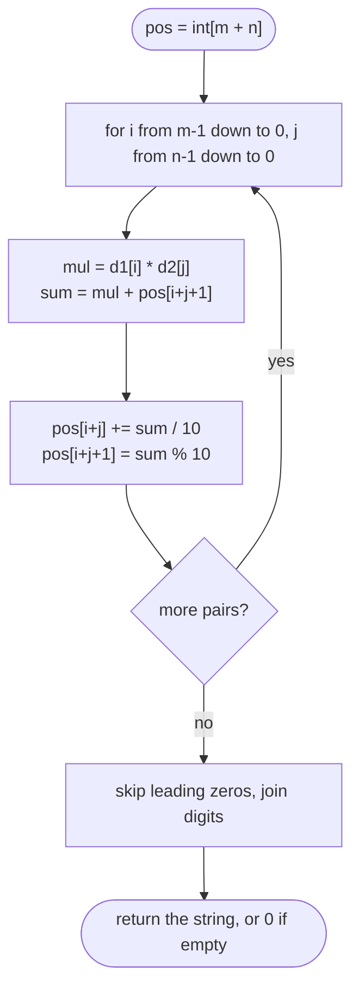

# LC 43 Multiply Strings

> [!abstract] In one sentence
> The product of two numbers with `m` and `n` digits has at most `m + n` digits, and the partial product of digit positions `i` and `j` (counted from the left) contributes exactly to positions `i + j` and `i + j + 1` of the result — so one `int[m + n]` accumulator plus a single carry pass replaces every intermediate string.

**Map:** [[NeetCode 150 MOC]] → [[DSA Dashboard]] · Pattern: [[Math & Geometry]]

> [!question] Predict before you read
> `"123" × "45"`: the digit `3` (index 2) times `5` (index 1) is 15. In a result array of length 5, which two indices should receive the `1` and the `5`? Generalise before reading on.

## Problem

Given two non-negative integers as strings `num1` and `num2`, return their product as a string. Do not use built-in big-integer types and do not convert the inputs to integers directly.

- `"2"`, `"3"` → `"6"`
- `"123"`, `"456"` → `"56088"`
- `"0"`, `"52"` → `"0"`

Constraints that matter: lengths up to 200, digits only, no leading zeros except the number `0` itself.

## Clarifying questions

1. Can either input be `"0"`? — Yes; the result must be exactly `"0"`, not `"00"`.
2. Negative numbers or signs? — No.
3. Leading zeros in the input? — Not except `"0"`; say you would strip them if present.
4. Is `Long.parseLong` allowed for small inputs? — Not in spirit; 200 digits overflow anyway.

## Brute force

Simulate long multiplication as taught in school: for each digit of `num2`, build a partial product string, shift it, and add strings with a carry (as in [[LC 2 Add Two Numbers]]). O(mn) too, but each addition allocates a string and juggles alignment — easy to get wrong under time pressure.

## The key insight

Index the result from the left: `pos[]` of length `m + n`. The product of `num1[i]` and `num2[j]` has place value `10^((m−1−i) + (n−1−j))`, which corresponds to the pair of cells `pos[i + j]` (tens) and `pos[i + j + 1]` (units). Add the whole two-digit product into `pos[i + j + 1]` (it may temporarily exceed 9) and immediately normalise: `pos[i + j] += sum / 10`, `pos[i + j + 1] = sum % 10`. Because the loops go from the least significant digits upward, every cell is normalised before it is read as a "tens" target again. Finally, skip leading zeros and join.

## Optimal approach

1. If either is `"0"` return `"0"` (optional shortcut).
2. `pos = new int[m + n]`.
3. For `i = m−1 .. 0`, `j = n−1 .. 0`: `mul = d1[i] * d2[j]`; `sum = mul + pos[i + j + 1]`; `pos[i + j] += sum / 10`; `pos[i + j + 1] = sum % 10`.
4. Build the string from `pos`, skipping leading zeros; if everything was skipped return `"0"`.



> [!example]- Excalidraw version — the same diagram as an editable canvas
> ![[LC 43 Multiply Strings — Optimal approach.excalidraw]]
> [[LC 43 Multiply Strings — Optimal approach.excalidraw|Open in Excalidraw]] — needs the Excalidraw plugin (see [[Plugins to Install]]).

## Walkthrough

`"123" × "45"` (`m = 3`, `n = 2`, `pos` has 5 cells):

> [!example] Each digit pair (i, j) writes into pos[i+j] and pos[i+j+1]; loop order i outer, j inner, both descending
> ![[LC 43 Multiply Strings — Each digit pair (i, j) writes into pos-i+j- and pos-i+j+1-; loop order i outer, j inner, both d.excalidraw]]
> [[LC 43 Multiply Strings — Each digit pair (i, j) writes into pos-i+j- and pos-i+j+1-; loop order i outer, j inner, both d.excalidraw|Open in Excalidraw]] — 123 x 45 = 5535: leading pos0 = 0 is skipped

%% excalidraw-spec
{"kind": "grid", "title": "Each digit pair (i, j) writes into pos[i+j] and pos[i+j+1]; loop order i outer, j inner, both descending", "col_labels": ["", "pos0", "pos1", "pos2", "pos3", "pos4"], "row_labels": ["", "3x5 (2,1)", "3x4 (2,0)", "2x5 (1,1)", "2x4 (1,0)", "1x5 (0,1)", "1x4 (0,0)", "final"], "rows": [ ["", "", "", "1", "5"], ["", "", "1", "3", "5"], ["", "", "2", "3", "5"], ["", "1", "0", "3", "5"], ["", "1", "5", "3", "5"], ["0", "5", "5", "3", "5"], ["0", "5", "5", "3", "5"] ], "highlight": [ [7, 2], [7, 3], [7, 4], [7, 5] ], "caption": "123 x 45 = 5535: leading pos0 = 0 is skipped"}
%%

Row by row (same order as the code: `i` outer, `j` inner, both descending): `3×5 = 15` → `pos[4] = 5`, carry 1 into `pos[3]`; `3×4 = 12` + `pos[3] = 1` → 13 → `pos[3] = 3`, `pos[2] += 1`; `2×5 = 10` + `pos[3] = 3` → 13 → `pos[3] = 3`, `pos[2] += 1` → 2; `2×4 = 8` + `pos[2] = 2` → 10 → `pos[2] = 0`, `pos[1] += 1`; `1×5 = 5` + `pos[2] = 0` → 5 → `pos[2] = 5`; `1×4 = 4` + `pos[1] = 1` → 5 → `pos[1] = 5`.

## Java solution

```java
import java.util.*;

class Solution {
    public String multiply(String num1, String num2) {
        if (num1.equals("0") || num2.equals("0")) return "0";
        int m = num1.length(), n = num2.length();
        int[] pos = new int[m + n];                       // product has at most m + n digits
        for (int i = m - 1; i >= 0; i--) {
            int d1 = num1.charAt(i) - '0';
            for (int j = n - 1; j >= 0; j--) {
                int d2 = num2.charAt(j) - '0';
                int sum = d1 * d2 + pos[i + j + 1];       // add into the units cell of this pair
                pos[i + j] += sum / 10;                   // carry into the tens cell
                pos[i + j + 1] = sum % 10;                // normalise the units cell
            }
        }
        StringBuilder sb = new StringBuilder();
        for (int p : pos) {
            if (sb.length() == 0 && p == 0) continue;     // skip leading zeros
            sb.append(p);
        }
        return sb.length() == 0 ? "0" : sb.toString();
    }
}
```

**Time** O(mn) · **Space** O(m + n)

## Why it works

Write `num1 = Σ a_i · 10^(m−1−i)` and `num2 = Σ b_j · 10^(n−1−j)`. The product is `Σ a_i b_j · 10^((m−1−i)+(n−1−j))`. In an `m + n` cell array indexed from the most significant end, the cell with place value `10^k` is `pos[m + n − 1 − k]`; substituting `k = (m−1−i) + (n−1−j)` gives `pos[i + j + 1]`, with its carry going to `pos[i + j]`. Processing `i` and `j` from high indices (least significant digits) to low means that when `pos[i + j + 1]` is read it already holds a normalised digit plus any carries from pairs with a larger `i + j`, and the carry written to `pos[i + j]` is at most 9 + 81 + 9 < 100 → the `/ 10` carry is at most 9, so cells never need a second carry pass except through later iterations that read them. The most significant cell `pos[0]` only ever receives carries, so it is 0 or a single digit; leading zeros are stripped and the all-zero case was handled up front.

## Edge cases

- Either operand `"0"` → `"0"`.
- Single digits (`"9" × "9"` → `"81"`): `pos` has 2 cells and the carry fills `pos[0]`.
- Operands of very different lengths (`"1" × "123456"`): fine, `m + n` cells.
- Result with fewer than `m + n` digits (`"10" × "10"` → `"100"`, 3 of 4 cells): leading zero skipped.
- 200-digit inputs: 40 000 multiplications, trivial; `sum` is at most `81 + 9 + 9 = 99`, no overflow.

## Common mistakes

> [!warning] What goes wrong
> - Indexing the result from the right (`pos[(m−1−i) + (n−1−j)]`) and then forgetting to reverse before printing — fine if consistent, but mixing conventions is the classic bug.
> - Writing `pos[i + j] = sum / 10` (assignment) instead of `+=`: loses carries already stored there.
> - Not normalising `pos[i + j + 1]` (`= sum % 10`): cells exceed 9 and the final digits are wrong.
> - Returning `""` for a product that is zero because every digit was skipped: guard with the `"0"` check.
> - Using `int` arithmetic on `Long.parseLong(num)`: overflows beyond 18 digits.
> - Iterating `i` and `j` from 0 upward: carries then flow into cells that have not been visited, which works only if you add a final carry pass — doable, but the downward loops avoid it.

## Variants & follow-ups

- Add two strings (LC 415) and [[LC 2 Add Two Numbers]]: single carry pass.
- Karatsuba: O(n^1.585) by splitting halves; mention it, do not implement in a 45-minute slot.
- Multiply with signs and decimal points: handle sign and scale separately, multiply the digit strings.
- Base other than 10: replace `/ 10` and `% 10` with the base.
- Power: [[LC 50 Pow(x, n)]] uses repeated squaring over doubles; for big integers combine it with this multiplication.

## Interview script

Restate: "multiply two decimal strings up to 200 digits without big-integer libraries." Brute force: "schoolbook rows with string addition — correct but fiddly." Insight: "digit `i` times digit `j` always lands in result cells `i + j` and `i + j + 1`, so I accumulate into one `int[m + n]` and carry as I go, processing least significant digits first." Approach: "double loop from the ends, `sum = d1·d2 + pos[i+j+1]`, `pos[i+j] += sum / 10`, `pos[i+j+1] = sum % 10`, strip leading zeros." Complexity: "O(mn) time, O(m + n) space." Tests: "a zero operand, single digits, different lengths, `10 × 10`." If they push: "Karatsuba for asymptotics; signs and decimals are a wrapper."

## Related

- Pattern: [[Math & Geometry]] (digit arithmetic), [[Strings]] (`charAt − '0'`, `StringBuilder`)
- Prerequisites: [[LC 66 Plus One]] (carry propagation), [[LC 2 Add Two Numbers]]
- Siblings: [[LC 50 Pow(x, n)]]
- Java: [[Java Pitfalls in Interviews]] (char arithmetic, overflow), [[Java Collections Cheat Sheet]] (`StringBuilder`)

## Attempt log

| Date | Result | Minutes | What I got wrong |
|---|---|---|---|
| | | | |

### Mastery checklist
- [ ] Solved without hints in under 25 minutes
- [ ] Stated complexity before coding
- [ ] Handled every edge case above
- [ ] Code compiled first time
- [ ] Can do the follow-up variant

## Open questions
- [ ] Prove that `pos[i + j]` never needs more than one carry when the loops run from the least significant digits. What is the maximum value a cell can hold right before normalisation?
- [ ] Write the version that iterates from index 0 upward with a final carry pass; which is easier to explain?
