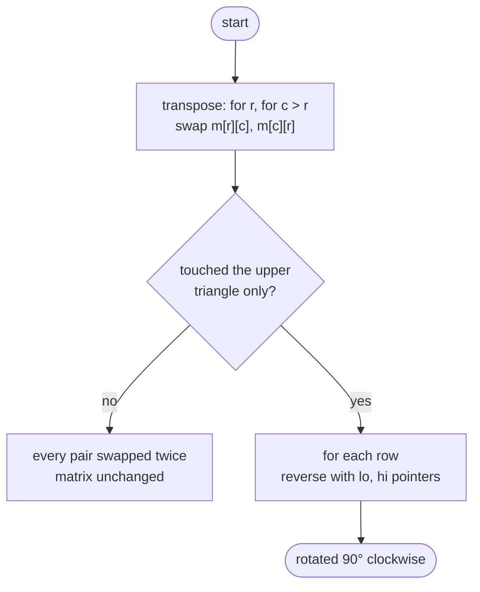

# LC 48 Rotate Image

> [!abstract] In one sentence
> A 90° clockwise rotation is the composition of two reflections — transpose across the main diagonal, then mirror each row left-to-right — and both reflections are trivially in place, so the whole rotation is in place with O(1) extra memory.

**Map:** [[NeetCode 150 MOC]] → [[DSA Dashboard]] · Pattern: [[Math & Geometry]]

> [!question] Predict before you read
> After a clockwise rotation, where does the element at `(r, c)` land? Write the formula for its new coordinates in terms of `n`, then check it on the top-left corner `(0, 0)`.

## Problem

You are given an `n × n` integer matrix. Rotate it by 90 degrees clockwise, modifying the matrix in place — you must not allocate a second `n × n` matrix.

- `[[1,2,3],[4,5,6],[7,8,9]]` → `[[7,4,1],[8,5,2],[9,6,3]]`
- `[[5,1,9,11],[2,4,8,10],[13,3,6,7],[15,14,12,16]]` → `[[15,13,2,5],[14,3,4,1],[12,6,8,9],[16,7,10,11]]`

Constraints that matter: `1 ≤ n ≤ 20`, so any polynomial approach is fast; the whole problem is about the in-place requirement and index correctness.

## Clarifying questions

1. Is the matrix always square? — Yes, `n × n`; a rectangular rotation cannot be in place because the shape changes.
2. Clockwise or counter-clockwise? — Clockwise. (Counter-clockwise is transpose + reverse each *column*, or reverse rows first and then transpose.)
3. May I return a new matrix? — No, the judge reads the input array after your call; mutate it.
4. What counts as O(1) space? — A few scalars for swapping; no `int[n][n]` copy, no `int[n]` row buffers.

## Brute force

Allocate `res = new int[n][n]`, place `res[c][n-1-r] = matrix[r][c]` for every cell, then copy `res` back. O(n²) time and O(n²) space. It is correct and the formula is worth knowing, but it ignores the only constraint that makes the problem interesting: the extra matrix.

## The key insight

Any rotation by 90° is two reflections glued together. Transposing maps `(r, c) → (c, r)`; reversing each row then maps `(c, r) → (c, n-1-r)`. Compose them and `(r, c) → (c, n-1-r)`, which is exactly the rotation formula from the brute force. Each reflection is a set of disjoint swaps, so each is in place, and so is their composition. Recognition cue: "in place" plus a geometric transform on a square grid → look for a decomposition into reflections or a four-element cycle.

## Optimal approach

1. Transpose: for every `r`, for every `c > r`, swap `matrix[r][c]` with `matrix[c][r]`. Only visit the upper triangle, otherwise you swap every pair twice and end up where you started.
2. Reverse each row with two pointers meeting in the middle.
3. Done — the matrix now holds the clockwise rotation.



> [!example]- Excalidraw version — the same diagram as an editable canvas
> ![[LC 48 Rotate Image — Optimal approach.excalidraw]]
> [[LC 48 Rotate Image — Optimal approach.excalidraw|Open in Excalidraw]] — needs the Excalidraw plugin (see [[Plugins to Install]]).

## Walkthrough

`[[1,2,3],[4,5,6],[7,8,9]]`. After the transpose the first row reads the old first column; after the row reversal the first row reads the old first column bottom-to-top, which is exactly where a clockwise turn puts it.

> [!example] Transpose, then reverse each row
> ![[LC 48 Rotate Image — Transpose, then reverse each row.excalidraw]]
> [[LC 48 Rotate Image — Transpose, then reverse each row.excalidraw|Open in Excalidraw]] — after transpose; reversing row 0 gives 7 4 1, the first row of the rotated matrix

%% excalidraw-spec
{"kind": "grid", "title": "Transpose, then reverse each row", "col_labels": ["", "c0", "c1", "c2"], "row_labels": ["r0", "r1", "r2"], "rows": [ [1, 4, 7], [2, 5, 8], [3, 6, 9] ], "highlight": [ [0, 0], [0, 1], [0, 2] ], "caption": "after transpose; reversing row 0 gives 7 4 1, the first row of the rotated matrix"}
%%

| step | matrix | note |
|---|---|---|
| input | `1 2 3 / 4 5 6 / 7 8 9` | — |
| transpose | `1 4 7 / 2 5 8 / 3 6 9` | swaps (0,1)↔(1,0), (0,2)↔(2,0), (1,2)↔(2,1) |
| reverse rows | `7 4 1 / 8 5 2 / 9 6 3` | three swaps, one per row |

## Java solution

```java
import java.util.*;

class Solution {
    public void rotate(int[][] matrix) {
        int n = matrix.length;
        // 1. transpose: only the upper triangle, or every swap is undone
        for (int r = 0; r < n; r++) {
            for (int c = r + 1; c < n; c++) {
                int t = matrix[r][c];
                matrix[r][c] = matrix[c][r];
                matrix[c][r] = t;
            }
        }
        // 2. reverse each row
        for (int[] row : matrix) {
            for (int lo = 0, hi = n - 1; lo < hi; lo++, hi--) {
                int t = row[lo];
                row[lo] = row[hi];
                row[hi] = t;
            }
        }
    }
}
```

**Time** O(n²) · **Space** O(1)

## Why it works

Write `T` for the transpose, `R` for row reversal, as maps on coordinates. `T(r, c) = (c, r)`; `R(r, c) = (r, n-1-c)`. Applying `T` first and then `R` sends `(r, c)` to `R(c, r) = (c, n-1-r)`. The clockwise rotation of a square sends the top row to the right column and the left column to the top row — concretely the cell at `(r, c)` ends up at row `c`, column `n-1-r`. The two formulas agree, so the composition *is* the rotation. Each step is a product of disjoint transpositions, hence a bijection on the cells, hence loses nothing.

## Edge cases

- `n = 1`: both loops do nothing; the matrix is unchanged, which is correct.
- `n = 2`: transpose swaps the two off-diagonal cells, then each row is reversed; `[[1,2],[3,4]]` → `[[3,1],[4,2]]`.
- Negative or repeated values: irrelevant; the algorithm never inspects values.
- Odd `n`: the centre cell `(n/2, n/2)` is a fixed point of both reflections, so it never moves — as it should.

## Common mistakes

> [!warning] What goes wrong
> - Starting the inner transpose loop at `c = 0` instead of `c = r + 1`: every pair is swapped twice and the matrix comes back untouched.
> - Reversing columns instead of rows after the transpose: that is the *counter-clockwise* rotation.
> - Writing the brute-force formula with rows and columns swapped (`res[r][c] = matrix[c][n-1-r]`) — test it on `(0, 0)`, which must land at `(0, n-1)`.
> - Trying the four-way cycle swap and losing a value: it works, but you need `tmp` and the four index expressions exactly right; the two-reflection version has none of that surface area.

## Variants & follow-ups

- Rotate counter-clockwise: transpose, then reverse each column (or reverse rows first, then transpose).
- Rotate 180°: reverse every row, then reverse the row order — two reflections again.
- Rotate a rectangular `m × n` matrix: impossible in place; return a new `n × m` matrix with `res[c][m-1-r] = a[r][c]`.
- The four-element cycle method: for each cell of the top-left quadrant, rotate the four cells it maps to in one go; same O(n²), harder to get right. Interviewers sometimes ask for it after the reflection trick, so know the index formula `(r, c) → (c, n-1-r) → (n-1-r, n-1-c) → (n-1-c, r)`.
- Layer-by-layer walking of a matrix is the engine behind [[LC 54 Spiral Matrix]]; marking rows and columns in place reappears in [[LC 73 Set Matrix Zeroes]].

## Interview script

Restate: "square matrix, rotate 90° clockwise, must be in place." Brute force: "write `res[c][n-1-r] = a[r][c]` into a fresh matrix, O(n²) space — rejected by the constraint." Insight: "a rotation is two reflections; transpose and reverse each row are both in place." Approach: "upper-triangle transpose with swaps, then two-pointer reversal of each row." Complexity: "O(n²) time, O(1) extra." Tests: `n = 1`, `n = 2`, the 3×3 example, and say out loud that the centre of an odd matrix must stay put. If asked for counter-clockwise, answer immediately: transpose then reverse columns.

## Related

- Pattern: [[Math & Geometry]] (matrix transforms) · grids in [[Arrays & Hashing]]
- Same family: [[LC 54 Spiral Matrix]], [[LC 73 Set Matrix Zeroes]], [[LC 36 Valid Sudoku]]
- Java: [[DSA Patterns in Java]] (matrix traversal directions), [[Java Pitfalls in Interviews]] (2-D array init and `clone()` being shallow — a copied `int[][]` still shares its rows)

## Attempt log

| Date | Result | Minutes | What I got wrong |
|---|---|---|---|
| | | | |

### Mastery checklist
- [ ] Solved without hints in under 25 minutes
- [ ] Stated complexity before coding
- [ ] Handled every edge case above
- [ ] Code compiled first time
- [ ] Can do the follow-up variant

## Open questions
- [ ] Derive the four-cycle formula `(r, c) → (c, n-1-r) → (n-1-r, n-1-c) → (n-1-c, r)` by applying the rotation four times and checking you return to `(r, c)`.
