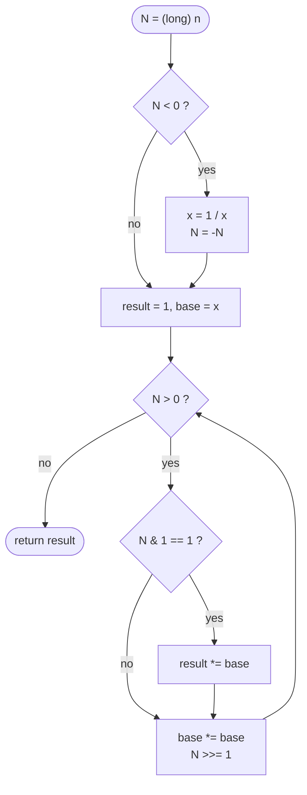

# LC 50 Pow(x, n)

> [!abstract] In one sentence
> `x^n` is the product of `x^(2^k)` over the set bits `k` of `n`; one loop that squares `x` and halves `n` computes every `x^(2^k)` once, so the whole power costs O(log n) multiplications — the only trap is that `n = Integer.MIN_VALUE` cannot be negated in an `int`.

**Map:** [[NeetCode 150 MOC]] → [[DSA Dashboard]] · Pattern: [[Math & Geometry]]

> [!question] Predict before you read
> What is `-Integer.MIN_VALUE` in Java, and what does `Math.abs(Integer.MIN_VALUE)` return? Now decide what the very first line of `myPow` must do.

## Problem

Implement `pow(x, n)`: compute `x` raised to the integer power `n`, where `x` is a double and `n` may be negative.

- `x = 2.0, n = 10` → `1024.0`
- `x = 2.0, n = -2` → `0.25`
- `x = 2.1, n = 3` → `9.261`

Constraints that matter: `-100 < x < 100`, `-2³¹ ≤ n ≤ 2³¹ − 1`, and the answer is guaranteed to fit a double. `n` can be exactly `Integer.MIN_VALUE`.

## Clarifying questions

1. Can `n` be negative? — Yes; `x^(−n) = (1/x)^n`.
2. Can `x` be 0 with negative `n`? — Not in the tests; say you would return `Infinity` or throw, and move on.
3. What precision is expected? — Doubles compared with a tolerance; plain multiplication is fine, no `BigDecimal`.
4. May I call `Math.pow`? — No; that is the whole exercise. (It is still the right answer in production code.)

## Brute force

Multiply `x` by itself `|n|` times: O(n). With `n` up to `2³¹` that is two billion multiplications — slow, and it still needs the same negative-`n` care. The waste: `x^8` is computed as seven multiplications when it is three squarings.

## The key insight

Write `n` in binary, `n = Σ b_k · 2^k`. Then `x^n = Π over set bits k of x^(2^k)`, and `x^(2^(k+1)) = (x^(2^k))²`. So keep `base = x^(2^k)` by squaring each step and multiply it into `result` whenever bit `k` of `n` is 1. Thirty-one bits → at most 62 multiplications regardless of `n`. Recognition cue: "repeated application of an associative operation `n` times" → exponentiation by squaring; the same loop powers matrix exponentiation and modular inverse computations.

## Optimal approach

1. `long N = n` (do this before any negation). If `N < 0`: `x = 1 / x`, `N = −N`.
2. `result = 1.0`, `base = x`.
3. While `N > 0`: if `(N & 1) == 1` then `result *= base`; `base *= base`; `N >>= 1`.
4. Return `result`.



> [!example]- Excalidraw version — the same diagram as an editable canvas
> ![[LC 50 Pow(x, n) — Optimal approach.excalidraw]]
> [[LC 50 Pow(x, n) — Optimal approach.excalidraw|Open in Excalidraw]] — needs the Excalidraw plugin (see [[Plugins to Install]]).

## Walkthrough

`x = 2, n = 10` (binary `1010`).

| step | N (binary) | low bit | result | base after squaring |
|---|---|---|---|---|
| start | 1010 | — | 1 | 2 |
| 1 | 1010 | 0 | 1 | 4 |
| 2 | 101 | 1 | 4 | 16 |
| 3 | 10 | 0 | 4 | 256 |
| 4 | 1 | 1 | 1024 | 65536 |
| end | 0 | — | 1024 | — |

`result = 2^2 · 2^8 = 4 · 256 = 1024`. For `n = −2`: `x` becomes `0.5`, `N = 2`, and the loop returns `0.25`.

> [!example] n = 10 selects which squarings multiply into the result
> ![[LC 50 Pow(x, n) — n = 10 selects which squarings multiply into the result.excalidraw]]
> [[LC 50 Pow(x, n) — n = 10 selects which squarings multiply into the result.excalidraw|Open in Excalidraw]] — result = x^8 · x^2; the bit column k corresponds to base = x^(2^k)

%% excalidraw-spec
{"kind": "bits", "title": "n = 10 selects which squarings multiply into the result", "rows": [ {"label": "n = 10", "bits": "1010"}, {"label": "base = x^(2^k)", "bits": "x8 x4 x2 x1"}, {"label": "used", "bits": "1010"} ], "highlight_cols": [0, 2], "caption": "result = x^8 · x^2; the bit column k corresponds to base = x^(2^k)"}
%%

## Java solution

```java
import java.util.*;

class Solution {
    public double myPow(double x, int n) {
        long N = n;                 // copy first: -Integer.MIN_VALUE overflows in int
        if (N < 0) {
            x = 1 / x;
            N = -N;                 // safe on a long
        }
        double result = 1.0, base = x;
        while (N > 0) {
            if ((N & 1) == 1) result *= base;   // this bit of n is set: include x^(2^k)
            base *= base;                        // x^(2^k) -> x^(2^(k+1))
            N >>= 1;
        }
        return result;
    }
}
```

**Time** O(log |n|) · **Space** O(1)

The recursive form, if asked for it (same complexity, O(log n) stack):

```java
import java.util.*;

class Solution {
    public double myPow(double x, int n) {
        long N = n;
        return N < 0 ? 1 / fast(x, -N) : fast(x, N);
    }

    private double fast(double x, long n) {
        if (n == 0) return 1.0;
        double half = fast(x, n / 2);        // one recursive call, not two
        return n % 2 == 0 ? half * half : half * half * x;
    }
}
```

**Time** O(log |n|) · **Space** O(log |n|) call stack

## Why it works

Loop invariant: `result · base^N = x^(n_original)` where `N` is the remaining exponent. Initially `1 · x^n = x^n`. If `N` is odd, `base^N = base · base^(N−1)`; moving one `base` into `result` and then squaring base while halving `N` keeps the product unchanged, because `base^(N−1) = (base²)^((N−1)/2)` and integer division of an odd `N` by 2 gives `(N−1)/2`. If `N` is even, squaring and halving is exact. When `N` reaches 0 the invariant reads `result · 1 = x^n`. The loop runs once per bit of `N`, at most 32 iterations.

## Edge cases

- `n = 0`: loop never runs, returns `1.0` for any `x`, including `x = 0` (LeetCode expects `0^0 = 1`).
- `n = Integer.MIN_VALUE`, `x = 2`: `N = 2147483648L` after negation, result underflows to `0.0` — correct within tolerance.
- `n = Integer.MIN_VALUE`, `x = 1` or `−1`: returns `1.0` (`(−1)^even = 1`).
- `x = −2, n = 3` → `−8.0`: sign is handled by ordinary multiplication; no special case.
- `x = 0, n > 0` → `0.0`.

## Common mistakes

> [!warning] What goes wrong — overflow in Java specifically
> - `if (n < 0) { x = 1 / x; n = -n; }` on an `int`: for `n = Integer.MIN_VALUE`, `-n` is still `Integer.MIN_VALUE` (two's complement wraps), the loop condition `n > 0` is false, and you return `1.0`. Copy into a `long` *before* negating.
> - `Math.abs(n)` has the same bug: `Math.abs(Integer.MIN_VALUE) == Integer.MIN_VALUE`.
> - Recursive version with *two* calls `fast(x, n/2) * fast(x, n/2)`: correct value, O(n) time — the squaring benefit is lost.
> - Using `n % 2 == 1` on a negative `n`: `-3 % 2 == -1` in Java, so the odd branch is skipped. Normalise the sign first (or test `(n & 1) == 1`).
> - `>>` on a negative `N` would never reach 0; again, normalise first.

## Variants & follow-ups

- Modular power `x^n mod m` with `long` arithmetic: identical loop, `result = result * base % m`; keep operands below `m` so the product fits a `long`.
- Matrix power (Fibonacci in O(log n)): replace `*` with 2×2 matrix multiplication; associativity is all the loop needs.
- `pow` for integer `x` with overflow detection: check `result > Long.MAX_VALUE / base` before each multiply.
- Super Pow (`a^b` where `b` is a digit array): process digits most-significant first, `result = result^10 · a^digit`.
- Bit loop cousins: [[LC 191 Number of 1 Bits]] (same `N & 1`, `N >>= 1` skeleton), overflow discipline in [[LC 7 Reverse Integer]].

## Interview script

Restate: "x to an integer power, n may be negative or `Integer.MIN_VALUE`." Brute force: "multiply |n| times, O(n), two billion steps worst case." Insight: "x^n factorises over the binary digits of n; squaring gives every x^(2^k) in one pass." Approach: "copy n to a long, invert x for negative n, loop over bits with result and base." Complexity: "O(log n) time, O(1) space." Tests: `n = 0`, `n = MIN_VALUE` with `x = 2` and `x = 1`, `x = 2, n = 10`, `n = −2`. Say the word "overflow" before the interviewer does.

## Related

- Pattern: [[Math & Geometry]] (fast power) · bit loop in [[Bit Manipulation]]
- Same skeleton: [[LC 191 Number of 1 Bits]]; overflow discipline: [[LC 7 Reverse Integer]], [[LC 43 Multiply Strings]]
- Java: [[DSA Patterns in Java]] (bit tricks), [[Java Pitfalls in Interviews]] (`Math.abs(Integer.MIN_VALUE)`, `%` with negatives, `>>>` vs `>>`)

## Attempt log

| Date | Result | Minutes | What I got wrong |
|---|---|---|---|
| | | | |

### Mastery checklist
- [ ] Solved without hints in under 25 minutes
- [ ] Stated complexity before coding
- [ ] Handled every edge case above
- [ ] Code compiled first time
- [ ] Can do the follow-up variant

## Open questions
- [ ] Write the 2×2 matrix version for Fibonacci and verify `fib(10) = 55` using the same bit loop.
