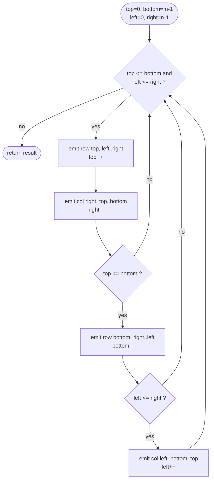

# LC 54 Spiral Matrix

> [!abstract] In one sentence
> Maintain four boundaries and repeatedly peel the top row left→right, the right column top→bottom, the bottom row right→left and the left column bottom→top, shrinking the boundary you just consumed — the only subtlety is re-checking `top ≤ bottom` and `left ≤ right` before the last two passes.

**Map:** [[NeetCode 150 MOC]] → [[DSA Dashboard]] · Pattern: [[Math & Geometry]]

> [!question] Predict before you read
> For a single-row matrix `[[1, 2, 3]]`, the top pass emits 1 2 3 and the right pass emits nothing. What stops the bottom pass from emitting 3 2 1 again?

## Problem

Given an `m × n` matrix, return all its elements in spiral order: start at the top-left, move right along the top row, down the right column, left along the bottom row, up the left column, then continue inward.

- `[[1,2,3],[4,5,6],[7,8,9]]` → `[1,2,3,6,9,8,7,4,5]`
- `[[1,2,3,4],[5,6,7,8],[9,10,11,12]]` → `[1,2,3,4,8,12,11,10,9,5,6,7]`

Constraints that matter: `1 ≤ m, n ≤ 10`, matrix is never empty, rectangular (not necessarily square). Size is tiny; correctness on degenerate shapes is the whole test.

## Clarifying questions

1. Can the matrix be non-square or a single row/column? — Yes to all three; these are the cases that break naive code.
2. Should I modify the input? — Not required; the boundary method reads only.
3. Direction? — Clockwise, starting at `(0, 0)` moving right.
4. Output type? — A `List<Integer>` with exactly `m × n` elements.

## Brute force

Simulate a walker with a direction vector and a `visited` boolean matrix: step forward, and when the next cell is out of bounds or visited, turn right. O(mn) time and O(mn) extra space for `visited`. It is correct and sometimes the clearest thing to write, but the extra matrix (or mutating the input as a sentinel) is unnecessary once you notice the spiral is just a sequence of shrinking rectangles.

## The key insight

The spiral is the perimeter of the full rectangle, then the perimeter of the rectangle one step inside, and so on. Four integers describe the current rectangle; after each edge is emitted, that edge's boundary moves inward by one. Termination is `top > bottom` or `left > right`. The only trap: after the top and right passes shrink `top` and `right`, the remaining rectangle might already be empty in one dimension, so the bottom and left passes need their own guard. Recognition cue: "traverse the matrix in some order" → boundaries + direction, not graph search.

## Optimal approach

1. `top = 0`, `bottom = m - 1`, `left = 0`, `right = n - 1`.
2. While `top ≤ bottom` and `left ≤ right`:
   - emit row `top` from `left` to `right`; `top++`;
   - emit column `right` from `top` to `bottom`; `right--`;
   - if `top ≤ bottom`: emit row `bottom` from `right` down to `left`; `bottom--`;
   - if `left ≤ right`: emit column `left` from `bottom` up to `top`; `left++`.
3. Return the list.



> [!example]- Excalidraw version — the same diagram as an editable canvas
> ![[LC 54 Spiral Matrix — Optimal approach.excalidraw]]
> [[LC 54 Spiral Matrix — Optimal approach.excalidraw|Open in Excalidraw]] — needs the Excalidraw plugin (see [[Plugins to Install]]).

## Walkthrough

`[[1,2,3,4],[5,6,7,8],[9,10,11,12]]` (`m = 3`, `n = 4`).

| pass | boundaries before (t, b, l, r) | emitted | boundary after |
|---|---|---|---|
| top row | (0, 2, 0, 3) | 1 2 3 4 | top = 1 |
| right col | (1, 2, 0, 3) | 8 12 | right = 2 |
| bottom row | (1, 2, 0, 2) | 11 10 9 | bottom = 1 |
| left col | (1, 1, 0, 2) | 5 | left = 1 |
| top row | (1, 1, 1, 2) | 6 7 | top = 2 |
| right col | (2, 1, 1, 2) | nothing (top > bottom) | right = 1 |
| bottom guard | (2, 1, 1, 1) | skipped — top > bottom | — |
| loop test | (2, 1, 1, 1) | exit | — |

Result `[1,2,3,4,8,12,11,10,9,5,6,7]`, twelve elements, each exactly once. Note the second-to-last line: without the `top ≤ bottom` guard the bottom pass would have emitted 7 6 again.

> [!example] First ring of the 3×4 spiral
> ![[LC 54 Spiral Matrix — First ring of the 3×4 spiral.excalidraw]]
> [[LC 54 Spiral Matrix — First ring of the 3×4 spiral.excalidraw|Open in Excalidraw]] — ring 1 = top row, right column, bottom row, left column; 6 and 7 form the inner ring

%% excalidraw-spec
{"kind": "grid", "title": "First ring of the 3×4 spiral", "col_labels": ["", "0", "1", "2", "3"], "row_labels": ["0", "1", "2"], "rows": [ [1, 2, 3, 4], [5, 6, 7, 8], [9, 10, 11, 12] ], "highlight": [ [0, 0], [0, 1], [0, 2], [0, 3], [1, 3], [2, 3], [2, 2], [2, 1], [2, 0], [1, 0] ], "caption": "ring 1 = top row, right column, bottom row, left column; 6 and 7 form the inner ring"}
%%

## Java solution

```java
import java.util.*;

class Solution {
    public List<Integer> spiralOrder(int[][] matrix) {
        List<Integer> res = new ArrayList<>();
        int top = 0, bottom = matrix.length - 1;
        int left = 0, right = matrix[0].length - 1;
        while (top <= bottom && left <= right) {
            for (int c = left; c <= right; c++) res.add(matrix[top][c]);
            top++;
            for (int r = top; r <= bottom; r++) res.add(matrix[r][right]);
            right--;
            if (top <= bottom) {                       // a single leftover row must not be re-emitted
                for (int c = right; c >= left; c--) res.add(matrix[bottom][c]);
                bottom--;
            }
            if (left <= right) {                       // same for a single leftover column
                for (int r = bottom; r >= top; r--) res.add(matrix[r][left]);
                left++;
            }
        }
        return res;
    }
}
```

**Time** O(m·n) · **Space** O(1) extra (the output list is required)

## Why it works

Invariant at the top of the loop: every cell outside the rectangle `[top..bottom] × [left..right]` has been emitted exactly once, and no cell inside has. Each pass emits one full edge of the current rectangle and then excludes that edge by moving its boundary, so the invariant is preserved. The two guards handle the case where the rectangle collapses to a single row (after `top++`) or a single column (after `right--`) mid-iteration: the collapsed edge was already emitted by the top or right pass, and the guard prevents the bottom or left pass from emitting it again. The loop ends when the rectangle is empty, i.e. everything has been emitted exactly once.

## Edge cases

- Single row `[[1,2,3]]`: top pass emits all, `top = 1 > bottom = 0`, right pass loop body runs zero times, bottom guard fails, left guard — `left = 0 ≤ right = 1` — loop runs from `bottom = 0` to `top = 1`, i.e. zero times. Output `[1,2,3]`.
- Single column `[[1],[2],[3]]`: top pass emits 1, right pass emits 2 3, `right = -1 < left`, bottom guard passes but its loop is empty, left guard fails. Output `[1,2,3]`.
- `1 × 1`: emits the one element in the top pass, every other loop is empty.
- Square odd `n`: the centre cell is emitted by a final top pass of length 1.

## Common mistakes

> [!warning] What goes wrong
> - Omitting the two inner guards: single-row and single-column remnants are emitted twice, so the list has more than `m × n` elements.
> - Shrinking a boundary *before* emitting the edge (e.g. `top++` then reading `matrix[top]`) — you skip the first row.
> - Using `<` instead of `<=` in the pass loops: inclusive boundaries need inclusive loops.
> - Confusing `m` (rows, `matrix.length`) with `n` (columns, `matrix[0].length`) in the initial `bottom` and `right`.

## Variants & follow-ups

- Spiral Matrix II (fill `1..n²` into an `n × n` matrix in spiral order): identical boundary loop writing a counter instead of reading.
- Counter-clockwise spiral: top→bottom on the left column first; same four boundaries, different order of passes.
- Spiral starting from the centre outward: generate the clockwise order and reverse it, or simulate with growing step lengths 1, 1, 2, 2, 3, 3, ….
- Direction-array simulation (`dr = {0,1,0,-1}`, `dc = {1,0,-1,0}`) with a `visited` matrix is the fallback if you blank on the boundaries; it also generalises to arbitrary walks.
- Geometric cousins: [[LC 48 Rotate Image]] (layers again), [[LC 73 Set Matrix Zeroes]] (first row/column as markers).

## Interview script

Restate: "return the elements of an `m × n` matrix in clockwise spiral order." Brute force: "walk with a direction vector and a visited matrix, turning right when blocked — O(mn) extra." Insight: "the spiral is a sequence of shrinking rectangles; four boundaries describe the current one." Approach: "emit top row, right column, bottom row, left column; shrink after each; guard the last two passes." Complexity: "O(mn) time, O(1) extra beyond the output." Tests: single row, single column, `1 × 1`, the 3×4 rectangle — and say which test catches the missing guard.

## Related

- Pattern: [[Math & Geometry]] (matrix walking) · grids in [[Arrays & Hashing]]
- Same family: [[LC 48 Rotate Image]], [[LC 73 Set Matrix Zeroes]], [[LC 74 Search a 2D Matrix]]
- Java: [[DSA Patterns in Java]] (matrix traversal directions array), [[Java Pitfalls in Interviews]] (2-D array init, `List.of` immutability if you build the result that way)

## Attempt log

| Date | Result | Minutes | What I got wrong |
|---|---|---|---|
| | | | |

### Mastery checklist
- [ ] Solved without hints in under 25 minutes
- [ ] Stated complexity before coding
- [ ] Handled every edge case above
- [ ] Code compiled first time
- [ ] Can do the follow-up variant

## Open questions
- [ ] Write the direction-array version with `visited` from memory and count how many lines it needs compared to the boundary version; decide which you would reach for under pressure.
