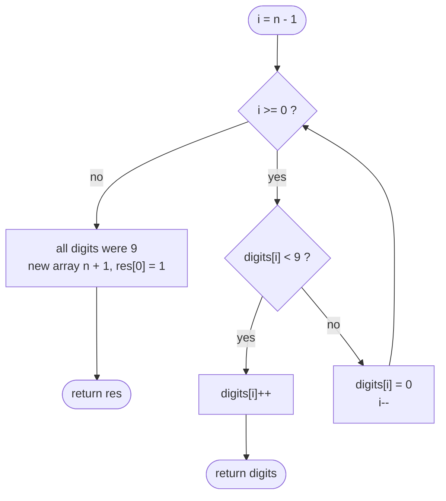

# LC 66 Plus One

> [!abstract] In one sentence
> Incrementing by one only ever carries through a trailing run of 9s, so scan from the right: any digit below 9 absorbs the increment and you return immediately; a 9 becomes 0 and the carry moves left; falling off the left end means the number was all 9s and needs a fresh leading 1.

**Map:** [[NeetCode 150 MOC]] → [[DSA Dashboard]] · Pattern: [[Math & Geometry]]

> [!question] Predict before you read
> Why would converting the array to an `int` or `long`, adding one and converting back be wrong here, even though it reads as the obvious solution?

## Problem

A non-negative integer is given as an array `digits`, most significant digit first, with no leading zeros (except the number 0 itself). Return the digit array of that number plus one.

- `[1, 2, 3]` → `[1, 2, 4]`
- `[9]` → `[1, 0]`
- `[4, 3, 2, 1]` → `[4, 3, 2, 2]`

Constraints that matter: `1 ≤ digits.length ≤ 100` — a hundred digits do not fit in any primitive, which is the point of the problem.

## Clarifying questions

1. Can I convert to an integer type? — No: 100 digits overflow `long` (19 digits). Work on the array.
2. Is `[0]` a valid input? — Yes; `[0]` → `[1]`.
3. Must I return a new array or modify in place? — Either; in place and return `digits` is fine unless the length grows.
4. Any digit outside `0..9`? — No; each entry is a single decimal digit.

## Brute force

Build the number as a `BigInteger` from the digits, add one, and split back into digits. O(n) but with a large constant, allocation, and a dependency on `java.math.BigInteger` that the interviewer did not ask for. It also hides the carry logic, which is what they want to see.

## The key insight

Adding one changes only the trailing block of 9s plus the one digit before it. So a right-to-left scan terminates at the first digit below 9 — most inputs finish in one step. The one structural case is "all 9s": every digit becomes 0 and the result gains a leading 1, which means a new array of length `n + 1` whose first cell is 1 and the rest are Java's default zeros. Recognition cue: "arithmetic on a number too big for a primitive" → digit-by-digit with an explicit carry, as in [[LC 43 Multiply Strings]] and [[LC 2 Add Two Numbers]].

## Optimal approach

1. For `i` from `n − 1` down to `0`:
   - if `digits[i] < 9`: `digits[i]++`, return `digits`;
   - else set `digits[i] = 0` and continue (the carry propagates).
2. The loop finished, so every digit was 9: return a new array of length `n + 1` with `res[0] = 1`.



> [!example]- Excalidraw version — the same diagram as an editable canvas
> ![[LC 66 Plus One — Optimal approach.excalidraw]]
> [[LC 66 Plus One — Optimal approach.excalidraw|Open in Excalidraw]] — needs the Excalidraw plugin (see [[Plugins to Install]]).

## Walkthrough

`digits = [1, 2, 9, 9]`

| i | digits[i] | action | array after |
|---|---|---|---|
| 3 | 9 | set 0, carry on | `[1, 2, 9, 0]` |
| 2 | 9 | set 0, carry on | `[1, 2, 0, 0]` |
| 1 | 2 | `< 9` → increment, return | `[1, 3, 0, 0]` |

`digits = [9, 9]`: both become 0, loop ends, return `[1, 0, 0]`.

> [!example] Carry stops at the first digit below 9
> ![[LC 66 Plus One — Carry stops at the first digit below 9.excalidraw]]
> [[LC 66 Plus One — Carry stops at the first digit below 9.excalidraw|Open in Excalidraw]] — indices 2 and 3 become 0; index 1 absorbs the carry and the scan stops

%% excalidraw-spec
{"kind": "array", "title": "Carry stops at the first digit below 9", "values": [1, 2, 9, 9], "pointers": {"i": 1}, "highlight": [2, 3], "caption": "indices 2 and 3 become 0; index 1 absorbs the carry and the scan stops"}
%%

## Java solution

```java
import java.util.*;

class Solution {
    public int[] plusOne(int[] digits) {
        for (int i = digits.length - 1; i >= 0; i--) {
            if (digits[i] < 9) {      // this digit absorbs the carry; nothing to the left changes
                digits[i]++;
                return digits;
            }
            digits[i] = 0;            // a 9 rolls over and the carry moves left
        }
        // only reached when every digit was 9: 999 + 1 = 1000
        int[] res = new int[digits.length + 1];
        res[0] = 1;                   // the rest are already 0
        return res;
    }
}
```

**Time** O(n) worst case, O(1) typical · **Space** O(1) extra, O(n) only for the all-9s result

## Why it works

Write the number as `D · 10^k + 99…9` (k trailing nines, `D`'s last digit below 9). Adding one gives `(D + 1) · 10^k`: the trailing nines become zeros and `D`'s last digit increments, with no further carry because that digit was at most 8. The loop does exactly this: it zeroes digits while they are 9 and increments the first non-9. If no non-9 exists, `D` is empty, the number is `10^n − 1`, and the answer is `10^n` — a 1 followed by `n` zeros.

## Edge cases

- `[0]` → `[1]`: first digit is below 9, incremented in place.
- `[9]` → `[1, 0]`: the all-9s branch with `n = 1`.
- `[8, 9, 9, 9]` → `[9, 0, 0, 0]`: the absorbing digit becomes 9, which is fine — it is a single increment, not a loop.
- Length 100 of all 9s: result has 101 digits; no primitive is ever involved, so no overflow.

## Common mistakes

> [!warning] What goes wrong
> - Converting to `int`/`long` and back: overflows above 9 or 18 digits and silently returns garbage; 100-digit inputs are in the tests precisely for this.
> - Writing `digits[i] += 1; if (digits[i] == 10) …` without returning early: it works but keeps looping over the untouched prefix; the early `return` is cleaner.
> - Handling the all-9s case by inserting at the front of an `ArrayList` after boxing — `O(n)` boxing plus `add(0, x)` shift; a fresh `int[n + 1]` is one line.
> - Forgetting that `new int[n + 1]` is zero-initialised and copying zeros by hand.

## Variants & follow-ups

- Add `k` instead of 1: carry becomes `(digits[i] + k) / 10` with `k = carry` after the first step — the general single-pass with a carry variable.
- Add two digit arrays (`addStrings` / [[LC 2 Add Two Numbers]] on arrays): two pointers from the right, `sum = a + b + carry`, build backwards into a `StringBuilder` and reverse.
- Minus one: borrow instead of carry, and strip a leading zero (`[1, 0]` → `[9]`).
- Increment a number stored in a linked list most-significant-first: recursion returns the carry from the tail, or reverse-add-reverse.
- Multiplication of huge numbers follows the same digit-cell discipline: [[LC 43 Multiply Strings]].

## Interview script

Restate: "digit array, most significant first, return the digits of the number plus one; up to 100 digits." Brute force: "BigInteger round-trip — correct but hides the logic and the interviewer wants the carry." Insight: "only a trailing run of 9s changes." Approach: "scan right-to-left, increment and return at the first non-9, zero the 9s, all-9s gives a new array with a leading 1." Complexity: "O(n) worst, O(1) extra space." Tests: `[0]`, `[9]`, `[1, 2, 9, 9]`, `[8, 9, 9]`. Mention the `k`-increment generalisation if they ask what you would change for `+k`.

## Related

- Pattern: [[Math & Geometry]] (digit arithmetic) · arrays in [[Arrays & Hashing]]
- Same family: [[LC 43 Multiply Strings]], [[LC 2 Add Two Numbers]], [[LC 202 Happy Number]] (digit extraction)
- Java: [[DSA Patterns in Java]], [[Java Pitfalls in Interviews]] (int overflow — the reason you never parse the array)

## Attempt log

| Date | Result | Minutes | What I got wrong |
|---|---|---|---|
| | | | |

### Mastery checklist
- [ ] Solved without hints in under 25 minutes
- [ ] Stated complexity before coding
- [ ] Handled every edge case above
- [ ] Code compiled first time
- [ ] Can do the follow-up variant

## Open questions
- [ ] Write `addK(int[] digits, int k)` with a running `carry` and confirm it degenerates to this solution when `k = 1`.
