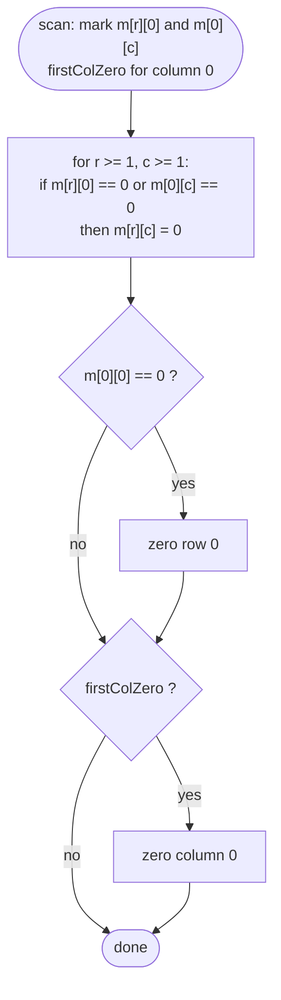

# LC 73 Set Matrix Zeroes

> [!abstract] In one sentence
> You need one flag per row and one per column; instead of allocating them, store the row flags in column 0 and the column flags in row 0 of the matrix itself, keep a single extra boolean for column 0 (whose flag slot `(0,0)` is shared), then apply the flags to the interior before finally zeroing the first row and column.

**Map:** [[NeetCode 150 MOC]] → [[DSA Dashboard]] · Pattern: [[Math & Geometry]]

> [!question] Predict before you read
> If you zero rows and columns while still scanning for zeros, what goes wrong? Think about a single 0 at `(0, 1)` in a 2×2 matrix.

## Problem

Given an `m × n` integer matrix, if any element is `0`, set its entire row and entire column to `0`. Do it in place.

- `[[1,1,1],[1,0,1],[1,1,1]]` → `[[1,0,1],[0,0,0],[1,0,1]]`
- `[[0,1,2,0],[3,4,5,2],[1,3,1,5]]` → `[[0,0,0,0],[0,4,5,0],[0,3,1,0]]`

Constraints that matter: `1 ≤ m, n ≤ 200`, values fit in `int`. The follow-up is explicit: O(mn) extra is easy, O(m + n) is better, O(1) is the real target.

## Clarifying questions

1. Do the zeros created during the process trigger further zeroing? — No; only the *original* zeros count. This is why you must separate marking from applying.
2. Can values be negative? — Yes; irrelevant, we only test `== 0`.
3. Is there a value I could use as a sentinel? — Not safely; any `int` could appear. Hence the first-row/first-column trick rather than a magic number.
4. Expected space? — Say O(1) up front and mention the O(m + n) version as the stepping stone.

## Brute force

Copy the matrix, scan the copy for zeros, and for each zero write zeros across the original's row and column. O(mn · (m + n)) time if you re-walk per zero, O(mn) space. Better: record `rowZero[m]` and `colZero[n]` in one scan, then apply in a second scan — O(mn) time, O(m + n) space. The waste is the two boolean arrays, which the matrix can host itself.

## The key insight

The flags `rowZero[r]` and `colZero[c]` only need to exist until the apply phase, and the apply phase writes the first row and first column to zero anyway if they contain a zero. So you can overwrite `matrix[r][0]` with `rowZero[r]` and `matrix[0][c]` with `colZero[c]` — once you have *separately* remembered whether row 0 and column 0 themselves need zeroing. Cell `(0,0)` would have to serve as both `rowZero[0]` and `colZero[0]`; one of those roles moves to a boolean. Recognition cue: "O(1) extra space on a matrix" → reuse a border row/column as scratch storage.

## Optimal approach

1. `firstColZero = false`. For each row `r`: if `matrix[r][0] == 0`, set `firstColZero = true`. Then for `c ≥ 1`: if `matrix[r][c] == 0`, set `matrix[r][0] = 0` and `matrix[0][c] = 0`.
2. For `r` from `1` and `c` from `1` (the interior): if `matrix[r][0] == 0` or `matrix[0][c] == 0`, set `matrix[r][c] = 0`.
3. If `matrix[0][0] == 0`, zero the whole first row (it was marked by some `(0, c)` zero or was `(0,0)` itself).
4. If `firstColZero`, zero the whole first column.

Order matters: the interior must be processed before the first row/column are wiped, because the markers live there.



> [!example]- Excalidraw version — the same diagram as an editable canvas
> ![[LC 73 Set Matrix Zeroes — Optimal approach.excalidraw]]
> [[LC 73 Set Matrix Zeroes — Optimal approach.excalidraw|Open in Excalidraw]] — needs the Excalidraw plugin (see [[Plugins to Install]]).

## Walkthrough

`[[0,1,2,0],[3,4,5,2],[1,3,1,5]]`.

| phase | matrix state | what happened |
|---|---|---|
| after marking | `0 1 2 0 / 3 4 5 2 / 1 3 1 5`, `firstColZero = true` | row 0 has zeros at c = 0 and c = 3: `m[0][0]` already 0, `m[0][3]` set 0 (already); `m[0][0] = 0` marks row 0 |
| interior apply | `0 1 2 0 / 3 4 5 0 / 1 3 1 0` | column 3 marker `m[0][3] = 0` zeroes `(1,3)`, `(2,3)`; rows 1–2 markers `m[1][0] = 3`, `m[2][0] = 1` are non-zero |
| first row | `0 0 0 0 / 3 4 5 0 / 1 3 1 0` | `m[0][0] == 0` |
| first column | `0 0 0 0 / 0 4 5 0 / 0 3 1 0` | `firstColZero` |

> [!example] Markers live in row 0 and column 0
> ![[LC 73 Set Matrix Zeroes — Markers live in row 0 and column 0.excalidraw]]
> [[LC 73 Set Matrix Zeroes — Markers live in row 0 and column 0.excalidraw|Open in Excalidraw]] — amber = marker cells that are 0; a separate boolean remembers that column 0 itself must be zeroed

%% excalidraw-spec
{"kind": "grid", "title": "Markers live in row 0 and column 0", "col_labels": ["", "c0", "c1", "c2", "c3"], "row_labels": ["r0", "r1", "r2"], "rows": [ [0, 1, 2, 0], [3, 4, 5, 2], [1, 3, 1, 5] ], "highlight": [ [0, 0], [0, 3] ], "caption": "amber = marker cells that are 0; a separate boolean remembers that column 0 itself must be zeroed"}
%%

## Java solution

```java
import java.util.*;

class Solution {
    public void setZeroes(int[][] matrix) {
        int m = matrix.length, n = matrix[0].length;
        boolean firstColZero = false;

        // 1. mark: row flag in column 0, column flag in row 0
        for (int r = 0; r < m; r++) {
            if (matrix[r][0] == 0) firstColZero = true;   // (0,0) cannot hold both flags
            for (int c = 1; c < n; c++) {
                if (matrix[r][c] == 0) {
                    matrix[r][0] = 0;
                    matrix[0][c] = 0;
                }
            }
        }
        // 2. apply to the interior, reading the markers
        for (int r = 1; r < m; r++) {
            for (int c = 1; c < n; c++) {
                if (matrix[r][0] == 0 || matrix[0][c] == 0) matrix[r][c] = 0;
            }
        }
        // 3. first row, then first column (markers are no longer needed)
        if (matrix[0][0] == 0) Arrays.fill(matrix[0], 0);
        if (firstColZero) {
            for (int r = 0; r < m; r++) matrix[r][0] = 0;
        }
    }
}
```

**Time** O(m·n) · **Space** O(1)

## Why it works

After phase 1, `matrix[r][0] == 0` iff row `r` originally contained a zero in columns `1..n-1` or `matrix[r][0]` was itself 0 — either way row `r` must become all zeros. Similarly `matrix[0][c] == 0` for `c ≥ 1` iff column `c` must be zeroed. `firstColZero` holds the same fact for column 0, and `matrix[0][0] == 0` holds it for row 0 (a zero anywhere in row 0 at `c ≥ 1` writes `matrix[0][0] = 0`; a zero at `(0,0)` is already 0). Phase 2 only writes interior cells and only reads markers, so no marker is destroyed before it is read. Phases 3 and 4 run last, after every read of the markers.

## Edge cases

- `1 × 1` matrix: `[[0]]` stays `[[0]]`, `[[5]]` stays `[[5]]` — the interior loops are empty.
- Single row `[[1,0,3]]`: marking sets `m[0][0] = 0`; phase 3 zeroes the row. Correct.
- Single column `[[1],[0],[3]]`: `firstColZero = true`; phase 4 zeroes the column. Correct.
- Zero exactly at `(0,0)`: `firstColZero = true` from the row-0 check, and `matrix[0][0] == 0` triggers the row; both the first row and first column are zeroed.
- No zeros: nothing is marked, nothing changes.

## Common mistakes

> [!warning] What goes wrong
> - Zeroing while scanning: a freshly written 0 is later read as an original zero and cascades through the whole matrix (the 2×2 case in the predict question wipes everything).
> - Wiping the first row or column *before* the interior pass — the markers disappear and the interior is untouched.
> - Forgetting the extra boolean and letting `(0,0)` stand for both row 0 and column 0: a zero in column 0 then wrongly zeroes row 0 (or vice versa).
> - Using a sentinel like `Integer.MIN_VALUE` for "to be zeroed": fails when that value is legitimately present, and interviewers know it.

## Variants & follow-ups

- O(m + n) version with two boolean arrays — write it first if the O(1) bookkeeping scares you, then say how to fold the arrays into the border.
- "Set the row and column to a given value `v` instead of 0": identical, marking on `== 0`, applying `v`.
- Count the cells that will become zero without modifying: `|rows| · n + |cols| · m − |rows| · |cols|` by inclusion–exclusion.
- Streaming variant: zeros arrive one at a time and you must answer "is cell (r, c) zero now?" — two hash sets, O(1) per query.
- In-place border tricks also appear in [[LC 48 Rotate Image]] (reflections) and the first-pass/second-pass structure in [[LC 54 Spiral Matrix]].

## Interview script

Restate: "any zero wipes its row and column; original zeros only; in place." Brute force: "flag arrays of size m and n, two passes, O(m + n) space." Insight: "the flags can live in row 0 and column 0 because those get wiped last anyway; one boolean resolves the (0,0) conflict." Approach: "mark, apply to the interior, then first row, then first column." Complexity: "O(mn) time, O(1) extra." Tests: zero at (0,0), zero only in the first column, single row, no zeros. Say explicitly why phase order matters — that is the thing the interviewer is listening for.

## Related

- Pattern: [[Math & Geometry]] (in-place matrix tricks) · [[Arrays & Hashing]] for the two-set version
- Same family: [[LC 48 Rotate Image]], [[LC 54 Spiral Matrix]], [[LC 36 Valid Sudoku]] (row/column/box flags)
- Java: [[DSA Patterns in Java]] (matrix templates), [[Java Pitfalls in Interviews]] (`Arrays.fill` on one row only; `clone()` of `int[][]` is shallow)

## Attempt log

| Date | Result | Minutes | What I got wrong |
|---|---|---|---|
| | | | |

### Mastery checklist
- [ ] Solved without hints in under 25 minutes
- [ ] Stated complexity before coding
- [ ] Handled every edge case above
- [ ] Code compiled first time
- [ ] Can do the follow-up variant

## Open questions
- [ ] Rewrite the solution using row 0 and column 0 the other way round (boolean for the first *row*) and check both pass the same edge cases.
