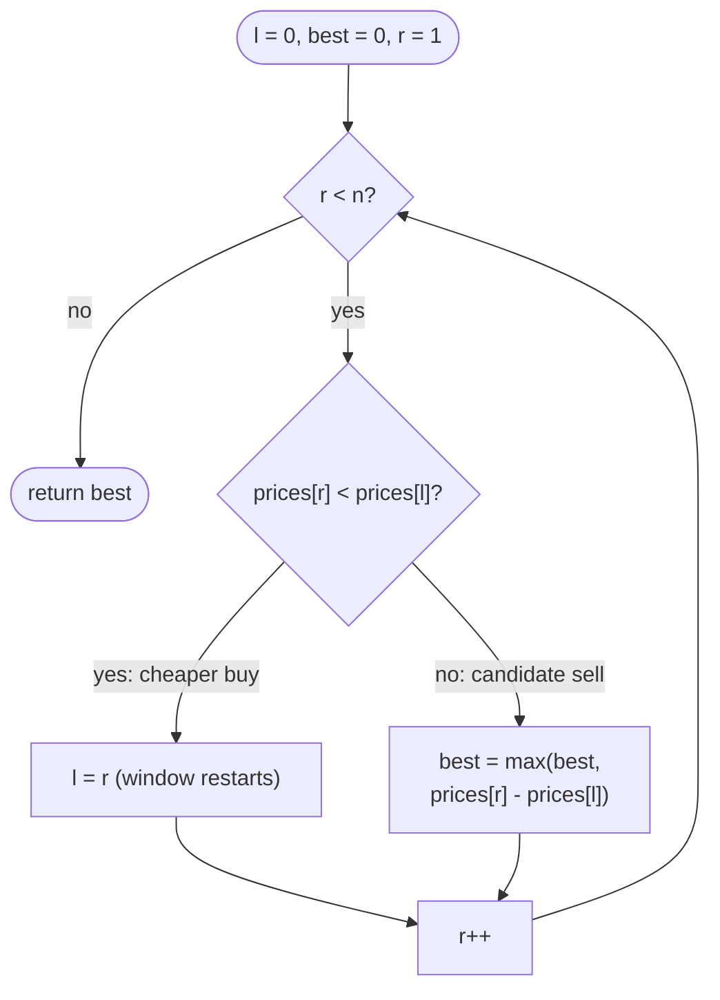

# LC 121 Best Time to Buy and Sell Stock

> [!abstract] In one sentence
> The best sell on day `r` pairs with the cheapest day before it, so one pass that carries the running minimum (the window's left edge) and the best difference so far answers the question without ever looking at a pair twice.

**Map:** [[NeetCode 150 MOC]] → [[DSA Dashboard]] · Pattern: [[Sliding Window]]

> [!question] Predict before you read
> `prices = [2, 10, 1, 4]`. The global maximum 10 comes before the global minimum 1. What does `max(prices) − min(prices)` give, what is the real answer, and which single comparison in the loop prevents the first mistake?

## Problem

You get `prices`, where `prices[i]` is the price of one share on day `i`. Pick one day to buy and a *later* day to sell so that the profit is as large as possible; if no profitable pair exists, return `0`. Exactly one buy and one sell.

- `[7, 1, 5, 3, 6, 4]` → `5` (buy at 1 on day 1, sell at 6 on day 4)
- `[7, 6, 4, 3, 1]` → `0` (prices only fall)

Constraints that matter: `1 ≤ n ≤ 10⁵` (so O(n²) is 5 × 10⁹ pair checks — too slow), prices in `[0, 10⁴]` (differences fit `int` trivially).

## Clarifying questions

1. Must the sell day be strictly after the buy day? — Yes; buying and selling on the same day is profit 0, which the `0` floor covers anyway.
2. One transaction only, not several? — One. (Several is the family of LC 122, 123, 188, 714 and [[LC 309 Best Time to Buy and Sell Stock with Cooldown]].)
3. If every pair loses money, return 0 rather than the least negative loss? — Yes.
4. Do I return the days or only the profit? — Only the profit; the days are a one-line addition.

## Brute force

For every buy day `i`, try every sell day `j > i` and keep the best `prices[j] − prices[i]`: O(n²) time, O(1) space. The waste: for a fixed sell day `j`, the only buy day that can matter is the cheapest one before `j`, and that minimum is computable incrementally in O(1) per step — the brute force rediscovers it `n` times.

## The key insight

Fix the *sell* day instead of the buy day. The best profit selling on day `r` is `prices[r] − min(prices[0..r−1])`, and the prefix minimum updates in one comparison as `r` advances. Seen as a window: `l` points at the cheapest day so far, `r` sweeps right; when a cheaper day appears the window restarts there (`l = r`), because any sell after it does better buying there than at the old `l`. Recognition cue: "buy before sell", "one pair with an order constraint, maximise the difference" → running minimum on the left, scan on the right.

## Optimal approach

1. `l = 0` (cheapest day seen), `best = 0`.
2. For `r` from 1 to `n − 1`: if `prices[r] < prices[l]`, set `l = r` (new cheapest day; the window restarts).
3. Otherwise `best = max(best, prices[r] − prices[l])`.
4. Return `best`.



> [!example]- Excalidraw version — the same diagram as an editable canvas
> ![[LC 121 Best Time to Buy and Sell Stock — Optimal approach.excalidraw]]
> [[LC 121 Best Time to Buy and Sell Stock — Optimal approach.excalidraw|Open in Excalidraw]] — needs the Excalidraw plugin (see [[Plugins to Install]]).

## Walkthrough

`prices = [7, 1, 5, 3, 6, 4]`

| r | prices[r] | prices[l] before | action | l after | best |
|---|---|---|---|---|---|
| 1 | 1 | 7 | cheaper: restart | 1 | 0 |
| 2 | 5 | 1 | profit 4 | 1 | 4 |
| 3 | 3 | 1 | profit 2 | 1 | 4 |
| 4 | 6 | 1 | profit 5 | 1 | 5 |
| 5 | 4 | 1 | profit 3 | 1 | 5 |

> [!example] r = 4: sell at 6 against the cheapest day l = 1
> ![[LC 121 Best Time to Buy and Sell Stock — r = 4- sell at 6 against the cheapest day l = 1.excalidraw]]
> [[LC 121 Best Time to Buy and Sell Stock — r = 4- sell at 6 against the cheapest day l = 1.excalidraw|Open in Excalidraw]] — the window [l, r] always starts at the minimum so far; days 2 and 3 were sell candidates against the same l, not new windows

%% excalidraw-spec
{"kind": "array", "title": "r = 4: sell at 6 against the cheapest day l = 1", "values": [7, 1, 5, 3, 6, 4], "pointers": {"l": 1, "r": 4}, "highlight": [1, 4], "labels": {"0": "never a buy: 1 is cheaper later"}, "caption": "the window [l, r] always starts at the minimum so far; days 2 and 3 were sell candidates against the same l, not new windows"}
%%

## Java solution

```java
import java.util.*;

class Solution {
    public int maxProfit(int[] prices) {
        int l = 0, best = 0;                                  // l = index of the cheapest day seen so far
        for (int r = 1; r < prices.length; r++) {
            if (prices[r] < prices[l]) l = r;                 // cheaper buy: every later sell prefers it
            else best = Math.max(best, prices[r] - prices[l]);
        }
        return best;
    }
}
```

**Time** O(n) · **Space** O(1)

The same loop written as Kadane's algorithm on day-to-day differences shows why this is also [[LC 53 Maximum Subarray]] in disguise:

```java
// snippet
int cur = 0, best = 0;
for (int i = 1; i < prices.length; i++) {
    cur = Math.max(0, cur + prices[i] - prices[i - 1]);   // best gain of a run ending today, or restart
    best = Math.max(best, cur);
}                                                         // a run of consecutive diffs = one buy, one sell
```

## Why it works

Invariant after processing `r`: `prices[l] = min(prices[0..r])` and `best = max over j ≤ r of (prices[j] − min(prices[0..j−1]))`. The first holds because `l` moves exactly when a strictly smaller price appears. For the second, any optimal pair `(i*, j*)` can be replaced by `(argmin prices[0..j*−1], j*)` without losing profit, so the optimum has the form the loop evaluates at `r = j*`; and the loop never evaluates an illegal pair because `l ≤ r` always and `l == r` only in the branch that does not record. Equal prices: a tie does not move `l` (strict `<`), which is harmless either way.

## Edge cases

- `n = 1`: the loop body never runs, return 0.
- Strictly decreasing: `l` moves every step, `best` stays 0.
- All equal: no branch moves `l`, every profit is 0.
- Minimum on the last day: it restarts the window but there is no later sell — `best` keeps the earlier value.
- Maximum before the minimum (`[2, 10, 1, 4]`): answer 8 from `(2, 10)`, not 9 — the order constraint is exactly what the running minimum enforces.

## Common mistakes

> [!warning] What goes wrong
> - `max(prices) − min(prices)` — ignores that the buy must come first; wrong on `[2, 10, 1, 4]`.
> - Initialising `best = Integer.MIN_VALUE` and returning it unchanged on a falling market instead of 0.
> - Refreshing the minimum with `prices[r]` and then computing `prices[r] − min` on the same day is fine (gives 0); the real bug is comparing against the minimum of the *whole* array.
> - Writing the O(n²) double loop under time pressure because the problem is tagged Easy; `n = 10⁵` makes it time out.
> - Tracking the best *day pair* with `l` but forgetting that `l` may move after the best pair was recorded — store `bestBuy = l` at the moment `best` improves if the days are required.

## Variants & follow-ups

- Unlimited transactions (LC 122): sum every positive day-to-day difference — pure [[Greedy]].
- At most two or `k` transactions (LC 123, LC 188): state DP over (day, transactions used, holding?) — the family's general form is in [[Dynamic Programming]].
- Cooldown after selling → [[LC 309 Best Time to Buy and Sell Stock with Cooldown]]; transaction fee (LC 714): the same state machine with a cost on the sell edge.
- Return the buy and sell days: record `l` whenever `best` improves.
- Streaming prices (ticks arriving one at a time): the loop is already online — keep `min` and `best` as two numbers.
- Maximum *loss* instead of gain: track the running maximum and `prices[l] − prices[r]`.

## Interview script

Restate: "one buy, one later sell, maximise the difference, zero if nothing is profitable." Brute force: "every pair, O(n²)." Insight: "for a fixed sell day the only buy that matters is the minimum before it, and that minimum is a running value." Approach: "pointer `l` at the cheapest day, sweep `r`; a cheaper day restarts the window, otherwise record `prices[r] − prices[l]`." Complexity: "O(n) time, O(1) space." Tests: single day, strictly falling, maximum before minimum, minimum on the last day. If asked for a follow-up: "unlimited transactions is the sum of positive diffs; `k` transactions is a DP."

## Related

- Pattern: [[Sliding Window]] (the degenerate window: left edge = running minimum); greedy reading: [[Greedy]]
- Prerequisites: [[Arrays & Hashing]]
- Siblings: [[LC 53 Maximum Subarray]] (Kadane on the diffs), [[LC 309 Best Time to Buy and Sell Stock with Cooldown]] (the DP sequel), [[LC 3 Longest Substring Without Repeating Characters]] (next window problem)
- Java: [[Java Collections Cheat Sheet]] (`Math.max`, `Arrays.stream`), [[DSA Patterns in Java]] (sliding-window template)

## Attempt log

| Date | Result | Minutes | What I got wrong |
|---|---|---|---|
| | | | |

### Mastery checklist
- [ ] Solved without hints in under 25 minutes
- [ ] Stated complexity before coding
- [ ] Handled every edge case above
- [ ] Code compiled first time
- [ ] Can do the follow-up variant

## Open questions
- [ ] Write LC 122 (unlimited transactions) in five lines and explain why summing positive diffs is never worse than any explicit schedule of buys and sells.
