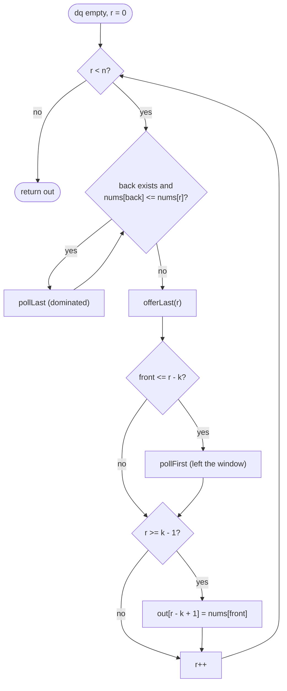

# LC 239 Sliding Window Maximum

> [!abstract] In one sentence
> An element that is older *and* smaller than a newer element can never be the maximum of any future window, so a deque that discards such elements on arrival stays sorted by value, its front is the current window's maximum, and every index is pushed and popped once.

**Map:** [[NeetCode 150 MOC]] → [[DSA Dashboard]] · Pattern: [[Sliding Window]]

> [!question] Predict before you read
> The deque stores *indices*, not values. Name the one operation that becomes impossible if you store values instead — and say why a max-heap of values has the same problem, and how "lazy deletion" works around it there.

## Problem

Given an integer array `nums` and a window size `k`, the window slides from the left edge to the right one position at a time. Return the maximum of each window, `n − k + 1` values in order.

- `nums = [1, 3, -1, -3, 5, 3, 6, 7]`, `k = 3` → `[3, 3, 5, 5, 6, 7]`
- `nums = [1]`, `k = 1` → `[1]`

Constraints that matter: `1 ≤ n ≤ 10⁵`, `1 ≤ k ≤ n`, values in ±10⁴ — so O(nk) (up to 10¹⁰) fails, O(n log n) passes, O(n) is the expected answer.

## Clarifying questions

1. Is `k ≤ n` guaranteed, so there is at least one window? — Yes; the output has `n − k + 1` entries.
2. Can values repeat? — Yes; equal values must be handled by the deque's comparison (either strict or non-strict pop is correct).
3. Return an array of maxima, or the indices? — Values; indices are what the deque holds anyway.
4. Is the input static, or do windows arrive as a stream? — Static here; the deque solution is online regardless.

## Brute force

For each of the `n − k + 1` windows scan its `k` elements: O(nk) time, O(1) space. The waste: consecutive windows share `k − 1` elements, and once a big element enters, the smaller elements before it are irrelevant for *every* later window that contains the big one — the brute force keeps re-examining them.

## The key insight

Dominance. If `i < j` and `nums[i] ≤ nums[j]`, then `i` leaves every window before `j` does and is never larger, so `i` can never be a window maximum again. Delete it the moment `j` arrives. What survives is a sequence of indices increasing in position and *strictly decreasing* in value — a monotonic deque. Its front is the maximum of the current window once indices that fell out of the window are evicted from the front. Recognition cue: "max / min of every window", "range extremum under a sliding range" → monotonic deque; the same structure as [[LC 739 Daily Temperatures]]'s stack with eviction on both ends.

## Optimal approach

1. `dq` = empty deque of indices; `out = new int[n − k + 1]`.
2. For each `r`: while the back of `dq` has `nums[back] ≤ nums[r]`, pop it (dominated). Push `r` at the back.
3. If the front index is `≤ r − k`, pop it from the front (it left the window `[r − k + 1, r]`).
4. If `r ≥ k − 1`, `out[r − k + 1] = nums[front]`.



> [!example]- Excalidraw version — the same diagram as an editable canvas
> ![[LC 239 Sliding Window Maximum — Optimal approach.excalidraw]]
> [[LC 239 Sliding Window Maximum — Optimal approach.excalidraw|Open in Excalidraw]] — needs the Excalidraw plugin (see [[Plugins to Install]]).

## Walkthrough

`nums = [5, 4, 3, 6, 2, 1, 0]`, `k = 3` — chosen so that both evictions happen.

| r | nums[r] | pops from back | push | front out? | deque (indices) | deque values | out |
|---|---|---|---|---|---|---|---|
| 0 | 5 | — | 0 | — | [0] | [5] | — |
| 1 | 4 | — | 1 | — | [0, 1] | [5, 4] | — |
| 2 | 3 | — | 2 | — | [0, 1, 2] | [5, 4, 3] | 5 |
| 3 | 6 | 2, 1, 0 (all ≤ 6) | 3 | — | [3] | [6] | 6 |
| 4 | 2 | — | 4 | — | [3, 4] | [6, 2] | 6 |
| 5 | 1 | — | 5 | 3 ≤ 2? no | [3, 4, 5] | [6, 2, 1] | 6 |
| 6 | 0 | — | 6 | 3 ≤ 3? yes → pop 3 | [4, 5, 6] | [2, 1, 0] | 2 |

> [!example] r = 3: the 6 evicts 3, 4, 5 from the back in one step
> ![[LC 239 Sliding Window Maximum — r = 3- the 6 evicts 3, 4, 5 from the back in one step.excalidraw]]
> [[LC 239 Sliding Window Maximum — r = 3- the 6 evicts 3, 4, 5 from the back in one step.excalidraw|Open in Excalidraw]] — all three are older and smaller than 6, so no later window can have them as its maximum; the deque is [3] and stays sorted by construction

%% excalidraw-spec
{"kind": "array", "title": "r = 3: the 6 evicts 3, 4, 5 from the back in one step", "values": [5, 4, 3, 6, 2, 1, 0], "pointers": {"l": 1, "r": 3}, "highlight": [3], "labels": {"0": "popped", "1": "popped", "2": "popped"}, "caption": "all three are older and smaller than 6, so no later window can have them as its maximum; the deque is [3] and stays sorted by construction"}
%%

## Java solution

```java
import java.util.*;

class Solution {
    public int[] maxSlidingWindow(int[] nums, int k) {
        int n = nums.length;
        int[] out = new int[n - k + 1];
        Deque<Integer> dq = new ArrayDeque<>();                          // indices; values strictly decreasing front to back
        for (int r = 0; r < n; r++) {
            while (!dq.isEmpty() && nums[dq.peekLast()] <= nums[r]) dq.pollLast();   // dominated: never a max again
            dq.offerLast(r);
            if (dq.peekFirst() <= r - k) dq.pollFirst();                 // the front fell out of [r - k + 1, r]
            if (r >= k - 1) out[r - k + 1] = nums[dq.peekFirst()];       // first full window ends at r = k - 1
        }
        return out;
    }
}
```

**Time** O(n) — each index is offered once and polled at most once · **Space** O(k) for the deque plus the output

The heap alternative is what most people reach for first. It is O(n log n) and needs *lazy deletion*, because `PriorityQueue.remove(Object)` is O(n):

```java
// snippet
PriorityQueue<int[]> pq = new PriorityQueue<>((a, b) -> Integer.compare(b[0], a[0]));   // {value, index}, largest on top
for (int r = 0; r < n; r++) {
    pq.offer(new int[]{nums[r], r});
    while (pq.peek()[1] <= r - k) pq.poll();            // discard tops that have left the window; others may linger below
    if (r >= k - 1) out[r - k + 1] = pq.peek()[0];
}                                                       // O(n log n) time, O(n) space in the worst case
```

The deque wins because dominance lets you delete *eagerly* from the back; the heap can only delete lazily from the top, so stale entries pile up and every operation pays a logarithm.

## Why it works

Invariant after step `r`: the deque holds exactly the indices `i` in the window `[r − k + 1, r]` that are **not dominated** — no `j` with `i < j ≤ r` and `nums[j] ≥ nums[i]` — in increasing index order, hence strictly decreasing value order. Pushing `r` after popping every back element `≤ nums[r]` keeps the order (anything left at the back is larger than `nums[r]`); the front eviction removes the only index that can be outside the window (indices are increasing, so the oldest is at the front, and at most one index leaves per step). The window maximum is never dominated, so it is in the deque, and it is the largest value there — the front. Amortised cost: every index enters once and leaves once, from either end.

## Edge cases

- `k = 1`: every element is popped from the back before the next one is pushed... only if smaller — either way the front is `nums[r]` and the output is a copy.
- `k = n`: one output value, the global maximum; the front eviction never fires.
- All equal values: with `<=` each new index evicts the previous one, the deque has a single entry; with `<` it grows to `k` and the front eviction does the work — both correct.
- Strictly decreasing input: nothing is ever dominated; the deque fills to `k` and the front eviction produces the answers.
- Negative values: nothing special; no sentinel like `Integer.MIN_VALUE` is used.

## Common mistakes

> [!warning] What goes wrong
> - Storing values in the deque: you cannot tell when the front has left the window. Store indices and look values up.
> - Evicting the front with `< r − k` instead of `<= r − k`: an index that just left the window stays one step too long and can be reported as the maximum.
> - Mixing up ends: `push`/`pop`/`peek` on `ArrayDeque` act on the *head*. For a monotonic deque use the explicit `offerLast`/`pollLast`/`peekLast` and `peekFirst`/`pollFirst`.
> - Writing `out[r]` instead of `out[r − k + 1]`, or sizing the output `n` instead of `n − k + 1`.
> - In the heap version, comparing with `b[0] − a[0]`: fine at ±10⁴, an overflow bug at ±2 × 10⁹ — `Integer.compare` costs nothing.
> - Calling `pq.remove(leavingElement)` to keep the heap exact: O(n) per step, back to O(nk).

## Variants & follow-ups

- Window *minimum*: flip the comparison (`>=` when popping from the back).
- Longest subarray with `max − min ≤ limit` (LC 1438): two deques (max and min) and a variable window — shrink `l` while the front difference exceeds the limit.
- Sliding window median (LC 480): two heaps with lazy deletion, or a `TreeMap` of counts; see [[Heaps & Priority Queues]].
- Jump Game VI (LC 1696) and other "DP where `dp[i]` is the max of the last `k` dp values": the same deque over `dp`.
- Range maximum queries with arbitrary (non-sliding) ranges: sparse table or [[Segment Trees]]; the deque needs the ranges to slide monotonically.
- Streaming: the deque is already online; memory is O(k), which is the point in a rate-limiter or moving-max metric.

## Interview script

Restate: "maximum of every contiguous window of size `k`, `k ≤ n`, output has `n − k + 1` values." Brute force: "scan each window, O(nk)." Heap: "max-heap of (value, index) with lazy deletion of expired tops — O(n log n), and that is usually acceptable." Insight: "an older element that is not larger than a newer one can never be a maximum again, so I delete it immediately — what remains is a deque decreasing in value." Approach: "pop the back while `≤ nums[r]`, push `r`, pop the front if it left the window, record the front." Complexity: "O(n) time, every index in and out once; O(k) space." Tests: `k = 1`, `k = n`, all equal, strictly decreasing, negatives. Mention the minimum variant and the two-deque trick if asked for a follow-up.

## Related

- Pattern: [[Sliding Window]]; the monotonic structure: [[Stack & Monotonic Stack]]; the alternative: [[Heaps & Priority Queues]]
- Prerequisites: [[LC 739 Daily Temperatures]] (monotonic stack, one end), [[LC 3 Longest Substring Without Repeating Characters]] (window bookkeeping)
- Siblings: [[LC 76 Minimum Window Substring]], [[LC 84 Largest Rectangle in Histogram]] (monotonic stack with both boundaries), [[LC 295 Find Median from Data Stream]] (two heaps)
- Java: [[Java Collections Cheat Sheet]] (`ArrayDeque` both-end methods, `PriorityQueue` comparator forms), [[DSA Patterns in Java]] (monotonic deque template)

## Attempt log

| Date | Result | Minutes | What I got wrong |
|---|---|---|---|
| | | | |

### Mastery checklist
- [ ] Solved without hints in under 25 minutes
- [ ] Stated complexity before coding
- [ ] Handled every edge case above
- [ ] Code compiled first time
- [ ] Can do the follow-up variant

## Open questions
- [ ] Solve LC 1438 (two deques plus a variable window) and state the invariant each deque maintains while `l` moves.
- [ ] Why can the heap not delete eagerly the way the deque does? What property of the deque's contents makes "delete from the back" safe?
