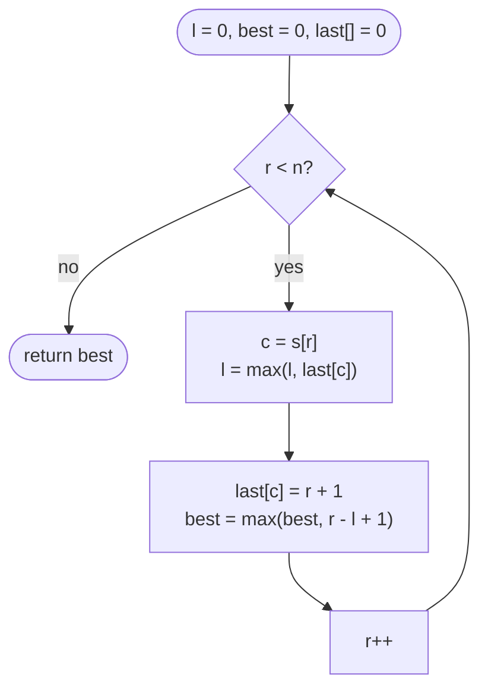

# LC 3 Longest Substring Without Repeating Characters

> [!abstract] In one sentence
> Keep a window `[l, r]` with no repeated character; when `s[r]` was last seen at index `p ≥ l`, the window cannot contain both copies, so `l` jumps to `p + 1` in one step and the longest valid window ending at every `r` falls out in O(n).

**Map:** [[NeetCode 150 MOC]] → [[DSA Dashboard]] · Pattern: [[Sliding Window]]

> [!question] Predict before you read
> On `"abba"`, after reading the second `b` the window is `[2, 2]`. Now the second `a` arrives and its last index is 0. If you set `l = last[a] + 1 = 1` the window becomes `"bba"`. What invariant did that break, and what one-token change fixes it?

## Problem

Given a string `s`, return the length of the longest substring (contiguous) in which no character appears twice.

- `"abcabcbb"` → `3` (`"abc"`)
- `"bbbbb"` → `1`
- `"pwwkew"` → `3` (`"wke"`; `"pwke"` is a subsequence, not a substring)

Constraints that matter: `0 ≤ n ≤ 5 × 10⁴`; characters are English letters, digits, symbols and spaces — i.e. ASCII, so a 128-slot array replaces a `HashMap`. Empty string → 0.

## Clarifying questions

1. Substring or subsequence? — Substring (contiguous); the `"pwke"` example is the classic misread.
2. Character set — ASCII only, or full Unicode? — ASCII per the constraints; with Unicode use `HashMap<Character, Integer>` (or code points).
3. Case-sensitive? — Yes, `'A'` and `'a'` are different.
4. Return the length, or the substring itself? — The length; the substring is `s.substring(bestL, bestL + best)` if you also record `bestL`.

## Brute force

Every start `i`, extend `j` while the characters are distinct using a boolean array: O(n²) time, O(1) space (the O(n³) version re-checks the whole substring each time). The waste: after the window `[i, j]` fails at `j` because `s[j]` already appears at position `p`, the brute force restarts at `i + 1`, `i + 2`, …, although no start before `p + 1` can ever pass `j`.

## The key insight

The validity condition "all distinct" is *monotone*: a window containing a repeat stays invalid however far you extend it, and a sub-window of a valid window is valid. So the left edge only ever moves right, and the right move it needs is known exactly — one past the previous occurrence of the offending character. Storing `last[c]` (last index of `c`) turns the shrink loop into a single assignment. Recognition cue: "longest substring/subarray with no repeats / at most k distinct / property that breaks only by adding" → variable window, left edge monotone.

## Optimal approach

1. `last[128]` filled with 0, holding `index + 1` of each character's latest occurrence (0 means never seen). `l = 0`, `best = 0`.
2. For each `r`: `c = s[r]`; `l = max(l, last[c])` — jump past the previous `c`, never backwards.
3. `last[c] = r + 1`; `best = max(best, r − l + 1)`.
4. Return `best`.



> [!example]- Excalidraw version — the same diagram as an editable canvas
> ![[LC 3 Longest Substring Without Repeating Characters — Optimal approach.excalidraw]]
> [[LC 3 Longest Substring Without Repeating Characters — Optimal approach.excalidraw|Open in Excalidraw]] — needs the Excalidraw plugin (see [[Plugins to Install]]).

The `max` is the whole algorithm: `last[c]` may point *before* `l` (that occurrence already left the window), and then it must be ignored.

## Walkthrough

`s = "pwwkew"`, `last[c]` stores index + 1.

| r | c | last[c] before | l = max(l, last[c]) | window | len | best |
|---|---|---|---|---|---|---|
| 0 | p | 0 | 0 | p | 1 | 1 |
| 1 | w | 0 | 0 | pw | 2 | 2 |
| 2 | w | 2 | 2 | w | 1 | 2 |
| 3 | k | 0 | 2 | wk | 2 | 2 |
| 4 | e | 0 | 2 | wke | 3 | 3 |
| 5 | w | 3 | 3 | kew | 3 | 3 |

> [!example] abba at r = 3: last[a] = 1 is stale, l stays at 2
> ![[LC 3 Longest Substring Without Repeating Characters — abba at r = 3- last-a- = 1 is stale, l stays at 2.excalidraw]]
> [[LC 3 Longest Substring Without Repeating Characters — abba at r = 3- last-a- = 1 is stale, l stays at 2.excalidraw|Open in Excalidraw]] — l = max(2, last[a]) = max(2, 1) = 2 keeps the window ba. Without the max, l would fall back to 1 and bba would be reported as repeat-free

%% excalidraw-spec
{"kind": "array", "title": "abba at r = 3: last[a] = 1 is stale, l stays at 2", "values": ["a", "b", "b", "a"], "pointers": {"l": 2, "r": 3}, "highlight": [2, 3], "labels": {"0": "old a: already outside", "1": "old b: pushed l to 2"}, "caption": "l = max(2, last[a]) = max(2, 1) = 2 keeps the window ba. Without the max, l would fall back to 1 and bba would be reported as repeat-free"}
%%

## Java solution

```java
import java.util.*;

class Solution {
    public int lengthOfLongestSubstring(String s) {
        int[] last = new int[128];                       // last[c] = (latest index of c) + 1; 0 = never seen
        int best = 0, l = 0;
        for (int r = 0; r < s.length(); r++) {
            char c = s.charAt(r);
            l = Math.max(l, last[c]);                    // jump past the previous c; never move backwards
            last[c] = r + 1;
            best = Math.max(best, r - l + 1);
        }
        return best;
    }
}
```

**Time** O(n) · **Space** O(1) (128 ints; O(min(n, alphabet)) with a map)

The general variable-window template — shrink with a `while` until valid — solves the same problem and generalises to "at most k distinct", where no jump target exists:

```java
// snippet
Set<Character> win = new HashSet<>();
int l = 0, best = 0;
for (int r = 0; r < s.length(); r++) {
    while (!win.add(s.charAt(r))) win.remove(s.charAt(l++));   // add() is false while s[r] is inside: evict from the left
    best = Math.max(best, r - l + 1);
}                                                              // each index enters and leaves the set once: O(n)
```

## Why it works

Invariant after step `r`: the window `[l, r]` contains no repeat, and `l` is the *smallest* index with that property (so `r − l + 1` is the longest valid substring ending at `r`). Induction: before reading `s[r]`, `[l, r − 1]` was the longest valid window ending at `r − 1`. Adding `s[r]` can break validity only if `s[r]` occurs in `[l, r − 1]`, i.e. at index `last[c] − 1 ≥ l`; the new smallest valid start is then `last[c]`, otherwise it stays `l` — exactly `max(l, last[c])`. Every `r` sees its longest valid window, so the maximum over `r` is the answer. `l` never decreases, hence O(n) even though `l` is assigned inside the loop.

## Edge cases

- Empty string: loop does not run, returns 0.
- Single character: 1.
- All identical (`"bbbbb"`): `l` follows one behind `r`, every window has length 1.
- All distinct: `l` stays 0, answer `n`.
- The stale-index case (`"abba"`): 2, not 3 — handled only because of the `max`.
- Characters outside ASCII: `s.charAt(r)` can exceed 127 → `ArrayIndexOutOfBoundsException`; size the array 256 or use a map.

## Common mistakes

> [!warning] What goes wrong
> - `l = last[c] + 1` without the `max` — the `"abba"` bug: a stale occurrence from before `l` pulls the left edge backwards and admits a repeat.
> - Storing the raw index with `0` as "unseen" — index 0 is a real position; store `index + 1` or fill the array with `−1`.
> - Confusing substring with subsequence (`"pwke"`).
> - In the set version, using `if` instead of `while` to evict — one eviction may not remove the duplicate.
> - Computing the length as `r − l` instead of `r − l + 1`.

## Variants & follow-ups

- At most `k` distinct characters (LC 340) / at most two distinct (LC 159): map of counts, shrink while `map.size() > k` — no jump, the `while` template.
- Longest substring with every character appearing at least `k` times (LC 395): not monotone; iterate over the number of distinct characters allowed, or divide and conquer on rare characters.
- Return the substring, not the length: record `bestL` when `best` improves.
- Huge alphabet or streaming input: `HashMap<Character, Integer>` of last indices, same logic.
- Count all repeat-free substrings instead of the longest: after each step add `r − l + 1` (every start in `[l, r]` is valid).
- The same window with "at most k replacements" → [[LC 424 Longest Repeating Character Replacement]].

## Interview script

Restate: "longest contiguous run with all distinct characters; ASCII; empty allowed." Brute force: "every start, extend until a repeat, O(n²)." Insight: "validity is monotone, so the left edge only moves right, and the exact move is known from the last index of the repeated character." Approach: "128-array of last index + 1; `l = max(l, last[c])`; record `r − l + 1`." Complexity: "O(n) time, O(1) space." Tests: `"abba"` (stale index), `"bbbbb"`, empty, all distinct. Mention the `while`-shrink version as the one that generalises to at-most-k-distinct.

## Related

- Pattern: [[Sliding Window]]; the array-as-map idea: [[Hashing]]
- Prerequisites: [[LC 121 Best Time to Buy and Sell Stock]] (first window), [[Strings]] (`charAt`, `char` as an index)
- Siblings: [[LC 424 Longest Repeating Character Replacement]], [[LC 567 Permutation in String]], [[LC 76 Minimum Window Substring]]
- Java: [[Java Collections Cheat Sheet]] (`HashSet.add` returns false on a repeat), [[DSA Patterns in Java]] (variable window template)

## Attempt log

| Date | Result | Minutes | What I got wrong |
|---|---|---|---|
| | | | |

### Mastery checklist
- [ ] Solved without hints in under 25 minutes
- [ ] Stated complexity before coding
- [ ] Handled every edge case above
- [ ] Code compiled first time
- [ ] Can do the follow-up variant

## Open questions
- [ ] Solve "at most k distinct characters" with the `while` template, then explain why the jump trick cannot be applied there.
