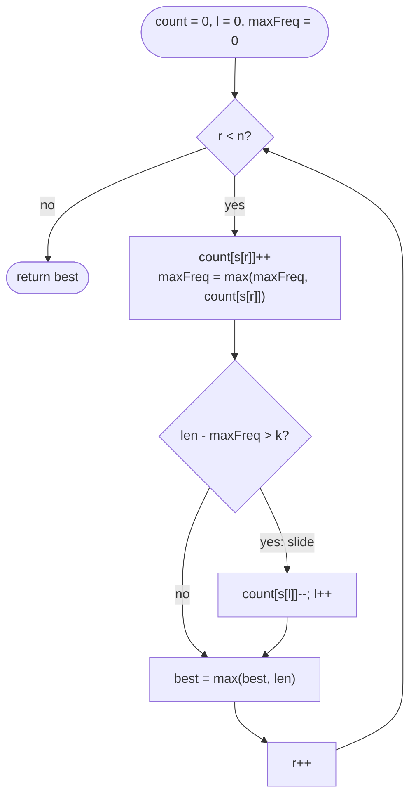

# LC 424 Longest Repeating Character Replacement

> [!abstract] In one sentence
> A window of length `len` can be made uniform with `len − maxFreq` replacements, so grow `r`, and when `len − maxFreq > k` slide `l` once; the window never shrinks below the best length found, and `maxFreq` may stay stale because the answer can only improve when some letter's count sets a new high.

**Map:** [[NeetCode 150 MOC]] → [[DSA Dashboard]] · Pattern: [[Sliding Window]]

> [!question] Predict before you read
> After the window slides past some `A`s, the true most frequent count inside it drops, but the code keeps the old `maxFreq`. The window it now holds may be *invalid*. Why is the length it reports still never larger than the real answer?

## Problem

You get an uppercase string `s` and an integer `k`. You may change at most `k` characters to any other uppercase letter. Return the length of the longest substring that, after those changes, consists of a single repeated letter.

- `s = "ABAB"`, `k = 2` → `4` (change both `A`s or both `B`s)
- `s = "AABABBA"`, `k = 1` → `4` (`"AABA"` → `"AAAA"`, or `"ABBA"` → `"BBBB"`)

Constraints that matter: `1 ≤ n ≤ 10⁵`, only `'A'..'Z'` (a 26-int count array), `0 ≤ k ≤ n`. `k ≥ n` means the whole string.

## Clarifying questions

1. Uppercase only, 26 letters? — Yes; it fixes the array size and makes a "recompute the max" scan cost 26.
2. Replace *at most* `k`, not exactly `k`? — At most; with `k = 0` the answer is the longest run of equal letters.
3. Can `k` exceed the length? — Then the answer is `n`; the code handles it without a special case.
4. Does the target letter have to be one already in the substring? — It never hurts: keeping the majority letter minimises replacements.

## Brute force

For every substring, count its letters and check `len − maxCount ≤ k`: O(n²) substrings with incremental counting per start, O(26) per check, O(26 n²) overall. The waste: once a window is invalid, every longer window with the same start is also invalid (adding a character raises `len` by 1 and `maxFreq` by at most 1), so the brute force explores a whole suffix of lengths it could have skipped.

## The key insight

The cost to make a window uniform is `len − maxFreq` (replace everything that is not the most frequent letter). That cost never decreases under extension, so the variable window applies: grow `r`, move `l` when `len − maxFreq > k`. The second insight is the one that separates a pass from a fumble: you never need to *re-compute* `maxFreq` when a character leaves. A longer window only becomes valid when some letter reaches a count higher than any seen before, and at that moment `maxFreq` is exact because the count that just incremented is a real count of the current window. Recognition cue: "longest substring with at most k changes / k zeros flipped / k exceptions" → window with a cost counter, slide when the cost exceeds `k`.

## Optimal approach

1. `count[26]`, `l = 0`, `maxFreq = 0`, `best = 0`.
2. For each `r`: `maxFreq = max(maxFreq, ++count[s[r]])`.
3. If `(r − l + 1) − maxFreq > k`: `count[s[l]]--`, `l++` (slide by one; the window keeps its size).
4. `best = max(best, r − l + 1)`. Return `best` (equivalently `n − l` at the end, since the window never shrinks).



> [!example]- Excalidraw version — the same diagram as an editable canvas
> ![[LC 424 Longest Repeating Character Replacement — Optimal approach.excalidraw]]
> [[LC 424 Longest Repeating Character Replacement — Optimal approach.excalidraw|Open in Excalidraw]] — needs the Excalidraw plugin (see [[Plugins to Install]]).

## Walkthrough

`s = "AABABBA"`, `k = 1`. Counts are shown after `s[r]` enters and before any slide.

| r | s[r] | counts A,B | maxFreq | len before slide | len − maxFreq | slide? | window after | best |
|---|---|---|---|---|---|---|---|---|
| 0 | A | 1,0 | 1 | 1 | 0 | no | A | 1 |
| 1 | A | 2,0 | 2 | 2 | 0 | no | AA | 2 |
| 2 | B | 2,1 | 2 | 3 | 1 | no | AAB | 3 |
| 3 | A | 3,1 | 3 | 4 | 1 | no | AABA | 4 |
| 4 | B | 3,2 | 3 | 5 | 2 | yes, A leaves | ABAB | 4 |
| 5 | B | 2,3 | 3 | 5 | 2 | yes, A leaves | BABB | 4 |
| 6 | A | 2,3 | 3 | 5 | 2 | yes, B leaves | ABBA | 4 |

At `r = 6` the held window `"ABBA"` has true max 2 and would need 2 changes — it is *invalid* — yet `best = 4` is right because `"AABA"` was valid earlier. The stale `maxFreq = 3` never lets the window grow until some letter genuinely reaches 4.

> [!example] r = 4: len 5 - maxFreq 3 = 2 > k, so l slides to 1
> ![[LC 424 Longest Repeating Character Replacement — r = 4- len 5 - maxFreq 3 = 2 - k, so l slides to 1.excalidraw]]
> [[LC 424 Longest Repeating Character Replacement — r = 4- len 5 - maxFreq 3 = 2 - k, so l slides to 1.excalidraw|Open in Excalidraw]] — the window keeps size 4 and slides; it will never shrink, so its final size is the answer

%% excalidraw-spec
{"kind": "array", "title": "r = 4: len 5 - maxFreq 3 = 2 > k, so l slides to 1", "values": ["A", "A", "B", "A", "B", "B", "A"], "pointers": {"l": 1, "r": 4}, "highlight": [1, 2, 3, 4], "labels": {"0": "left the window"}, "caption": "the window keeps size 4 and slides; it will never shrink, so its final size is the answer"}
%%

## Java solution

```java
import java.util.*;

class Solution {
    public int characterReplacement(String s, int k) {
        int[] count = new int[26];
        int l = 0, maxFreq = 0, best = 0;
        for (int r = 0; r < s.length(); r++) {
            maxFreq = Math.max(maxFreq, ++count[s.charAt(r) - 'A']);   // exact whenever it increases
            if (r - l + 1 - maxFreq > k) {                               // cannot fix this window: slide once
                count[s.charAt(l) - 'A']--;
                l++;
            }
            best = Math.max(best, r - l + 1);
        }
        return best;
    }
}
```

**Time** O(n) · **Space** O(1) (26 ints)

The "honest" version shrinks with a `while` and recomputes the maximum after each eviction — O(26 n) and easier to defend if the stale-max argument escapes you under pressure:

```java
// snippet
while (r - l + 1 - maxFreq > k) {
    count[s.charAt(l++) - 'A']--;
    maxFreq = 0;
    for (int c : count) maxFreq = Math.max(maxFreq, c);   // exact max of the current window, 26 steps
}
```

## Why it works

Two directions. *Never too large*: the window grows (to length `L + 1`) only at a step where `(L + 1) − maxFreq ≤ k`. Take the moment `maxFreq` was last raised, by letter `c` reaching count `M` in a window of length `L₀ ≤ L` starting at `l₀`; the window length rises by at most one per step, so the string has at least `L + 1 − L₀` characters after that window, and the substring of length `L + 1` starting at `l₀` contains those `M` copies of `c` — it is a genuinely valid window of length `L + 1`. *Never too small*: let `[a, r]` be the longest valid window ending at `r` with majority letter `c`. If the algorithm's `l` ever moved past `a`, it did so at some `r' ≤ r` because `(r' − a + 1) − maxFreq > k`; but `maxFreq ≥ count of c in [a, r']`, and the non-`c` characters in `[a, r']` are a subset of those in `[a, r]`, at most `k` — contradiction. So `l ≤ a` at step `r`, the held length is at least the longest valid one, and the maximum over `r` is the answer. (With the `while` version the held window is always valid and the second direction is the standard "longest valid window ending at `r`" argument.)

## Edge cases

- `k = 0`: longest run of one letter — the slide happens as soon as a different letter enters.
- `k ≥ n`: the condition never fires, answer `n`.
- `n = 1`: 1.
- All one letter: `maxFreq == len` always, answer `n`.
- Two letters alternating (`"ABAB"`, `k = 2`): 4 — note the answer can exceed `2 × maxFreq`.

## Common mistakes

> [!warning] What goes wrong
> - Decrementing `maxFreq` when the departing character was the majority letter — not just unnecessary, *wrong* if you then take some other letter's stale count; either keep it stale or recompute from the array.
> - Using `while` with the stale `maxFreq` and returning `n − l`: the window can shrink below a length that was already valid. Track `best` separately if you shrink.
> - Lowercase input or `s.charAt(r) − 'a'` on uppercase: negative index.
> - Checking validity with `maxFreq + k >= len` *before* incrementing the count of `s[r]`.
> - Computing `len` as `r − l` instead of `r − l + 1`.

## Variants & follow-ups

- Max consecutive ones with at most `k` zeros flipped (LC 1004): identical with `maxFreq` replaced by "count of ones" — the cost is the number of zeros.
- Longest substring with at most `k` characters *not equal to a given letter*: same window, cost = `len − count[letter]`.
- Weighted replacement costs: the cost stays additive, so the window still works; the "max over letters" becomes a min over costs.
- Return the substring: store `bestL` when `best` improves (with the sliding version, `l` at the end starts a window of the right length that may itself be invalid — recompute).
- Shortest instead of longest → the shrink-while-valid shape of [[LC 76 Minimum Window Substring]].

## Interview script

Restate: "uppercase, change up to `k` letters, longest substring that becomes a single letter." Brute force: "every substring with counts, O(n²)." Insight: "a window needs `len − maxFreq` changes; that cost only grows when the window extends, so a sliding window applies." Approach: "26 counts; on each `r` update `maxFreq`; if the cost exceeds `k`, move `l` once; the answer is the largest window size." Complexity: "O(n), O(1)." Then volunteer the subtle point: "`maxFreq` can be stale because the window can only grow when a count sets a new maximum, at which point it is exact" — interviewers who know the problem are checking for exactly this. Tests: `k = 0`, `k ≥ n`, `"ABAB"`, single letter.

## Related

- Pattern: [[Sliding Window]]
- Prerequisites: [[LC 3 Longest Substring Without Repeating Characters]] (variable window), [[Strings]]
- Siblings: [[LC 567 Permutation in String]] (fixed window with counts), [[LC 76 Minimum Window Substring]] (shortest instead of longest)
- Java: [[DSA Patterns in Java]] (variable window with a cost), [[Java Pitfalls in Interviews]] (`char − 'A'` arithmetic)

## Attempt log

| Date | Result | Minutes | What I got wrong |
|---|---|---|---|
| | | | |

### Mastery checklist
- [ ] Solved without hints in under 25 minutes
- [ ] Stated complexity before coding
- [ ] Handled every edge case above
- [ ] Code compiled first time
- [ ] Can do the follow-up variant

## Open questions
- [ ] Construct an input where the held window is invalid at the end, then point at the earlier window of the same length that was valid.
