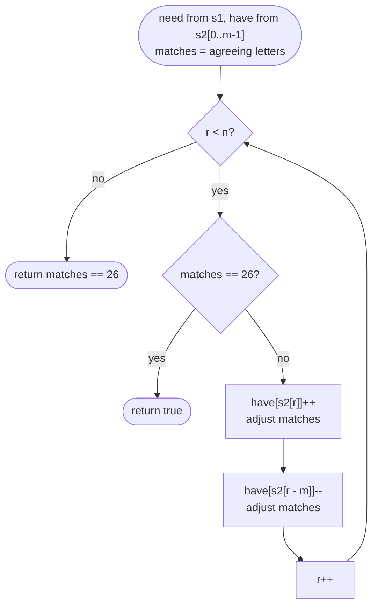

# LC 567 Permutation in String

> [!abstract] In one sentence
> A permutation of `s1` is any substring of `s2` with the same letter counts, so slide a window of exactly `|s1|` characters over `s2`, update one count in and one count out per step, and keep a counter of how many of the 26 letters currently agree — the window is a hit when all 26 do.

**Map:** [[NeetCode 150 MOC]] → [[DSA Dashboard]] · Pattern: [[Sliding Window]]

> [!question] Predict before you read
> You maintain `matches` = number of letters whose window count equals the `s1` count. A letter `x` enters the window. Under exactly which two conditions does `matches` change, and in which direction each time?

## Problem

Given strings `s1` and `s2`, return `true` if some substring of `s2` is a permutation (rearrangement) of `s1`.

- `s1 = "ab"`, `s2 = "eidbaooo"` → `true` (`"ba"`)
- `s1 = "ab"`, `s2 = "eidboaoo"` → `false`

Constraints that matter: `1 ≤ |s1|, |s2| ≤ 10⁴`, lowercase English letters only — 26 counts, and O(|s1| · |s2|) = 10⁸ is borderline, so the per-step work must be O(1), not O(|s1|).

## Clarifying questions

1. Lowercase ASCII only? — Yes; it fixes 26 buckets. Unicode would need a map and a size-of-mismatch counter instead of 26.
2. If `s1` is longer than `s2`? — `false` immediately; also guards the first-window loop against going out of bounds.
3. Boolean only, or the index of the match? — Boolean here; [[LC 49 Group Anagrams]]-style problems and LC 438 want every start index, which is the same loop collecting `r − m + 1`.
4. Can `s1` contain repeated letters? — Yes; counts, not sets, so `"aab"` is distinguished from `"ab"`.

## Brute force

For every start in `s2`, take the next `m = |s1|` characters, sort them and compare with sorted `s1`: O(n · m log m). Counting from scratch per window is O(n · 26 + n · m). The waste: adjacent windows differ in exactly two characters, yet the brute force rebuilds the whole count vector each time.

## The key insight

A permutation is a multiset equality, and a multiset of lowercase letters is a 26-vector of counts. The window has *fixed* size `m`, so sliding it changes two counts; comparing the full vectors after every slide costs 26 per step (fine, O(26 n)), but a `matches` counter — how many of the 26 positions currently agree — makes each slide O(1): a count changes by one, so it can only move into or out of agreement with `need[c]`, and only one position changes per character. Recognition cue: "contains a permutation / an anagram of the pattern" → fixed window of the pattern's length with counts; "find all anagram starts" is the same loop with a list.

## Optimal approach

1. If `m > n` return `false`. Build `need[26]` from `s1` and `have[26]` from `s2[0..m−1]`.
2. `matches` = number of letters `c` with `have[c] == need[c]`.
3. For `r` from `m` to `n − 1`: if `matches == 26` return `true`. Enter `s2[r]`: `have[in]++`; if it now equals `need[in]`, `matches++`; if it is now `need[in] + 1`, `matches--`. Leave `s2[r − m]`: `have[out]--`; if it now equals `need[out]`, `matches++`; if it is now `need[out] − 1`, `matches--`.
4. Return `matches == 26` (covers the last window).



> [!example]- Excalidraw version — the same diagram as an editable canvas
> ![[LC 567 Permutation in String — Optimal approach.excalidraw]]
> [[LC 567 Permutation in String — Optimal approach.excalidraw|Open in Excalidraw]] — needs the Excalidraw plugin (see [[Plugins to Install]]).

## Walkthrough

`s1 = "ab"`, `s2 = "eidbaooo"`, `m = 2`. The first window `"ei"` disagrees on four letters (`a`, `b` missing; `e`, `i` extra), so `matches = 22`.

| r | enters | leaves | window | matches after |
|---|---|---|---|---|
| — | — | — | ei | 22 |
| 2 | d (0 → 1, need 0: −1) | e (1 → 0, need 0: +1) | id | 22 |
| 3 | b (0 → 1, need 1: +1) | i (1 → 0, need 0: +1) | db | 24 |
| 4 | a (0 → 1, need 1: +1) | d (1 → 0, need 0: +1) | ba | 26 |
| 5 | check first: `matches == 26` → return `true` | | | |

> [!example] window of size 2 at r = 4 matches the counts of ab
> ![[LC 567 Permutation in String — window of size 2 at r = 4 matches the counts of ab.excalidraw]]
> [[LC 567 Permutation in String — window of size 2 at r = 4 matches the counts of ab.excalidraw|Open in Excalidraw]] — the window never changes size: one letter in, one letter out, two count updates, at most two matches updates

%% excalidraw-spec
{"kind": "array", "title": "window of size 2 at r = 4 matches the counts of ab", "values": ["e", "i", "d", "b", "a", "o", "o", "o"], "pointers": {"l": 3, "r": 4}, "highlight": [3, 4], "labels": {"2": "left at r = 4"}, "caption": "the window never changes size: one letter in, one letter out, two count updates, at most two matches updates"}
%%

## Java solution

```java
import java.util.*;

class Solution {
    public boolean checkInclusion(String s1, String s2) {
        int m = s1.length(), n = s2.length();
        if (m > n) return false;
        int[] need = new int[26], have = new int[26];
        for (int i = 0; i < m; i++) {
            need[s1.charAt(i) - 'a']++;
            have[s2.charAt(i) - 'a']++;                         // first window: s2[0..m-1]
        }
        int matches = 0;
        for (int c = 0; c < 26; c++) if (need[c] == have[c]) matches++;
        for (int r = m; r < n; r++) {                           // slide: s2[r] enters, s2[r - m] leaves
            if (matches == 26) return true;
            int in = s2.charAt(r) - 'a';
            have[in]++;
            if (have[in] == need[in]) matches++;                // reached agreement from below
            else if (have[in] == need[in] + 1) matches--;       // was equal, now one too many
            int out = s2.charAt(r - m) - 'a';
            have[out]--;
            if (have[out] == need[out]) matches++;              // reached agreement from above
            else if (have[out] == need[out] - 1) matches--;     // was equal, now one too few
        }
        return matches == 26;                                   // the final window
    }
}
```

**Time** O(m + n) · **Space** O(1) (two 26-int arrays)

Without the counter, compare the two arrays after each slide — 26 operations per step, the same asymptotics for a fixed alphabet and less to get wrong:

```java
// snippet
for (int r = m; r < n; r++) {
    if (Arrays.equals(need, have)) return true;      // never need == have: that compares references
    have[s2.charAt(r) - 'a']++;
    have[s2.charAt(r - m) - 'a']--;
}
return Arrays.equals(need, have);
```

## Why it works

Invariant at the top of each iteration: `have` is exactly the letter count of `s2[r − m .. r − 1]`, and `matches` equals the number of letters `c` with `have[c] == need[c]`. The window is an anagram of `s1` iff the two count vectors are equal iff `matches == 26`. Each slide changes two entries of `have` by ±1, and a ±1 change can cross the equality line in only one of the two ways tested, so the four `if`s keep `matches` exact. Every window of length `m` is examined once (the loop plus the final check), so a permutation is found iff one exists.

## Edge cases

- `m > n`: `false` before touching any index.
- `m == n`: the loop body never runs; the final `return` compares the only window.
- `s1` with repeated letters (`"aab"` in `"baa"`): counts handle it; a set would not.
- The permutation ends at the last character of `s2`: caught by the final `return`, not inside the loop.
- `s1` a single letter: reduces to `s2.indexOf(s1) >= 0`, and the code gives the same answer.

## Common mistakes

> [!warning] What goes wrong
> - Checking `matches == 26` only inside the loop and forgetting the final window after the loop ends.
> - `need == have` on arrays — reference comparison, always `false`; use `Arrays.equals`.
> - Removing index `r − m + 1` or `r − m − 1` instead of `r − m` — the window is `[r − m + 1, r]` after the slide, so the character that leaves is the one at `r − m`.
> - Updating `matches` with the *old* value of `have[c]` or with `>=` tests: the counter then drifts and never reaches 26.
> - Building the first window with a loop to `m` when `m > n` — `StringIndexOutOfBoundsException`; the guard must come first.

## Variants & follow-ups

- Find all anagram start indices (LC 438): same loop, `out.add(r − m + 1)` whenever `matches == 26` after the slide.
- Whole-string anagram → [[LC 242 Valid Anagram]]; grouping many → [[LC 49 Group Anagrams]].
- Any alphabet: `HashMap<Character, Integer>` of `need − have` differences and a counter of non-zero entries; hit when the map of differences is all zero.
- Shortest window containing `s1` as a multiset (not exact) → [[LC 76 Minimum Window Substring]] (variable size, shrink while valid).
- Permutation as a *subsequence* instead of a substring: trivial (just counts of the whole `s2`); the substring constraint is what makes the window necessary.
- Windows over a stream: the fixed window needs only the last `m` characters — a ring buffer of size `m` plus the counts.

## Interview script

Restate: "is some substring of `s2` an anagram of `s1`; lowercase; `|s1|` may exceed `|s2|`." Brute force: "sort every length-`m` substring, O(n m log m)." Insight: "anagram = equal 26-counts; the window has fixed length, so each slide changes two counts." Approach: "counts of `s1` and of the first window; a `matches` counter over the 26 letters; slide and adjust on the equality transitions; return true when `matches` hits 26, check the last window after the loop." Complexity: "O(m + n) time, O(1) space." Tests: `m > n`, `m == n`, repeated letters, match at the very end. If they ask "all anagram indices", say it is LC 438 with the same loop.

## Related

- Pattern: [[Sliding Window]] (fixed size); counting as a signature: [[Hashing]]
- Prerequisites: [[LC 242 Valid Anagram]] (the count-vector idea), [[LC 3 Longest Substring Without Repeating Characters]] (first variable window)
- Siblings: [[LC 76 Minimum Window Substring]], [[LC 424 Longest Repeating Character Replacement]], [[LC 49 Group Anagrams]]
- Java: [[Java Collections Cheat Sheet]] (`Arrays.equals`, `char − 'a'`), [[DSA Patterns in Java]] (fixed-window template)

## Attempt log

| Date | Result | Minutes | What I got wrong |
|---|---|---|---|
| | | | |

### Mastery checklist
- [ ] Solved without hints in under 25 minutes
- [ ] Stated complexity before coding
- [ ] Handled every edge case above
- [ ] Code compiled first time
- [ ] Can do the follow-up variant

## Open questions
- [ ] Rewrite the solution for an arbitrary alphabet with a `HashMap` of differences and a "non-zero entries" counter, and check it against `s1 = "aab"`.
