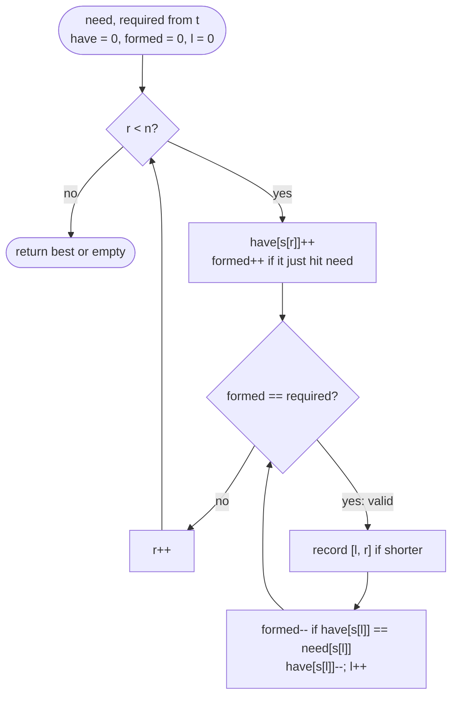

# LC 76 Minimum Window Substring

> [!abstract] In one sentence
> "Contains all of `t`" is preserved by extension, so for each right end the shortest valid window is found by shrinking from the left while still valid; a counter of how many distinct characters of `t` have their full requirement met turns "still valid?" into one comparison instead of a scan over the alphabet.

**Map:** [[NeetCode 150 MOC]] → [[DSA Dashboard]] · Pattern: [[Sliding Window]]

> [!question] Predict before you read
> `formed` counts the distinct characters of `t` whose requirement is currently met. `t = "AAB"`, and the window gains its second `A`. Does `formed` change? Now a third `A` arrives. Does it change? Write the one condition that answers both questions.

## Problem

Given strings `s` and `t`, return the shortest substring of `s` that contains every character of `t`, counting multiplicity (if `t` has two `A`s the window needs two). Return `""` if no such substring exists; the answer is guaranteed to be unique when it exists.

- `s = "ADOBECODEBANC"`, `t = "ABC"` → `"BANC"`
- `s = "a"`, `t = "a"` → `"a"`
- `s = "a"`, `t = "aa"` → `""` (needs two `a`s)

Constraints that matter: `1 ≤ |s|, |t| ≤ 10⁵`, upper- and lowercase letters — so O(|s| · |t|) is 10¹⁰ and the follow-up explicitly asks for O(|s| + |t|). A 128-int array covers the alphabet.

## Clarifying questions

1. Multiplicity counts? — Yes; `t = "aa"` needs two `a`s. This decides counts-versus-set.
2. Case-sensitive? — Yes, `A` and `a` differ. ASCII only, so arrays rather than a map.
3. What if nothing qualifies, and can `t` be longer than `s`? — Return `""`; a longer `t` simply never forms.
4. Return the substring, or just its length or indices? — The substring; record `bestL` and `bestLen` and build it once at the end.

## Brute force

Every pair `(l, r)` checked with a fresh count over the window: O(n²) windows × O(n) = O(n³); with incremental counts per `l` it is O(n²). The waste: for a fixed `r`, the valid starts form a prefix `[0, a_r]`, and `a_r` only moves right as `r` grows — the brute force rediscovers that boundary from scratch for every `r`.

## The key insight

Covering `t` is monotone under extension (a superset of a valid window is valid), so the two-pointer window applies in its *shortest* form: expand `r` until valid, then shrink `l` while valid, recording the window before each shrink step. The second idea is the O(1) validity test: instead of comparing 128 counts, track `required` = number of distinct characters in `t` and `formed` = how many of them currently have `have[c] ≥ need[c]`; `formed` changes only when `have[c]` crosses `need[c]` exactly, going up or down. Recognition cue: "smallest / minimum window containing …" → shrink-while-valid; "longest …" → shrink-until-valid. The two shapes record the answer at opposite moments.

## Optimal approach

1. `need[128]` from `t`; `required` = number of distinct characters of `t`. `have[128]` zero, `formed = 0`, `l = 0`, `bestLen = ∞`.
2. For each `r`: `c = s[r]`; `have[c]++`; if `have[c] == need[c]` then `formed++` (the requirement for `c` was just met — the equality fires exactly once on the way up).
3. While `formed == required`: if `r − l + 1 < bestLen`, record `bestL = l`, `bestLen = r − l + 1`. Then remove `s[l]`: if `have[out] == need[out]` before the decrement, `formed--`; `have[out]--`; `l++`.
4. Return `""` if `bestLen` is still `∞`, else `s.substring(bestL, bestL + bestLen)`.



> [!example]- Excalidraw version — the same diagram as an editable canvas
> ![[LC 76 Minimum Window Substring — Optimal approach.excalidraw]]
> [[LC 76 Minimum Window Substring — Optimal approach.excalidraw|Open in Excalidraw]] — needs the Excalidraw plugin (see [[Plugins to Install]]).

## Walkthrough

`s = "ADOBECODEBANC"`, `t = "ABC"` (`required = 3`). Only the steps where something happens:

| r | s[r] | formed after add | shrink loop (window → action) | l after | best |
|---|---|---|---|---|---|
| 0 | A | 1 | — | 0 | — |
| 3 | B | 2 | — | 0 | — |
| 5 | C | 3 | `[0,5]` ADOBEC len 6 → record; remove A → formed 2 | 1 | ADOBEC |
| 9 | B | 2 (have B = 2 ≠ need 1) | — | 1 | ADOBEC |
| 10 | A | 3 | `[1,10]` len 10 no; remove D, O, B (B: 2 → 1, still ≥ 1), E → `[5,10]` len 6 no; remove C → formed 2 | 6 | ADOBEC |
| 12 | C | 3 | `[6,12]` len 7 no; remove O, D → `[8,12]` EBANC len 5 record; remove E → `[9,12]` BANC len 4 record; remove B → formed 2 | 10 | BANC |

> [!example] r = 12: the window shrinks to BANC before B's removal breaks it
> ![[LC 76 Minimum Window Substring — r = 12- the window shrinks to BANC before B's removal breaks it.excalidraw]]
> [[LC 76 Minimum Window Substring — r = 12- the window shrinks to BANC before B's removal breaks it.excalidraw|Open in Excalidraw]] — l never moves left; each index enters the window once and leaves once, which is the whole O(n) argument

%% excalidraw-spec
{"kind": "array", "title": "r = 12: the window shrinks to BANC before B's removal breaks it", "values": ["A", "D", "O", "B", "E", "C", "O", "D", "E", "B", "A", "N", "C"], "pointers": {"l": 9, "r": 12}, "highlight": [9, 10, 11, 12], "labels": {"5": "first C: formed = 3 at r = 5", "6": "l reached 6 after r = 10"}, "caption": "l never moves left; each index enters the window once and leaves once, which is the whole O(n) argument"}
%%

## Java solution

```java
import java.util.*;

class Solution {
    public String minWindow(String s, String t) {
        int[] need = new int[128], have = new int[128];
        int required = 0;
        for (char c : t.toCharArray()) if (need[c]++ == 0) required++;   // distinct characters that must be satisfied
        int formed = 0, l = 0, bestLen = Integer.MAX_VALUE, bestL = 0;
        for (int r = 0; r < s.length(); r++) {
            char c = s.charAt(r);
            if (++have[c] == need[c]) formed++;                           // crossed the requirement upwards (once)
            while (formed == required) {                                  // valid: record, then try to shrink
                if (r - l + 1 < bestLen) { bestLen = r - l + 1; bestL = l; }
                char out = s.charAt(l++);
                if (have[out]-- == need[out]) formed--;                   // was exactly met, now one short
            }
        }
        return bestLen == Integer.MAX_VALUE ? "" : s.substring(bestL, bestL + bestLen);
    }
}
```

**Time** O(|s| + |t|) · **Space** O(1) (two 128-entry arrays)

When `t` is tiny and `s` is huge, most of `s` is noise. Filter first and run the same window over the surviving positions — same asymptotics, fewer touched characters:

```java
// snippet
List<int[]> keep = new ArrayList<>();                    // {index in s, char} for characters that occur in t
for (int i = 0; i < s.length(); i++) if (need[s.charAt(i)] > 0) keep.add(new int[]{i, s.charAt(i)});
// run the identical formed/required loop over keep; a window [l, r] in keep is s[keep[l][0] .. keep[r][0]]
```

## Why it works

Two invariants carry the proof. (1) `formed` equals the number of characters `c` with `have[c] ≥ need[c]` among those in `t`: it changes only on the two transitions `need − 1 → need` (increment, tested *after* the `++`) and `need → need − 1` (decrement, tested *before* the `--`); characters absent from `t` have `need = 0`, and `have` for them is never 0 after an increment nor equal to 0 before a decrement, so they never touch `formed`. Hence `formed == required` iff the window covers `t`. (2) For each `r`, when the inner loop exits, `l` is one past the *last* valid start for this `r`, and every valid window ending at `r` with start ≥ the previous `l` was recorded. Validity is monotone, so the valid starts for `r` form a prefix `[0, a_r]` with `a_r` non-decreasing in `r`; the loop walks `l` from its previous value (≤ `a_r`, by monotonicity) up to `a_r + 1`, recording `[a_r, r]` — the shortest valid window ending at `r` — on the way. The global minimum is the shortest over all `r`, so it is recorded. `l` and `r` each advance at most `n` times: O(n).

## Edge cases

- `|t| > |s|`: `formed` never reaches `required`; `""`.
- `t` with repeated letters (`"AABC"`): `need[A] = 2`, the window needs two `A`s before `formed` counts it.
- `s == t`: the whole string is recorded once, then the first removal breaks it.
- `t` a single character: the answer is that character; the loop records length 1 at its first occurrence and nothing shorter exists.
- The best window ends at the last index: the `while` runs inside the final iteration — no post-loop check is needed, unlike [[LC 567 Permutation in String]].
- Extra copies of a `t`-character inside the window (`B` twice above): removing one keeps `formed` because `have` was above `need`, not equal.

## Common mistakes

> [!warning] What goes wrong
> - Shrinking with `if` instead of `while` — the window carries extra prefix after one removal and the recorded length is too long.
> - Recording *after* shrinking: the window at that point is invalid by construction.
> - `formed` counting matched *characters* (increment on every `have ≤ need`) but comparing with the number of *distinct* letters, or vice versa — pick one: distinct letters with `required`, or total characters with `t.length()`.
> - Testing the decrement transition after the `--` with `have[out] < need[out]`: correct, but testing `have[out] == need[out]` after the `--` is wrong by one — the order of the compare and the decrement must match the formula.
> - Building `s.substring` on every record: O(n) each; store indices and build once.
> - With a `HashMap<Character, Integer>`, comparing boxed counts via `==` — `Integer` identity beyond 127.

## Variants & follow-ups

- Fixed-size exact anagram window → [[LC 567 Permutation in String]] / LC 438 (no shrinking: the size is given).
- Smallest subarray with sum ≥ S (LC 209, positive numbers): same shrink-while-valid shape with a running sum.
- Minimum window *subsequence* (LC 727, order of `t` matters): not a count window — forward scan to match, then backward scan to tighten.
- Shortest substring containing at least `k` distinct characters, or all characters of `s` itself: same loop, different `need`.
- Return all minimum windows / count windows that cover `t`: after the shrink, every start in `[0, l − 1]` for this `r` is valid — add `l` to a counter.
- Streaming `s`: `r` is the stream; the window state is the two arrays and `l`, which is online.

## Interview script

Restate: "shortest substring of `s` with all characters of `t`, multiplicity included, case-sensitive, `""` if none; the target is O(|s| + |t|)." Brute force: "every window with a count check, O(n²) or worse." Insight: "covering is monotone, so I expand `r` until valid and shrink `l` while valid; I record each valid window before shrinking." Approach: "`need` and `have` arrays; `required` distinct characters; `formed` counts the ones fully met, updated only on the exact crossing; `while (formed == required)` record and remove `s[l]`." Complexity: "each pointer moves at most `n` times: O(|s| + |t|), O(1) space for ASCII." Tests: `t` longer than `s`, repeated letters in `t`, `s == t`, best window at the end, duplicate `t`-letters inside the window. If they push: "for a tiny `t` and huge `s`, filter `s` to the positions that matter first."

## Related

- Pattern: [[Sliding Window]] (the shortest-window shape); counting as validity: [[Hashing]]
- Prerequisites: [[LC 3 Longest Substring Without Repeating Characters]] (longest shape), [[LC 567 Permutation in String]] (counts in a window)
- Siblings: [[LC 424 Longest Repeating Character Replacement]], [[LC 239 Sliding Window Maximum]]
- Java: [[Java Collections Cheat Sheet]] (`substring`, `toCharArray`, `char` as an index), [[Java Pitfalls in Interviews]] (boxed `Integer` equality), [[DSA Patterns in Java]] (variable window template)

## Attempt log

| Date | Result | Minutes | What I got wrong |
|---|---|---|---|
| | | | |

### Mastery checklist
- [ ] Solved without hints in under 25 minutes
- [ ] Stated complexity before coding
- [ ] Handled every edge case above
- [ ] Code compiled first time
- [ ] Can do the follow-up variant

## Open questions
- [ ] Rewrite the `formed` logic to count matched characters against `t.length()` instead of distinct letters against `required`, and verify both versions on `t = "AAB"`.
- [ ] Why does the longest-window shape record *after* the shrink loop while this one records *inside* it? State the invariant each one relies on.
